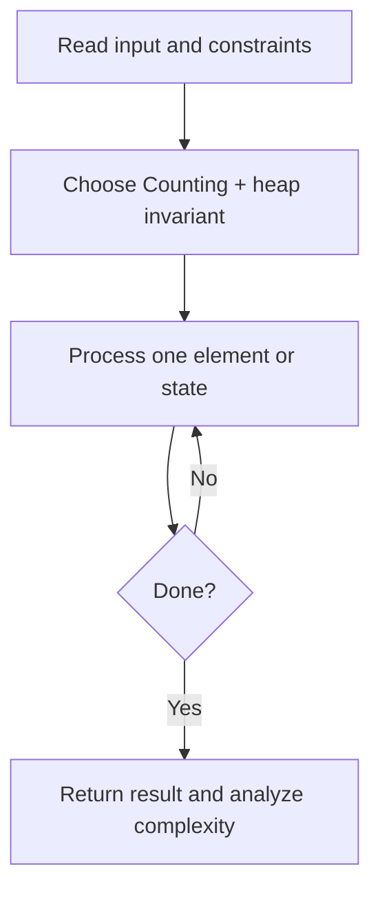
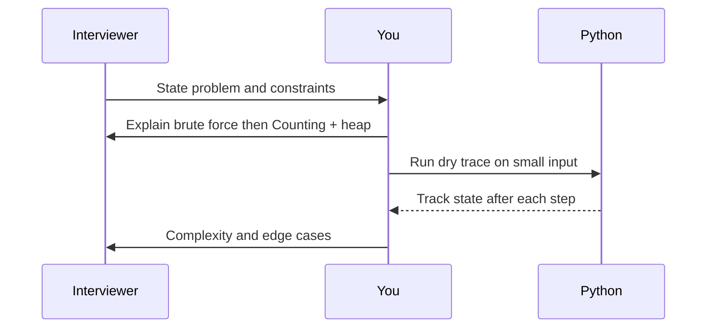

# Day 20 — Top K Frequent Elements

**Pattern:** Counting + heap · **Time:** 35 minutes · **Track:** Python interview DSA

[Course home](../README.md) · [Practice file](../practice/day-20.py) · [Commented reference](../solutions/day-20.py)

## What and why (5 minutes)

**Problem:** Return the k most frequent values, in any order.

**Why this pattern:** Frequency table + heap balances clarity and performance.

**Interview trap:** Ties may return any matching values; tests should not assume a tie order.

## Algorithm flow



## Execution / timing diagram



## Try it yourself (15 minutes)

1. Open `practice/day-20.py`. Write `solve(...)` without looking below.
2. Verbally state the invariant and walk through a sample input.
3. Run `python -m unittest discover -s tests -v` from the repository root (reference tests run against completed solutions).
4. Check your practice implementation with `python scripts/check_practice.py 20` when you finish.

### Sample cases

```python
solve([1, 1, 1, 2, 2, 3], 2)  # [1, 2]
```
```python
solve([4, 4, 4], 1)  # [4]
```

## Commented solution — reveal after attempting

<details>
<summary>Show Python reference implementation</summary>

```python
from collections import Counter
import heapq

def solve(nums, k):
    frequency = Counter(nums)
    if not (0 <= k <= len(frequency)):
        raise ValueError('k out of range')
    # nlargest uses a heap; values with ties may be chosen arbitrarily.
    return heapq.nlargest(k, frequency, key=frequency.get)
```

</details>

## Complexity (5 minutes)

**O(n + u log k) time, O(u+k) space.** Explain *why*, including auxiliary data structure cost.

## Tricky interview follow-up (10 minutes)

**Question:** How would you solve this in expected O(n) time using buckets?

Before moving on, explain (1) why your implementation is correct, (2) one edge case, (3) a trade-off versus a simpler solution.

**Next:** [Day 21](day-21.md)
