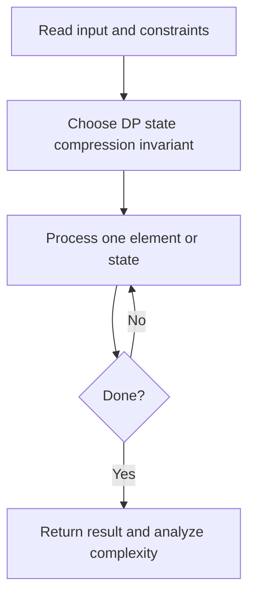
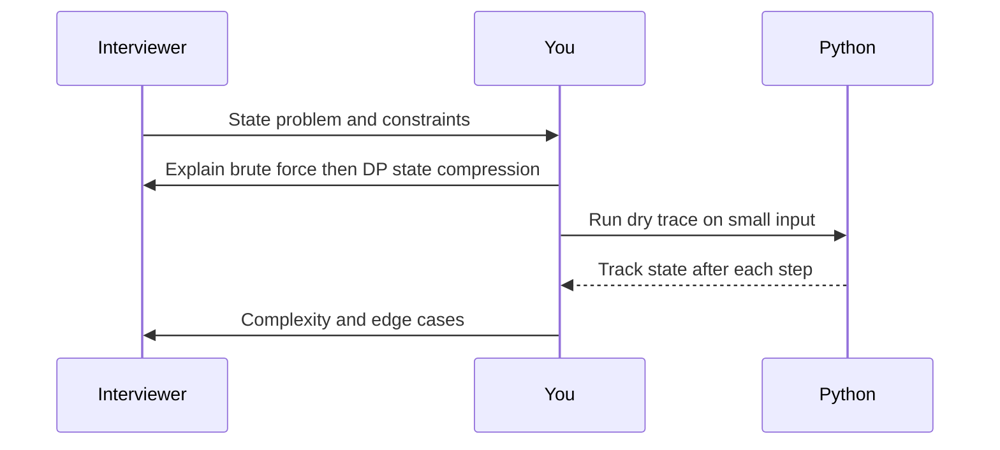

# Day 24 — House Robber

**Pattern:** DP state compression · **Time:** 35 minutes · **Track:** Python interview DSA

[Course home](../README.md) · [Practice file](../practice/day-24.py) · [Commented reference](../solutions/day-24.py)

## What and why (5 minutes)

**Problem:** Maximize sum of nonadjacent nonnegative house values.

**Why this pattern:** At each house choose skip (previous best) or take (best from two back + value).

**Interview trap:** Avoid choosing adjacent houses.

## Algorithm flow



## Execution / timing diagram



## Try it yourself (15 minutes)

1. Open `practice/day-24.py`. Write `solve(...)` without looking below.
2. Verbally state the invariant and walk through a sample input.
3. Run `python -m unittest discover -s tests -v` from the repository root (reference tests run against completed solutions).
4. Check your practice implementation with `python scripts/check_practice.py 24` when you finish.

### Sample cases

```python
solve([1, 2, 3, 1])  # 4
```
```python
solve([2, 7, 9, 3, 1])  # 12
```

## Commented solution — reveal after attempting

<details>
<summary>Show Python reference implementation</summary>

```python
def solve(nums):
    two_back = 0
    previous = 0
    for money in nums:
        current = max(previous, two_back + money)
        two_back, previous = previous, current
    return previous
```

</details>

## Complexity (5 minutes)

**O(n) time, O(1) space.** Explain *why*, including auxiliary data structure cost.

## Tricky interview follow-up (10 minutes)

**Question:** How do you adapt it if houses form a circle?

Before moving on, explain (1) why your implementation is correct, (2) one edge case, (3) a trade-off versus a simpler solution.

**Next:** [Day 25](day-25.md)
