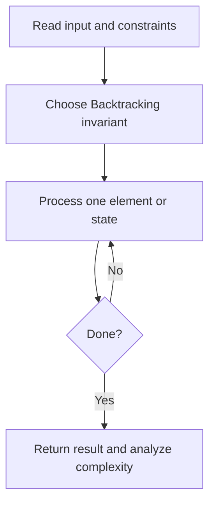
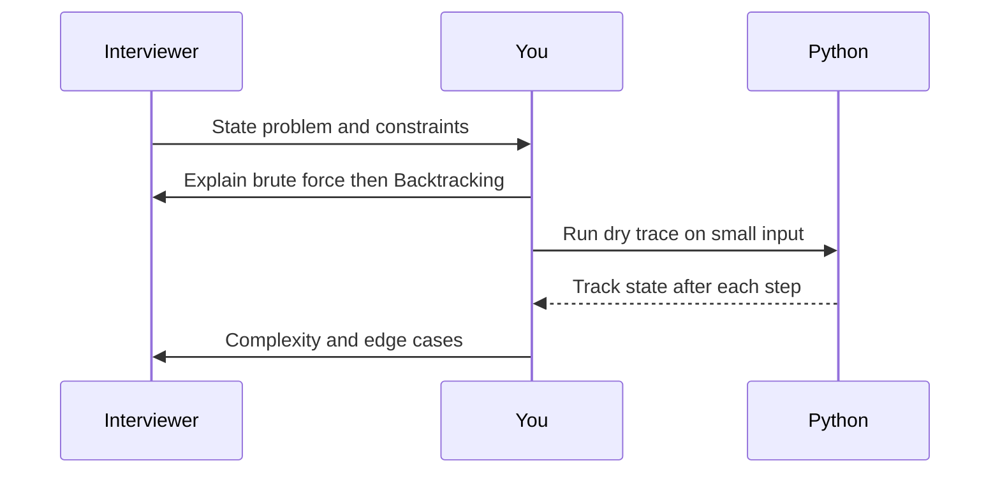

# Day 26 — Subsets

**Pattern:** Backtracking · **Time:** 35 minutes · **Track:** Python interview DSA

[Course home](../README.md) · [Practice file](../practice/day-26.py) · [Commented reference](../solutions/day-26.py)

## What and why (5 minutes)

**Problem:** Return the power set of distinct input values.

**Why this pattern:** At each position choose whether to include the value.

**Interview trap:** Copy the current path when saving a result; otherwise all results share one list.

## Algorithm flow



## Execution / timing diagram



## Try it yourself (15 minutes)

1. Open `practice/day-26.py`. Write `solve(...)` without looking below.
2. Verbally state the invariant and walk through a sample input.
3. Run `python -m unittest discover -s tests -v` from the repository root (reference tests run against completed solutions).
4. Check your practice implementation with `python scripts/check_practice.py 26` when you finish.

### Sample cases

```python
solve([])  # [[]]
```
```python
solve([1])  # [[], [1]]
```

## Commented solution — reveal after attempting

<details>
<summary>Show Python reference implementation</summary>

```python
def solve(nums):
    result = []
    path = []
    def dfs(i):
        if i == len(nums):
            result.append(path.copy())  # snapshot, not alias
            return
        dfs(i + 1)  # exclude
        path.append(nums[i])
        dfs(i + 1)  # include
        path.pop()  # restore state for caller
    dfs(0)
    return result
```

</details>

## Complexity (5 minutes)

**O(n*2^n) time, O(n) recursion depth excluding output.** Explain *why*, including auxiliary data structure cost.

## Tricky interview follow-up (10 minutes)

**Question:** How do you handle duplicate numbers without duplicate subsets?

Before moving on, explain (1) why your implementation is correct, (2) one edge case, (3) a trade-off versus a simpler solution.

**Next:** [Day 27](day-27.md)
