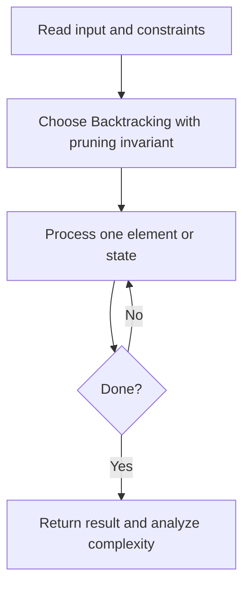
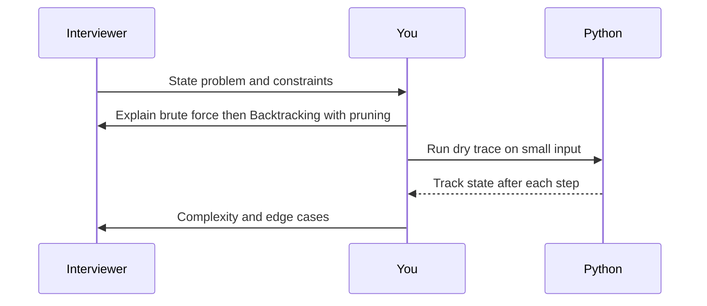

# Day 27 — Combination Sum

**Pattern:** Backtracking with pruning · **Time:** 35 minutes · **Track:** Python interview DSA

[Course home](../README.md) · [Practice file](../practice/day-27.py) · [Commented reference](../solutions/day-27.py)

## What and why (5 minutes)

**Problem:** Return combinations of positive distinct candidate numbers totaling target (reuse allowed).

**Why this pattern:** Use a start index to avoid permutations and permit reusing a candidate.

**Interview trap:** Assume candidates positive and distinct; sort to prune.

## Algorithm flow



## Execution / timing diagram



## Try it yourself (15 minutes)

1. Open `practice/day-27.py`. Write `solve(...)` without looking below.
2. Verbally state the invariant and walk through a sample input.
3. Run `python -m unittest discover -s tests -v` from the repository root (reference tests run against completed solutions).
4. Check your practice implementation with `python scripts/check_practice.py 27` when you finish.

### Sample cases

```python
solve([2, 3, 6, 7], 7)  # [[2, 2, 3], [7]]
```

## Commented solution — reveal after attempting

<details>
<summary>Show Python reference implementation</summary>

```python
def solve(candidates, target):
    candidates = sorted(candidates)
    result, path = [], []
    def dfs(start, remaining):
        if remaining == 0:
            result.append(path.copy())
            return
        for i in range(start, len(candidates)):
            value = candidates[i]
            if value > remaining:
                break  # sorted, so later choices also too large
            path.append(value)
            dfs(i, remaining - value)  # reuse same index
            path.pop()
    dfs(0, target)
    return result
```

</details>

## Complexity (5 minutes)

**Exponential output-sensitive time and O(target/min_coin) stack.** Explain *why*, including auxiliary data structure cost.

## Tricky interview follow-up (10 minutes)

**Question:** Why not recurse with start=i+1?

Before moving on, explain (1) why your implementation is correct, (2) one edge case, (3) a trade-off versus a simpler solution.

**Next:** [Day 28](day-28.md)
