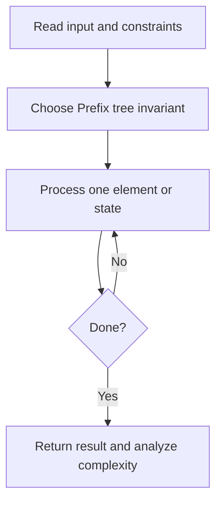
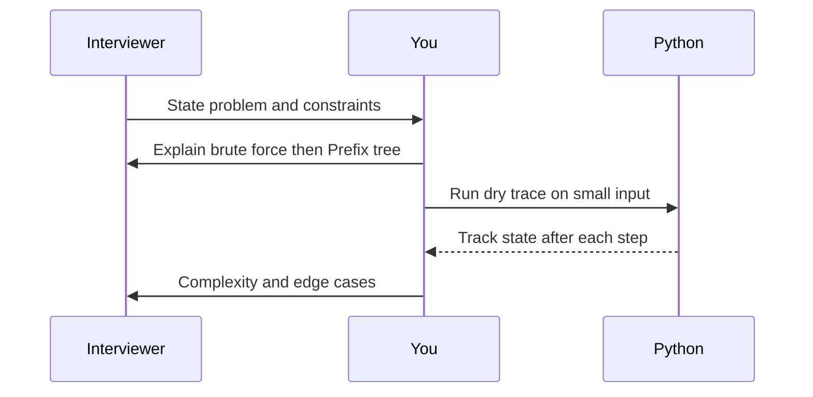

# Day 28 — Implement Trie

**Pattern:** Prefix tree · **Time:** 35 minutes · **Track:** Python interview DSA

[Course home](../README.md) · [Practice file](../practice/day-28.py) · [Commented reference](../solutions/day-28.py)

## What and why (5 minutes)

**Problem:** Support insert(word), search(word), starts_with(prefix) for lowercase or general characters.

**Why this pattern:** Each character is an edge; shared prefixes share nodes.

**Interview trap:** search must check end-of-word flag; prefix alone is not enough.

## Algorithm flow



## Execution / timing diagram



## Try it yourself (15 minutes)

1. Open `practice/day-28.py`. Write `solve(...)` without looking below.
2. Verbally state the invariant and walk through a sample input.
3. Run `python -m unittest discover -s tests -v` from the repository root (reference tests run against completed solutions).
4. Check your practice implementation with `python scripts/check_practice.py 28` when you finish.

### Sample cases

```python
solve(['apple'], 'apple')  # True
```
```python
solve(['apple'], 'app')  # False
```
```python
solve(['apple'], 'app', 'prefix')  # True
```

## Commented solution — reveal after attempting

<details>
<summary>Show Python reference implementation</summary>

```python
class Trie:
    def __init__(self):
        self.root = {}

    def insert(self, word):
        node = self.root
        for ch in word:
            node = node.setdefault(ch, {})
        node['#'] = True  # terminal marker (assume # not in words)

    def _walk(self, text):
        node = self.root
        for ch in text:
            if ch not in node:
                return None
            node = node[ch]
        return node

    def search(self, word):
        node = self._walk(word)
        return node is not None and '#' in node

    def starts_with(self, prefix):
        return self._walk(prefix) is not None

def solve(words, query, mode='search'):
    trie = Trie()
    for word in words:
        trie.insert(word)
    return trie.search(query) if mode == 'search' else trie.starts_with(query)
```

</details>

## Complexity (5 minutes)

**O(L) time per operation, O(total inserted characters) space.** Explain *why*, including auxiliary data structure cost.

## Tricky interview follow-up (10 minutes)

**Question:** What does the trie cost compared with a hash set?

Before moving on, explain (1) why your implementation is correct, (2) one edge case, (3) a trade-off versus a simpler solution.

**Next:** [Day 29](day-29.md)
