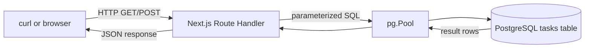
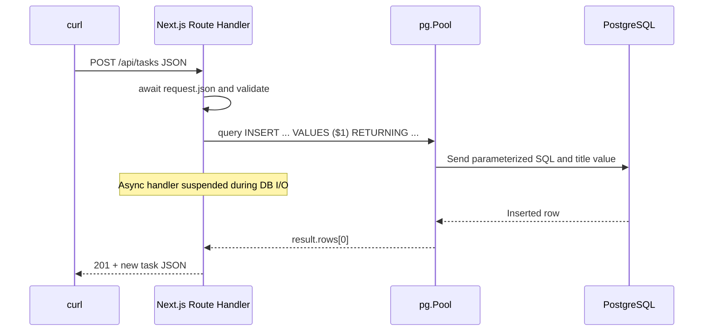

# Day 3 — PostgreSQL, SQL, parameters and connection pools

**Goal:** save tasks so they survive restarts. **Time:** ~90 min. **Today:** create the PostgreSQL schema and build typed Next.js Route Handlers with `pg`. **Next:** [Day 4](day-4.md).

## 1. Why PostgreSQL? (10 min)

Day 2's array is local to one Node process and disappears after restart. PostgreSQL gives persistence, indexes, constraints, and concurrency control. We write SQL directly instead of an ORM to make database behavior interview-visible.

### Data flow



### Timing / sequence diagram



## 2. Install and create a database (15 min)

**On macOS with Homebrew** (skip install if Postgres already exists):

```bash
brew install postgresql@17
brew services start postgresql@17
# Homebrew may require adding its postgresql@17/bin to your PATH.
createdb minitrack
```

Postgres user/password configuration varies. Use a valid local role. Then create `backend/sql/schema.sql`:

```sql
-- Re-runnable Week 1 schema. Do not DROP the table each time you run this.
CREATE TABLE IF NOT EXISTS tasks (
  id BIGINT GENERATED ALWAYS AS IDENTITY PRIMARY KEY,
  title TEXT NOT NULL CHECK (char_length(title) BETWEEN 1 AND 200),
  done BOOLEAN NOT NULL DEFAULT FALSE,
  created_at TIMESTAMPTZ NOT NULL DEFAULT now()
);

-- A small starter set, only inserted if the table is still empty.
INSERT INTO tasks (title, done)
SELECT 'Learn the JavaScript event loop', TRUE
WHERE NOT EXISTS (SELECT 1 FROM tasks);
INSERT INTO tasks (title, done)
SELECT 'Build a full-stack task tracker', FALSE
WHERE (SELECT COUNT(*) FROM tasks) = 1;
```


Run this **from repository root**:

```bash
psql -d minitrack -f backend/sql/schema.sql
psql -d minitrack -c 'SELECT id, title, done FROM tasks ORDER BY id;'
```

If authentication fails, use `psql -h localhost -U YOUR_USER -d minitrack` and set the matching credentials in `frontend/.env.local` below. The schema is re-runnable; it does not wipe your tasks.

**Why identity IDs?** PostgreSQL allocates IDs, not each Node instance; sequence values can have gaps. **Why BIGINT?** Supports more IDs, but `pg` gives BIGINT values as strings by default to avoid unsafe JavaScript integer conversion.

## 3. Configure TypeScript and the database driver (15 min)

From repository root:

```bash
cd frontend
npm install
cp .env.local.example .env.local
# Edit DATABASE_URL to match your role/password:
# postgresql://YOUR_MAC_USER@localhost:5432/minitrack
```

Create `frontend/lib/` if it does not exist, then write `frontend/lib/db.ts`:

```ts
import 'server-only';
import { Pool } from 'pg';

const globalForPg = globalThis as typeof globalThis & { taskPool?: Pool };

export function getPool(): Pool {
  const connectionString = process.env.DATABASE_URL;
  if (!connectionString) {
    throw new Error('DATABASE_URL is missing. Copy frontend/.env.local.example to .env.local and edit it.');
  }
  globalForPg.taskPool ??= new Pool({ connectionString, max: 5 });
  return globalForPg.taskPool;
}
```

The `server-only` import prevents this database module from being included in Client Components. The global pool guard avoids creating a new pool on every Next.js development reload.

**Why a pool?** Keeping a small number of reusable PostgreSQL connections is cheaper than making a new connection for each HTTP request. The pool also limits simultaneous database connections.

## 4. Add the task type and database functions (15 min)

Create `frontend/app/types.ts`. `pg` returns `BIGINT` IDs as strings, and the API sends timestamps as ISO strings:

```ts
export type Task = {
  id: string;
  title: string;
  done: boolean;
  created_at: string;
};
```

Create `frontend/lib/tasks.ts`. Start with the two operations used today, `listTasks` and `createTask`:

```ts
import type { Task } from '../app/types';
import { getPool } from './db';

type TaskRow = Omit<Task, 'created_at'> & { created_at: Date };

function toTask(row: TaskRow): Task {
  return { ...row, created_at: row.created_at.toISOString() };
}

export async function listTasks(): Promise<Task[]> {
  const result = await getPool().query<TaskRow>(
    'SELECT id, title, done, created_at FROM tasks ORDER BY id'
  );
  return result.rows.map(toTask);
}

export async function createTask(title: string): Promise<Task> {
  const result = await getPool().query<TaskRow>(
    'INSERT INTO tasks (title) VALUES ($1) RETURNING id, title, done, created_at',
    [title]
  );
  const row = result.rows[0];
  if (!row) throw new Error('Inserted task was not returned by PostgreSQL');
  return toTask(row);
}
```

`$1` is a parameter placeholder; the title is sent separately from the SQL text. `TaskRow` describes the database timestamp as a `Date`, and `toTask` converts it to a JSON-friendly string.

Create `frontend/lib/validation.ts`. Request JSON is untrusted, so accept `unknown` and narrow it before reading properties:

```ts
export function normalizeTitle(value: unknown): string | null {
  if (typeof value !== 'string') return null;
  const title = value.trim();
  return title.length >= 1 && title.length <= 200 ? title : null;
}

export function isRecord(value: unknown): value is Record<string, unknown> {
  return typeof value === 'object' && value !== null && !Array.isArray(value);
}
```

## 5. Add typed Route Handlers (15 min)

The Day 1–2 checkpoint servers taught the built-in Node HTTP lifecycle. In the actual Next.js app, use **Route Handlers** instead of starting another server. Create `frontend/app/api/tasks/route.ts`; Next maps exported HTTP-method functions to `/api/tasks`:

```ts
import { createTask, listTasks } from '../../../lib/tasks';
import { isRecord, normalizeTitle } from '../../../lib/validation';

export async function GET(): Promise<Response> {
  try {
    return Response.json(await listTasks(), {
      headers: { 'Cache-Control': 'no-store' },
    });
  } catch (error: unknown) {
    console.error('GET /api/tasks failed:', error);
    return Response.json({ error: 'Internal server error' }, { status: 500 });
  }
}

export async function POST(request: Request): Promise<Response> {
  let body: unknown;
  try {
    body = await request.json();
  } catch {
    return Response.json({ error: 'Invalid JSON' }, { status: 400 });
  }
  const title = normalizeTitle(isRecord(body) ? body.title : undefined);
  if (!title) {
    return Response.json({ error: 'title must be 1–200 characters' }, { status: 400 });
  }
  try {
    return Response.json(await createTask(title), { status: 201 });
  } catch (error: unknown) {
    console.error('POST /api/tasks failed:', error);
    return Response.json({ error: 'Internal server error' }, { status: 500 });
  }
}
```

Also create `frontend/app/api/health/route.ts`:

```ts
export function GET(): Response {
  return Response.json({ ok: true });
}
```

Run the app from `frontend`:

```bash
npm run dev
# In another terminal:
curl -i http://localhost:3000/api/tasks
curl -i -X POST http://localhost:3000/api/tasks \
  -H 'Content-Type: application/json' -d '{"title":"Persist in PostgreSQL"}'
```

Stop/restart Next.js and GET again. **The task should still exist.** The API and page run in the same Next.js server; PostgreSQL is the persistent store.

## 6. SQL and interview drill (25 min)

Try:

```sql
-- Select only open tasks; PostgreSQL performs filtering.
SELECT id, title FROM tasks WHERE done = FALSE ORDER BY id;
-- SQL returns the changed row without needing a second SELECT.
UPDATE tasks SET done = TRUE WHERE id = 1 RETURNING *;
-- An aggregate: count rows still open.
SELECT COUNT(*) FROM tasks WHERE done = FALSE;
```

1. **Why `$1` instead of template strings?** Bound parameters keep values separate from SQL syntax and prevent SQL injection in values.
2. **Why `RETURNING`?** Return generated ID and defaults without a second query.
3. **Is the database ID guaranteed gap-free?** No. Uniqueness and consecutive numbering are different requirements.
4. **What if the pool is full?** Additional requests wait for a free connection; configure limits/timeouts for real systems.
5. **Why use `await pool.query`?** The Route Handler pauses while PostgreSQL works, without blocking the JavaScript event loop from handling other requests.
6. **What if Postgres goes down?** Query rejects, handler catches it and returns a server error; production systems need logging, timeouts and recovery plans.

## Exit checklist

- [ ] Schema created; GET reads from Postgres.
- [ ] POST survives Next.js restart.
- [ ] I understand $1 parameters, pooling, and BIGINT strings.

**Commit:** `git add . && git commit -m "day3: persist in Postgres"`

**Continue → [Day 4: Next.js server-rendered task list](day-4.md)**
