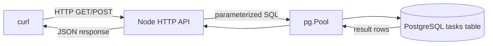
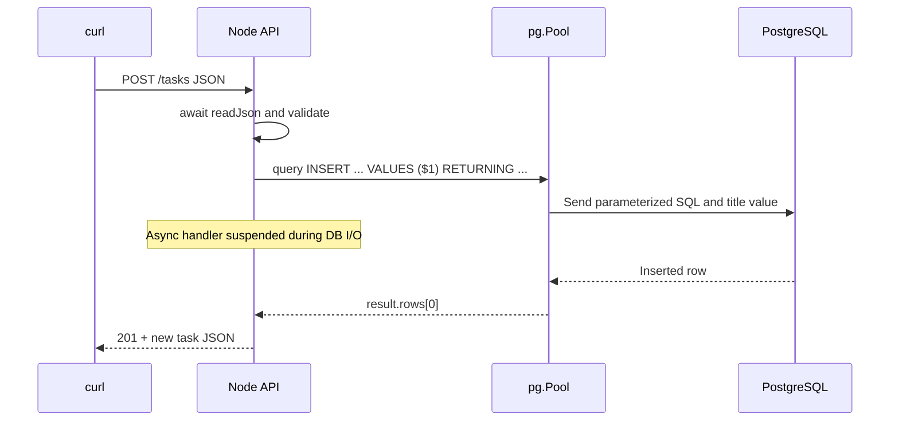

# Day 3 — PostgreSQL, SQL, parameters and connection pools

**Goal:** save tasks so they survive restarts. **Time:** ~90 min. **Today:** write `backend/sql/schema.sql`, `backend/src/db.js`, and `backend/src/server.js`. **Next:** [Day 4](day-4.md).

## 1. Why PostgreSQL? (10 min)

Day 2's array is local to one Node process and disappears after restart. PostgreSQL gives persistence, indexes, constraints, and concurrency control. We write SQL directly instead of an ORM to make database behavior interview-visible.

### Data flow



### Timing / sequence diagram



## 2. Install and create a database (15 min)

**On macOS with Homebrew** (skip install if Postgres already exists):

```bash
brew install postgresql@17
brew services start postgresql@17
# Homebrew may require adding its postgresql@17/bin to your PATH.
createdb minitrack
```

Postgres user/password configuration varies. Use a valid local role. Then create `backend/sql/schema.sql`:

```sql
-- Re-runnable Week 1 schema. Do not DROP the table each time you run this.
CREATE TABLE IF NOT EXISTS tasks (
  id BIGINT GENERATED ALWAYS AS IDENTITY PRIMARY KEY,
  title TEXT NOT NULL CHECK (char_length(title) BETWEEN 1 AND 200),
  done BOOLEAN NOT NULL DEFAULT FALSE,
  created_at TIMESTAMPTZ NOT NULL DEFAULT now()
);

-- A small starter set, only inserted if the table is still empty.
INSERT INTO tasks (title, done)
SELECT 'Learn the JavaScript event loop', TRUE
WHERE NOT EXISTS (SELECT 1 FROM tasks);
INSERT INTO tasks (title, done)
SELECT 'Build a full-stack task tracker', FALSE
WHERE (SELECT COUNT(*) FROM tasks) = 1;
```


Run this **from repository root**:

```bash
psql -d minitrack -f backend/sql/schema.sql
psql -d minitrack -c 'SELECT id, title, done FROM tasks ORDER BY id;'
```

If authentication fails, use `psql -h localhost -U YOUR_USER -d minitrack` and set the matching credentials in `.env` below. The schema is re-runnable; it does not wipe your tasks.

**Why identity IDs?** PostgreSQL allocates IDs, not each Node instance; sequence values can have gaps. **Why BIGINT?** Supports more IDs, but `pg` gives BIGINT values as strings by default to avoid unsafe JavaScript integer conversion.

## 3. Configure the Node database driver (15 min)

From repository root:

```bash
cd backend
npm install
cp .env.example .env
# Edit DATABASE_URL to match your role/password:
# postgresql://YOUR_MAC_USER@localhost:5432/minitrack
```

Write `backend/src/db.js`:

```js
const { Pool } = require('pg');
require('dotenv').config();

if (!process.env.DATABASE_URL) {
  throw new Error('DATABASE_URL is missing. Copy backend/.env.example to .env and edit it.');
}

// A Pool reuses a limited number of database connections across HTTP requests.
const pool = new Pool({ connectionString: process.env.DATABASE_URL, max: 5 });
module.exports = { pool };
```


**Why a pool?** Keeping a small number of reusable PostgreSQL connections is cheaper than making a new connection for each HTTP request. The pool also limits simultaneous database connections.

## 4. Replace Day 2's in-memory server (25 min)

Write this into `backend/src/server.js` (its source is also in `checkpoints/day3/server.js` if you need to compare):

```js
const http = require('node:http');
require('dotenv').config(); // Reads DATABASE_URL and PORT from backend/.env.
const { pool } = require('./db'); // A reusable PostgreSQL connection pool.

const PORT = Number(process.env.PORT || 3001);

function sendJson(res, status, value) {
  res.writeHead(status, { 'Content-Type': 'application/json' });
  res.end(JSON.stringify(value));
}

function readJson(req) {
  return new Promise((resolve, reject) => {
    let raw = '';
    req.setEncoding('utf8');
    req.on('data', chunk => {
      raw += chunk;
      if (raw.length > 10_000) {
        reject(Object.assign(new Error('Body too large'), { status: 413 }));
        req.destroy();
      }
    });
    req.on('end', () => {
      try { resolve(JSON.parse(raw)); }
      catch { reject(Object.assign(new Error('Invalid JSON'), { status: 400 })); }
    });
    req.on('error', reject);
  });
}

http.createServer(async (req, res) => {
  try {
    if (req.method === 'GET' && req.url === '/tasks') {
      // Await relinquishes the JS thread while PostgreSQL works.
      const result = await pool.query('SELECT id, title, done, created_at FROM tasks ORDER BY id');
      sendJson(res, 200, result.rows);
      return;
    }
    if (req.method === 'POST' && req.url === '/tasks') {
      const body = await readJson(req);
      const title = typeof body?.title === 'string' ? body.title.trim() : '';
      if (!title || title.length > 200) {
        sendJson(res, 400, { error: 'Title must be 1–200 characters' });
        return;
      }
      // $1 is a bound parameter: do not splice user input into SQL text.
      const result = await pool.query(
        'INSERT INTO tasks (title) VALUES ($1) RETURNING id, title, done, created_at',
        [title]
      );
      sendJson(res, 201, result.rows[0]);
      return;
    }
    sendJson(res, 404, { error: 'Not found' });
  } catch (error) {
    console.error(error); // Log diagnostic details on server, not to the client.
    if (!res.headersSent && !res.destroyed) {
      sendJson(res, error.status || 500, {
        error: error.status ? error.message : 'Internal server error'
      });
    }
  }
}).listen(PORT, () => console.log(`API: http://localhost:${PORT}`));
```


Run from the `backend` directory:

```bash
npm run dev
# In a second terminal:
curl -i http://localhost:3001/tasks
curl -i -X POST http://localhost:3001/tasks \
  -H 'Content-Type: application/json' -d '{"title":"Persist in PostgreSQL"}'
```

Stop/restart the backend and GET again. **The task should still exist.**

## 5. SQL and interview drill (25 min)

Try:

```sql
-- Select only open tasks; PostgreSQL performs filtering.
SELECT id, title FROM tasks WHERE done = FALSE ORDER BY id;
-- SQL returns the changed row without needing a second SELECT.
UPDATE tasks SET done = TRUE WHERE id = 1 RETURNING *;
-- An aggregate: count rows still open.
SELECT COUNT(*) FROM tasks WHERE done = FALSE;
```

1. **Why `$1` instead of template strings?** Bound parameters keep values separate from SQL syntax and prevent SQL injection in values.
2. **Why `RETURNING`?** Return generated ID and defaults without a second query.
3. **Is the database ID guaranteed gap-free?** No. Uniqueness and consecutive numbering are different requirements.
4. **What if the pool is full?** Additional requests wait for a free connection; configure limits/timeouts for real systems.
5. **Why use `await pool.query`?** Node can handle other work while waiting for DB I/O.
6. **What if Postgres goes down?** Query rejects, handler catches it and returns a server error; production systems need logging, timeouts and recovery plans.

## Exit checklist

- [ ] Schema created; GET reads from Postgres.
- [ ] POST survives backend restart.
- [ ] I understand $1 parameters, pooling, and BIGINT strings.

**Commit:** `git add . && git commit -m "day3: persist in Postgres"`

**Continue → [Day 4: Next.js server-rendered task list](day-4.md)**
