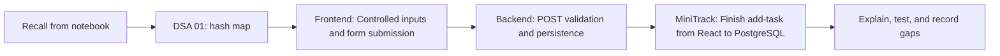
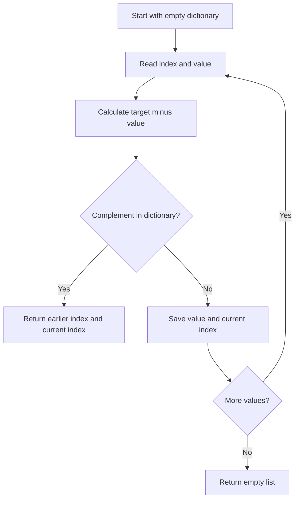
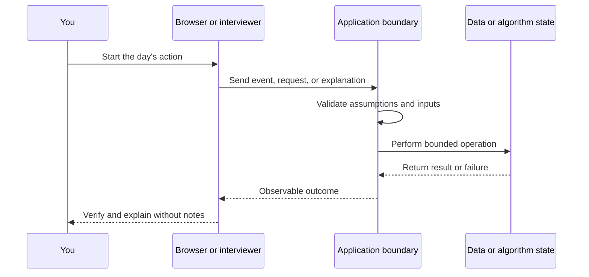

# Prep Day 01 — Finish add-task from React to PostgreSQL

**Date:** Wednesday, November 25, 2026  
**Time:** 7 study hours plus breaks  
**Starting point:** App Days 1–4 are complete. Continue from the current learner workspace and the previous preparation-day exit checklist.  
**Goal:** Finish add-task from React to PostgreSQL.

[Track home](README.md) · [Preparation plan](../../docs/FULL_STACK_INTERVIEW_PREP_PLAN.md) · [Prep Day 02](prep-day-02.md)

**Everything to read today is below.** The original [App Day 5](../day-05.md)
and [DSA Day 01](../../dsa-python/lessons/dsa-day-01.md) remain available for
comparison. This prep day covers only adding tasks; completion, deletion, and
filtering belong to Prep Day 02. Write runnable code in the named project and
practice files, not in this Markdown file.

## Learning objectives

- explain controlled inputs and form submission in beginner-friendly language;
- explain post validation and persistence and its failure boundary;
- implement or verify the listed MiniTrack milestone;
- solve DSA Day 01 using the hash map pattern;
- record the result in your rough notebook and explain it without reading.

## 1. Start with notebook recall (45 minutes)

Before opening a lesson, write answers in
[`checkpoints/ROUGH/Notes.md`](../../checkpoints/ROUGH/Notes.md):

1. What did yesterday's browser action send to the server?
2. Where is persistent task data stored, and what state is only temporary?
3. What error or edge case can you already predict for today's topic?
4. What do you remember about the **hash map** pattern?

Use this format:

```md
## Wednesday, November 25, 2026

- What:
- Why:
- How MiniTrack uses it:
- What can go wrong:
- First task:
```

Do not copy the source paragraph. Write what you remember, then compare.

## 2. Understand today's full-stack boundary (20 minutes)

**Frontend focus — Controlled inputs and form submission:** React owns a controlled input through its value prop, and onChange updates the state used for the next render. onSubmit handles the form as one user action and preventDefault stops the browser's traditional page navigation.

**Backend focus — POST validation and persistence:** The Route Handler parses untrusted JSON, validates the title, calls the data function, and returns a 201 response. PostgreSQL remains the source of truth; React state only holds the temporary input.

**Today's connection:** A browser event becomes validated JSON, a parameterized INSERT, a 201 response, and a refreshed Server Component.



## 3. Python DSA practice (1 hour 45 minutes)

**Practice file:** [`dsa-python/practice/day-01.py`](../../dsa-python/practice/day-01.py)  
**Pattern:** hash map

### Problem: Two Sum

Given a list of numbers and a target, return the indices of two **different**
elements that add up to the target. Return an empty list if no pair exists.
Assume the inputs are integers and any valid pair is acceptable.

```python
solve([2, 7, 11, 15], 9)  # [0, 1]
solve([3, 3], 6)           # [0, 1]
solve([1, 2], 7)           # []
```

The simple approach checks every pair: O(n²) time and O(1) extra space.
For a faster approach, a Python dictionary can remember numbers already seen.
For each number, its **complement** is `target - number`.

### Start coding

In the practice file, replace the `raise NotImplementedError` line with your
own implementation. This is the starting shape:

```python
def solve(nums, target):
    # Return two different indices, or [] if no pair exists.
    raise NotImplementedError
```

In Python, `enumerate(nums)` gives both the index and value. For example,
`enumerate([2, 7])` produces `(0, 2)` and then `(1, 7)`. A dictionary such as
`{2: 0}` can remember that the value `2` was seen at index `0`.



### Invariant to say aloud

Store each visited number by index and check for the needed complement before inserting the current value.

### Work in this order

1. Restate the problem and ask about constraints.
2. Give a brute-force approach and its cost before optimizing.
3. Write the invariant above in your own words.
4. Implement without opening the solution for 25 minutes.
5. Test empty, smallest, typical, duplicate, and boundary cases where relevant.
6. Use a small hint if blocked; do not spend the entire block stuck.
7. Compare with the commented reference and re-code the key loop from memory.

From the repository root:

```bash
python3 dsa-python/scripts/check_practice.py 1
python3 -m unittest discover -s dsa-python/tests -v
```

**Expected observation:** the day-specific checker accepts your implementation,
and the completed reference suite still passes. The checker uses exact
expected results for its supplied examples; those examples each have only one
valid pair. Its examples are not a complete test of every possible input.

You can also temporarily add these checks below your `solve` function in the
practice file, then run `python3 dsa-python/practice/day-01.py`:

```python
if __name__ == '__main__':
    assert solve([2, 7, 11, 15], 9) == [0, 1]
    assert solve([3, 3], 6) == [0, 1]
    assert solve([1, 2], 7) == []
    assert solve([], 5) == []
    assert solve([3], 6) == []  # One element cannot be used twice.
    assert solve([-3, 4], 1) == [0, 1]
    print('All checks passed')
```

### Brute-force code — reveal after attempting

<details>
<summary>Show the simple solution</summary>

```python
def solve(nums, target):
    for i in range(len(nums)):
        # Start after i so the two indices are always different.
        for j in range(i + 1, len(nums)):
            if nums[i] + nums[j] == target:
                return [i, j]
    return []
```

</details>

This compares every possible pair until it finds a match. If there are `n`
numbers, there can be `n × (n - 1) / 2` pairs, so the worst-case time is
O(n²). It uses O(1) extra space.

### Optimized code — reveal after attempting

<details>
<summary>Show the Two Sum solution</summary>

```python
def solve(nums, target):
    seen = {}  # number -> an earlier index
    for i, value in enumerate(nums):
        complement = target - value
        if complement in seen:
            return [seen[complement], i]  # two different indices
        seen[value] = i
    return []
```

</details>

For `[2, 7]` and target `9`, first store `2: 0`. Next, `9 - 7` is
`2`, which is already in the dictionary, so return `[0, 1]`. Checking before
inserting prevents one element from being used twice. Expected time is O(n)
with average constant-time dictionary operations; extra space is O(n).

| Index | Value | Complement | Dictionary before checking | Action |
|---:|---:|---:|---|---|
| 0 | 2 | 7 | `{}` | Not found; store `{2: 0}` |
| 1 | 7 | 2 | `{2: 0}` | Found; return `[0, 1]` |

### DSA interview questions and answers

#### DSA Q1. What is the brute-force approach?

**Interview-ready answer:** “I compare each number with every number after
it. If their sum equals the target, I return their indices. Otherwise I return
an empty list after checking all pairs. This takes O(n²) time in the worst
case and O(1) extra space.”

**Example:** For `[2, 7, 11]` and target `9`, compare `2 + 7` first and
return `[0, 1]`.

**Follow-up:** Why start the inner loop at `i + 1`? It avoids comparing an
element with itself and checking the same pair twice.

#### DSA Q2. How does a hash map improve the solution?

**Interview-ready answer:** “As I scan the list, I save each number and its
index in a dictionary. For the current number, I calculate the missing number,
or complement, and look it up. If it is already present, I have found a pair.”

**Example:** For target `9` and current value `7`, the complement is `2`.
If the dictionary contains `{2: 0}`, return the earlier index `0` and the
current index `1`.

**Follow-up:** What is the trade-off? The dictionary uses extra memory in
exchange for faster average lookups than checking every pair.

#### DSA Q3. Why check before inserting?

**Interview-ready answer:** “The dictionary contains only values from earlier
indices when I check it. Therefore a match cannot reuse the current element.”

**Example:** With `[3]` and target `6`, checking first finds nothing and
returns `[]`. Inserting `3` first would incorrectly allow index `0` twice.
With `[3, 3]`, the second `3` can correctly match the first.

**Follow-up:** What is an invariant? It is a statement that remains true at a
specific point in each iteration: before checking, `seen` contains only
previously visited values and their indices.

#### DSA Q4. What are the time and space costs?

**Interview-ready answer:** “The optimized solution takes expected O(n) time
because it scans the list once and dictionary operations are O(1) on average.
It uses O(n) extra space because the dictionary can hold up to n values.”

**Example:** If no pair exists, every number can be added to the dictionary
before the function returns `[]`.

**Follow-up:** Is O(n) time guaranteed in every case? No. Heavy hash
collisions can make individual dictionary operations O(n) in the worst case,
so the overall worst case can be O(n²).

#### DSA Q5. What edge cases should I test?

**Interview-ready answer:** “I test an empty list, one element, duplicate
values, negative numbers, a pair at the end, and no matching pair. I also
clarify whether there can be multiple valid answers.”

**Example:** `[3, 3]` with target `6` returns `[0, 1]`; `[3]` with target
`6` returns `[]`.

**Follow-up:** What if there are multiple valid pairs? This implementation
returns the first pair it encounters while scanning, not necessarily every
pair or a particular preferred pair. Ask the interviewer which is required.

#### DSA Q6. What changes if the input is sorted?

**Interview-ready answer:** “I can use two pointers, one at each end. If the
sum is too small, I move the left pointer right; if it is too large, I move
the right pointer left. This takes O(n) time and O(1) extra space.”

**Example:** In `[2, 3, 5, 8]` with target `8`, `2 + 8` is too large, so
move the right pointer left. Then `2 + 5` is too small, so move the left
pointer right and find `3 + 5`.

**Follow-up:** Can I sort an unsorted input first? Yes, but sorting costs
O(n log n), and you must preserve original indices if those are required.
Two pointers directly on an already sorted input return indices in that
sorted input.

## 4. Frontend guided study (1 hour 30 minutes)

### What

React owns a controlled input through its value prop, and onChange updates the state used for the next render. onSubmit handles the form as one user action and preventDefault stops the browser's traditional page navigation.

### Why

The browser layer should make state and feedback understandable without taking
ownership of persistent data or security decisions that belong on the server.

### How

Before looking at the code in section 6, sketch the component state, user
event, request, success result, and failure result.

Files to open deliberately:

- `frontend/app/TaskBoard.tsx`
- `frontend/app/api/tasks/route.ts`
- `frontend/lib/tasks.ts`

Answer before coding:

- Which value is persistent, and which value is temporary interaction state?
- What starts this behavior?
- What should the user see while work is pending?
- What should remain unchanged when the operation fails?

## 5. Backend guided study (1 hour 30 minutes)

### What

The Route Handler parses untrusted JSON, validates the title, calls the data function, and returns a 201 response. PostgreSQL remains the source of truth; React state only holds the temporary input.

### Boundary checklist

- Validate untrusted path, query, and body values.
- Authenticate identity when the route is protected.
- Authorize the resource separately from authentication.
- Bind SQL values rather than concatenating untrusted data.
- Return an explicit success or error status.
- Log internal failures on the server without exposing secrets.

The key existing Day 3 code is shown below for review. Keep any later
functions already present in these files; these excerpts are not replacement
files.

In `frontend/app/api/tasks/route.ts`, the POST handler validates the request
before saving it:

```ts
export async function POST(request: Request): Promise<Response> {
  let body: unknown;
  try {
    body = await request.json();
  } catch {
    return Response.json({ error: 'Invalid JSON' }, { status: 400 });
  }
  const title = normalizeTitle(isRecord(body) ? body.title : undefined);
  if (!title) {
    return Response.json({ error: 'title must be 1–200 characters' }, { status: 400 });
  }
  try {
    return Response.json(await createTask(title), { status: 201 });
  } catch (error: unknown) {
    console.error('POST /api/tasks failed:', error);
    return Response.json({ error: 'Internal server error' }, { status: 500 });
  }
}
```

`normalizeTitle` trims a string and accepts 1–200 characters; `isRecord`
checks that the JSON body is an object. Both are imported from
`frontend/lib/validation.ts`. The handler imports `createTask` from
`frontend/lib/tasks.ts`, where the existing function is:

```ts
export async function createTask(title: string): Promise<Task> {
  const result = await getPool().query<TaskRow>(
    'INSERT INTO tasks (title) VALUES ($1) RETURNING id, title, done, created_at',
    [title]
  );
  const row = result.rows[0];
  if (!row) throw new Error('Inserted task was not returned by PostgreSQL');
  return toTask(row);
}
```

`$1` keeps the supplied title separate from SQL syntax. `toTask` converts the
database timestamp to a string for the browser.

## 6. MiniTrack implementation (1 hour)

### Step 1: Create the add-task component

First try the three steps yourself: render the supplied tasks, connect the
input to React state, and send a POST request. Then compare with this
add-task-only implementation in `frontend/app/TaskBoard.tsx`:

```tsx
'use client';

import { useState, type FormEvent } from 'react';
import { useRouter } from 'next/navigation';
import type { Task } from './types';

export default function TaskBoard({ tasks }: { tasks: Task[] }) {
  const [title, setTitle] = useState('');
  const [busy, setBusy] = useState(false);
  const [error, setError] = useState('');
  const router = useRouter();

  async function addTask(event: FormEvent<HTMLFormElement>) {
    event.preventDefault();
    const cleanTitle = title.trim();
    if (!cleanTitle) {
      setError('Enter a task title.');
      return;
    }

    setBusy(true);
    setError('');
    try {
      const response = await fetch('/api/tasks', {
        method: 'POST',
        headers: { 'Content-Type': 'application/json' },
        body: JSON.stringify({ title: cleanTitle }),
      });

      if (!response.ok) {
        setError(`Could not add task (${response.status})`);
        return;
      }

      setTitle('');
      router.refresh();
    } catch {
      setError('Could not connect to the server');
    } finally {
      setBusy(false);
    }
  }

  return (
    <section className="mt-8">
      <form onSubmit={addTask} className="flex flex-wrap gap-3">
        <label htmlFor="task-title" className="sr-only">Task title</label>
        <input
          id="task-title"
          className="min-w-0 flex-1 rounded-lg border border-slate-700 bg-slate-900 px-4 py-2"
          value={title}
          onChange={event => setTitle(event.target.value)}
          placeholder="What needs doing?"
          maxLength={200}
          disabled={busy}
        />
        <button
          type="submit"
          className="rounded-lg bg-violet-600 px-4 py-2 disabled:opacity-50"
          disabled={busy}
        >
          {busy ? 'Adding...' : 'Add task'}
        </button>
      </form>
      {error && <p role="alert" className="mt-3 text-rose-300">{error}</p>}
      <p className="mt-4 text-slate-400">{tasks.length} tasks</p>
      <ul className="mt-4 overflow-hidden rounded-2xl border border-slate-700 bg-slate-900">
        {tasks.map(task => (
          <li key={task.id} className="flex gap-3 border-b border-slate-700 px-5 py-4 last:border-b-0">
            <span aria-hidden="true">{task.done ? '✅' : '⬜'}</span>
            <span className={task.done ? 'text-slate-500 line-through' : ''}>
              {task.title}
            </span>
          </li>
        ))}
      </ul>
    </section>
  );
}
```

`value` and `onChange` make the input controlled by React. The input remains
available after a failed request; after success, `router.refresh()` asks the
server for fresh task data. Disabling the button reduces duplicate clicks but
does not guarantee server-side idempotency. The refreshed props may arrive
after `busy` becomes false.

### Step 2: Connect the server page

Replace `frontend/app/page.tsx` with the following. It keeps the database read
on the server and passes the resulting tasks to the Client Component:

```tsx
import { Suspense } from 'react';
import { io } from 'next/cache';
import TaskBoard from './TaskBoard';
import { listTasks } from '../lib/tasks';
import type { Task } from './types';

async function TaskContent() {
  await io();

  let tasks: Task[] = [];
  let error: string | null = null;
  try {
    tasks = await listTasks();
  } catch (err) {
    error = err instanceof Error ? err.message : 'Unable to load tasks';
  }

  return error ? (
    <p
      className="rounded-xl border border-rose-400/30 bg-rose-400/10 p-4 text-rose-200"
      role="alert"
    >
      Could not load tasks: {error}. Check PostgreSQL and DATABASE_URL.
    </p>
  ) : (
    <TaskBoard tasks={tasks} />
  );
}

export default function Home() {
  return (
    <main className="mx-auto min-h-screen w-full max-w-5xl px-5 py-12">
      <header className="mb-8">
        <p className="text-sm font-semibold uppercase tracking-widest text-violet-300">
          Your workspace
        </p>
        <h1 className="mt-3 text-4xl font-bold tracking-tight">MiniTrack</h1>
        <p className="mt-2 text-slate-400">
          Simple tasks. Serious full-stack concepts.
        </p>
      </header>
      <Suspense fallback={<p className="text-slate-400">Loading tasks...</p>}>
        <TaskContent />
      </Suspense>
    </main>
  );
}
```

With Cache Components enabled, `io()` and `Suspense` keep the database read in
a request-time subtree; do not add `dynamic = 'force-dynamic'`.

### Step 3: Run and verify

With PostgreSQL running and your existing `frontend/.env.local` configured,
run from the repository root:

```bash
cd frontend
npm run lint
npm run dev
```

Open `http://localhost:3000`, add a task, and reload: the task should remain.
Try a blank title and confirm that the page shows an error without adding a
task. In a separate terminal, check the server's validation:

```bash
curl -i -X POST http://localhost:3000/api/tasks \
  -H 'Content-Type: application/json' -d '{"title":"  "}'
```

Expect HTTP 400. If PostgreSQL is unavailable, the page or request should show
an error instead of pretending the task was saved.

**Expected observation:** the user-visible milestone works, its important
failure path is explicit, and existing behavior remains intact.

## 7. Trace the event or request



Trace one concrete input. Name every boundary, value, and possible failure.

## 8. Deliberate debugging exercise (25 minutes)

**Break it:** Remove event.preventDefault() from the submit handler.

**Predict before running:** write the expected symptom in your notebook.

**Expected symptom:** The browser performs a traditional form navigation and the React flow is interrupted.

**Root cause:** A form submits through the browser by default; React must deliberately take control.

**Restore and verify:** Restore preventDefault(), submit again, and verify the page does not navigate.

Do not stop after making the symptom disappear. Explain why the repair restores
the intended invariant.

## 9. Interview questions and answers (30 minutes)

### Q1. What is controlled inputs and form submission?

**Interview-ready answer:** React owns a controlled input through its value prop, and onChange updates the state used for the next render. onSubmit handles the form as one user action and preventDefault stops the browser's traditional page navigation.

**Example:** Use `frontend/app/TaskBoard.tsx` and point to the state, event, or rendered
behavior involved in today's milestone.

**Senior follow-up:** Explain when this frontend choice would become difficult
to maintain and what measurement or requirement would justify a different
design.

### Q2. How should the backend handle post validation and persistence?

**Interview-ready answer:** The Route Handler parses untrusted JSON, validates the title, calls the data function, and returns a 201 response. PostgreSQL remains the source of truth; React state only holds the temporary input.

**Example:** Trace the relevant Route Handler or server boundary into the
MiniTrack data function and back to its response.

**Senior follow-up:** Describe the failure mode, logging requirement, and what
must remain private when the dependency is unavailable.

### Q3. What invariant makes the hash map solution correct?

**Interview-ready answer:** Store each visited number by index and check for the needed complement before inserting the current value.

**Example:** Dry-run the first non-trivial sample from DSA Day 01 and
show the state after each iteration.

**Senior follow-up:** State the assumptions under which the claimed complexity
holds and how changed constraints might require another approach.

### Q4. How does today's work fit the complete MiniTrack system?

**Interview-ready answer:** A browser event becomes validated JSON, a parameterized INSERT, a 201 response, and a refreshed Server Component.

**Example:** Begin with one user action and finish with the visible result or
verified system state.

**Senior follow-up:** Identify the first bottleneck, security risk, or
operational signal you would measure before adding infrastructure.

## 10. Complexity and operational cost

- **DSA:** O(n) time and O(n) auxiliary space.
- **Application:** The client does constant local work, while inserting is normally dominated by one network round trip and one indexed database write.
- **Learning:** Attempting, retrieving, and correcting is more valuable than
  copying several solutions. Keep the scope to one understood pattern today.

## Exit checklist

- [ ] I completed DSA Day 01 before reading its solution.
- [ ] I can state the invariant and complexity without notes.
- [ ] I completed or verified the MiniTrack milestone.
- [ ] I tested one success path and one failure path.
- [ ] I completed the deliberate debugging exercise.
- [ ] I answered all four interview questions aloud.
- [ ] I recorded what remains confusing and tomorrow's first task.

**Suggested commit:** `prep day 01: finish add-task from react to postgresql`
