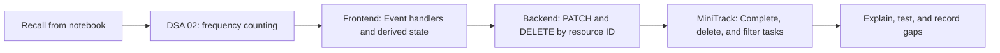
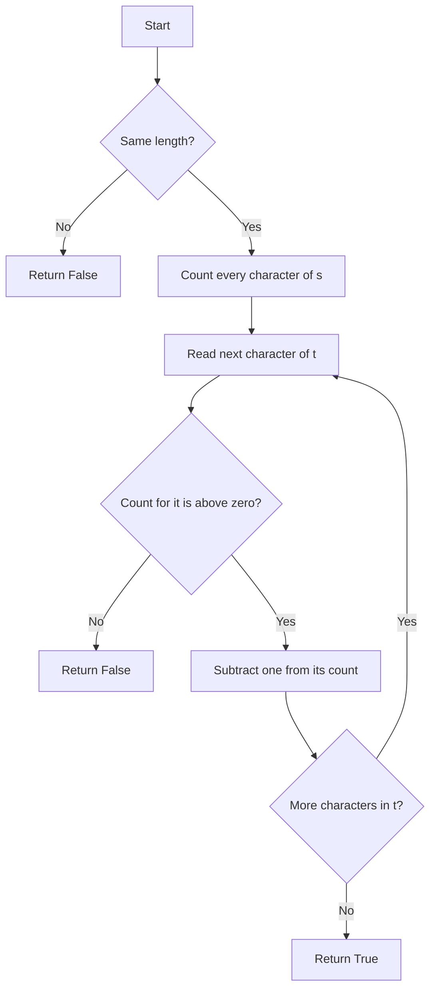

# Prep Day 02 — Complete, delete, and filter tasks

**Date:** Thursday, November 26, 2026  
**Time:** 7 study hours plus breaks  
**Starting point:** App Days 1–4 are complete. Continue from the current learner workspace and the previous preparation-day exit checklist.  
**Goal:** Complete, delete, and filter tasks.

[Prep Day 01](prep-day-01.md) · [Preparation plan](../../docs/FULL_STACK_INTERVIEW_PREP_PLAN.md) · [Track home](README.md) · [Prep Day 03](prep-day-03.md)

**Everything to read today is below.** The original [App Day 5](../day-05.md)
and [DSA Day 02](../../dsa-python/lessons/dsa-day-02.md) remain available for
comparison. This prep day adds completing, deleting, and filtering tasks on top
of Prep Day 01's add-task flow. Renaming a task through the API belongs to Prep
Day 03, and the browser editing UI belongs to Prep Day 04. Write runnable code
in the named project and practice files, not in this Markdown file.

## Learning objectives

- explain event handlers and derived state in beginner-friendly language;
- explain PATCH and DELETE by resource ID and its failure boundary;
- implement or verify the listed MiniTrack milestone;
- solve DSA Day 02 using the frequency counting pattern;
- record the result in your rough notebook and explain it without reading.

## 1. Start with notebook recall (45 minutes)

Before opening a lesson, write answers in
[`checkpoints/ROUGH/Notes.md`](../../checkpoints/ROUGH/Notes.md):

1. What did yesterday's browser action send to the server?
2. Where is persistent task data stored, and what state is only temporary?
3. What error or edge case can you already predict for today's topic?
4. What do you remember about the **frequency counting** pattern?

Use this format:

```md
## Thursday, November 26, 2026

- What:
- Why:
- How MiniTrack uses it:
- What can go wrong:
- First task:
```

Do not copy the source paragraph. Write what you remember, then compare.

## 2. Understand today's full-stack boundary (20 minutes)

**Frontend focus — Event handlers and derived state:** A checkbox uses onChange, a delete button uses onClick, and visible tasks are derived from task state plus the selected filter. Derived values should not be copied into a second state variable.

**Backend focus — PATCH and DELETE by resource ID:** The dynamic Route Handler validates the path ID, validates the PATCH body, and calls parameterized UPDATE or DELETE functions. Missing tasks return 404 instead of success-shaped data.

**Today's connection:** The task ID travels in the URL, the new value travels in JSON when needed, and the client requests the latest rows after a successful mutation.



## 3. Python DSA practice (1 hour 45 minutes)

**Practice file:** [`dsa-python/practice/day-02.py`](../../dsa-python/practice/day-02.py)  
**Pattern:** frequency counting

### Problem: Valid Anagram

Given two strings `s` and `t`, return `True` if `t` uses **exactly the same
characters with the same counts** as `s`, in any order. Otherwise return
`False`. Assume the comparison is case-sensitive and every character counts,
including spaces and punctuation.

```python
solve('anagram', 'nagaram')  # True
solve('rat', 'car')          # False
```

Equal length is necessary but not enough: `'aab'` and `'abb'` both have three
letters, but the counts of `a` and `b` differ.

The simple approach removes each character of `s` from a list copy of `t`:
O(n²) time. A faster approach **counts** how many times each character appears
in `s`, then uses up those counts while reading `t`.

### Start coding

In the practice file, replace the `raise NotImplementedError` line with your
own implementation. This is the starting shape:

```python
def solve(s, t):
    # Return True when t is a rearrangement of s, otherwise False.
    raise NotImplementedError
```

Two Python helpers make counting short:

- A `for ch in s:` loop gives one character at a time: `'abc'` gives `'a'`,
  then `'b'`, then `'c'`.
- `counts.get(ch, 0)` reads the value for key `ch` from the dictionary
  `counts`, or returns `0` if the key is missing. So
  `counts[ch] = counts.get(ch, 0) + 1` means "add one to this character's
  count, starting from zero the first time".



### Invariant to say aloud

Count characters from one string and subtract matches from the other; every final count must balance.

### Work in this order

1. Restate the problem and ask about constraints.
2. Give a brute-force approach and its cost before optimizing.
3. Write the invariant above in your own words.
4. Implement without opening the solution for 25 minutes.
5. Test empty, smallest, typical, duplicate, and boundary cases where relevant.
6. Use a small hint if blocked; do not spend the entire block stuck.
7. Compare with the commented reference and re-code the key loop from memory.

From the repository root:

```bash
python3 dsa-python/scripts/check_practice.py 2
python3 -m unittest discover -s dsa-python/tests -v
```

**Expected observation:** the day-specific checker accepts your implementation,
and the completed reference suite still passes. The checker only runs the two
examples above, so it cannot prove that repeated letters or empty strings work.

You can also temporarily add these checks below your `solve` function in the
practice file, then run `python3 dsa-python/practice/day-02.py`:

```python
if __name__ == '__main__':
    assert solve('anagram', 'nagaram') is True
    assert solve('rat', 'car') is False
    assert solve('', '') is True
    assert solve('a', 'ab') is False      # Different lengths.
    assert solve('aab', 'abb') is False   # Same length, different counts.
    assert solve('Aa', 'aA') is True
    assert solve('a', 'A') is False       # Case-sensitive.
    print('All checks passed')
```

### Brute-force code — reveal after attempting

<details>
<summary>Show the simple solution</summary>

```python
def solve(s, t):
    if len(s) != len(t):
        return False
    remaining = list(t)  # A list copy we can remove characters from.
    for ch in s:
        if ch not in remaining:
            return False
        remaining.remove(ch)  # Removes the first matching character.
    return True
```

</details>

For each of the `n` characters in `s`, `ch not in remaining` and
`remaining.remove(ch)` can scan the whole list, so the worst-case time is
O(n²). The list copy uses O(n) extra space. Sorting both strings
(`sorted(s) == sorted(t)`) is a shorter alternative at O(n log n) time.

### Optimized code — reveal after attempting

<details>
<summary>Show the Valid Anagram solution</summary>

```python
def solve(s, t):
    if len(s) != len(t):
        return False
    counts = {}  # character -> how many unused copies came from s
    for ch in s:
        counts[ch] = counts.get(ch, 0) + 1
    for ch in t:
        # Zero (or missing) means t needs a copy that s did not provide.
        if counts.get(ch, 0) == 0:
            return False
        counts[ch] -= 1
    return True
```

</details>

Because the lengths are equal, `t` cannot finish with any count above zero
unless some other count would have gone below zero first, and that case already
returned `False`. Time is O(n) with average constant-time dictionary
operations; extra space is O(k), where `k` is the number of distinct
characters.

For `s = 'aab'` and `t = 'aba'`, counting `s` gives `{'a': 2, 'b': 1}`:

| Step | Character of `t` | Count before | Action | Dictionary after |
|---:|---|---:|---|---|
| 1 | `a` | 2 | Above zero; subtract one | `{'a': 1, 'b': 1}` |
| 2 | `b` | 1 | Above zero; subtract one | `{'a': 1, 'b': 0}` |
| 3 | `a` | 1 | Above zero; subtract one | `{'a': 0, 'b': 0}` |
| End | — | — | Every count balanced | Return `True` |

With `'rat'` and `'car'`, counting gives `{'r': 1, 'a': 1, 't': 1}`; the
first character of `t` is `c`, whose count is `0`, so return `False`.

### DSA interview questions and answers

#### DSA Q1. What is the brute-force approach?

**Interview-ready answer:** “I first check that the lengths match. Then, for
each character of `s`, I search a copy of `t` and remove one matching
character. If I cannot find one, the strings are not anagrams. Searching and
removing from a list are linear, so this is O(n²) time.”

**Example:** For `'rat'` and `'tar'`, remove `r` → `['t', 'a']`, remove `a`
→ `['t']`, remove `t` → `[]`, so return `True`.

**Follow-up:** Why remove instead of only checking `ch in t`? Checking alone
ignores counts: `'aab'` would wrongly match `'abb'`, because every `a` would
find the same single `a`.

#### DSA Q2. How does frequency counting improve the solution?

**Interview-ready answer:** “I store how many times each character appears in
`s` in a dictionary. Then each character of `t` uses up one count. A dictionary
lookup is O(1) on average, so the whole check is one pass over each string.”

**Example:** `'anagram'` produces `{'a': 3, 'n': 1, 'g': 1, 'r': 1, 'm': 1}`.
Reading `'nagaram'` subtracts each of those counts down to zero.

**Follow-up:** Python's `collections.Counter(s) == Counter(t)` expresses the
same idea in one line. In an interview, show the manual version first so the
interviewer sees you understand what `Counter` does.

#### DSA Q3. Why is the solution correct?

**Interview-ready answer:** “Every count means ‘unused copies of this
character from `s`’. When `t` needs a character whose count is zero, `t` has
more of it than `s`, so I return `False`. If I finish without that happening
and the lengths are equal, every count must be exactly zero.”

**Example:** `'aab'` vs `'abb'`: after `a` and `b`, the counts are
`{'a': 1, 'b': 0}`. The final `b` sees `0`, so return `False`.

**Follow-up:** Why is the early length check needed? Without it, `'ab'` vs
`'a'` would finish the loop with `{'a': 0, 'b': 1}` and wrongly return `True`.

#### DSA Q4. What are the time and space costs?

**Interview-ready answer:** “Time is O(n) expected, where n is the string
length, because I read each string once and dictionary operations are O(1) on
average. Extra space is O(k) for k distinct characters.”

**Example:** For lowercase English letters, `k` is at most 26, so the extra
space is effectively constant. For arbitrary Unicode text, `k` can grow with
the input.

**Follow-up:** Is O(n) guaranteed? Not strictly: hash collisions can make
dictionary operations slower in the worst case. Sorting gives a guaranteed
O(n log n) bound and is a reasonable trade-off for short strings.

#### DSA Q5. What edge cases should I test?

**Interview-ready answer:** “Empty strings, different lengths, repeated
letters with the same length, uppercase versus lowercase, and spaces or
punctuation. I ask whether case and whitespace should be ignored.”

**Example:** `solve('', '')` is `True`; `solve('a', 'A')` is `False` under
case-sensitive rules; `solve('aab', 'abb')` is `False`.

**Follow-up:** If the interviewer wants `'Dormitory'` and `'dirty room'` to
match, normalize first, for example lowercase both strings and keep only
letters, then run the same count check.

#### DSA Q6. What changes if I must group many words into anagram groups?

**Interview-ready answer:** “I build a key that is the same for every anagram,
such as the sorted word or a tuple of 26 letter counts, and store a dictionary
from key to a list of words.”

**Example:** `['eat', 'tea', 'tan']` produces keys `'aet'`, `'aet'`, and
`'ant'`, so the groups are `[['eat', 'tea'], ['tan']]`.

**Follow-up:** Sorted keys cost O(m log m) per word of length m; a 26-count
tuple key costs O(m) per word but only works for a fixed alphabet.

## 4. Frontend guided study (1 hour 30 minutes)

### What

A checkbox uses onChange, a delete button uses onClick, and visible tasks are derived from task state plus the selected filter. Derived values should not be copied into a second state variable.

### Why

The browser layer should make state and feedback understandable without taking
ownership of persistent data or security decisions that belong on the server.

### How

Before looking at the code in section 6, sketch the component state, user
event, request, success result, and failure result.

Three ideas are new today:

1. **Event handlers with an argument.** Each row needs to tell the handler
   *which* task changed. An arrow function captures the row's ID:
   `onClick={() => { void deleteTask(task.id); }}`. `void` says "start this
   async function; I am deliberately not awaiting it here".
2. **Checkbox `onChange`.** For a checkbox, `event.target.checked` is the new
   boolean value. MiniTrack sends that value to the server instead of flipping
   it locally.
3. **Derived state.** The filter (`'all'`, `'open'`, or `'done'`) is real state
   because the user chooses it. The list of visible tasks is *not* state: it is
   calculated from `tasks` and `filter` on every render.

```tsx
// Derived during rendering: no useState, no useEffect.
let visibleTasks = tasks;
if (filter === 'open') {
  visibleTasks = tasks.filter(task => !task.done);
}
if (filter === 'done') {
  visibleTasks = tasks.filter(task => task.done);
}
```

`Array.prototype.filter` returns a **new** array containing only items for
which the callback returns `true`; it does not change `tasks`.

Files to open deliberately:

- `frontend/app/page.tsx`
- `frontend/app/api/tasks/[id]/route.ts`
- `frontend/lib/validation.ts`

Answer before coding:

- Which value is persistent, and which value is temporary interaction state?
- What starts this behavior?
- What should the user see while work is pending?
- What should remain unchanged when the operation fails?

## 5. Backend guided study (1 hour 30 minutes)

### What

The dynamic Route Handler validates the path ID, validates the PATCH body, and calls parameterized UPDATE or DELETE functions. Missing tasks return 404 instead of success-shaped data.

### Boundary checklist

- Validate untrusted path, query, and body values.
- Authenticate identity when the route is protected.
- Authorize the resource separately from authentication.
- Bind SQL values rather than concatenating untrusted data.
- Return an explicit success or error status.
- Log internal failures on the server without exposing secrets.

MiniTrack has no login yet, so today's routes check the first, fourth, fifth,
and sixth items. Authentication arrives in a later prep day.

### Step 1: Add the database functions

Try writing these two signatures yourself before reading the full file:

```ts
export async function setDone(id: string, done: boolean): Promise<Task | null>
export async function deleteTask(id: string): Promise<boolean>
```

Then replace `frontend/lib/tasks.ts` with this full file. `listTasks` and
`createTask` are unchanged from Prep Day 01; `setDone` and `deleteTask` are new.

```ts
import type { Task } from '../app/types';
import { getPool } from './db';

// PostgreSQL returns created_at as a Date; the browser receives a string.
type TaskRow = Omit<Task, 'created_at'> & { created_at: Date };

function toTask(row: TaskRow): Task {
  return { ...row, created_at: row.created_at.toISOString() };
}

export async function listTasks(): Promise<Task[]> {
  const result = await getPool().query<TaskRow>(
    'SELECT id, title, done, created_at FROM tasks ORDER BY id'
  );
  return result.rows.map(toTask);
}

export async function createTask(title: string): Promise<Task> {
  const result = await getPool().query<TaskRow>(
    'INSERT INTO tasks (title) VALUES ($1) RETURNING id, title, done, created_at',
    [title]
  );
  const row = result.rows[0];
  if (!row) throw new Error('Inserted task was not returned by PostgreSQL');
  return toTask(row);
}

export async function setDone(id: string, done: boolean): Promise<Task | null> {
  const result = await getPool().query<TaskRow>(
    'UPDATE tasks SET done = $1 WHERE id = $2 RETURNING id, title, done, created_at',
    [done, id]
  );
  const row = result.rows[0];
  // No row means no task has this ID: a normal "not found", not a crash.
  return row ? toTask(row) : null;
}

export async function deleteTask(id: string): Promise<boolean> {
  const result = await getPool().query('DELETE FROM tasks WHERE id = $1 RETURNING id', [id]);
  return result.rowCount !== null && result.rowCount > 0;
}
```

`$1` and `$2` are placeholders; the values array is sent separately, so a
title or ID can never become SQL syntax. The `BIGINT` ID stays a string in
TypeScript so large IDs cannot lose precision.

### Step 2: Add ID validation

Replace `frontend/lib/validation.ts`. `normalizeTitle` and `isRecord` are
unchanged from Prep Day 01; `isValidId` is new.

```ts
export function normalizeTitle(value: unknown): string | null {
  if (typeof value !== 'string') return null;
  const title = value.trim();
  return title.length >= 1 && title.length <= 200 ? title : null;
}

export function isValidId(raw: string): boolean {
  // Positive whole number, no leading zero, small enough to be exact in JS.
  return /^[1-9]\d*$/.test(raw) && Number.isSafeInteger(Number(raw));
}

export function isRecord(value: unknown): value is Record<string, unknown> {
  return typeof value === 'object' && value !== null && !Array.isArray(value);
}
```

`isValidId` rejects `abc`, `0`, `-1`, `1.5`, `007`, and numbers too large to
represent exactly. Rejecting them early avoids a pointless database query and
gives the client a clear 400.

### Step 3: Create the item Route Handler

The folder name `[id]` makes a **dynamic route**: `/api/tasks/7` runs this file
with `id = '7'`. In this Next.js version, `params` is a Promise, so await it.
Create `frontend/app/api/tasks/[id]/route.ts`:

```ts
import { deleteTask, setDone } from '../../../../lib/tasks';
import { isRecord, isValidId } from '../../../../lib/validation';

type RouteContext = { params: Promise<{ id: string }> };

export async function PATCH(request: Request, { params }: RouteContext): Promise<Response> {
  const { id } = await params;
  if (!isValidId(id)) {
    return Response.json({ error: 'Invalid task ID' }, { status: 400 });
  }

  let parsingBody = true;
  try {
    const body: unknown = await request.json();
    parsingBody = false;
    if (!isRecord(body) || typeof body.done !== 'boolean') {
      return Response.json({ error: 'done must be boolean' }, { status: 400 });
    }
    const task = await setDone(id, body.done);
    return task
      ? Response.json(task)
      : Response.json({ error: 'Task not found' }, { status: 404 });
  } catch (error: unknown) {
    if (parsingBody) {
      return Response.json({ error: 'Invalid JSON' }, { status: 400 });
    }
    // Full details stay in the server log; the client gets a generic message.
    console.error(`PATCH /api/tasks/${id} failed:`, error);
    return Response.json({ error: 'Internal server error' }, { status: 500 });
  }
}

export async function DELETE(_request: Request, { params }: RouteContext): Promise<Response> {
  const { id } = await params;
  if (!isValidId(id)) {
    return Response.json({ error: 'Invalid task ID' }, { status: 400 });
  }

  try {
    const deleted = await deleteTask(id);
    return deleted
      ? Response.json({ deleted: true })
      : Response.json({ error: 'Task not found' }, { status: 404 });
  } catch (error: unknown) {
    console.error(`DELETE /api/tasks/${id} failed:`, error);
    return Response.json({ error: 'Internal server error' }, { status: 500 });
  }
}
```

Keep `frontend/app/api/tasks/route.ts` (GET and POST) exactly as it was. The
browser page and the API share the origin `http://localhost:3000`, so no CORS
setup is needed.

With `npm run dev` running, check the API before touching React:

```bash
curl -i -X POST http://localhost:3000/api/tasks \
  -H 'Content-Type: application/json' -d '{"title":"Test PATCH and DELETE"}'
# Replace TASK_ID with the "id" value returned by the POST request:
curl -i -X PATCH http://localhost:3000/api/tasks/TASK_ID \
  -H 'Content-Type: application/json' -d '{"done":true}'
curl -i -X PATCH http://localhost:3000/api/tasks/TASK_ID \
  -H 'Content-Type: application/json' -d '{"done":"yes"}'
curl -i -X PATCH http://localhost:3000/api/tasks/abc \
  -H 'Content-Type: application/json' -d '{"done":true}'
curl -i -X DELETE http://localhost:3000/api/tasks/TASK_ID
curl -i -X DELETE http://localhost:3000/api/tasks/TASK_ID
```

**Expected statuses:** `201`, `200` with `"done":true`, `400` (`done must be
boolean`), `400` (`Invalid task ID`), `200` with `{"deleted":true}`, and
finally `404` because the task is already gone.

## 6. MiniTrack implementation (1 hour)

### Step 1: Extend the client page

First try it yourself in three passes, running the app after each: connect the
checkbox to PATCH, connect Delete to DELETE, then add the filter. Then compare
with this full updated `frontend/app/page.tsx`. The `addTask` function and
the add form are unchanged from Prep Day 01; lines marked `NEW` are today's
work.

```tsx
'use client';

import { useCallback, useEffect, useRef, useState, type FormEvent } from 'react';
import type { Task } from './types';

type Filter = 'all' | 'open' | 'done'; // NEW

export default function Home() {
  // This is a displayed copy; PostgreSQL keeps the saved data.
  const [tasks, setTasks] = useState<Task[]>([]);
  // The draft and selected filter are temporary user choices.
  const [title, setTitle] = useState('');
  const [filter, setFilter] = useState<Filter>('all'); // NEW
  // Track mutation errors separately from loading errors.
  const [busy, setBusy] = useState(false);
  const [error, setError] = useState('');
  const [loading, setLoading] = useState(true);
  const [loadError, setLoadError] = useState('');
  const currentLoad = useRef<AbortController | null>(null);

  // GET the latest list and cancel an older request before starting a new one.
  const loadTasks = useCallback(async () => {
    currentLoad.current?.abort();
    const controller = new AbortController();
    currentLoad.current = controller;
    setLoading(true);
    setLoadError('');

    try {
      const response = await fetch('/api/tasks', {
        cache: 'no-store',
        signal: controller.signal,
      });
      if (controller.signal.aborted) return;
      if (!response.ok) {
        setLoadError(`Could not load tasks (${response.status})`);
        setLoading(false);
        return;
      }

      const data: Task[] = await response.json();
      if (controller.signal.aborted) return;
      setTasks(data);
      setLoading(false);
    } catch {
      if (controller.signal.aborted) return;
      setLoadError('Could not load tasks. Check your connection and try again.');
      setLoading(false);
    }
  }, []);

  useEffect(() => {
    void loadTasks();
    return () => currentLoad.current?.abort();
  }, [loadTasks]);

  // NEW: derived from task state + filter during rendering.
  let visibleTasks = tasks;
  if (filter === 'open') {
    visibleTasks = tasks.filter(task => !task.done);
  }
  if (filter === 'done') {
    visibleTasks = tasks.filter(task => task.done);
  }

  // Submit a new title and reload the saved list after success.
  async function addTask(event: FormEvent<HTMLFormElement>) {
    event.preventDefault();
    const cleanTitle = title.trim();
    if (!cleanTitle) {
      setError('Enter a task title.');
      return;
    }

    setBusy(true);
    setError('');
    try {
      const response = await fetch('/api/tasks', {
        method: 'POST',
        headers: { 'Content-Type': 'application/json' },
        body: JSON.stringify({ title: cleanTitle }),
      });

      if (!response.ok) {
        setError(`Could not add task (${response.status})`);
        setBusy(false);
        return;
      }

      setTitle('');
      await loadTasks();
      setBusy(false);
    } catch {
      setError('Could not connect to the server');
      setBusy(false);
    }
  }

  // NEW: send the checkbox's new value; the server decides what is saved.
  async function toggleTask(taskId: string, done: boolean) {
    setBusy(true);
    setError('');
    try {
      const response = await fetch(`/api/tasks/${taskId}`, {
        method: 'PATCH',
        headers: { 'Content-Type': 'application/json' },
        body: JSON.stringify({ done }),
      });

      if (!response.ok) {
        setError(`Could not update task (${response.status})`);
        setBusy(false);
        return;
      }

      await loadTasks();
      setBusy(false);
    } catch {
      setError('Could not connect to the server');
      setBusy(false);
    }
  }

  // NEW: DELETE needs only the ID in the URL, so there is no request body.
  async function deleteTask(taskId: string) {
    setBusy(true);
    setError('');
    try {
      const response = await fetch(`/api/tasks/${taskId}`, { method: 'DELETE' });

      if (!response.ok) {
        setError(`Could not delete task (${response.status})`);
        setBusy(false);
        return;
      }

      await loadTasks();
      setBusy(false);
    } catch {
      setError('Could not connect to the server');
      setBusy(false);
    }
  }

  return (
    // mx-auto centers the page; max-w-5xl limits width; px/py add padding.
    <main className="mx-auto min-h-screen w-full max-w-5xl px-5 py-12">
      <h1 className="text-4xl font-bold">MiniTrack</h1>
      <section className="mt-8">
      {/* flex displays controls in a row; flex-wrap and gap help on small screens. */}
      <form onSubmit={addTask} className="flex flex-wrap gap-3">
        {/* sr-only hides the label visually but keeps it available to screen readers. */}
        <label htmlFor="task-title" className="sr-only">Task title</label>
        <input
          id="task-title"
          className="min-w-0 flex-1 rounded-lg border border-slate-700 bg-slate-900 px-4 py-2"
          value={title}
          onChange={event => setTitle(event.target.value)}
          placeholder="What needs doing?"
          maxLength={200}
          disabled={busy || loading}
        />
        {/* bg-violet-600 colors the button; disabled:opacity-50 fades it when disabled. */}
        <button
          type="submit"
          className="rounded-lg bg-violet-600 px-4 py-2 disabled:opacity-50"
          disabled={busy || loading}
        >
          {busy ? 'Adding...' : 'Add task'}
        </button>
      </form>

      {/* NEW: the filter is real state because the user chooses it. */}
      <label className="mt-5 flex items-center gap-2 text-sm text-slate-300">
        Show:
        <select
          className="rounded-lg border border-slate-700 bg-slate-950 px-3 py-2"
          value={filter}
          onChange={event => setFilter(event.target.value as Filter)}
        >
          <option value="all">All</option>
          <option value="open">Open</option>
          <option value="done">Done</option>
        </select>
      </label>

      {error && <p role="alert" className="mt-3 text-rose-300">{error}</p>}
      {loading && <p role="status" className="mt-3 text-slate-400">Loading tasks...</p>}
      {loadError && (
        <div role="alert" className="mt-3 text-rose-300">
          <p>{loadError}</p>
          <button type="button" onClick={() => void loadTasks()} disabled={loading}>
            Retry loading tasks
          </button>
        </div>
      )}
      <p className="mt-4 text-slate-400">
        Showing {visibleTasks.length} of {tasks.length} tasks
      </p>

      {visibleTasks.length === 0 ? (
        <p className="mt-4 text-slate-400">No tasks in this filter.</p>
      ) : (
        <ul className="mt-4 overflow-hidden rounded-2xl border border-slate-700 bg-slate-900">
          {visibleTasks.map(task => (
            <li
              key={task.id}
              className="flex items-center gap-3 border-b border-slate-700 px-5 py-4 last:border-b-0"
            >
              {/* NEW: checkbox replaces Prep Day 01's emoji marker. */}
              <input
                className="size-5 accent-violet-400"
                aria-label={`Complete ${task.title}`}
                type="checkbox"
                checked={task.done}
                disabled={busy || loading}
                onChange={event => {
                  void toggleTask(task.id, event.target.checked);
                }}
              />
              <span className={`flex-1 ${task.done ? 'text-slate-500 line-through' : ''}`}>
                {task.title}
              </span>
              {/* NEW: type="button" so it can never submit a form. */}
              <button
                className="rounded-lg px-3 py-2 text-sm text-slate-300 hover:bg-rose-400/10 hover:text-rose-300"
                disabled={busy || loading}
                type="button"
                onClick={() => {
                  void deleteTask(task.id);
                }}
              >
                Delete
              </button>
            </li>
          ))}
        </ul>
      )}
      </section>
    </main>
  );
}
```

The checkbox's `checked` value comes from the task list in React state.
Clicking it sends the change to the server; after success, `loadTasks()` calls
GET to read the saved list again. If the mutation fails, the old list remains
and an error explains why. If the mutation succeeds but the GET fails, the
list may be stale: use **Retry loading tasks** rather than repeating the
mutation. `busy` reduces double clicks but is not server-side protection.

### Step 2: Run and verify

With PostgreSQL running and your existing `frontend/.env.local` configured,
run from the repository root:

```bash
cd frontend
npm run lint
npm run dev
```

Open `http://localhost:3000` and check:

1. Add two tasks, tick one, and reload: the tick remains.
2. Choose **Open**: only the unticked task is shown. Choose **Done**: only the
   ticked task is shown. Choose **All**: both return.
3. Delete one task and reload: it stays deleted.
4. Stop PostgreSQL, tick a box: an error appears and the box does not change.
   Restart PostgreSQL afterwards.

**Expected observation:** the user-visible milestone works, its important
failure path is explicit, and existing behavior remains intact.

**If something fails:**

- `404` for every PATCH: check the folder is literally named `[id]` inside
  `frontend/app/api/tasks/`.
- TypeScript error about `params`: the type must be `Promise<{ id: string }>`
  and you must `await params`.
- Filter shows stale rows after a toggle: you stored `visibleTasks` in state
  instead of calculating it (see section 8).

## 7. Trace the event or request

```mermaid
sequenceDiagram
  participant U as You
  participant B as page.tsx (browser)
  participant A as api/tasks/[id]/route.ts
  participant G as api/tasks/route.ts
  participant D as PostgreSQL
  U->>B: Tick the checkbox for task 7
  B->>B: toggleTask("7", true); setBusy(true)
  B->>A: PATCH /api/tasks/7 body {"done":true}
  A->>A: isValidId("7"); typeof done is boolean
  A->>D: UPDATE tasks SET done = $1 WHERE id = $2 RETURNING ...
  D-->>A: Updated row (or no row)
  A-->>B: 200 task JSON (or 404 / 500)
  B->>G: GET /api/tasks
  G->>D: listTasks(): SELECT ... ORDER BY id
  D-->>G: Fresh rows
  G-->>B: JSON tasks; visibleTasks recalculated
  B-->>U: Box stays ticked and the filter view updates
```

Trace one concrete input. Name every boundary, value, and possible failure.
For example, `PATCH /api/tasks/abc` stops at `isValidId` with 400 and never
reaches PostgreSQL.

## 8. Deliberate debugging exercise (25 minutes)

**Break it:** Change the filter to store a separate visibleTasks state value.

**Predict before running:** write the expected symptom in your notebook.

**Expected symptom:** The list can become stale when fresh tasks arrive.

**Root cause:** Duplicated state has two sources that must be synchronized.

**Restore and verify:** Delete the duplicate state and compute visible tasks during rendering.

One way to break it: add
`const [visibleTasks, setVisibleTasks] = useState(tasks);` and update it only
inside the `<select>` `onChange`. Then add a task while **All** is selected:
the new task is saved but missing from the list until you change the filter.

Do not stop after making the symptom disappear. Explain why the repair restores
the intended invariant.

## 9. Interview questions and answers (30 minutes)

### Q1. What are event handlers and derived state?

**Interview-ready answer:** A checkbox uses onChange, a delete button uses onClick, and visible tasks are derived from task state plus the selected filter. Derived values should not be copied into a second state variable.

**Example:** In `frontend/app/page.tsx`, the checkbox calls
`toggleTask(task.id, event.target.checked)` and Delete calls
`deleteTask(task.id)`. `filter` is `useState<Filter>('all')`, while
`visibleTasks` is a plain variable computed with `tasks.filter(...)` on every
render.

**Senior follow-up:** If filtering became expensive (thousands of rows plus
search and sorting), first measure, then consider `useMemo` for the derived
value or move filtering to the server with a query parameter. It would still be
derived data, not a second source of truth.

### Q2. How should the backend handle PATCH and DELETE by resource ID?

**Interview-ready answer:** The dynamic Route Handler validates the path ID, validates the PATCH body, and calls parameterized UPDATE or DELETE functions. Missing tasks return 404 instead of success-shaped data.

**Example:** `PATCH /api/tasks/abc` returns 400 from `isValidId`;
`{"done":"yes"}` returns 400; a valid request for a missing ID gets `null` from
`setDone` and returns 404; a database outage is logged with `console.error`
and the client receives only `{"error":"Internal server error"}` with 500.

**Senior follow-up:** Deleting twice returns 200 then 404, but the server
*state* after both is the same, so DELETE is still idempotent. Once users
exist, the WHERE clause must also check ownership, otherwise any valid ID can
be changed by anyone (an IDOR vulnerability).

### Q3. What invariant makes the frequency counting solution correct?

**Interview-ready answer:** Count characters from one string and subtract matches from the other; every final count must balance.

**Example:** For `'aab'` and `'aba'`, counts start at `{'a': 2, 'b': 1}`
and reach `{'a': 0, 'b': 0}` after reading `t`. For `'rat'` and `'car'`, `c`
has count `0` immediately, so return `False`.

**Senior follow-up:** O(n) relies on average O(1) dictionary operations and
equal lengths being checked first. For a fixed alphabet, a 26-element list is
faster and uses constant space; for very long streams, counts must be stored
without holding both strings.

### Q4. How does today's work fit the complete MiniTrack system?

**Interview-ready answer:** The task ID travels in the URL, the new value travels in JSON when needed, and the client requests the latest rows after mutation.

**Example:** Ticking task 7 sends `PATCH /api/tasks/7` with
`{"done":true}`; the Route Handler runs `UPDATE ... WHERE id = $2`; after 200,
`loadTasks()` calls `GET /api/tasks`, whose handler calls `listTasks()`.
The page updates task state and recalculates `visibleTasks`.

**Senior follow-up:** Each mutation costs two round trips (mutation plus
GET). Measure p95 latency of `/api/tasks/[id]` and `/api/tasks` before
adding optimistic UI or caching; also log 404 and 500 rates per route.

## 10. Complexity and operational cost

- **DSA:** O(n) time and O(k) space for k distinct characters.
- **Application:** Filtering is O(n) per render for n tasks. PATCH and DELETE each use one database round trip; the refresh adds a read round trip.
- **Learning:** Attempting, retrieving, and correcting is more valuable than
  copying several solutions. Keep the scope to one understood pattern today.

## Exit checklist

- [ ] I completed DSA Day 02 before reading its solution.
- [ ] I can state the invariant and complexity without notes.
- [ ] I completed or verified the MiniTrack milestone.
- [ ] I tested one success path and one failure path.
- [ ] I completed the deliberate debugging exercise.
- [ ] I answered all four interview questions aloud.
- [ ] I recorded what remains confusing and tomorrow's first task.

**Suggested commit:** `prep day 02: complete, delete, and filter tasks`
