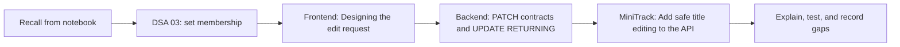
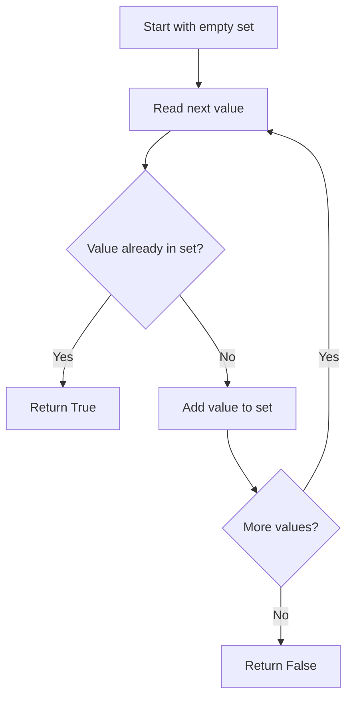
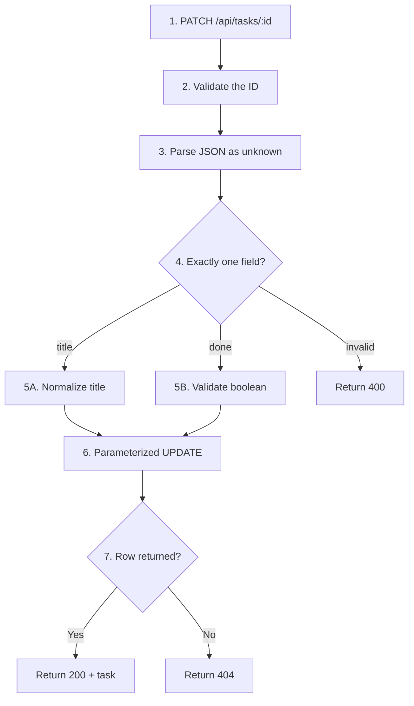

# Prep Day 03 — Add safe title editing to the API

**Date:** Friday, November 27, 2026  
**Time:** 7 study hours plus breaks  
**Starting point:** App Days 1–4 are complete. Continue from the current learner workspace and the previous preparation-day exit checklist.  
**Goal:** Add safe title editing to the API.

[Prep Day 02](prep-day-02.md) · [Preparation plan](../../docs/FULL_STACK_INTERVIEW_PREP_PLAN.md) · [Track home](README.md) · [Prep Day 04](prep-day-04.md)

**Everything to read today is below.** The original [App Day 6](../day-06.md)
and [DSA Day 03](../../dsa-python/lessons/dsa-day-03.md) remain available for
comparison. This prep day changes only the data layer and the
`PATCH /api/tasks/[id]` contract so a title can be renamed safely; you test it
with curl and the browser console. Completing, deleting, and filtering came
from Prep Day 02 and must keep working. The Edit, Save, and Cancel buttons in
the browser belong to Prep Day 04. Write runnable code in the named project and
practice files, not in this Markdown file.

## Learning objectives

- explain designing the edit request in beginner-friendly language;
- explain PATCH contracts and UPDATE RETURNING and its failure boundary;
- implement or verify the listed MiniTrack milestone;
- solve DSA Day 03 using the set membership pattern;
- record the result in your rough notebook and explain it without reading.

## 1. Start with notebook recall (45 minutes)

Before opening a lesson, write answers in
[`checkpoints/ROUGH/Notes.md`](../../checkpoints/ROUGH/Notes.md):

1. What did yesterday's browser action send to the server?
2. Where is persistent task data stored, and what state is only temporary?
3. What error or edge case can you already predict for today's topic?
4. What do you remember about the **set membership** pattern?

Use this format:

```md
## Friday, November 27, 2026

- What:
- Why:
- How MiniTrack uses it:
- What can go wrong:
- First task:
```

Do not copy the source paragraph. Write what you remember, then compare.

## 2. Understand today's full-stack boundary (20 minutes)

**Frontend focus — Designing the edit request:** The browser sends only the field being changed. A narrow PATCH body makes intent clear and prevents unrelated values from being overwritten.

**Backend focus — PATCH contracts and UPDATE RETURNING:** A partial-update endpoint validates that exactly one supported field is present, binds values in SQL, and uses RETURNING to obtain the updated row in the same database round trip.

**Today's connection:** The API boundary protects the data layer from malformed partial updates before SQL runs.



## 3. Python DSA practice (1 hour 45 minutes)

**Practice file:** [`dsa-python/practice/day-03.py`](../../dsa-python/practice/day-03.py)  
**Pattern:** set membership

### Problem: Contains Duplicate

Given a sequence of numbers, return `True` if **any** value appears at least
twice, and `False` if every value is distinct. Assume the values are hashable
(numbers here), and the input may be a list or a tuple.

```python
solve([1, 2, 3, 1])  # True  (1 appears twice)
solve((1, 2, 3))     # False (the checker passes a tuple here)
```

The simple approach compares every pair: O(n²) time. A faster approach
remembers every value already seen in a Python **set** and stops as soon as a
value is seen a second time.

### Start coding

In the practice file, replace the `raise NotImplementedError` line with your
own implementation. This is the starting shape:

```python
def solve(nums):
    # Return True if any value appears more than once, otherwise False.
    raise NotImplementedError
```

A **set** is a collection with no duplicates and fast membership checks:

- `seen = set()` creates an empty set. (Note: `{}` creates an empty
  *dictionary*, not a set.)
- `value in seen` is `True` if `value` was added before; on average this is
  O(1), like a dictionary key lookup.
- `seen.add(value)` stores `value`; adding it again changes nothing.



### Invariant to say aloud

Insert each value into a set and stop when a value is already present.

More precisely: before checking the current value, `seen` contains exactly the
earlier values, and all of them were distinct.

### Work in this order

1. Restate the problem and ask about constraints.
2. Give a brute-force approach and its cost before optimizing.
3. Write the invariant above in your own words.
4. Implement without opening the solution for 25 minutes.
5. Test empty, smallest, typical, duplicate, and boundary cases where relevant.
6. Use a small hint if blocked; do not spend the entire block stuck.
7. Compare with the commented reference and re-code the key loop from memory.

From the repository root:

```bash
python3 dsa-python/scripts/check_practice.py 3
python3 -m unittest discover -s dsa-python/tests -v
```

**Expected observation:** the day-specific checker accepts your implementation,
and the completed reference suite still passes. The checker's two examples do
not include an empty input or negative numbers, so add those yourself.

You can also temporarily add these checks below your `solve` function in the
practice file, then run `python3 dsa-python/practice/day-03.py`:

```python
if __name__ == '__main__':
    assert solve([1, 2, 3, 1]) is True
    assert solve((1, 2, 3)) is False
    assert solve([]) is False
    assert solve([5]) is False
    assert solve([-1, -1]) is True
    assert solve([0, 1, 0]) is True
    print('All checks passed')
```

### Brute-force code — reveal after attempting

<details>
<summary>Show the simple solution</summary>

```python
def solve(nums):
    for i in range(len(nums)):
        # Start after i so a value is never compared with itself.
        for j in range(i + 1, len(nums)):
            if nums[i] == nums[j]:
                return True
    return False
```

</details>

This compares every pair, up to `n × (n - 1) / 2` comparisons, so the
worst-case time is O(n²). It uses O(1) extra space. A middle option is to sort
a copy and compare neighbours: O(n log n) time.

### Optimized code — reveal after attempting

<details>
<summary>Show the Contains Duplicate solution</summary>

```python
def solve(nums):
    seen = set()  # distinct values read so far
    for value in nums:
        if value in seen:
            return True  # second time we meet this value
        seen.add(value)
    return False
```

</details>

Checking before adding means a value can only match an **earlier** copy of
itself. Expected time is O(n) with average constant-time set operations; extra
space is O(n) because, with no duplicate, every value is stored.

| Index | Value | Set before checking | Action |
|---:|---:|---|---|
| 0 | 1 | `{}` (empty) | Not present; add → `{1}` |
| 1 | 2 | `{1}` | Not present; add → `{1, 2}` |
| 2 | 3 | `{1, 2}` | Not present; add → `{1, 2, 3}` |
| 3 | 1 | `{1, 2, 3}` | Present; return `True` |

### DSA interview questions and answers

#### DSA Q1. What is the brute-force approach?

**Interview-ready answer:** “I compare every value with every later value. If
any pair is equal, I return `True`; after all pairs, I return `False`. That is
O(n²) time and O(1) extra space.”

**Example:** For `[1, 2, 3, 1]`, the pair at indexes `0` and `3` is equal,
so return `True`.

**Follow-up:** Sorting first and comparing neighbours is O(n log n) and needs
no hash set, which helps if memory is tight. Sorting in place changes the
caller's list, so sort a copy unless mutation is allowed.

#### DSA Q2. How does a set improve the solution?

**Interview-ready answer:** “A set answers ‘have I seen this before?’ in O(1)
on average. I scan once: if the value is already in the set it is a duplicate;
otherwise I add it.”

**Example:** After reading `1, 2, 3`, the set is `{1, 2, 3}`. The next `1`
is found immediately.

**Follow-up:** One-liner: `len(set(nums)) != len(nums)`. It is also O(n) but
always builds the whole set; the loop can stop early at the first duplicate.

#### DSA Q3. Why is the solution correct?

**Interview-ready answer:** “Before each check, the set holds exactly the
earlier values, all distinct. If the current value is in it, an earlier copy
exists, so there is a duplicate. If the loop finishes, every value was new
when read, so all values are distinct.”

**Example:** `[0, 1, 0]`: `0` added, `1` added, then `0` is found → `True`.

**Follow-up:** Why check before adding? Adding first would make every value
find itself, so `[5]` would wrongly return `True`.

#### DSA Q4. What are the time and space costs?

**Interview-ready answer:** “Expected O(n) time, because each value causes at
most one lookup and one insert, both O(1) on average. O(n) extra space in the
worst case, when all values are distinct.”

**Example:** `(1, 2, 3)` stores all three values and returns `False` after
three lookups and three inserts.

**Follow-up:** The O(1) average assumes a good hash function; adversarial
collisions can degrade lookups. Sorting gives a guaranteed O(n log n) bound.

#### DSA Q5. What edge cases should I test?

**Interview-ready answer:** “Empty input, one value, two equal values,
negative numbers and zero, a duplicate at the very end, and whether the input
can be a tuple or contain unhashable items.”

**Example:** `solve([])` and `solve([5])` are `False`; `solve([-1, -1])` is
`True`.

**Follow-up:** Lists such as `[[1], [1]]` cannot be put in a set because a
list is unhashable; convert each inner list to a tuple first.

#### DSA Q6. What if duplicates only count when they are at most k indexes apart?

**Interview-ready answer:** “I keep a sliding window: the set holds only the
last k values. Before moving on, I remove the value that falls out of the
window. That stays O(n) time with O(k) space.”

**Example:** `[1, 2, 3, 1]` with `k = 3` is `True` (indexes 0 and 3); with
`k = 2` it is `False`, because `1` leaves the window before index 3.

**Follow-up:** If values only need to be *close* (within `t`), a set is no
longer enough; you need buckets or a sorted structure.

## 4. Frontend guided study (1 hour 30 minutes)

### What

The browser sends only the field being changed. A narrow PATCH body makes intent clear and prevents unrelated values from being overwritten.

### Why

The browser layer should make state and feedback understandable without taking
ownership of persistent data or security decisions that belong on the server.

### How

Today there is no new React code. Instead, design the request that Prep Day 04's
Edit form will send. After today the same URL accepts two request shapes:

```json
{ "done": true }
```

```json
{ "title": "Review React state" }
```

One request must contain **exactly one** of these fields. These are rejected
with 400: `{}`, `{"title":"A","done":true}`, `{"title":"   "}`,
`{"done":"yes"}`, an array, and malformed JSON.

Why narrow? If the browser sent the whole task, for example
`{"title":"New","done":false,"created_at":"..."}`, a stale copy could silently
undo someone's completion or overwrite a server-owned value. Sending only the
changed field makes intent explicit.

You can try the contract from the browser before Prep Day 04 exists. Open
`http://localhost:3000`, open DevTools → Console, and paste (replace `7` with
a real task ID):

```js
await fetch('/api/tasks/7', {
  method: 'PATCH',
  headers: { 'Content-Type': 'application/json' },
  body: JSON.stringify({ title: 'Renamed from the console' }),
}).then(response => response.status);
```

Expect `200`. Reload the page: it requests the task list from the API, which
reads the new title from PostgreSQL.

Files to open deliberately:

- `frontend/app/api/tasks/[id]/route.ts`
- `frontend/lib/tasks.ts`
- `frontend/lib/validation.ts`

Answer before coding:

- Which value is persistent, and which value is temporary interaction state?
- What starts this behavior?
- What should the user see while work is pending?
- What should remain unchanged when the operation fails?

## 5. Backend guided study (1 hour 30 minutes)

### What

A partial-update endpoint validates that exactly one supported field is present, binds values in SQL, and uses RETURNING to obtain the updated row in the same database round trip.

### Boundary checklist

- Validate untrusted path, query, and body values.
- Authenticate identity when the route is protected.
- Authorize the resource separately from authentication.
- Bind SQL values rather than concatenating untrusted data.
- Return an explicit success or error status.
- Log internal failures on the server without exposing secrets.

MiniTrack still has no login, so authentication and authorization are not yet
part of these routes.



Three status codes, three meanings:

| Status | Meaning | MiniTrack example |
|---:|---|---|
| 400 | The request itself is wrong | `{"title":""}` or ID `abc` |
| 404 | The request is valid but the task does not exist | ID `999999999` |
| 500 | Something unexpected failed on the server | PostgreSQL is stopped |

`normalizeTitle` and `isValidId` in `frontend/lib/validation.ts` are unchanged
from Prep Day 02; the title rules (trim, then 1–200 characters) are the same
rules POST already uses.

## 6. MiniTrack implementation (1 hour)

### Step 1: Add the rename function

Write only this signature in `frontend/lib/tasks.ts` first, and ask: which
values must be SQL parameters, and how will a missing ID be reported?

```ts
export async function renameTask(id: string, title: string): Promise<Task | null>
```

Then compare with this full updated `frontend/lib/tasks.ts`. Everything above
`renameTask` is unchanged from Prep Day 02.

```ts
import type { Task } from '../app/types';
import { getPool } from './db';

type TaskRow = Omit<Task, 'created_at'> & { created_at: Date };

function toTask(row: TaskRow): Task {
  return { ...row, created_at: row.created_at.toISOString() };
}

export async function listTasks(): Promise<Task[]> {
  const result = await getPool().query<TaskRow>(
    'SELECT id, title, done, created_at FROM tasks ORDER BY id'
  );
  return result.rows.map(toTask);
}

export async function createTask(title: string): Promise<Task> {
  const result = await getPool().query<TaskRow>(
    'INSERT INTO tasks (title) VALUES ($1) RETURNING id, title, done, created_at',
    [title]
  );
  const row = result.rows[0];
  if (!row) throw new Error('Inserted task was not returned by PostgreSQL');
  return toTask(row);
}

export async function setDone(id: string, done: boolean): Promise<Task | null> {
  const result = await getPool().query<TaskRow>(
    'UPDATE tasks SET done = $1 WHERE id = $2 RETURNING id, title, done, created_at',
    [done, id]
  );
  const row = result.rows[0];
  return row ? toTask(row) : null;
}

export async function deleteTask(id: string): Promise<boolean> {
  const result = await getPool().query('DELETE FROM tasks WHERE id = $1 RETURNING id', [id]);
  return result.rowCount !== null && result.rowCount > 0;
}

// NEW
export async function renameTask(id: string, title: string): Promise<Task | null> {
  const result = await getPool().query<TaskRow>(
    `
      UPDATE tasks
      SET title = $1
      WHERE id = $2
      RETURNING id, title, done, created_at
    `,
    // Values are separate from SQL syntax, preventing value-based injection.
    [title, id]
  );

  const row = result.rows[0];
  // No row is a normal "not found" outcome, not a database failure.
  return row ? toTask(row) : null;
}
```

`RETURNING` sends back the saved row in the same round trip, so no second
`SELECT` is needed and the response shows exactly what PostgreSQL stored.

### Step 2: Extend the PATCH Route Handler

Replace `frontend/app/api/tasks/[id]/route.ts` with this full file. The ID
check, JSON parsing, and the whole `DELETE` function are unchanged from Prep
Day 02. The PATCH body check now decides which single update was requested.

```ts
import type { Task } from '../../../types';
import { deleteTask, renameTask, setDone } from '../../../../lib/tasks';
import { isRecord, isValidId, normalizeTitle } from '../../../../lib/validation';

type RouteContext = { params: Promise<{ id: string }> };

export async function PATCH(request: Request, { params }: RouteContext): Promise<Response> {
  const { id } = await params;
  if (!isValidId(id)) {
    return Response.json({ error: 'Invalid task ID' }, { status: 400 });
  }

  let parsingBody = true;
  try {
    const body: unknown = await request.json();
    parsingBody = false;
    if (!isRecord(body)) {
      return Response.json({ error: 'Request body must be an object' }, { status: 400 });
    }

    const hasDone = Object.hasOwn(body, 'done');
    const hasTitle = Object.hasOwn(body, 'title');

    // Both true or both false means the request contract is ambiguous.
    if (hasDone === hasTitle) {
      return Response.json({ error: 'Provide either done or title' }, { status: 400 });
    }

    // Choose the operation first, then run it below.
    let updateTask: () => Promise<Task | null>;

    if (hasTitle) {
      const title = normalizeTitle(body.title);
      if (!title) {
        return Response.json({ error: 'title must be 1–200 characters' }, { status: 400 });
      }
      updateTask = () => renameTask(id, title);
    } else if (typeof body.done === 'boolean') {
      const done = body.done;
      updateTask = () => setDone(id, done);
    } else {
      return Response.json({ error: 'done must be boolean' }, { status: 400 });
    }
    const task = await updateTask();
    return task
      ? Response.json(task)
      : Response.json({ error: 'Task not found' }, { status: 404 });
  } catch (error: unknown) {
    if (parsingBody) {
      return Response.json({ error: 'Invalid JSON' }, { status: 400 });
    }
    console.error(`PATCH /api/tasks/${id} failed:`, error);
    return Response.json({ error: 'Internal server error' }, { status: 500 });
  }
}

export async function DELETE(_request: Request, { params }: RouteContext): Promise<Response> {
  const { id } = await params;
  if (!isValidId(id)) {
    return Response.json({ error: 'Invalid task ID' }, { status: 400 });
  }

  try {
    const deleted = await deleteTask(id);
    return deleted
      ? Response.json({ deleted: true })
      : Response.json({ error: 'Task not found' }, { status: 404 });
  } catch (error: unknown) {
    console.error(`DELETE /api/tasks/${id} failed:`, error);
    return Response.json({ error: 'Internal server error' }, { status: 500 });
  }
}
```

Two helpers to understand:

- `Object.hasOwn(body, 'title')` is `true` when the object has its own
  `title` key, even if the value is `""` or `null`. That lets us tell "field
  missing" apart from "field present but invalid".
- `hasDone === hasTitle` is `true` in exactly two cases: neither key (`{}`) or
  both keys. Both are ambiguous, so both return 400.

`updateTask` is a function stored in a variable. Choosing it first and calling
it once keeps a single `404`/`500` response path for both operations. The
`Task` type comes from `frontend/app/types.ts`.

### Step 3: Run and verify

With PostgreSQL running and `frontend/.env.local` configured, run from the
repository root:

```bash
cd frontend
npm run lint
npm run dev
```

In a second terminal, create a task and copy its returned `id`:

```bash
curl -i -X POST http://localhost:3000/api/tasks \
  -H 'Content-Type: application/json' \
  -d '{"title":"Original title"}'
```

Then replace `TASK_ID` and run each request:

```bash
# 1. Valid rename
curl -i -X PATCH http://localhost:3000/api/tasks/TASK_ID \
  -H 'Content-Type: application/json' -d '{"title":"  Updated title  "}'

# 2. Existing completion behavior must still work
curl -i -X PATCH http://localhost:3000/api/tasks/TASK_ID \
  -H 'Content-Type: application/json' -d '{"done":true}'

# 3. Invalid: both operations in one request
curl -i -X PATCH http://localhost:3000/api/tasks/TASK_ID \
  -H 'Content-Type: application/json' -d '{"title":"Ambiguous","done":true}'

# 4. Invalid: empty object
curl -i -X PATCH http://localhost:3000/api/tasks/TASK_ID \
  -H 'Content-Type: application/json' -d '{}'

# 5. Invalid: blank title
curl -i -X PATCH http://localhost:3000/api/tasks/TASK_ID \
  -H 'Content-Type: application/json' -d '{"title":"   "}'

# 6. Invalid: malformed JSON
curl -i -X PATCH http://localhost:3000/api/tasks/TASK_ID \
  -H 'Content-Type: application/json' -d '{"title":'

# 7. Valid ID shape, but no matching row
curl -i -X PATCH http://localhost:3000/api/tasks/999999999 \
  -H 'Content-Type: application/json' -d '{"title":"Missing"}'
```

**Expected statuses:** `200` (title saved as `"Updated title"`, trimmed),
`200` (`"done":true` and the new title kept), `400`, `400`, `400`, `400`, and
`404`. Then open `http://localhost:3000`: the renamed task shows its new title,
and ticking, deleting, and filtering from Prep Day 02 still work.

**Expected observation:** the user-visible milestone works, its important
failure path is explicit, and existing behavior remains intact.

**If something fails:**

- Rename returns 200 but the title is unchanged: check the values array is
  `[title, id]` to match `SET title = $1 WHERE id = $2`.
- TypeScript reports `Property 'hasOwn' does not exist`: the `lib` option in
  `frontend/tsconfig.json` must include `esnext` (the scaffold already does).
- The checkbox stops working: the `done` branch must still call `setDone`.

## 7. Trace the event or request

```mermaid
sequenceDiagram
  participant U as You
  participant C as curl or DevTools console
  participant R as api/tasks/[id]/route.ts
  participant V as lib/validation.ts
  participant D as lib/tasks.ts
  participant P as PostgreSQL
  U->>C: Rename task 7
  C->>R: PATCH /api/tasks/7 body {"title":"  Updated title  "}
  R->>V: isValidId("7"); isRecord(body)
  R->>R: hasTitle true, hasDone false: exactly one field
  R->>V: normalizeTitle(body.title)
  V-->>R: "Updated title"
  R->>D: renameTask("7", "Updated title")
  D->>P: UPDATE tasks SET title = $1 WHERE id = $2 RETURNING ...
  P-->>D: Updated row (or no row)
  D-->>R: Task (or null)
  R-->>C: 200 task JSON (or 404 / 500)
  C-->>U: Check status, then reload the page to see the title
```

Trace one concrete input. Name every boundary, value, and possible failure.
For example, `{"title":"A","done":true}` stops at `hasDone === hasTitle` and
never reaches `renameTask`.

## 8. Deliberate debugging exercise (25 minutes)

**Break it:** Allow both title and done in a request that is meant to update exactly one field.

**Predict before running:** write the expected symptom in your notebook.

**Expected symptom:** The endpoint contract becomes ambiguous and tests cannot prove which change was intended.

**Root cause:** Loose object checks accept states outside the designed API contract.

**Restore and verify:** Require exactly one supported key and reject extra or conflicting fields.

One way to break it: delete the `if (hasDone === hasTitle)` block. Send
`{"title":"Ambiguous","done":true}`: the response is 200, the title changes,
and `done` is silently ignored because the `hasTitle` branch wins. Send `{}`:
the request falls through to `done must be boolean`, a misleading message.

Do not stop after making the symptom disappear. Explain why the repair restores
the intended invariant.

## 9. Interview questions and answers (30 minutes)

### Q1. What is designing the edit request?

**Interview-ready answer:** The browser sends only the field being changed. A narrow PATCH body makes intent clear and prevents unrelated values from being overwritten.

**Example:** Renaming task 7 sends `PATCH /api/tasks/7` with
`{"title":"Review React state"}`, not the full task. A stale full-task body
such as `{"title":"New","done":false}` could undo a completion made in another
tab.

**Senior follow-up:** If the UI later needs to change several fields at once,
define a multi-field patch contract with a fixed allowlist of columns and one
transactional UPDATE, rather than looping over whatever keys the client sent.

### Q2. How should the backend handle PATCH contracts and UPDATE RETURNING?

**Interview-ready answer:** A partial-update endpoint validates that exactly one supported field is present, binds values in SQL, and uses RETURNING to obtain the updated row in the same database round trip.

**Example:** In `frontend/app/api/tasks/[id]/route.ts`, `Object.hasOwn`
detects which key is present, `normalizeTitle` trims and length-checks it, and
`renameTask` runs `UPDATE tasks SET title = $1 WHERE id = $2 RETURNING id,
title, done, created_at`. No row becomes `null` and then 404.

**Senior follow-up:** Without `RETURNING`, a follow-up `SELECT` could see a
different row if another request changed it in between. When PostgreSQL is
down, the handler logs the real error server-side and returns only
`Internal server error`, never connection strings or SQL text.

### Q3. What invariant makes the set membership solution correct?

**Interview-ready answer:** Insert each value into a set and stop when a value is already present.

**Example:** `[1, 2, 3, 1]`: the set grows `{1}`, `{1, 2}`, `{1, 2, 3}`;
the fourth value `1` is already present, so return `True`.

**Senior follow-up:** O(n) time assumes average O(1) hashing and enough
memory for O(n) values. If memory is limited, sort a copy (O(n log n)) and
compare neighbours; for a stream too big for memory, use external sorting or a
probabilistic filter that accepts false positives.

### Q4. How does today's work fit the complete MiniTrack system?

**Interview-ready answer:** The API boundary protects the data layer from malformed partial updates before SQL runs.

**Example:** `{"title":"   "}` is rejected with 400 by `normalizeTitle` before
`renameTask` is called; a valid rename reaches PostgreSQL once, and the next
client can read the saved title through `GET /api/tasks` and update its state.

**Senior follow-up:** Track 400 vs 404 vs 500 counts for `PATCH
/api/tasks/[id]`. A spike in 400s suggests a client bug or contract change;
500s suggest a database problem. Concurrent renames are last-write-wins today;
a version column would be needed to detect conflicts.

## 10. Complexity and operational cost

- **DSA:** O(n) expected time and O(n) space.
- **Application:** Validation is proportional to the small request body. An UPDATE by primary key is typically O(log n) index lookup plus the write.
- **Learning:** Attempting, retrieving, and correcting is more valuable than
  copying several solutions. Keep the scope to one understood pattern today.

## Exit checklist

- [ ] I completed DSA Day 03 before reading its solution.
- [ ] I can state the invariant and complexity without notes.
- [ ] I completed or verified the MiniTrack milestone.
- [ ] I tested one success path and one failure path.
- [ ] I completed the deliberate debugging exercise.
- [ ] I answered all four interview questions aloud.
- [ ] I recorded what remains confusing and tomorrow's first task.

**Suggested commit:** `prep day 03: add safe title editing to the api`
