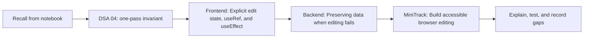
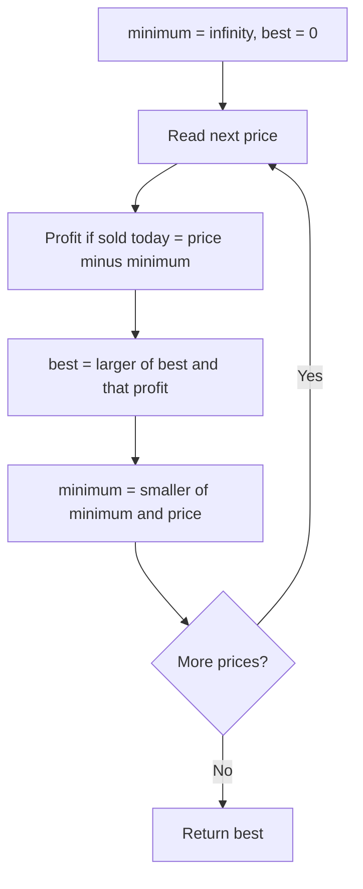
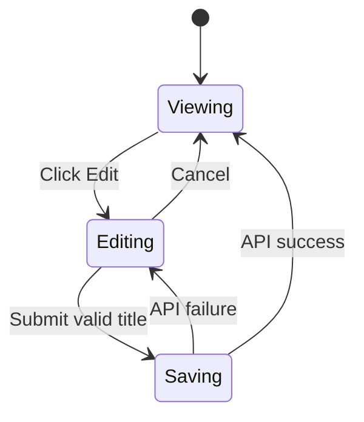

# Prep Day 04 — Build accessible browser editing

**Date:** Saturday, November 28, 2026  
**Time:** 7 study hours plus breaks  
**Starting point:** App Days 1–4 are complete. Continue from the current learner workspace and the previous preparation-day exit checklist.  
**Goal:** Build accessible browser editing.

[Prep Day 03](prep-day-03.md) · [Preparation plan](../../docs/FULL_STACK_INTERVIEW_PREP_PLAN.md) · [Track home](README.md) · [Prep Day 05](prep-day-05.md)

**Everything to read today is below.** The original [App Day 7](../day-07.md)
and [DSA Day 04](../../dsa-python/lessons/dsa-day-04.md) remain available for
comparison. This prep day adds Edit, Save, and Cancel controls to
`page.tsx` and uses the title-rename API built in Prep Day 03 without
changing it. Adding, completing, deleting, and filtering came from Prep Days
01–02 and must keep working. Search and shareable URL filters belong to Prep
Day 05. Write runnable code in the named project and practice files, not in
this Markdown file.

## Learning objectives

- explain explicit edit state, useRef, and useEffect in beginner-friendly language;
- explain preserving data when editing fails and its failure boundary;
- implement or verify the listed MiniTrack milestone;
- solve DSA Day 04 using the one-pass invariant pattern;
- record the result in your rough notebook and explain it without reading.

## 1. Start with notebook recall (45 minutes)

Before opening a lesson, write answers in
[`checkpoints/ROUGH/Notes.md`](../../checkpoints/ROUGH/Notes.md):

1. What did yesterday's browser action send to the server?
2. Where is persistent task data stored, and what state is only temporary?
3. What error or edge case can you already predict for today's topic?
4. What do you remember about the **one-pass invariant** pattern?

Use this format:

```md
## Saturday, November 28, 2026

- What:
- Why:
- How MiniTrack uses it:
- What can go wrong:
- First task:
```

Do not copy the source paragraph. Write what you remember, then compare.

## 2. Understand today's full-stack boundary (20 minutes)

**Frontend focus — Explicit edit state, useRef, and useEffect:** State stores which task is being edited and the draft title. A ref points to the rendered input, and an effect focuses it because focus synchronizes React with the browser DOM.

**Backend focus — Preserving data when editing fails:** The server rejects invalid or missing updates explicitly. The client should keep edit mode and the draft value when the request fails so the user can correct or retry it.

**Today's connection:** Local draft state supports interaction while PostgreSQL remains the final persisted state.



## 3. Python DSA practice (1 hour 45 minutes)

**Practice file:** [`dsa-python/practice/day-04.py`](../../dsa-python/practice/day-04.py)  
**Pattern:** one-pass invariant

### Problem: Best Time to Buy and Sell Stock

You are given a list of daily stock prices, where `prices[i]` is the price on
day `i`. Buy **once** and sell **once**, on a **later** day. Return the
largest possible profit, or `0` if no profitable trade exists. Assume prices
are non-negative numbers; an empty list returns `0`.

```python
solve([7, 1, 5, 3, 6, 4])  # 5  (buy at 1, sell at 6)
solve([7, 6, 4, 3, 1])     # 0  (prices only fall)
```

The trap: you cannot sell before you buy. In the first example, `7 - 1 = 6`
would mean selling on day 0 and buying on day 1, which is not allowed.

The simple approach tries every buy day with every later sell day: O(n²). A
faster approach walks the list **once**, remembering the cheapest price seen so
far and the best profit found so far.

### Start coding

In the practice file, replace the `raise NotImplementedError` line with your
own implementation. This is the starting shape:

```python
def solve(prices):
    # Return the best profit from one buy followed by one later sell, or 0.
    raise NotImplementedError
```

Three Python helpers keep the loop short:

- `float('inf')` is "infinity": larger than every number. Starting the
  minimum there means the first real price always becomes the new minimum.
- `max(a, b)` returns the larger value; `min(a, b)` returns the smaller value.
- `price - float('inf')` is negative infinity, so `max(0, price - minimum)`
  safely stays `0` on the first day.



### Invariant to say aloud

Track the lowest price seen before today and the best profit available at the current price.

The order matters: compute today's profit **before** letting today's price
become the minimum, so the buy is always on an earlier day.

### Work in this order

1. Restate the problem and ask about constraints.
2. Give a brute-force approach and its cost before optimizing.
3. Write the invariant above in your own words.
4. Implement without opening the solution for 25 minutes.
5. Test empty, smallest, typical, duplicate, and boundary cases where relevant.
6. Use a small hint if blocked; do not spend the entire block stuck.
7. Compare with the commented reference and re-code the key loop from memory.

From the repository root:

```bash
python3 dsa-python/scripts/check_practice.py 4
python3 -m unittest discover -s dsa-python/tests -v
```

**Expected observation:** the day-specific checker accepts your implementation,
and the completed reference suite still passes. The checker does not test an
empty list or a new minimum that appears after the best trade, so add those.

You can also temporarily add these checks below your `solve` function in the
practice file, then run `python3 dsa-python/practice/day-04.py`:

```python
if __name__ == '__main__':
    assert solve([7, 1, 5, 3, 6, 4]) == 5
    assert solve([7, 6, 4, 3, 1]) == 0
    assert solve([]) == 0
    assert solve([5]) == 0          # One day: no later day to sell.
    assert solve([2, 2]) == 0       # Equal prices: no profit.
    assert solve([1, 2]) == 1
    assert solve([3, 8, 1, 4]) == 5  # Later low of 1 does not beat 8 - 3.
    print('All checks passed')
```

### Brute-force code — reveal after attempting

<details>
<summary>Show the simple solution</summary>

```python
def solve(prices):
    best = 0
    for buy in range(len(prices)):
        # Only later days can be sell days.
        for sell in range(buy + 1, len(prices)):
            best = max(best, prices[sell] - prices[buy])
    return best
```

</details>

This tries every buy/sell pair, up to `n × (n - 1) / 2` pairs, so the time is
O(n²). It uses O(1) extra space.

### Optimized code — reveal after attempting

<details>
<summary>Show the Best Time to Buy and Sell Stock solution</summary>

```python
def solve(prices):
    minimum = float('inf')  # cheapest price on an earlier day
    best = 0                # best profit found so far; 0 means "do not trade"
    for price in prices:
        # Sell today using the cheapest earlier buy.
        best = max(best, price - minimum)
        # Only now may today's price become a future buy candidate.
        minimum = min(minimum, price)
    return best
```

</details>

Each price is read once, so time is O(n). Only two numbers are stored, so extra
space is O(1).

For `[7, 1, 5, 3, 6, 4]`:

| Day | Price | Minimum before | Profit if sold today | Best after | Minimum after |
|---:|---:|---:|---:|---:|---:|
| 0 | 7 | ∞ | −∞ | 0 | 7 |
| 1 | 1 | 7 | −6 | 0 | 1 |
| 2 | 5 | 1 | 4 | 4 | 1 |
| 3 | 3 | 1 | 2 | 4 | 1 |
| 4 | 6 | 1 | 5 | 5 | 1 |
| 5 | 4 | 1 | 3 | 5 | 1 |

Return `5`.

### DSA interview questions and answers

#### DSA Q1. What is the brute-force approach?

**Interview-ready answer:** “For every buy day, I try every later sell day and
keep the largest difference, starting from zero. That checks all valid pairs,
so it is correct, but it takes O(n²) time and O(1) extra space.”

**Example:** For `[7, 1, 5]`, the pairs are `1 - 7`, `5 - 7`, and `5 - 1`;
the best is `4`.

**Follow-up:** Why start the inner loop at `buy + 1`? Selling on the same day
gives zero and selling earlier is not allowed, so only later days matter.

#### DSA Q2. What is the key idea of the one-pass solution?

**Interview-ready answer:** “If I sell today, the best buy is simply the
cheapest earlier price. So I only need to remember that minimum and the best
profit so far while I scan once.”

**Example:** On day 4 of `[7, 1, 5, 3, 6, 4]`, the cheapest earlier price is
`1`, so selling at `6` gives `5`, the answer.

**Follow-up:** This is a simple form of dynamic programming: the best answer
ending at day i depends only on a small summary (the minimum) of days before i.

#### DSA Q3. Why is the solution correct?

**Interview-ready answer:** “Before processing a price, `minimum` is the
lowest price on earlier days and `best` is the best profit using a sell day
before today. Today's best sale is `price - minimum`. Updating `best` first and
`minimum` second keeps both statements true for the next day, so at the end
`best` covers every valid pair.”

**Example:** `[3, 8, 1, 4]`: at `8`, best becomes `5`; at `1`, the minimum
drops to `1`; at `4`, the profit is only `3`, so best stays `5`.

**Follow-up:** What if I update the minimum first? Then a day can "buy and
sell" against itself. Here that only adds a profit of `0`, so the answer is
still right, but the code no longer matches the invariant. In a variant with a
per-trade fee or a minimum holding period, that order can produce wrong
answers.

#### DSA Q4. What are the time and space costs?

**Interview-ready answer:** “O(n) time, because each price is read once with
constant work, and O(1) extra space, because I store only `minimum` and
`best`.”

**Example:** A million prices need a million loop iterations and still only
two stored numbers.

**Follow-up:** O(1) space assumes the input list already exists. For a live
stream of prices, the same two variables work without storing the history.

#### DSA Q5. What edge cases should I test?

**Interview-ready answer:** “An empty list, one price, all equal prices,
strictly falling prices, and a new minimum that appears after the best trade.
I also ask whether prices can be negative or floating point.”

**Example:** `[]`, `[5]`, `[2, 2]`, and `[7, 6, 4, 3, 1]` all return `0`;
`[3, 8, 1, 4]` returns `5`, not `3`.

**Follow-up:** If the interviewer wants the actual buy and sell days, store
the index of the minimum and update a `(buy_day, sell_day)` pair whenever
`best` improves.

#### DSA Q6. What changes if I may make unlimited transactions?

**Interview-ready answer:** “Then I add every positive day-to-day increase,
because any rising stretch can be split into one-day trades with the same total
profit. That is still O(n) time and O(1) space.”

**Example:** `[1, 3, 2, 5]` gives `(3 - 1) + (5 - 2) = 5`, while a single
trade can only make `4`.

**Follow-up:** With at most k transactions or a cooldown day, you need a small
dynamic-programming state per day (for example, holding vs not holding).

## 4. Frontend guided study (1 hour 30 minutes)

### What

State stores which task is being edited and the draft title. A ref points to the rendered input, and an effect focuses it because focus synchronizes React with the browser DOM.

### Why

The browser layer should make state and feedback understandable without taking
ownership of persistent data or security decisions that belong on the server.

### How

Before looking at the code in section 6, sketch the component state, user
event, request, success result, and failure result.

Model the edit UI as a small state machine before writing JSX:



Three new pieces of client-only state live in `page.tsx`:

```ts
const [editingId, setEditingId] = useState<string | null>(null);
const [editTitle, setEditTitle] = useState('');
const editInputRef = useRef<HTMLInputElement>(null);
```

- `editingId` answers **which** task is being edited (`null` means none). A
  plain `true/false` could not say which row to show as a form.
- `editTitle` is the uncommitted draft. It is copied from `task.title` when
  editing starts, so the user can change it without mutating the saved task
  in React state.
- `editInputRef` is a **ref**: a box whose `.current` React fills with the
  real `<input>` element after it appears on screen. Changing a ref does not
  re-render.

`useEffect(callback, [editingId])` runs `callback` **after** React has put the
new UI on screen, and again whenever `editingId` changes. That is the right time
to call the browser's `focus()` and `select()` on the input, because only then
does the input exist:

```ts
useEffect(() => {
  if (editingId) {
    editInputRef.current?.focus();
    editInputRef.current?.select();
  }
}, [editingId]);
```

`?.` means "only call this if `.current` is not `null`". Focus is an external
browser operation, so an effect is appropriate; do not use effects to compute
values that can be derived during rendering (like Prep Day 02's
`visibleTasks`).

Accessibility rules for today:

- every input has a label; the edit input uses a visually hidden `sr-only`
  `<label>` so screen readers announce "Edit Buy milk";
- Edit, Save, and Cancel are real `<button>` elements, reachable with Tab;
- Save is `type="submit"` so **Enter** saves; Cancel is `type="button"` so it
  never submits;
- errors use `role="alert"` so they are announced.

Files to open deliberately:

- `frontend/app/page.tsx`
- `frontend/app/api/tasks/[id]/route.ts`

Answer before coding:

- Which value is persistent, and which value is temporary interaction state?
- What starts this behavior?
- What should the user see while work is pending?
- What should remain unchanged when the operation fails?

## 5. Backend guided study (1 hour 30 minutes)

### What

The server rejects invalid or missing updates explicitly. The client should keep edit mode and the draft value when the request fails so the user can correct or retry it.

### Boundary checklist

- Validate untrusted path, query, and body values.
- Authenticate identity when the route is protected.
- Authorize the resource separately from authentication.
- Bind SQL values rather than concatenating untrusted data.
- Return an explicit success or error status.
- Log internal failures on the server without exposing secrets.

No server file changes today. The browser reuses Prep Day 03's contract in
`frontend/app/api/tasks/[id]/route.ts`:

| Browser sends | Server responds | What the client page must do |
|---|---|---|
| `{"title":"Buy oat milk"}` for an existing task | `200` + updated task | Leave edit mode; call `loadTasks()` |
| `{"title":"   "}` (if the client check is bypassed) | `400` | Stay in edit mode; keep draft; show error |
| A title for a task deleted in another tab | `404` | Stay in edit mode; keep draft; show error |
| Any request while PostgreSQL is down | `500` | Stay in edit mode; keep draft; show error |
| Network failure (server stopped) | `fetch` throws | Stay in edit mode; keep draft; show error |

The client also checks for a blank title before sending, but that is only for a
quick message. The server's `normalizeTitle` check is the real protection,
because any client (curl, a script) can skip the browser.

The rule on the client side: **clear the edit state only after a successful
response.** Clearing it before awaiting the request would lose the user's typing
if the save fails.

## 6. MiniTrack implementation (1 hour)

### Step 1: Add editing to the task board

First try it yourself in passes, running the app after each: add the two state
values and the Edit button, render the edit form, add the focus effect, then
save. Then compare with this full updated `frontend/app/page.tsx`. Code
from Prep Day 02 is unchanged; lines marked `NEW` are today's work.

```tsx
'use client';

import { useCallback, useEffect, useRef, useState, type FormEvent } from 'react';
import type { Task } from './types';

type Filter = 'all' | 'open' | 'done';

export default function Home() {
  // The API supplies this displayed copy; PostgreSQL stores the saved tasks.
  const [tasks, setTasks] = useState<Task[]>([]);
  // These states hold the add draft, chosen filter, and current edit draft.
  const [title, setTitle] = useState('');
  const [filter, setFilter] = useState<Filter>('all');
  const [editingId, setEditingId] = useState<string | null>(null); // NEW
  const [editTitle, setEditTitle] = useState(''); // NEW: uncommitted draft
  // Track mutation status separately from list-loading status.
  const [busy, setBusy] = useState(false);
  const [error, setError] = useState('');
  const editInputRef = useRef<HTMLInputElement>(null); // NEW
  const [loading, setLoading] = useState(true);
  const [loadError, setLoadError] = useState('');
  const currentLoad = useRef<AbortController | null>(null);

  // GET the latest list; cancel an older request before starting a new one.
  const loadTasks = useCallback(async () => {
    currentLoad.current?.abort();
    const controller = new AbortController();
    currentLoad.current = controller;
    setLoading(true);
    setLoadError('');

    try {
      const response = await fetch('/api/tasks', {
        cache: 'no-store',
        signal: controller.signal,
      });
      if (controller.signal.aborted) return;
      if (!response.ok) {
        setLoadError(`Could not load tasks (${response.status})`);
        setLoading(false);
        return;
      }

      const data: Task[] = await response.json();
      if (controller.signal.aborted) return;
      setTasks(data);
      setLoading(false);
    } catch {
      if (controller.signal.aborted) return;
      setLoadError('Could not load tasks. Check your connection and try again.');
      setLoading(false);
    }
  }, []);

  useEffect(() => {
    void loadTasks();
    return () => currentLoad.current?.abort();
  }, [loadTasks]);

  let visibleTasks = tasks;
  if (filter === 'open') {
    visibleTasks = tasks.filter(task => !task.done);
  }
  if (filter === 'done') {
    visibleTasks = tasks.filter(task => task.done);
  }

  // NEW: after the edit input is on screen, move keyboard focus into it.
  useEffect(() => {
    if (editingId) {
      editInputRef.current?.focus();
      editInputRef.current?.select();
    }
  }, [editingId]);

  // Save a new task, then reload the list from the API.
  async function addTask(event: FormEvent<HTMLFormElement>) {
    event.preventDefault();
    const cleanTitle = title.trim();
    if (!cleanTitle) {
      setError('Enter a task title.');
      return;
    }

    setBusy(true);
    setError('');
    try {
      const response = await fetch('/api/tasks', {
        method: 'POST',
        headers: { 'Content-Type': 'application/json' },
        body: JSON.stringify({ title: cleanTitle }),
      });

      if (!response.ok) {
        setError(`Could not add task (${response.status})`);
        setBusy(false);
        return;
      }

      setTitle('');
      await loadTasks();
      setBusy(false);
    } catch {
      setError('Could not connect to the server');
      setBusy(false);
    }
  }

  // Send the checkbox value to the API; do not mutate the task locally.
  async function toggleTask(taskId: string, done: boolean) {
    setBusy(true);
    setError('');
    try {
      const response = await fetch(`/api/tasks/${taskId}`, {
        method: 'PATCH',
        headers: { 'Content-Type': 'application/json' },
        body: JSON.stringify({ done }),
      });

      if (!response.ok) {
        setError(`Could not update task (${response.status})`);
        setBusy(false);
        return;
      }

      await loadTasks();
      setBusy(false);
    } catch {
      setError('Could not connect to the server');
      setBusy(false);
    }
  }

  // Delete by ID, then reload so the saved list is displayed.
  async function deleteTask(taskId: string) {
    setBusy(true);
    setError('');
    try {
      const response = await fetch(`/api/tasks/${taskId}`, { method: 'DELETE' });

      if (!response.ok) {
        setError(`Could not delete task (${response.status})`);
        setBusy(false);
        return;
      }

      await loadTasks();
      setBusy(false);
    } catch {
      setError('Could not connect to the server');
      setBusy(false);
    }
  }

  // NEW: copy the saved title into the draft; never edit the task prop itself.
  function startEditing(task: Task) {
    setEditingId(task.id);
    setEditTitle(task.title);
    setError('');
  }

  // NEW: discard the draft without any request.
  function cancelEditing() {
    setEditingId(null);
    setEditTitle('');
    setError('');
  }

  // NEW: send only the title; leave edit mode only after the server agrees.
  async function saveTask(event: FormEvent<HTMLFormElement>) {
    event.preventDefault();
    if (!editingId) return;

    const cleanTitle = editTitle.trim();
    if (!cleanTitle) {
      setError('Task title cannot be empty.');
      return;
    }

    setBusy(true);
    setError('');
    try {
      const response = await fetch(`/api/tasks/${editingId}`, {
        method: 'PATCH',
        headers: { 'Content-Type': 'application/json' },
        body: JSON.stringify({ title: cleanTitle }),
      });

      if (!response.ok) {
        // Keep editingId and editTitle so the user can fix or retry.
        setError(`Could not save task (${response.status})`);
        setBusy(false);
        return;
      }

      setEditingId(null);
      setEditTitle('');
      await loadTasks();
      setBusy(false);
    } catch {
      setError('Could not connect to the server');
      setBusy(false);
    }
  }

  return (
    // mx-auto centers the page; max-w-5xl limits width; px/py add padding.
    <main className="mx-auto min-h-screen w-full max-w-5xl px-5 py-12">
      <h1 className="text-4xl font-bold">MiniTrack</h1>
      <section className="mt-8">
      {/* flex displays controls in a row; flex-wrap allows wrapping on small screens. */}
      <form onSubmit={addTask} className="flex flex-wrap gap-3">
        {/* sr-only hides the label visually while screen readers can still use it. */}
        <label htmlFor="task-title" className="sr-only">Task title</label>
        <input
          id="task-title"
          className="min-w-0 flex-1 rounded-lg border border-slate-700 bg-slate-900 px-4 py-2"
          value={title}
          onChange={event => setTitle(event.target.value)}
          placeholder="What needs doing?"
          maxLength={200}
          disabled={busy || loading}
        />
        <button
          type="submit"
          className="rounded-lg bg-violet-600 px-4 py-2 disabled:opacity-50"
          disabled={busy || loading}
        >
          {busy ? 'Adding...' : 'Add task'}
        </button>
      </form>

      <label className="mt-5 flex items-center gap-2 text-sm text-slate-300">
        Show:
        <select
          className="rounded-lg border border-slate-700 bg-slate-950 px-3 py-2"
          value={filter}
          onChange={event => setFilter(event.target.value as Filter)}
        >
          <option value="all">All</option>
          <option value="open">Open</option>
          <option value="done">Done</option>
        </select>
      </label>

      {error && <p role="alert" className="mt-3 text-rose-300">{error}</p>}
      {loading && <p role="status" className="mt-3 text-slate-400">Loading tasks...</p>}
      {loadError && (
        <div role="alert" className="mt-3 text-rose-300">
          <p>{loadError}</p>
          <button type="button" onClick={() => void loadTasks()} disabled={loading}>
            Retry loading tasks
          </button>
        </div>
      )}
      <p className="mt-4 text-slate-400">
        Showing {visibleTasks.length} of {tasks.length} tasks
      </p>

      {visibleTasks.length === 0 ? (
        <p className="mt-4 text-slate-400">No tasks in this filter.</p>
      ) : (
        <ul className="mt-4 overflow-hidden rounded-2xl border border-slate-700 bg-slate-900">
          {visibleTasks.map(task => (
            <li
              key={task.id}
              className="flex items-center gap-3 border-b border-slate-700 px-5 py-4 last:border-b-0"
            >
              <input
                className="size-5 accent-violet-400"
                aria-label={`Complete ${task.title}`}
                type="checkbox"
                checked={task.done}
                disabled={busy || loading}
                onChange={event => {
                  void toggleTask(task.id, event.target.checked);
                }}
              />
              {/* NEW: this row shows either the edit form or the normal view. */}
              {editingId === task.id ? (
                <form className="flex min-w-0 flex-1 items-center gap-2" onSubmit={saveTask}>
                  {/* flex-1 fills the row; gap-2 separates the form controls. */}
                  <label className="sr-only" htmlFor={`edit-${task.id}`}>
                    Edit {task.title}
                  </label>
                  <input
                    id={`edit-${task.id}`}
                    className="min-h-10 min-w-0 flex-1 rounded-lg border border-violet-400 bg-slate-950 px-3 outline-none"
                    ref={editInputRef}
                    value={editTitle}
                    onChange={event => setEditTitle(event.target.value)}
                    maxLength={200}
                    disabled={busy || loading}
                  />
                  <button
                    className="rounded-lg px-3 py-2 text-violet-300 hover:bg-slate-800"
                    type="submit"
                    disabled={busy || loading}
                  >
                    Save
                  </button>
                  <button
                    className="rounded-lg px-3 py-2 text-slate-300 hover:bg-slate-800"
                    type="button"
                    disabled={busy || loading}
                    onClick={cancelEditing}
                  >
                    Cancel
                  </button>
                </form>
              ) : (
                <>
                  <span className={`flex-1 ${task.done ? 'text-slate-500 line-through' : ''}`}>
                    {task.title}
                  </span>
                  <div className="flex items-center gap-1">
                    <button
                      className="rounded-lg px-3 py-2 text-sm text-slate-300 hover:bg-slate-800"
                      type="button"
                      disabled={busy || loading}
                      onClick={() => startEditing(task)}
                    >
                      Edit
                    </button>
                    <button
                      className="rounded-lg px-3 py-2 text-sm text-slate-300 hover:bg-rose-400/10 hover:text-rose-300"
                      disabled={busy || loading}
                      type="button"
                      onClick={() => {
                        void deleteTask(task.id);
                      }}
                    >
                      Delete
                    </button>
                  </div>
                </>
              )}
            </li>
          ))}
        </ul>
      )}
      </section>
    </main>
  );
}
```

Important decisions:

- The draft is local state; the task list is a copy loaded from PostgreSQL.
  Never write `task.title = editTitle`: that changes nothing in the database
  and mutates React state instead of updating it properly.
- This is **not** optimistic UI: the old title stays visible in the list until
  the server confirms and `loadTasks()` reads the list again.
- `<>...</>` is a **fragment**: it groups two elements without adding an
  extra DOM element.
- Starting a second edit simply replaces `editingId` and the draft; the first
  draft is discarded deliberately.

`frontend/lib/tasks.ts` and both Route Handlers do **not** change today.

### Step 2: Run and verify

With PostgreSQL running and `frontend/.env.local` configured, run from the
repository root:

```bash
cd frontend
npm run lint
npm run dev
```

Open `http://localhost:3000` and check each item:

1. Click **Edit**: the row becomes an input with the current title already
   selected, so typing replaces it.
2. Type a new title and press **Enter**: the list shows the new title. Reload:
   it is still there.
3. Click **Edit**, change the text, click **Cancel**: the old title returns.
   In DevTools → Network, no request was sent.
4. Clear the input and press **Enter**: "Task title cannot be empty." appears
   and the row stays in edit mode.
5. Using only the keyboard, **Tab** reaches Edit, the input, Save, and Cancel.
6. Stop PostgreSQL (leave `npm run dev` running), edit, and Save: an error
   appears, the form stays open, and your draft is still there. Restart
   PostgreSQL and press Save again: it succeeds.
7. Ticking, deleting, adding, and filtering still work.

**Expected observation:** the user-visible milestone works, its important
failure path is explicit, and existing behavior remains intact.

**If something fails:**

- The input does not get focus: check `ref={editInputRef}` is on the edit
  input and `editingId` is in the effect's dependency array.
- Every row turns into a form: compare `editingId === task.id`, not just
  `editingId`.
- Save reloads the whole page: `event.preventDefault()` is missing in
  `saveTask`.
- The draft disappears after a failed save: `setEditingId(null)` runs before
  `response.ok` is checked.

## 7. Trace the event or request

```mermaid
sequenceDiagram
  participant U as You
  participant C as page.tsx (browser)
  participant A as api/tasks/[id]/route.ts
  participant P as PostgreSQL
  participant G as api/tasks/route.ts
  U->>C: Click Edit on task 7 "Buy milk"
  C->>C: startEditing: editingId "7", editTitle "Buy milk"
  C->>C: Effect runs after render: focus() and select()
  U->>C: Type "Buy oat milk" and press Enter
  C->>C: saveTask: preventDefault; trim; setBusy(true)
  C->>A: PATCH /api/tasks/7 body {"title":"Buy oat milk"}
  A->>P: UPDATE tasks SET title = $1 WHERE id = $2 RETURNING ...
  P-->>A: Updated row (or no row / error)
  A-->>C: 200 task JSON (or 400 / 404 / 500)
  C->>C: On 200 clear edit state; on failure keep draft and show error
  C->>G: GET /api/tasks (success only)
  G->>P: listTasks()
  P-->>G: Fresh rows
  G-->>C: JSON updates task state
  C-->>U: Row back in viewing mode with the saved title
```

Trace one concrete input. Name every boundary, value, and possible failure.
For example, a blank draft never leaves the browser: `saveTask` stops at the
`trim()` check and keeps edit mode open.

## 8. Deliberate debugging exercise (25 minutes)

**Break it:** Call focus directly while the component is rendering.

**Predict before running:** write the expected symptom in your notebook.

**Expected symptom:** The input may not exist yet, and rendering now has an external side effect.

**Root cause:** DOM synchronization must happen after React commits the element.

**Restore and verify:** Move focus into an effect keyed by the editing task ID.

One way to break it: delete the `useEffect` and instead write
`if (editingId) editInputRef.current?.focus();` directly in the component body
above `return`. Click Edit: on that first render `editInputRef.current` is
still `null` (the input has not been placed on screen yet), so nothing is
focused. React's lint rules may also warn about reading a ref during render.

Do not stop after making the symptom disappear. Explain why the repair restores
the intended invariant.

## 9. Interview questions and answers (30 minutes)

### Q1. What are explicit edit state, useRef, and useEffect?

**Interview-ready answer:** State stores which task is being edited and the draft title. A ref points to the rendered input, and an effect focuses it because focus synchronizes React with the browser DOM.

**Example:** In `frontend/app/page.tsx`, clicking Edit on task 7 sets
`editingId` to `"7"` and `editTitle` to `"Buy milk"`. The row renders an
input with `ref={editInputRef}`, and the effect keyed on `[editingId]` calls
`focus()` and `select()` after that input exists.

**Senior follow-up:** `editingId` and `editTitle` can drift (for example a
draft with no editing ID). If editing grows more complex, combine them into one
state object such as `{ mode: 'editing', id, draft }` or use `useReducer`, so
impossible combinations cannot be represented.

### Q2. How should the backend handle preserving data when editing fails?

**Interview-ready answer:** The server rejects invalid or missing updates explicitly. The client should keep edit mode and the draft value when the request fails so the user can correct or retry it.

**Example:** If task 7 was deleted in another tab, `PATCH /api/tasks/7`
returns 404 from `renameTask` returning `null`. `saveTask` sees
`response.ok === false`, shows "Could not save task (404)", and does not clear
`editingId` or `editTitle`.

**Senior follow-up:** Two tabs renaming the same task is last-write-wins
today. To detect conflicts, add a version or `updated_at` column, send it with
the PATCH, and return 409 when it no longer matches. On 500, log the database
error server-side only; the browser never sees connection details.

### Q3. What invariant makes the one-pass invariant solution correct?

**Interview-ready answer:** Track the lowest price seen before today and the best profit available at the current price.

**Example:** `[7, 1, 5, 3, 6, 4]`: the minimum becomes `1` on day 1; on day
4, `6 - 1 = 5` raises `best` to `5`, which is returned.

**Senior follow-up:** O(n) time and O(1) space hold for one transaction. If
the problem allows unlimited trades, sum positive daily increases; with at most
k trades or fees, you need a dynamic-programming state per day.

### Q4. How does today's work fit the complete MiniTrack system?

**Interview-ready answer:** Local draft state supports interaction while PostgreSQL remains the final persisted state.

**Example:** `editTitle` holds "Buy oat milk" only in the browser until
`PATCH /api/tasks/7` returns 200. Then `loadTasks()` calls `GET /api/tasks`,
the route reads PostgreSQL, and the page shows the saved title.

**Senior follow-up:** Each save costs a PATCH plus a refresh read. If users
find saving slow, measure that latency first; optimistic UI could show the new
title immediately but would need rollback on failure and handling for stale
responses that finish out of order.

## 10. Complexity and operational cost

- **DSA:** O(n) time and O(1) space.
- **Application:** Finding the edited task is O(n) in a simple rendered list. Focus is constant work; the network update dominates latency.
- **Learning:** Attempting, retrieving, and correcting is more valuable than
  copying several solutions. Keep the scope to one understood pattern today.

## Exit checklist

- [ ] I completed DSA Day 04 before reading its solution.
- [ ] I can state the invariant and complexity without notes.
- [ ] I completed or verified the MiniTrack milestone.
- [ ] I tested one success path and one failure path.
- [ ] I completed the deliberate debugging exercise.
- [ ] I answered all four interview questions aloud.
- [ ] I recorded what remains confusing and tomorrow's first task.

**Suggested commit:** `prep day 04: build accessible browser editing`
