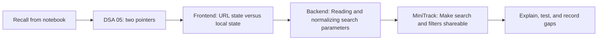
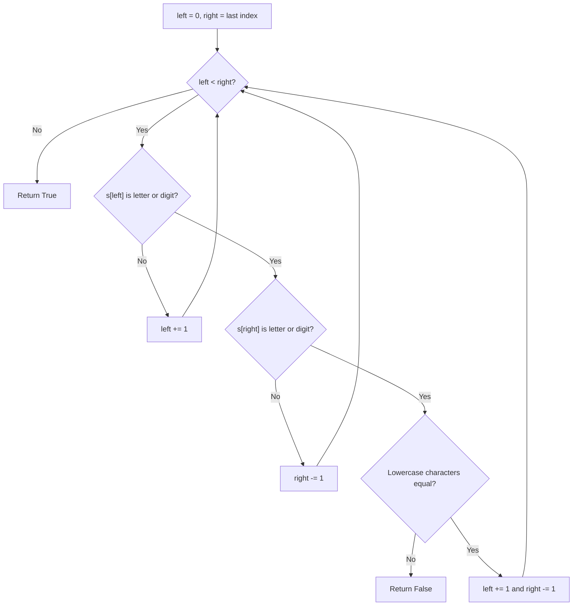
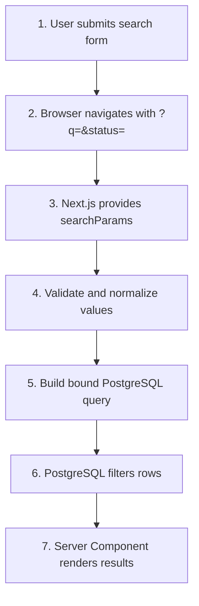
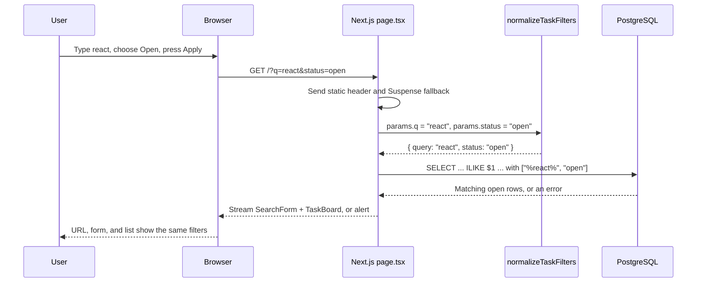

# Prep Day 05 — Make search and filters shareable

> **Architecture transition:** This lesson still uses server-rendered task
> data and has not yet been adapted to the client-fetch page introduced in
> Prep Days 01–04. Its page and task-board code cannot be applied directly
> to that client page without further changes.

**Date:** Monday, November 30, 2026  
**Time:** 7 study hours plus breaks  
**Starting point:** App Days 1–4 are complete. Continue from the current learner workspace and the previous preparation-day exit checklist.  
**Goal:** Make search and filters shareable.

[Prep Day 04](prep-day-04.md) · [Preparation plan](../../docs/FULL_STACK_INTERVIEW_PREP_PLAN.md) · [Track home](README.md) · [Prep Day 06](prep-day-06.md)

**Everything to read today is below.** The original [App Day 8](../day-08.md)
and [DSA Day 05](../../dsa-python/lessons/dsa-day-05.md) remain available for
comparison. This prep day covers the URL contract, normalizing `q` and
`status`, the GET search form, and a first parameterized PostgreSQL filter.
Title editing belongs to Prep Days 03–04. Making `%` and `_` literal,
filtering the JSON API, and the search loading/empty/error states belong to
Prep Day 06; automated tests begin on Prep Day 07. Write runnable code in the
named project and practice files, not in this Markdown file.

## Learning objectives

- explain url state versus local state in beginner-friendly language;
- explain reading and normalizing search parameters and its failure boundary;
- implement or verify the listed MiniTrack milestone;
- solve DSA Day 05 using the two pointers pattern;
- record the result in your rough notebook and explain it without reading.

## 1. Start with notebook recall (45 minutes)

Before opening a lesson, write answers in
[`checkpoints/ROUGH/Notes.md`](../../checkpoints/ROUGH/Notes.md):

1. What did yesterday's browser action send to the server?
2. Where is persistent task data stored, and what state is only temporary?
3. What error or edge case can you already predict for today's topic?
4. What do you remember about the **two pointers** pattern?

Use this format:

```md
## Monday, November 30, 2026

- What:
- Why:
- How MiniTrack uses it:
- What can go wrong:
- First task:
```

Do not copy the source paragraph. Write what you remember, then compare.

## 2. Understand today's full-stack boundary (20 minutes)

**Frontend focus — URL state versus local state:** Search and filter values belong in the URL when users should reload, bookmark, or share them. Temporary draft text can stay local until the user applies it.

**Backend focus — Reading and normalizing search parameters:** The server treats query parameters as untrusted strings, normalizes allowed values, and passes a typed filter to the data function.

**Today's connection:** The URL becomes the input to server rendering, so navigation and data selection describe the same state.



## 3. Python DSA practice (1 hour 45 minutes)

**Practice file:** [`dsa-python/practice/day-05.py`](../../dsa-python/practice/day-05.py)  
**Pattern:** two pointers

### Problem: Valid Palindrome

Given a string, return `True` if it reads the same forwards and backwards
after you **ignore** every character that is not a letter or digit and treat
uppercase and lowercase letters as equal. Otherwise return `False`.
Assume an empty string, or a string with no letters or digits, counts as a
palindrome.

```python
solve('A man, a plan, a canal: Panama')  # True  ("amanaplanacanalpanama")
solve('race a car')                      # False ("raceacar" reversed is "racaecar")
```

The simple approach builds a cleaned copy and compares it with its reverse:
O(n) time but O(n) extra space. Two pointers give the same answer with O(1)
extra space by reading the original string from both ends.

### Start coding

In the practice file, replace the `raise NotImplementedError` line with your
own implementation. This is the starting shape:

```python
def solve(s):
    # Return True if s is a palindrome when only letters and digits count.
    raise NotImplementedError
```

Three small Python tools are useful:

- `ch.isalnum()` returns `True` when the one-character string `ch` is a
  letter or a digit. For example, `'a'.isalnum()` and `'7'.isalnum()` are
  `True`, while `','.isalnum()` and `' '.isalnum()` are `False`.
- `ch.lower()` returns the lowercase version, so `'A'.lower()` is `'a'`.
- Inside a loop, `continue` skips the rest of the current pass and starts the
  next pass immediately.

A **pointer** here is just an index variable. `left` starts at the first index
and `right` starts at the last index; they walk toward each other.



### Invariant to say aloud

Move inward from both ends while skipping ignored characters and comparing normalized values.

More precisely: every character outside `left..right` has already been either
skipped or matched with its mirror partner, so only the middle part can still
break the palindrome.

### Work in this order

1. Restate the problem and ask about constraints.
2. Give a brute-force approach and its cost before optimizing.
3. Write the invariant above in your own words.
4. Implement without opening the solution for 25 minutes.
5. Test empty, smallest, typical, duplicate, and boundary cases where relevant.
6. Use a small hint if blocked; do not spend the entire block stuck.
7. Compare with the commented reference and re-code the key loop from memory.

From the repository root:

```bash
python3 dsa-python/scripts/check_practice.py 5
python3 -m unittest discover -s dsa-python/tests -v
```

**Expected observation:** the day-specific checker prints `Case 1 passed` and
`Case 2 passed` for the two sample strings above, and the completed reference
suite still passes. Two samples are not a complete test, so add your own.

You can also temporarily add these checks below your `solve` function in the
practice file, then run `python3 dsa-python/practice/day-05.py`:

```python
if __name__ == '__main__':
    assert solve('A man, a plan, a canal: Panama') is True
    assert solve('race a car') is False
    assert solve('') is True           # Nothing to compare.
    assert solve(' ') is True          # Only ignored characters.
    assert solve('.,!') is True
    assert solve('a') is True
    assert solve('Aa') is True         # Case is ignored.
    assert solve('ab') is False
    assert solve('0P') is False        # Digits count and are not letters.
    assert solve('ab,A') is True       # Cleaned text is "aba".
    print('All checks passed')
```

Remove the block before committing if you prefer to keep practice files clean.

### Brute-force code — reveal after attempting

<details>
<summary>Show the simple solution</summary>

```python
def solve(s):
    # Keep only letters and digits, all in lowercase.
    cleaned = ''.join(ch.lower() for ch in s if ch.isalnum())
    # cleaned[::-1] is a reversed copy of the string.
    return cleaned == cleaned[::-1]
```

</details>

There is no slower "try everything" version worth writing here, so this is
the simpler alternative. It visits each character a constant number of times:
O(n) time. It builds the cleaned string and its reversed copy: O(n) extra
space. It is a good first answer; the interviewer's follow-up is usually
"can you avoid the copy?"

### Optimized code — reveal after attempting

<details>
<summary>Show the two-pointer solution</summary>

```python
def solve(s):
    left, right = 0, len(s) - 1
    while left < right:
        # Skip ignored characters on the left before comparing.
        if not s[left].isalnum():
            left += 1
            continue
        # Skip ignored characters on the right before comparing.
        if not s[right].isalnum():
            right -= 1
            continue
        if s[left].lower() != s[right].lower():
            return False
        left += 1
        right -= 1
    return True
```

</details>

Each pass moves at least one pointer inward, so the loop runs at most `n`
times: O(n) time and O(1) extra space. For an empty string `right` starts at
`-1`, the loop never runs, and the answer is `True`.

Trace for `'ab,A'` (indices `0:a`, `1:b`, `2:,`, `3:A`):

| Pass | left | right | Characters | Action |
|---:|---:|---:|---|---|
| 1 | 0 | 3 | `a` and `A` | Both kept; `a == a`; move both inward |
| 2 | 1 | 2 | `b` and `,` | Right is ignored; `right -= 1` |
| 3 | 1 | 1 | — | `left < right` is false; return `True` |

The middle `b` never needs a partner, which is why the loop stops when the
pointers meet.

### DSA interview questions and answers

#### DSA Q1. What is the brute-force or simple approach?

**Interview-ready answer:** “I build a cleaned string containing only the
lowercase letters and digits, then compare it with its reverse. That is O(n)
time and O(n) extra space because of the copy.”

**Example:** `'race a car'` becomes `'raceacar'`; its reverse is
`'racaecar'`, so the answer is `False`.

**Follow-up:** Is building the copy wrong? No. It is clear and correct. Offer
it first, then improve space if the interviewer asks or if strings can be
very large.

#### DSA Q2. How do two pointers improve the solution?

**Interview-ready answer:** “I compare the first and last useful characters
directly in the original string. One pointer starts at the left and one at
the right. I skip ignored characters, compare lowercase values, and move both
pointers inward after a match. No cleaned copy is needed.”

**Example:** In `'A man, a plan...'`, the first comparison is `A` against the
final `a`; they match after `.lower()`.

**Follow-up:** Why skip only one pointer per pass and then `continue`? It keeps
each pass simple and re-checks `left < right` after every move, so the
pointers can never cross while skipping punctuation.

#### DSA Q3. Why is the algorithm correct?

**Interview-ready answer:** “Before each pass, every kept character outside
`left..right` has already been matched with its mirror partner. If I find a
mismatch, the string cannot be a palindrome. If the pointers meet or cross
without a mismatch, every pair matched, so it is a palindrome.”

**Example:** For `'ab,A'`, the outer `a`/`A` pair matches; the comma is
skipped; the middle `b` has no partner to compare.

**Follow-up:** What would break the invariant? Comparing before skipping. Then
`'a,'` would compare `a` with `,` and wrongly return `False`.

#### DSA Q4. What are the time and space costs?

**Interview-ready answer:** “O(n) time because each pass moves at least one
pointer and the pointers move at most `n` positions in total. O(1) extra
space because I store only two integer indices.”

**Example:** For `'.,!'`, the left pointer skips punctuation until it meets
the right pointer: at most three moves.

**Follow-up:** Are there hidden costs? `str.lower()` on one character is
constant work. For full Unicode case rules, `str.casefold()` is more correct
than `lower()` for some languages, but it can change string length in rare
cases, so clarify requirements.

#### DSA Q5. What edge cases should I test?

**Interview-ready answer:** “An empty string, only punctuation or spaces, one
character, mixed case, digits mixed with letters, and punctuation at either
end. I also confirm whether digits count and how case should be compared.”

**Example:** `''` and `' '` return `True`; `'0P'` returns `False` because
`0` and `p` differ.

**Follow-up:** Why does `'0P'` matter? It catches implementations that only
keep letters with `isalpha()` and therefore ignore the digit.

#### DSA Q6. What if one deletion is allowed?

**Interview-ready answer:** “That is the ‘valid palindrome II’ variant. I run
the same two pointers. At the first mismatch, I check whether skipping the left
character or skipping the right character leaves a palindrome for the middle
part. Each check is a plain two-pointer scan, so the total is still O(n) time
and O(1) space.”

**Example:** For `'abca'`, the first mismatch is `b` versus `c`; skipping `c`
leaves `'aba'`, so the answer is `True`.

**Follow-up:** Why not try deleting every character? That is n deletions times
an O(n) check: O(n²). The first mismatch is the only place a deletion can
help.

## 4. Frontend guided study (1 hour 30 minutes)

### What

Search and filter values belong in the URL when users should reload, bookmark, or share them. Temporary draft text can stay local until the user applies it.

### Why

The browser layer should make state and feedback understandable without taking
ownership of persistent data or security decisions that belong on the server.

Compare the two kinds of state already in MiniTrack:

| Value | Where it lives | Survives reload? | Shareable? |
|---|---|---|---|
| `title` draft in `TaskBoard` | React `useState` | No | No |
| `editingId` and `editTitle` (Prep Day 04) | React `useState` | No | No |
| Day 5 `filter` in the **Show** select | React `useState` | No | No |
| `q` and `status` after today | URL: `/?q=react&status=open` | Yes | Yes |
| Task rows | PostgreSQL | Yes | Yes (through the server) |

### How

Today's URL contract is:

```text
/?q=react&status=open
```

- `q` is trimmed and limited to 100 characters;
- `status` is `all`, `open`, or `done`;
- a missing or unknown value means `q=""` and `status="all"`.



The form uses `method="GET"`. When a GET form is submitted, the browser
itself turns each named field into the query string: `name="q"` becomes `q=`
and `name="status"` becomes `status=`. No JavaScript, `useState`, or `fetch`
is needed, so there are no debounce timers or out-of-order responses yet.

Create `frontend/app/SearchForm.tsx`. It has no `'use client'`, so it is a
Server Component:

```tsx
import type { TaskFilters } from '../lib/validation';

export default function SearchForm({ filters }: { filters: TaskFilters }) {
  return (
    // method="GET" puts the field values in the URL: /?q=...&status=...
    <form
      className="my-6 grid gap-3 rounded-2xl border border-slate-700 bg-slate-900 p-4 sm:grid-cols-[1fr_auto_auto]"
      method="GET"
    >
      <label>
        <span className="sr-only">Search task titles</span>
        <input
          className="min-h-11 w-full rounded-lg border border-slate-700 bg-slate-950 px-3"
          type="search"
          name="q"
          // defaultValue: the browser owns the draft; the URL owns the applied value.
          defaultValue={filters.query}
          placeholder="Search tasks"
          maxLength={100}
        />
      </label>

      <label>
        <span className="sr-only">Task status</span>
        <select
          className="min-h-11 rounded-lg border border-slate-700 bg-slate-950 px-3"
          name="status"
          defaultValue={filters.status}
        >
          <option value="all">All</option>
          <option value="open">Open</option>
          <option value="done">Done</option>
        </select>
      </label>

      <button className="min-h-11 rounded-lg bg-violet-500 px-5 font-bold">
        Apply
      </button>
    </form>
  );
}
```

`defaultValue` (instead of `value`) makes these **uncontrolled** inputs: the
browser keeps the draft the user is typing, and React only supplies the
starting value from the URL. Typing does not change the URL; pressing
**Apply** or **Enter** does. That is the "draft stays local until applied"
rule from the What section.

Files to open deliberately:

- `frontend/app/page.tsx`
- `frontend/app/TaskBoard.tsx`
- `frontend/lib/tasks.ts`

Answer before coding:

- Which value is persistent, and which value is temporary interaction state?
- What starts this behavior?
- What should the user see while work is pending?
- What should remain unchanged when the operation fails?

**Leave `TaskBoard.tsx` unchanged today.** It still has the Day 5 **Show**
select (`useState<Filter>`). That select only narrows the list the server has
already filtered, and it is lost on reload. Keep it for now as the contrast in
today's debugging exercise.

## 5. Backend guided study (1 hour 30 minutes)

### What

The server treats query parameters as untrusted strings, normalizes allowed values, and passes a typed filter to the data function.

### Boundary checklist

- Validate untrusted path, query, and body values.
- Authenticate identity when the route is protected.
- Authorize the resource separately from authentication.
- Bind SQL values rather than concatenating untrusted data.
- Return an explicit success or error status.
- Log internal failures on the server without exposing secrets.

### Step 1: Add one shared filter type and normalizer

Anyone can type `/?status=banana&q=` followed by 10,000 characters. The
normalizer turns any input into one of a few safe shapes.

Replace `frontend/lib/validation.ts` with this complete file. The first three
functions are unchanged from Prep Day 02; the filter code is new:

```ts
export function normalizeTitle(value: unknown): string | null {
  if (typeof value !== 'string') return null;
  const title = value.trim();
  return title.length >= 1 && title.length <= 200 ? title : null;
}

export function isValidId(raw: string): boolean {
  return /^[1-9]\d*$/.test(raw) && Number.isSafeInteger(Number(raw));
}

export function isRecord(value: unknown): value is Record<string, unknown> {
  return typeof value === 'object' && value !== null && !Array.isArray(value);
}

// New today: the only three status values the app understands.
export type TaskStatus = 'all' | 'open' | 'done';

export type TaskFilters = {
  query: string;
  status: TaskStatus;
};

export function normalizeTaskFilters(
  queryValue: unknown,
  statusValue: unknown,
): TaskFilters {
  // Anything that is not a string (missing, or an array from ?q=a&q=b) becomes ''.
  const query =
    typeof queryValue === 'string'
      ? queryValue.trim().slice(0, 100)
      : '';

  // An allowlist: unknown values fall back to 'all' instead of reaching SQL.
  const status: TaskStatus =
    statusValue === 'open' || statusValue === 'done'
      ? statusValue
      : 'all';

  return { query, status };
}
```

`slice(0, 100)` keeps at most the first 100 characters. Falling back to
defaults is a deliberate policy for a page; an API could return `400`
instead. Documenting the choice matters more than pretending only one policy
is valid.

| Raw URL | Normalized `TaskFilters` |
|---|---|
| `/` | `{ query: '', status: 'all' }` |
| `/?q=%20%20React%20%20&status=open` | `{ query: 'React', status: 'open' }` |
| `/?status=banana` | `{ query: '', status: 'all' }` |
| `/?q=a&q=b` | `{ query: '', status: 'all' }` (array is not a string) |

### Step 2: Add a first filtered query

Add this function to the end of `frontend/lib/tasks.ts`, and add the import at
the top. Keep every existing function (`listTasks`, `createTask`, `setDone`,
`deleteTask`, and Prep Day 03's `renameTask`):

```ts
// Add near the other imports at the top of the file.
import type { TaskFilters } from './validation';

// Add after the existing functions.
export async function searchTasks(filters: TaskFilters): Promise<Task[]> {
  // First version: % and _ typed by a user still act as LIKE wildcards.
  // Prep Day 06 escapes them so they are matched literally.
  const pattern = `%${filters.query}%`;

  const result = await getPool().query<TaskRow>(
    `
      SELECT id, title, done, created_at
      FROM tasks
      WHERE title ILIKE $1
        AND (
          $2::text = 'all'
          OR done = ($2::text = 'done')
        )
      ORDER BY id
    `,
    // Values travel separately from the SQL text.
    [pattern, filters.status],
  );

  return result.rows.map(toTask);
}
```

How the SQL reads:

- `ILIKE` is case-insensitive pattern matching. In a pattern, `%` means "any
  characters". So `%react%` matches any title containing `react`, `React`,
  or `REACT`. An empty query gives `%%`, which matches every title.
- `$2::text` tells PostgreSQL to treat parameter 2 as text.
- `$2::text = 'all' OR ...` lets every row through when the status is `all`.
- `done = ($2::text = 'done')` compares the `done` column with a boolean:
  `true` when status is `done`, `false` when status is `open`.

The SQL structure is fixed; only bound values change. A title containing a
quote such as `Bob's task` is data, not SQL syntax.

## 6. MiniTrack implementation (1 hour)

**Milestone source:** Day 8 URL-backed search and status filters

1. Read searchParams in the Server Component.
2. Build a form or navigation update that writes q and status to the URL.
3. Verify reload and copied URLs preserve the result.

### Step 1: Read searchParams in the page

Next.js gives a page its query string as `searchParams`, which is a
**Promise**. Awaiting it inside the `Suspense` subtree makes only that part
request-specific, so the header stays in the static shell. You do not need
`io()` in this component: awaiting `searchParams` already marks it as
request-time. Do not add `dynamic = 'force-dynamic'`.

Replace `frontend/app/page.tsx` with:

```tsx
import { Suspense } from 'react';
import SearchForm from './SearchForm';
import TaskBoard from './TaskBoard';
import { searchTasks } from '../lib/tasks';
import { normalizeTaskFilters } from '../lib/validation';
import type { Task } from './types';

type PageProps = {
  searchParams: Promise<{
    q?: string;
    status?: string;
  }>;
};

async function TaskResults({ searchParams }: PageProps) {
  // Awaiting searchParams makes this subtree request-specific.
  const params = await searchParams;
  const filters = normalizeTaskFilters(params.q, params.status);

  let tasks: Task[] = [];
  let error: string | null = null;
  try {
    tasks = await searchTasks(filters);
  } catch (err) {
    error = err instanceof Error ? err.message : 'Unable to load tasks';
  }

  return (
    <>
      {/* The form shows the same filters the URL and SQL used. */}
      <SearchForm filters={filters} />
      {error ? (
        <p
          className="rounded-xl border border-rose-400/30 bg-rose-400/10 p-4 text-rose-200"
          role="alert"
        >
          Could not load tasks: {error}. Check PostgreSQL and DATABASE_URL.
        </p>
      ) : (
        <TaskBoard tasks={tasks} />
      )}
    </>
  );
}

export default function Home({ searchParams }: PageProps) {
  return (
    <main className="mx-auto min-h-screen w-full max-w-5xl px-5 py-12">
      <header className="mb-8">
        <p className="text-sm font-semibold uppercase tracking-widest text-violet-300">
          Your workspace
        </p>
        <h1 className="mt-3 text-4xl font-bold tracking-tight">MiniTrack</h1>
        <p className="mt-2 text-slate-400">
          Simple tasks. Serious full-stack concepts.
        </p>
      </header>

      <Suspense fallback={<p className="mt-8 text-slate-400">Filtering tasks...</p>}>
        <TaskResults searchParams={searchParams} />
      </Suspense>
    </main>
  );
}
```

`Home` is not `async`; it passes the unresolved Promise down. `TaskResults`
awaits it, normalizes once, and uses the same `filters` for both the SQL call
and the form's default values, so the screen and the URL cannot disagree.
`listTasks` is no longer used by the page; keep it in `tasks.ts` because
`GET /api/tasks` still uses it until Prep Day 06.

### Step 2: Run and verify

With PostgreSQL running and `frontend/.env.local` configured, from the
repository root:

```bash
cd frontend
npx tsc --noEmit
npm run lint
npm run dev
```

Add tasks such as `Learn React`, `Review SQL`, and `React testing`, then mark
`Review SQL` done. Check each case:

1. Type `react`, choose **Open**, press **Apply**. The address bar shows
   `/?q=react&status=open` and only open titles containing "react" appear.
2. Reload. The same results and the same form values remain.
3. Copy the URL into a new tab. The same view appears.
4. Apply a second search, then press the browser **Back** button. The previous
   search and results return.
5. Visit `/?status=banana`. The select shows **All** and all tasks appear.
6. Visit `/?q=zzzz`. The board shows its empty message.
7. Add, complete, edit, and delete a task while a filter is applied; each
   still works and the list refreshes through `router.refresh()`.

**Expected observation:** the user-visible milestone works, its important
failure path is explicit, and existing behavior remains intact.

**Failure checks:**

- Stop PostgreSQL and reload: the page shows the `role="alert"` message, not
  an empty list that looks like "no matches". Restart PostgreSQL afterwards.
- If the URL changes but results do not, confirm the inputs have `name="q"`
  and `name="status"` and that `TaskResults` passes `filters` to `searchTasks`.
- If TypeScript reports that `searchParams` is not a Promise, check the
  `PageProps` type and that you `await` it.

**Known gap for Prep Day 06:** searching for `%` currently matches every
title because `%` is still a wildcard. That is a search-semantics bug, not
SQL injection: the value is bound.

## 7. Trace the event or request



Trace one concrete input. Name every boundary, value, and possible failure.

## 8. Deliberate debugging exercise (25 minutes)

**Break it:** Keep the active filter only in component state.

You do not need to write new code: the Day 5 **Show** select in `TaskBoard`
is exactly this design. Choose **Done** in that select (not in the search
form), copy the URL, and reload.

**Predict before running:** write the expected symptom in your notebook.

**Expected symptom:** Reloading or sharing the URL loses the selected view.

**Root cause:** Local state is not a durable navigation representation.

**Restore and verify:** Move committed filter state into search parameters.
Use the search form's **Status** select instead, reload, and confirm
`status=done` survives in the URL and on screen.

Do not stop after making the symptom disappear. Explain why the repair restores
the intended invariant.

## 9. Interview questions and answers (30 minutes)

### Q1. What is url state versus local state?

**Interview-ready answer:** Search and filter values belong in the URL when users should reload, bookmark, or share them. Temporary draft text can stay local until the user applies it.

**Example:** In `frontend/app/SearchForm.tsx`, the search input uses
`defaultValue={filters.query}`, so typing is a local browser draft. Pressing
**Apply** submits the GET form and the URL becomes `/?q=react&status=open`.
In contrast, `TaskBoard`'s `title` and `editTitle` are `useState` drafts that
should never appear in the URL.

**Senior follow-up:** URL state becomes hard to maintain when there are many
interdependent parameters, when values are large, or when they are private
(never put tokens or personal data in a URL; it ends up in history and logs).
If users need live search, measure request volume first, then add debouncing
and cancellation while still writing the committed value to the URL.

### Q2. How should the backend handle reading and normalizing search parameters?

**Interview-ready answer:** The server treats query parameters as untrusted strings, normalizes allowed values, and passes a typed filter to the data function.

**Example:** `normalizeTaskFilters(params.q, params.status)` turns
`/?q=  React  &status=banana` into `{ query: 'React', status: 'all' }`.
`searchTasks(filters)` then binds `'%React%'` and `'all'` as `$1` and `$2`.

**Senior follow-up:** A silent fallback is friendly for a page, but an API
client may prefer `400` so mistakes are visible. Either way, never log or
echo raw query strings that may contain personal data, and when PostgreSQL is
unavailable show a generic error rather than an empty "no matches" list.

### Q3. What invariant makes the two pointers solution correct?

**Interview-ready answer:** Move inward from both ends while skipping ignored characters and comparing normalized values.

**Example:** For `'ab,A'`: compare `a` with `A` (match), skip the comma,
then the pointers meet at `b`, so return `True`. For `'race a car'`, the
first mismatch is `e` versus `a`, so return `False`.

**Senior follow-up:** O(n) time and O(1) space assume `isalnum()` and
`lower()` are constant-time per character. If full Unicode case folding is
required, `casefold()` is more correct, and if the input is a stream that can
only be read forwards, two pointers no longer apply directly.

### Q4. How does today's work fit the complete MiniTrack system?

**Interview-ready answer:** The URL becomes the input to server rendering, so navigation and data selection describe the same state.

**Example:** Applying the form sends `GET /?q=react&status=open`. The page
awaits `searchParams`, normalizes it, runs one parameterized `SELECT`, and
streams `SearchForm` plus `TaskBoard`. A colleague opening the same URL gets
the same view.

**Senior follow-up:** The first bottleneck to measure is the `%react%`
`ILIKE` query, which can scan every row. Check it with `EXPLAIN` on realistic
data before adding an index. The first security risk is tomorrow's wildcard
semantics and, later, making sure filters are always combined with the
signed-in owner.

## 10. Complexity and operational cost

- **DSA:** O(n) time and O(1) auxiliary space.
- **Application:** Parsing query parameters is constant for this fixed filter set. Database cost depends on selectivity and indexing, which must be measured.
- **Learning:** Attempting, retrieving, and correcting is more valuable than
  copying several solutions. Keep the scope to one understood pattern today.

## Exit checklist

- [ ] I completed DSA Day 05 before reading its solution.
- [ ] I can state the invariant and complexity without notes.
- [ ] I completed or verified the MiniTrack milestone.
- [ ] I tested one success path and one failure path.
- [ ] I completed the deliberate debugging exercise.
- [ ] I answered all four interview questions aloud.
- [ ] I recorded what remains confusing and tomorrow's first task.

**Suggested commit:** `prep day 05: make search and filters shareable`
