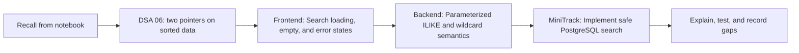
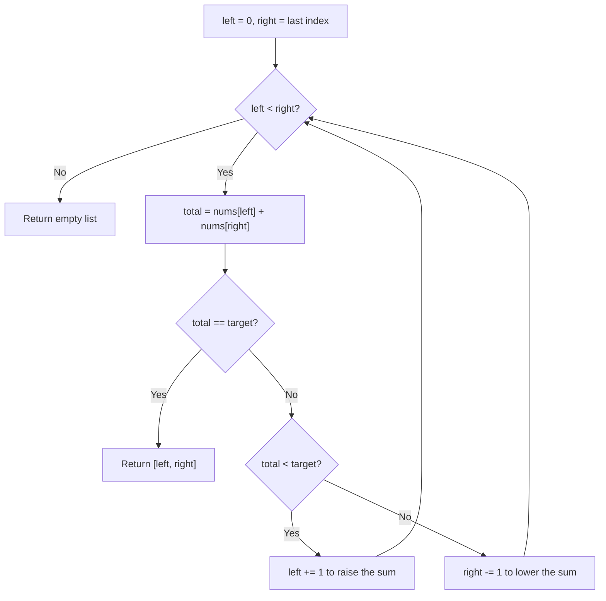
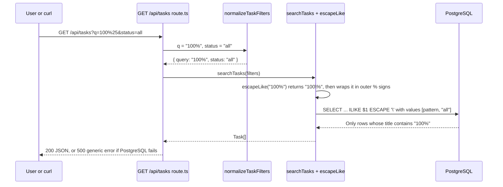

# Prep Day 06 — Implement safe PostgreSQL search

**Date:** Tuesday, December 1, 2026  
**Time:** 7 study hours plus breaks  
**Starting point:** App Days 1–4 are complete. Continue from the current learner workspace and the previous preparation-day exit checklist.  
**Goal:** Implement safe PostgreSQL search.

[Prep Day 05](prep-day-05.md) · [Preparation plan](../../docs/FULL_STACK_INTERVIEW_PREP_PLAN.md) · [Track home](README.md) · [Prep Day 07](prep-day-07.md)

**Everything to read today is below.** The original [App Day 8](../day-08.md)
(sections 3, 6, 7, and the debugging exercise) and
[DSA Day 06](../../dsa-python/lessons/dsa-day-06.md) remain available for
comparison. Prep Day 05 already added the URL contract,
`normalizeTaskFilters`, `SearchForm.tsx`, and a first `searchTasks`. Today
makes `%`, `_`, and `\` literal, filters `GET /api/tasks` with the same rules,
and checks the loading, empty, and error states. Automated tests begin on
Prep Day 07. Write runnable code in the named project and practice files, not
in this Markdown file.

## Learning objectives

- explain search loading, empty, and error states in beginner-friendly language;
- explain parameterized ilike and wildcard semantics and its failure boundary;
- implement or verify the listed MiniTrack milestone;
- solve DSA Day 06 using the two pointers on sorted data pattern;
- record the result in your rough notebook and explain it without reading.

## 1. Start with notebook recall (45 minutes)

Before opening a lesson, write answers in
[`checkpoints/ROUGH/Notes.md`](../../checkpoints/ROUGH/Notes.md):

1. What did yesterday's browser action send to the server?
2. Where is persistent task data stored, and what state is only temporary?
3. What error or edge case can you already predict for today's topic?
4. What do you remember about the **two pointers on sorted data** pattern?

Use this format:

```md
## Tuesday, December 1, 2026

- What:
- Why:
- How MiniTrack uses it:
- What can go wrong:
- First task:
```

Do not copy the source paragraph. Write what you remember, then compare.

## 2. Understand today's full-stack boundary (20 minutes)

**Frontend focus — Search loading, empty, and error states:** A complete search experience distinguishes pending work, zero matching records, validation failures, and server failures instead of showing an unexplained blank list.

**Backend focus — Parameterized ILIKE and wildcard semantics:** Binding a value prevents SQL injection, but percent and underscore still have wildcard meaning inside LIKE patterns. Decide whether users are allowed to use those wildcards and escape them when literal search is required.

**Today's connection:** Normalized URL input becomes bound SQL data and returns a server-rendered filtered list.



## 3. Python DSA practice (1 hour 45 minutes)

**Practice file:** [`dsa-python/practice/day-06.py`](../../dsa-python/practice/day-06.py)  
**Pattern:** two pointers on sorted data

### Problem: Two Sum II (sorted input)

You are given a list of integers sorted from smallest to largest and a target.
Return the **zero-based** indices `[i, j]` with `i < j` of two different
elements whose sum equals the target. Return an empty list if no pair exists.
Assume any one valid pair is acceptable.

```python
solve([2, 7, 11, 15], 9)  # [0, 1]  because 2 + 7 == 9
solve([1, 2, 4, 6], 8)    # [1, 3]  because 2 + 6 == 8
```

This is Prep Day 01's Two Sum with one extra fact: the list is **sorted**.
Prep Day 01 used a dictionary (O(n) extra space). Sorted order lets us use two
pointers instead, with O(1) extra space.

### Start coding

In the practice file, replace the `raise NotImplementedError` line with your
own implementation. This is the starting shape:

```python
def solve(nums, target):
    # nums is sorted ascending. Return [left, right] or [] if no pair exists.
    raise NotImplementedError
```

No new Python helpers are needed: a `while` loop and two index variables are
enough. The key idea is what sorted order guarantees:

- moving `left` one step **right** can only keep the sum the same or make it
  **larger**;
- moving `right` one step **left** can only keep the sum the same or make it
  **smaller**.

So a sum that is too small says "move `left`", and a sum that is too large
says "move `right`".



### Invariant to say aloud

Compare the sum at both ends; move the left pointer for a small sum and the right pointer for a large sum.

More precisely: if a valid pair exists, it always lies inside `left..right`.
Each move discards only an index that cannot belong to any valid pair.

### Work in this order

1. Restate the problem and ask about constraints.
2. Give a brute-force approach and its cost before optimizing.
3. Write the invariant above in your own words.
4. Implement without opening the solution for 25 minutes.
5. Test empty, smallest, typical, duplicate, and boundary cases where relevant.
6. Use a small hint if blocked; do not spend the entire block stuck.
7. Compare with the commented reference and re-code the key loop from memory.

From the repository root:

```bash
python3 dsa-python/scripts/check_practice.py 6
python3 -m unittest discover -s dsa-python/tests -v
```

**Expected observation:** the day-specific checker prints `Case 1 passed` and
`Case 2 passed` for the two samples above, and the completed reference suite
still passes. The checker compares exact lists, so return zero-based indices
in increasing order.

You can also temporarily add these checks below your `solve` function in the
practice file, then run `python3 dsa-python/practice/day-06.py`:

```python
if __name__ == '__main__':
    assert solve([2, 7, 11, 15], 9) == [0, 1]
    assert solve([1, 2, 4, 6], 8) == [1, 3]
    assert solve([], 5) == []
    assert solve([5], 10) == []            # One element cannot be used twice.
    assert solve([2, 2], 4) == [0, 1]      # Duplicates at different indices.
    assert solve([-3, -1, 4, 6], 3) == [0, 3]
    assert solve([1, 2, 3], 100) == []     # Every sum is too small.
    assert solve([1, 2, 3], -5) == []      # Every sum is too large.
    print('All checks passed')
```

### Brute-force code — reveal after attempting

<details>
<summary>Show the simple solution</summary>

```python
def solve(nums, target):
    for i in range(len(nums)):
        # Start after i so the two indices are always different.
        for j in range(i + 1, len(nums)):
            if nums[i] + nums[j] == target:
                return [i, j]
    return []
```

</details>

This ignores the sorted order and checks every pair: O(n²) time in the worst
case and O(1) extra space. The Prep Day 01 dictionary solution also works
here, in O(n) expected time but O(n) extra space.

### Optimized code — reveal after attempting

<details>
<summary>Show the two-pointer solution</summary>

```python
def solve(nums, target):
    left, right = 0, len(nums) - 1
    while left < right:
        total = nums[left] + nums[right]
        if total == target:
            return [left, right]
        if total < target:  # raise sum
            left += 1
        else:  # lower sum
            right -= 1
    return []
```

</details>

Each pass moves one pointer inward, so there are at most `n - 1` passes: O(n)
time in the worst case (no hashing caveat) and O(1) extra space.

Trace for `[1, 2, 4, 6]` with target `8`:

| Pass | left | right | nums[left] + nums[right] | Action |
|---:|---:|---:|---|---|
| 1 | 0 | 3 | 1 + 6 = 7 | Too small; `left += 1` |
| 2 | 1 | 3 | 2 + 6 = 8 | Equal; return `[1, 3]` |

In pass 1, `1` is discarded because even the largest partner, `6`, is too
small for it.

### DSA interview questions and answers

#### DSA Q1. What is the brute-force approach?

**Interview-ready answer:** “I try every pair `i < j` and return the first
pair whose sum equals the target. That is O(n²) time and O(1) extra space. It
does not use the fact that the list is sorted.”

**Example:** For `[1, 2, 4, 6]` and `8`, it checks `1+2`, `1+4`, `1+6`, then
`2+4`, then `2+6` and returns `[1, 3]`.

**Follow-up:** The dictionary solution from Two Sum is O(n) expected time but
O(n) space. Sorted input makes an O(1)-space answer possible.

#### DSA Q2. What is the core idea of the two-pointer solution?

**Interview-ready answer:** “I start with the smallest and largest values. If
their sum is too small, the only way to increase it is to move the left
pointer right. If it is too large, I move the right pointer left. I stop when
the sum matches or the pointers meet.”

**Example:** `[2, 7, 11, 15]` with `9`: `2 + 15 = 17` is too large, then
`2 + 11 = 13` too large, then `2 + 7 = 9`, so return `[0, 1]`.

**Follow-up:** Why must the input be sorted? Without sorted order, moving a
pointer has no predictable effect on the sum, so discarding an index is not
safe.

#### DSA Q3. Why is it correct to discard an index?

**Interview-ready answer:** “If `nums[left] + nums[right]` is too small, then
`nums[left]` plus any other remaining value is also too small, because
`nums[right]` is the largest remaining value. So `left` cannot be in any
answer and can be discarded. The symmetric argument discards `right` when the
sum is too large. Therefore, if an answer exists, it stays between the
pointers.”

**Example:** In `[1, 2, 4, 6]` with target `8`, `1 + 6 = 7`. Since `6` is the
biggest partner left, `1` can never reach `8`.

**Follow-up:** This invariant is the proof. State it before coding so the
interviewer sees why the pointer moves are not guesses.

#### DSA Q4. What are the time and space costs?

**Interview-ready answer:** “O(n) time because each pass moves one pointer
inward and they can move at most `n - 1` times in total. O(1) extra space for
two indices and a sum.”

**Example:** For `[1, 2, 3]` and target `100`, the left pointer moves twice
and then the loop stops with `[]`.

**Follow-up:** Unlike the dictionary version, this O(n) is a true worst-case
bound with no hash-collision caveat. If the input were unsorted, sorting first
costs O(n log n) and you would need to keep original indices.

#### DSA Q5. What edge cases should I test?

**Interview-ready answer:** “An empty list, one element, duplicates such as
`[2, 2]`, negative numbers, a target smaller than every sum, a target larger
than every sum, and a pair at the very ends.”

**Example:** `[5]` with `10` returns `[]` because the same element cannot be
used twice; `[2, 2]` with `4` returns `[0, 1]`.

**Follow-up:** Ask whether indices should be zero-based or one-based. Some
interview platforms expect `[1, 2]` for the first pair; this course uses
`[0, 1]`.

#### DSA Q6. How does this extend to 3Sum?

**Interview-ready answer:** “Sort the list. For each index `i`, run this same
two-pointer search on the part to the right of `i` for target
`-nums[i]`. Skip equal neighbouring values to avoid duplicate triplets. That
is O(n²) time and O(1) extra space besides the output.”

**Example:** For `[-1, 0, 1, 2, -1, -4]`, sorting gives
`[-4, -1, -1, 0, 1, 2]`; fixing `-1` and searching for `1` finds `[-1, 0, 1]`
and `[-1, -1, 2]`.

**Follow-up:** Sorting changes positions, so 3Sum normally returns values,
not original indices. Clarify which output is required.

## 4. Frontend guided study (1 hour 30 minutes)

### What

A complete search experience distinguishes pending work, zero matching records, validation failures, and server failures instead of showing an unexplained blank list.

### Why

The browser layer should make state and feedback understandable without taking
ownership of persistent data or security decisions that belong on the server.
A blank screen is ambiguous: the user cannot tell "still loading" from "no
matches" from "the database is down".

### How

You built every state on Prep Day 05; today you verify each one deliberately.
This table maps each state to the exact code that renders it:

| State | Trigger | Where it is rendered | What the user sees |
|---|---|---|---|
| Pending | The GET request is in flight | `loading` in `frontend/app/page.tsx` | `Loading tasks...` |
| Empty | Query succeeded with zero rows | `visibleTasks.length === 0` in `frontend/app/page.tsx` | `No tasks match these filters.` plus the search form |
| Invalid input | `?status=banana` or a very long `q` | `normalizeTaskFilters` in `frontend/lib/validation.ts` | Safe defaults (`All`, shortened search); no error |
| Server failure | PostgreSQL is down or the query throws | `loadError` in the client page | `role="alert"` and a retry button |
| Success | Rows returned | Client page list | Matching tasks; form shows applied filters |

Two details are worth saying aloud:

- The search form remains visible when loading fails, so the user can change
  the search or retry.
- Normalization is a policy choice. MiniTrack silently falls back for the
  page. The JSON API below uses the same policy, so the page and API never
  disagree.

Because `SearchForm` is a plain `method="GET"` form, submitting it performs a
normal browser navigation. The client then fetches the filtered list and shows
`Loading tasks...` until the request finishes.

Files to open deliberately:

- `frontend/app/page.tsx`
- `frontend/app/api/tasks/route.ts`
- `frontend/lib/tasks.ts`

Answer before coding:

- Which value is persistent, and which value is temporary interaction state?
- What starts this behavior?
- What should the user see while work is pending?
- What should remain unchanged when the operation fails?

## 5. Backend guided study (1 hour 30 minutes)

### What

Binding a value prevents SQL injection, but percent and underscore still have wildcard meaning inside LIKE patterns. Decide whether users are allowed to use those wildcards and escape them when literal search is required.

### Boundary checklist

- Validate untrusted path, query, and body values.
- Authenticate identity when the route is protected.
- Authorize the resource separately from authentication.
- Bind SQL values rather than concatenating untrusted data.
- Return an explicit success or error status.
- Log internal failures on the server without exposing secrets.

### Two different problems

| Problem | Example input | Protected by |
|---|---|---|
| **SQL injection:** input changes the SQL structure | `' OR 1=1 --` | Bound parameters (`$1`) — done since Prep Day 01 |
| **Wildcard semantics:** input is data, but the pattern language interprets it | `100%` or `a_b` | Escaping `%`, `_`, and `\` — today |

In an `ILIKE` pattern:

- `%` matches any sequence of characters (including none);
- `_` matches exactly one character;
- `\` is the escape character we will declare, so `\%` means a real `%`.

With Prep Day 05's code, searching `100%` builds the pattern `%100%%`, which
also matches `1000 tests`. Searching `a_b` matches `axb`. MiniTrack's contract
says search is a **literal** substring match, so those are bugs.

### Escape the pattern characters

A **regular expression** (regex) is a small pattern language for finding text.
In JavaScript, `/[\\%_]/g` means "find any one of the characters `\`, `%`, or
`_`, everywhere in the string" (`g` means global: every match, not just the
first). In the replacement `'\\$&'`, `\\` is one real backslash and `$&` means
"the character that was matched". So each special character gets a backslash
in front of it:

| Input | `escapeLike(input)` | Final pattern `%...%` |
|---|---|---|
| `react` | `react` | `%react%` |
| `100%` | `100\%` | `%100\%%` |
| `a_b` | `a\_b` | `%a\_b%` |
| `C:\temp` | `C:\\temp` | `%C:\\temp%` |

## 6. MiniTrack implementation (1 hour)

**Milestone source:** Day 8 SQL filtering and wildcard behavior

1. Add owner-safe or current-stage SQL predicates for status and title.
2. Bind every value instead of concatenating SQL data.
3. Test percent, underscore, empty text, and no-result cases.

MiniTrack has no users yet, so "current-stage" means status and title only.
An owner predicate arrives with authentication on a later prep day.

### Step 1: Make search literal in `frontend/lib/tasks.ts`

Add `escapeLike` above `searchTasks`, then replace the Prep Day 05
`searchTasks` with this version. Keep all other functions and the
`import type { TaskFilters } from './validation';` line:

```ts
function escapeLike(value: string): string {
  // Escape the escape character first, then PostgreSQL wildcard characters.
  return value.replace(/[\\%_]/g, '\\$&');
}

export async function searchTasks(filters: TaskFilters): Promise<Task[]> {
  // The user's text is literal; only our own outer % characters are wildcards.
  const pattern = `%${escapeLike(filters.query)}%`;

  const result = await getPool().query<TaskRow>(
    `
      SELECT id, title, done, created_at
      FROM tasks
      WHERE title ILIKE $1 ESCAPE '\\'
        AND (
          $2::text = 'all'
          OR done = ($2::text = 'done')
        )
      ORDER BY id
    `,
    [pattern, filters.status],
  );

  return result.rows.map(toTask);
}
```

Two changes from Prep Day 05: `escapeLike(filters.query)` and
`ESCAPE '\\'`. Inside a JavaScript template string, `'\\'` becomes the SQL
text `'\'`, a one-character string declaring backslash as the escape
character. `escapeLike` is not exported: it is an internal detail of the data
layer. The values are still bound; the SQL structure is still fixed.

### Step 2: Filter the JSON API with the same rules

Compare `frontend/app/api/tasks/route.ts` with this complete file. Both
handlers are unchanged from Prep Day 05; the updated `searchTasks` function
now applies literal wildcard escaping:

```ts
import type { NextRequest } from 'next/server';
import { createTask, searchTasks } from '../../../lib/tasks';
import { isRecord, normalizeTaskFilters, normalizeTitle } from '../../../lib/validation';

// GET /api/tasks?q=react&status=open
export async function GET(request: NextRequest): Promise<Response> {
  // Same normalizer as page.tsx, so the page and API apply identical rules.
  const filters = normalizeTaskFilters(
    request.nextUrl.searchParams.get('q'),
    request.nextUrl.searchParams.get('status'),
  );

  try {
    return Response.json(await searchTasks(filters), {
      headers: { 'Cache-Control': 'no-store' },
    });
  } catch (error: unknown) {
    console.error('GET /api/tasks failed:', error);
    return Response.json(
      { error: 'Internal server error' },
      { status: 500 },
    );
  }
}

export async function POST(request: Request): Promise<Response> {
  // Network JSON is untrusted, so keep it unknown until validation.
  let parsingBody = true;
  try {
    const body: unknown = await request.json();
    parsingBody = false;
    const title = normalizeTitle(isRecord(body) ? body.title : undefined);
    if (!title) {
      return Response.json({ error: 'title must be 1–200 characters' }, { status: 400 });
    }
    return Response.json(await createTask(title), { status: 201 });
  } catch (error: unknown) {
    if (parsingBody) {
      return Response.json({ error: 'Invalid JSON' }, { status: 400 });
    }
    console.error('POST /api/tasks failed:', error);
    return Response.json({ error: 'Internal server error' }, { status: 500 });
  }
}
```

`NextRequest` is the Web `Request` plus Next.js helpers;
`request.nextUrl.searchParams.get('q')` returns the first `q` value as a
string, or `null` if missing. `normalizeTaskFilters` accepts `unknown`, so
`null` safely becomes `''`. With no query string, `GET /api/tasks` behaves as
before: every task. `listTasks` is now unused by the routes; you may keep it.

### Step 3: Run and verify

From the repository root:

```bash
cd frontend
npx tsc --noEmit
npm run lint
npm run dev
```

In a second terminal, create titles that expose wildcard bugs:

```bash
curl -s -X POST http://localhost:3000/api/tasks \
  -H 'Content-Type: application/json' -d '{"title":"100% done"}'
curl -s -X POST http://localhost:3000/api/tasks \
  -H 'Content-Type: application/json' -d '{"title":"1000 tests"}'
curl -s -X POST http://localhost:3000/api/tasks \
  -H 'Content-Type: application/json' -d '{"title":"a_b"}'
curl -s -X POST http://localhost:3000/api/tasks \
  -H 'Content-Type: application/json' -d '{"title":"axb"}'
curl -s -X POST http://localhost:3000/api/tasks \
  -H 'Content-Type: application/json' -d '{"title":"C:\\temp"}'
```

In JSON, `\\` is one real backslash, so the last title is `C:\temp`.
Now search through the API. In a URL, `%` must be written `%25` and `\` must
be written `%5C`:

```bash
curl -s 'http://localhost:3000/api/tasks?q=100%25'      # only "100% done"
curl -s 'http://localhost:3000/api/tasks?q=a_b'         # only "a_b"
curl -s 'http://localhost:3000/api/tasks?q=C:%5C'       # only "C:\temp"
curl -s 'http://localhost:3000/api/tasks?q=%25'         # only titles containing %
curl -s 'http://localhost:3000/api/tasks?q=zzzz'        # []
curl -s 'http://localhost:3000/api/tasks?q=&status=open' # all open tasks
curl -s "http://localhost:3000/api/tasks?q=%27%20OR%201%3D1%20--"  # [] — text, not SQL
```

Then repeat `100%`, `a_b`, and `zzzz` in the browser search form. The browser
encodes the characters for you.

**Expected observation:** the user-visible milestone works, its important
failure path is explicit, and existing behavior remains intact.

**Failure checks:**

- **Error state:** stop PostgreSQL, reload `/?q=react`, and confirm the red
  alert appears with the search form still visible. Run
  `curl -i 'http://localhost:3000/api/tasks?q=react'` and expect `500` with
  `{"error":"Internal server error"}` — no SQL text or password in the body.
  The detailed error appears only in the `npm run dev` terminal. Restart
  PostgreSQL.
- **Empty state:** `/?q=zzzz` shows `No tasks match these filters.`, not a blank
  page or an error.
- **Pending state:** use the browser Network panel to throttle the connection,
  reload, and observe `Loading tasks...`; then restore normal network speed.
- **Cost check:** a leading `%` usually prevents a normal B-tree index from
  helping. Inspect the plan in `psql`:

```bash
psql -d minitrack -c "EXPLAIN SELECT id FROM tasks WHERE title ILIKE '%react%'"
```

Expect a `Seq Scan on tasks` (every row is checked). That is fine for a small
table; measure with realistic data before adding a trigram index.

## 7. Trace the event or request



Trace one concrete input. Name every boundary, value, and possible failure.

## 8. Deliberate debugging exercise (25 minutes)

**Break it:** Concatenate the search text directly into the SQL string.

For example, temporarily change the query to
``WHERE title ILIKE '%${filters.query}%'`` and remove `$1` from the values.
Do this only against your local development database.

**Predict before running:** write the expected symptom in your notebook.

**Expected symptom:** Quotes or SQL syntax in the input can change the query and create an injection vulnerability.

Searching `Bob's` now produces a PostgreSQL syntax error (a `500`), and a
crafted value can change which rows are returned.

**Root cause:** The query structure and untrusted data were mixed.

**Restore and verify:** Restore placeholders and pass search values separately.

Then search `Bob's` again and confirm it returns matching rows or `[]`, not
an error. As a second, smaller experiment, remove only `escapeLike` and
confirm `100%` matches `1000 tests` again: still safe from injection, but the
wildcard semantics changed. Restore it.

Do not stop after making the symptom disappear. Explain why the repair restores
the intended invariant.

## 9. Interview questions and answers (30 minutes)

### Q1. What is search loading, empty, and error states?

**Interview-ready answer:** A complete search experience distinguishes pending work, zero matching records, validation failures, and server failures instead of showing an unexplained blank list.

**Example:** In MiniTrack, `/?q=react` shows `Loading tasks...` while the
client requests the list; `/?q=zzzz` shows `No tasks match these filters.`;
`/?status=banana` falls back to **All**; and a stopped database shows an
alert and retry button with the search form still usable.

**Senior follow-up:** These states get harder with live (debounced) search:
you need to cancel or ignore stale responses, avoid flashing the fallback on
every keystroke, and keep old results visible while new ones load. Add that
only when users or measurements show the GET form is too slow.

### Q2. How should the backend handle parameterized ilike and wildcard semantics?

**Interview-ready answer:** Binding a value prevents SQL injection, but percent and underscore still have wildcard meaning inside LIKE patterns. Decide whether users are allowed to use those wildcards and escape them when literal search is required.

**Example:** `searchTasks` calls `escapeLike('100%')`, producing `100\%`,
binds the pattern `%100\%%` as `$1`, and declares `ESCAPE '\'`. The result
contains `100% done` but not `1000 tests`.

**Senior follow-up:** When PostgreSQL is unavailable, the route logs the
error with `console.error` on the server and returns only
`{"error":"Internal server error"}`; it must never return the SQL text,
connection string, or stack trace. Later, add the owner predicate so search
cannot reveal another user's titles.

### Q3. What invariant makes the two pointers on sorted data solution correct?

**Interview-ready answer:** Compare the sum at both ends; move the left pointer for a small sum and the right pointer for a large sum.

**Example:** `[1, 2, 4, 6]` with target `8`: `1 + 6 = 7` is too small, so
discard index `0`; `2 + 6 = 8`, so return `[1, 3]`.

**Senior follow-up:** O(n) time and O(1) space hold only because the input is
already sorted. If it is unsorted, sorting costs O(n log n) and loses original
indices, so the Prep Day 01 dictionary solution may be the better choice.

### Q4. How does today's work fit the complete MiniTrack system?

**Interview-ready answer:** Normalized URL input becomes bound SQL data and returns a server-rendered filtered list.

**Example:** The browser form and `curl 'http://localhost:3000/api/tasks?q=a_b'`
both go through `normalizeTaskFilters` and the same `searchTasks`, so the page
and the API return the same `a_b` task and exclude `axb`.

**Senior follow-up:** The first bottleneck is the `Seq Scan` from
`ILIKE '%...%'`. Measure with `EXPLAIN (ANALYZE, BUFFERS)` on realistic data;
a `pg_trgm` GIN index can help reads but adds storage and write cost.

## 10. Complexity and operational cost

- **DSA:** O(n) time and O(1) space.
- **Application:** A leading-wildcard search can scan many rows. Use EXPLAIN with representative data before adding a specialized index.
- **Learning:** Attempting, retrieving, and correcting is more valuable than
  copying several solutions. Keep the scope to one understood pattern today.

## Exit checklist

- [ ] I completed DSA Day 06 before reading its solution.
- [ ] I can state the invariant and complexity without notes.
- [ ] I completed or verified the MiniTrack milestone.
- [ ] I tested one success path and one failure path.
- [ ] I completed the deliberate debugging exercise.
- [ ] I answered all four interview questions aloud.
- [ ] I recorded what remains confusing and tomorrow's first task.

**Suggested commit:** `prep day 06: implement safe postgresql search`
