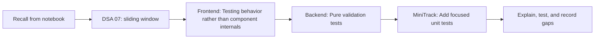
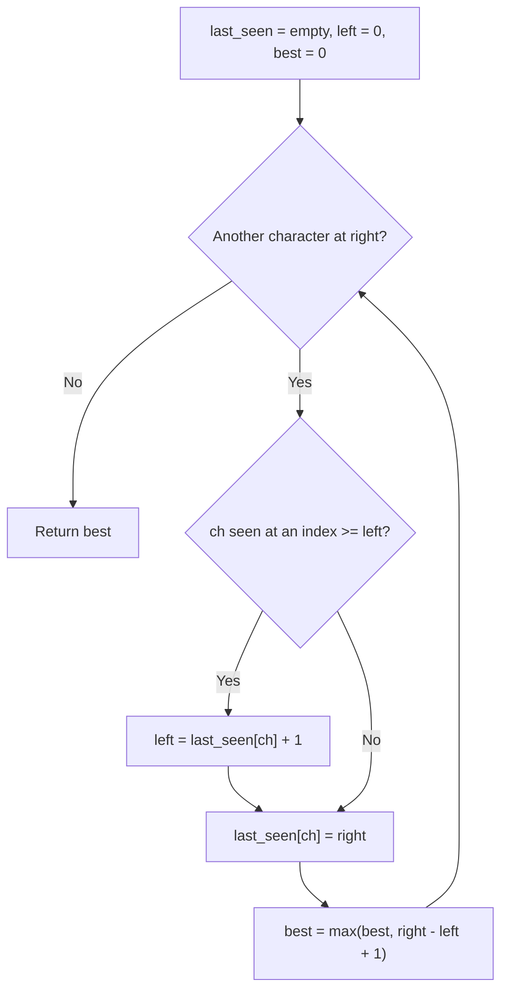
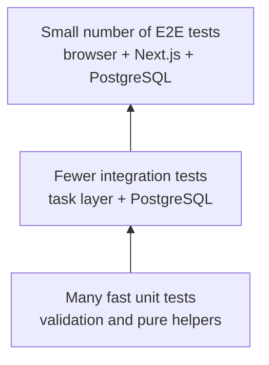
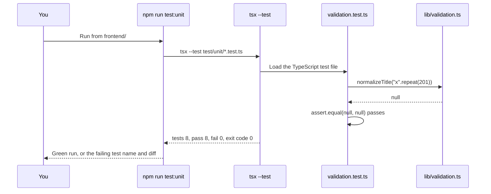

# Prep Day 07 — Add focused unit tests

**Date:** Wednesday, December 2, 2026  
**Time:** 7 study hours plus breaks  
**Starting point:** App Days 1–4 are complete. Continue from the current learner workspace and the previous preparation-day exit checklist.  
**Goal:** Add focused unit tests.

[Prep Day 06](prep-day-06.md) · [Preparation plan](../../docs/FULL_STACK_INTERVIEW_PREP_PLAN.md) · [Track home](README.md) · [Prep Day 08](prep-day-08.md)

**Everything to read today is below.** The original [App Day 9](../day-09.md)
(sections 1, 2, and 4) and [DSA Day 07](../../dsa-python/lessons/dsa-day-07.md)
remain available for comparison. This prep day covers only fast **unit**
tests for the pure functions in `frontend/lib/validation.ts`: no server, no
database, no browser. The isolated test database, PostgreSQL integration
tests, and Playwright browser tests belong to Prep Day 08. Search and filters
were completed on Prep Days 05–06. Write runnable code in the named project
and practice files, not in this Markdown file.

## Learning objectives

- explain testing behavior rather than component internals in beginner-friendly language;
- explain pure validation tests and its failure boundary;
- implement or verify the listed MiniTrack milestone;
- solve DSA Day 07 using the sliding window pattern;
- record the result in your rough notebook and explain it without reading.

## 1. Start with notebook recall (45 minutes)

Before opening a lesson, write answers in
[`checkpoints/ROUGH/Notes.md`](../../checkpoints/ROUGH/Notes.md):

1. What did yesterday's browser action send to the server?
2. Where is persistent task data stored, and what state is only temporary?
3. What error or edge case can you already predict for today's topic?
4. What do you remember about the **sliding window** pattern?

Use this format:

```md
## Wednesday, December 2, 2026

- What:
- Why:
- How MiniTrack uses it:
- What can go wrong:
- First task:
```

Do not copy the source paragraph. Write what you remember, then compare.

## 2. Understand today's full-stack boundary (20 minutes)

**Frontend focus — Testing behavior rather than component internals:** A frontend test should interact through labels, roles, text, and user actions, then assert what a user can observe. Internal state names are implementation details.

**Backend focus — Pure validation tests:** Pure normalization and validation functions are fast unit-test targets because they need no server or database. Test valid values and each rejected boundary.

**Today's connection:** Unit tests create a fast safety net at the narrowest deterministic boundary.



## 3. Python DSA practice (1 hour 45 minutes)

**Practice file:** [`dsa-python/practice/day-07.py`](../../dsa-python/practice/day-07.py)  
**Pattern:** sliding window

### Problem: Longest Substring Without Repeating Characters

Given a string, return the **length** of the longest substring in which no
character appears twice. A substring is a run of **consecutive** characters.
Return `0` for an empty string.

```python
solve('abcabcbb')  # 3  ("abc")
solve('bbbbb')     # 1  ("b")
solve('')          # 0
```

A **substring** is different from a subsequence: in `'pwwkew'`, `'wke'` is a
substring, but `'pwke'` is not, because its letters are not next to each other.

### Start coding

In the practice file, replace the `raise NotImplementedError` line with your
own implementation. This is the starting shape:

```python
def solve(s):
    # Return the length of the longest substring with no repeated character.
    raise NotImplementedError
```

Python tools you will use:

- `enumerate(s)` gives index and character pairs: `enumerate('ab')` produces
  `(0, 'a')` and then `(1, 'b')`.
- A dictionary such as `{'a': 0}` can remember that `'a'` was last seen at
  index `0`. `ch in last_seen` checks whether a key exists.
- `max(a, b)` returns the larger number.

A **window** is the current substring `s[left..right]`, described by two
indices. The right edge moves forward one character at a time. When the new
character is already inside the window, the left edge jumps just past the
earlier copy, so the window contains no repeats again.



### Invariant to say aloud

Expand the right edge and move the left edge past a repeated character while tracking the best valid window.

More precisely: after each step, `s[left..right]` has no repeated character,
and `best` is the length of the longest such window seen so far.

### Work in this order

1. Restate the problem and ask about constraints.
2. Give a brute-force approach and its cost before optimizing.
3. Write the invariant above in your own words.
4. Implement without opening the solution for 25 minutes.
5. Test empty, smallest, typical, duplicate, and boundary cases where relevant.
6. Use a small hint if blocked; do not spend the entire block stuck.
7. Compare with the commented reference and re-code the key loop from memory.

From the repository root:

```bash
python3 dsa-python/scripts/check_practice.py 7
python3 -m unittest discover -s dsa-python/tests -v
```

**Expected observation:** the day-specific checker prints `Case 1 passed`
through `Case 3 passed` for the three samples above, and the completed
reference suite still passes. The samples do not include the tricky `'abba'`
case, so add it yourself.

You can also temporarily add these checks below your `solve` function in the
practice file, then run `python3 dsa-python/practice/day-07.py`:

```python
if __name__ == '__main__':
    assert solve('abcabcbb') == 3
    assert solve('bbbbb') == 1
    assert solve('') == 0
    assert solve('a') == 1
    assert solve(' ') == 1         # A space is a character too.
    assert solve('au') == 2        # Whole string is the answer.
    assert solve('pwwkew') == 3    # "wke", not the subsequence "pwke".
    assert solve('dvdf') == 3      # "vdf": left jumps to 1, not 2.
    assert solve('abba') == 2      # left must never move backwards.
    print('All checks passed')
```

### Brute-force code — reveal after attempting

<details>
<summary>Show the simple solution</summary>

```python
def solve(s):
    best = 0
    for start in range(len(s)):
        seen = set()  # characters in s[start..end]
        for end in range(start, len(s)):
            if s[end] in seen:
                break  # Any longer substring from start also repeats.
            seen.add(s[end])
        best = max(best, len(seen))
    return best
```

</details>

A `set` is like a dictionary with only keys; `x in seen` checks membership.
For every start index, this grows the substring until a repeat appears. That
is O(n²) time in the worst case (for example, all different characters) and
O(k) extra space, where `k` is the number of different characters. Checking
every substring separately, without the early `break`, would be O(n³).

### Optimized code — reveal after attempting

<details>
<summary>Show the sliding-window solution</summary>

```python
def solve(s):
    last_seen = {}  # character -> most recent index
    left = 0
    best = 0
    for right, ch in enumerate(s):
        # Only a copy inside the current window (index >= left) is a repeat.
        if ch in last_seen and last_seen[ch] >= left:
            left = last_seen[ch] + 1  # discard old duplicate
        last_seen[ch] = right
        best = max(best, right - left + 1)
    return best
```

</details>

`right` visits each index once and `left` only moves forward, so the work is
O(n) time with average constant-time dictionary operations. The dictionary
holds at most one entry per distinct character: O(k) extra space, where `k`
is at most `n` and at most the alphabet size.

Trace for `'abba'` — the case that catches most bugs:

| right | ch | `last_seen` before | Repeat inside window? | left after | Window | best |
|---:|---|---|---|---:|---|---:|
| 0 | `a` | `{}` | No | 0 | `a` | 1 |
| 1 | `b` | `{a: 0}` | No | 0 | `ab` | 2 |
| 2 | `b` | `{a: 0, b: 1}` | Yes, `1 >= 0` | 2 | `b` | 2 |
| 3 | `a` | `{a: 0, b: 2}` | No, `0 < 2` (outside window) | 2 | `ba` | 2 |

At `right = 3`, the old `a` at index `0` is already outside the window.
Without the `>= left` check, `left` would jump **back** to `1` and the window
`bba` would wrongly contain two `b`s, giving `3`.

### DSA interview questions and answers

#### DSA Q1. What is the brute-force approach?

**Interview-ready answer:** “For each start index, I extend the substring to
the right, keeping a set of characters. When I see a repeat, I stop extending
from that start. I track the largest set size. That is O(n²) time and O(k)
space.”

**Example:** For `'abcabcbb'`, start `0` grows to `abc` and stops at the
second `a`; the best so far is `3`.

**Follow-up:** The waste is that each new start rebuilds almost the same set.
The sliding window reuses the previous window instead of starting over.

#### DSA Q2. What is the core sliding-window idea?

**Interview-ready answer:** “I keep one window with no repeats. I always move
the right edge forward. If the new character already appears inside the
window, I move the left edge to just after that earlier copy. A dictionary of
last-seen indices lets me jump directly instead of moving left one step at a
time.”

**Example:** In `'dvdf'`, at the second `d` (index 2), the earlier `d` is at
`0`, so `left` becomes `1` and the window is `vd`; then `f` makes `vdf`,
length `3`.

**Follow-up:** A version with a set and a `while` loop that removes
characters from the left is also O(n), because each character is added and
removed at most once.

#### DSA Q3. Why is the `last_seen[ch] >= left` check necessary?

**Interview-ready answer:** “The dictionary remembers characters from the
whole string, not only the current window. A remembered index smaller than
`left` is outside the window, so it is not a repeat. Without the check, `left`
could move backwards and the window would contain duplicates again.”

**Example:** `'abba'` must return `2`. Without the check, the final `a` moves
`left` back to `1` and the code returns `3`.

**Follow-up:** An equivalent fix is `left = max(left, last_seen[ch] + 1)`.
Both express the invariant that `left` never decreases.

#### DSA Q4. What are the time and space costs?

**Interview-ready answer:** “O(n) time because `right` visits each index once,
`left` only moves forward, and dictionary operations are O(1) on average.
O(k) space for the dictionary, where `k` is the number of distinct
characters.”

**Example:** For a string of 1,000,000 lowercase letters, the dictionary holds
at most 26 entries.

**Follow-up:** With heavy hash collisions, dictionary operations can degrade.
If the alphabet is small and known, a fixed-size list indexed by character
code gives guaranteed O(1) access.

#### DSA Q5. What edge cases should I test?

**Interview-ready answer:** “An empty string, one character, all the same
character, all different characters, spaces or punctuation, and a repeat
whose earlier copy is already outside the window.”

**Example:** `''` gives `0`; `'bbbbb'` gives `1`; `'au'` gives `2`;
`'abba'` gives `2`.

**Follow-up:** Ask whether the input is ASCII or full Unicode, and whether
uppercase and lowercase are different. In Python, `'A'` and `'a'` are
different characters unless you normalize them.

#### DSA Q6. What if at most `k` distinct characters are allowed?

**Interview-ready answer:** “The window rule changes from ‘no repeats’ to ‘at
most `k` distinct characters’. I keep a count of each character in the
window. When the number of distinct characters exceeds `k`, I move `left`
forward, decreasing counts and deleting zero counts, until the rule holds
again. It is still O(n) time.”

**Example:** For `'eceba'` with `k = 2`, the longest valid substring is
`'ece'`, length `3`.

**Follow-up:** That variant is a variable sliding window with a `while`
shrink loop, which is tomorrow's DSA pattern. The validity rule is the only
part that changes.

## 4. Frontend guided study (1 hour 30 minutes)

### What

A frontend test should interact through labels, roles, text, and user actions, then assert what a user can observe. Internal state names are implementation details.

### Why

The browser layer should make state and feedback understandable without taking
ownership of persistent data or security decisions that belong on the server.

A test is a **contract check**. If it checks internals, a harmless refactor
breaks it. If it checks behavior, it only breaks when users would notice.

### How

Look at what a user (or screen reader) can actually find in
`frontend/app/page.tsx` and `frontend/app/SearchForm.tsx`:

| User-visible handle | Where it comes from |
|---|---|
| Textbox labelled **Task title** | `aria-label="Task title"` on the add input |
| Button named **Add task** | the submit button's text |
| Checkbox labelled **Complete Learn React** | ``aria-label={`Complete ${task.title}`}`` |
| Button named **Edit**, **Save**, **Cancel**, **Delete** | button text |
| Search box labelled **Search task titles** | the `sr-only` label in `SearchForm` |
| Text **No tasks in this filter.** | the empty branch |

Now compare two ways to describe the same check, in plain language:

| Coupled to internals (fragile) | Coupled to behavior (robust) |
|---|---|
| "`editingId` equals `'7'`" | "a textbox labelled **Edit Learn React** is visible" |
| "`setBusy` was called with `true`" | "the **Add task** button is disabled while saving" |
| "the element with class `line-through` exists" | "the checkbox **Complete Learn React** is checked after reload" |
| "`toggleTask` was called" | "after checking the box and reloading, it is still checked" |

Renaming `editingId` to `activeTaskId`, or replacing the Tailwind classes, must
not break a good test. Removing the **Task title** label **should** break one,
because a real user would be affected.

Today you apply the same principle at the smallest layer: you test what
`normalizeTitle` **returns**, not how it computes it. Prep Day 08 automates
the browser checks in the right-hand column with Playwright, using these exact
labels.

Files to open deliberately:

- `frontend/test/unit/validation.test.ts` (you create it today)
- `frontend/lib/validation.ts`
- `frontend/package.json`

Answer before coding:

- Which value is persistent, and which value is temporary interaction state?
- What starts this behavior?
- What should the user see while work is pending?
- What should remain unchanged when the operation fails?

## 5. Backend guided study (1 hour 30 minutes)

### What

Pure normalization and validation functions are fast unit-test targets because they need no server or database. Test valid values and each rejected boundary.

### Boundary checklist

- Validate untrusted path, query, and body values.
- Authenticate identity when the route is protected.
- Authorize the resource separately from authentication.
- Bind SQL values rather than concatenating untrusted data.
- Return an explicit success or error status.
- Log internal failures on the server without exposing secrets.

### Choose the right test level



Use the lowest level that proves the behavior. Today is only the bottom layer.

A function is **pure** when its result depends only on its arguments and it
changes nothing outside itself: no network, database, clock, or random
numbers. Every function in `frontend/lib/validation.ts` is pure, and that
file has no `server-only` or `pg` import, so tests can import it directly.

These are the exact rules every route and page already relies on:

| Function | Accepts | Rejects or falls back |
|---|---|---|
| `normalizeTitle(value)` | strings of 1–200 characters after trimming | non-strings, blank, more than 200 → `null` |
| `isValidId(raw)` | `'1'`, `'12'`, up to `Number.MAX_SAFE_INTEGER` | `''`, `'0'`, `'-1'`, `'1.5'`, `'12abc'`, `'007'`, unsafe integers → `false` |
| `isRecord(value)` | plain objects such as `{}` | `null`, arrays, strings → `false` |
| `normalizeTaskFilters(q, status)` | trimmed `q` up to 100 characters; `open`/`done` | non-string `q` → `''`; unknown status → `'all'` |

Test the **boundaries** — the values on each side of a rule — because that is
where off-by-one mistakes hide: 200 characters is valid, 201 is not.

### Tools used in the test file

- `node:test` is Node's built-in test runner. `test('name', () => { ... })`
  registers one test.
- `node:assert/strict` provides checks. `assert.equal(actual, expected)`
  compares with `===`. `assert.deepEqual(actual, expected)` compares objects
  field by field.
- `tsx` runs TypeScript files directly, so Node can load `.ts` tests without a
  separate build step.

## 6. MiniTrack implementation (1 hour)

**Milestone source:** Day 9 unit tests and test boundaries

1. Write a success test before changing implementation.
2. Add empty, whitespace, wrong-type, too-long, and unsafe-ID cases.
3. Break one condition deliberately and confirm the test fails for the expected reason.

### Step 1: Install the test runner and add scripts

From `frontend/`:

```bash
npm install --save-dev tsx
```

Add these two lines to the existing `"scripts"` object in
`frontend/package.json`. Keep `dev`, `build`, `start`, and `lint`:

```json
"test": "npm run test:unit",
"test:unit": "tsx --test test/unit/*.test.ts"
```

Prep Day 08 adds `test:integration` and `test:e2e` next to these.

### Step 2: Write the unit tests

Create `frontend/test/unit/validation.test.ts`. Write the first success test,
run it, and only then add the rejection cases:

```ts
import assert from 'node:assert/strict';
import test from 'node:test';
import {
  isRecord,
  isValidId,
  normalizeTaskFilters,
  normalizeTitle,
} from '../../lib/validation';

test('normalizes a valid title', () => {
  assert.equal(normalizeTitle('  Learn testing  '), 'Learn testing');
});

test('accepts titles at the length boundaries', () => {
  assert.equal(normalizeTitle('x'), 'x');
  assert.equal(normalizeTitle('x'.repeat(200)), 'x'.repeat(200));
  // Length is checked after trimming, so surrounding spaces do not count.
  assert.equal(normalizeTitle(`  ${'x'.repeat(200)}  `), 'x'.repeat(200));
});

test('rejects invalid titles', () => {
  assert.equal(normalizeTitle(''), null);
  assert.equal(normalizeTitle('   '), null);
  assert.equal(normalizeTitle(42), null);
  assert.equal(normalizeTitle(null), null);
  assert.equal(normalizeTitle(undefined), null);
  assert.equal(normalizeTitle('x'.repeat(201)), null);
});

test('accepts positive, safe integer IDs', () => {
  assert.equal(isValidId('1'), true);
  assert.equal(isValidId('12'), true);
  assert.equal(isValidId(String(Number.MAX_SAFE_INTEGER)), true);
});

test('rejects malformed and unsafe IDs', () => {
  for (const raw of ['', '0', '-1', '1.5', '12abc', ' 12', '007', '1 OR 1=1']) {
    assert.equal(isValidId(raw), false, `expected ${JSON.stringify(raw)} to be rejected`);
  }
  // 2^53 cannot be represented exactly as a JavaScript number.
  assert.equal(isValidId('9007199254740992'), false);
});

test('recognizes only plain JSON objects as records', () => {
  assert.equal(isRecord({ title: 'x' }), true);
  assert.equal(isRecord(null), false);
  assert.equal(isRecord([]), false);
  assert.equal(isRecord('title'), false);
});

test('normalizes search and status', () => {
  assert.deepEqual(
    normalizeTaskFilters('  React  ', 'open'),
    { query: 'React', status: 'open' },
  );

  assert.deepEqual(
    normalizeTaskFilters(undefined, 'unknown'),
    { query: '', status: 'all' },
  );
});

test('bounds and sanitizes search input', () => {
  assert.equal(normalizeTaskFilters('q'.repeat(150), 'done').query.length, 100);
  // A repeated ?q=a&q=b can arrive as an array; it is not a string.
  assert.deepEqual(
    normalizeTaskFilters(['a', 'b'], 'DONE'),
    { query: '', status: 'all' },
  );
});
```

Each test name describes a behavior, and each assertion checks a returned
value. The optional third argument to `assert.equal` is a message printed if
that check fails, which tells you **which** ID broke the loop.

### Step 3: Run the tests

From `frontend/`:

```bash
npm run test:unit
npx tsc --noEmit
npm run lint
```

**Expected observation:** the user-visible milestone works, its important
failure path is explicit, and existing behavior remains intact.

The test output lists eight passing tests and ends with lines similar to:

```text
ℹ tests 8
ℹ pass 8
ℹ fail 0
```

No PostgreSQL server or `npm run dev` is needed. The run should take well
under a few seconds.

### Step 4: Prove the tests can fail

In `frontend/lib/validation.ts`, temporarily change `title.length <= 200` to
`title.length < 200` and run `npm run test:unit` again. Expect exactly one
failure, `accepts titles at the length boundaries`, with an
`AssertionError` showing `null` where `'xxx...'` was expected. Restore `<=`
and rerun until all eight pass.

**Failure checks:**

- `Cannot find module '../../lib/validation'`: the test file must be at
  `frontend/test/unit/validation.test.ts`, and `validation.ts` at
  `frontend/lib/validation.ts`.
- `sh: tsx: command not found`: run `npm install --save-dev tsx` inside
  `frontend/`.
- `Could not find '.../test/unit/*.test.ts'`: the glob found no file; check
  the folder and the `.test.ts` suffix.
- A test that imports `frontend/lib/tasks.ts` or `db.ts` is not a unit test:
  it needs PostgreSQL and belongs to Prep Day 08.

## 7. Trace the event or request



Trace one concrete input. Name every boundary, value, and possible failure.

## 8. Deliberate debugging exercise (25 minutes)

**Break it:** Write a test that only checks an internal helper was called.

For example, imagine a test that passes only if `normalizeTitle` internally
calls `value.trim()`. Now refactor `normalizeTitle` to strip spaces with a
regular expression instead: the returned values are identical, but that test
fails.

**Predict before running:** write the expected symptom in your notebook.

**Expected symptom:** A refactor can fail the test even when user behavior remains correct.

**Root cause:** The test is coupled to implementation instead of the contract.

**Restore and verify:** Assert the returned value, response, or visible result.

Your `validation.test.ts` already does this: `normalizeTitle('  Learn testing  ')`
must return `'Learn testing'`, however it is computed. Make the regex
refactor, confirm all eight tests still pass, then revert it.

Do not stop after making the symptom disappear. Explain why the repair restores
the intended invariant.

## 9. Interview questions and answers (30 minutes)

### Q1. What is testing behavior rather than component internals?

**Interview-ready answer:** A frontend test should interact through labels, roles, text, and user actions, then assert what a user can observe. Internal state names are implementation details.

**Example:** For `frontend/app/page.tsx`, a good check is "the
checkbox labelled **Complete Learn React** is still checked after reload", not
"`toggleTask` was called" or "`busy` became `true`". In today's
`frontend/test/unit/validation.test.ts`, the same idea means asserting
`normalizeTitle('  Learn testing  ') === 'Learn testing'`, not how it trims.

**Senior follow-up:** Behavior-focused tests become hard when accessible
names are missing or duplicated, which is itself a product bug worth fixing.
If a component has complex internal logic, extract it into a pure function and
unit-test that, rather than reaching into component state.

### Q2. How should the backend handle pure validation tests?

**Interview-ready answer:** Pure normalization and validation functions are fast unit-test targets because they need no server or database. Test valid values and each rejected boundary.

**Example:** `normalizeTitle('x'.repeat(200))` is accepted and
`normalizeTitle('x'.repeat(201))` returns `null`; `isValidId('007')` and
`isValidId('9007199254740992')` return `false`. These are the same checks the
`POST` and `PATCH` route handlers rely on before reaching SQL.

**Senior follow-up:** Unit tests prove the rules, not the wiring. A route
could forget to call `isValidId`, and these tests would still pass. That gap
is covered by Prep Day 08's integration and browser tests; keep each layer
focused on what only it can prove.

### Q3. What invariant makes the sliding window solution correct?

**Interview-ready answer:** Expand the right edge and move the left edge past a repeated character while tracking the best valid window.

**Example:** For `'abba'`: windows `a`, `ab`, then the second `b` moves `left`
to `2` (`b`), then the final `a` was last seen at `0 < left`, so `left` stays
at `2` and the window is `ba`. The answer is `2`.

**Senior follow-up:** O(n) assumes average O(1) dictionary operations and that
`left` never moves backwards. For a small fixed alphabet, an array indexed by
character code removes the hashing caveat.

### Q4. How does today's work fit the complete MiniTrack system?

**Interview-ready answer:** Unit tests create a fast safety net at the narrowest deterministic boundary.

**Example:** Every request path starts with these functions: `POST` uses
`normalizeTitle` and `isRecord`, `PATCH` and `DELETE` use `isValidId`, and the
page and `GET /api/tasks` use `normalizeTaskFilters`. `npm run test:unit`
checks all of them in seconds, without PostgreSQL.

**Senior follow-up:** Run unit tests on every commit in CI because they are
cheap. The first signal to watch is flaky or slow tests; a unit test that
needs a database or network has drifted to the wrong level.

## 10. Complexity and operational cost

- **DSA:** O(n) time and O(k) space.
- **Application:** Each pure test is normally O(input size) and runs without I/O, making the suite cheap enough to run frequently.
- **Learning:** Attempting, retrieving, and correcting is more valuable than
  copying several solutions. Keep the scope to one understood pattern today.

## Exit checklist

- [ ] I completed DSA Day 07 before reading its solution.
- [ ] I can state the invariant and complexity without notes.
- [ ] I completed or verified the MiniTrack milestone.
- [ ] I tested one success path and one failure path.
- [ ] I completed the deliberate debugging exercise.
- [ ] I answered all four interview questions aloud.
- [ ] I recorded what remains confusing and tomorrow's first task.

**Suggested commit:** `prep day 07: add focused unit tests`
