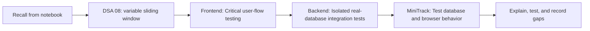
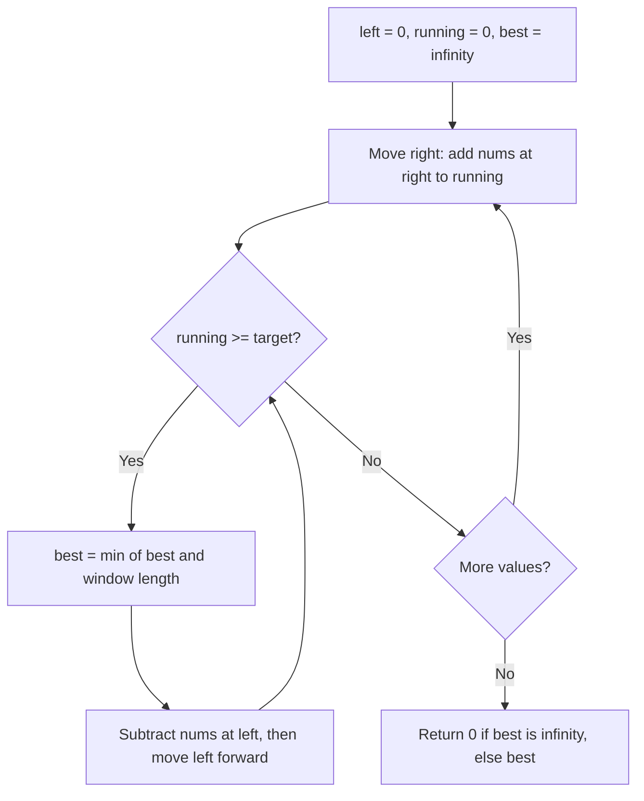
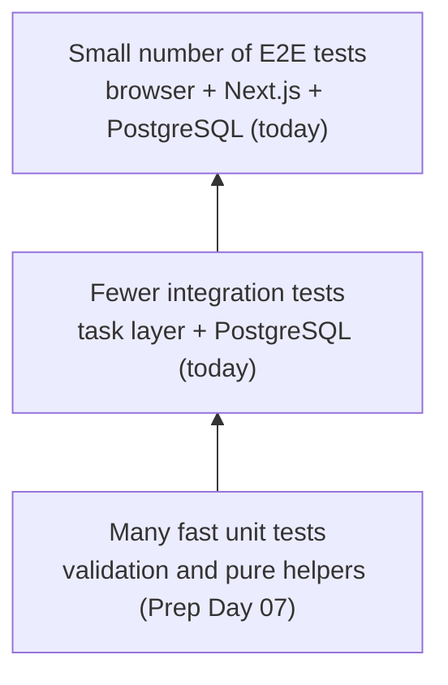
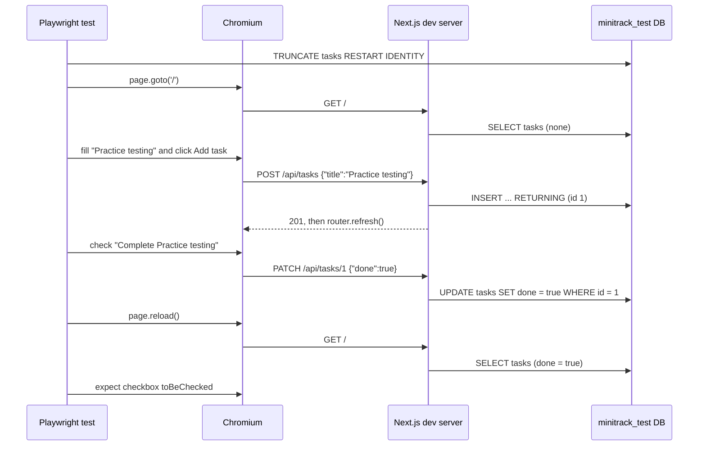

# Prep Day 08 — Test database and browser behavior

**Date:** Thursday, December 3, 2026  
**Time:** 7 study hours plus breaks  
**Starting point:** App Days 1–4 are complete. Continue from the current learner workspace and the previous preparation-day exit checklist.  
**Goal:** Test database and browser behavior.

[Prep Day 07](prep-day-07.md) · [Preparation plan](../../docs/FULL_STACK_INTERVIEW_PREP_PLAN.md) · [Track home](README.md) · [Prep Day 09](prep-day-09.md)

**Everything to read today is below.** The original [App Day 9](../day-09.md)
and [DSA Day 08](../../dsa-python/lessons/dsa-day-08.md) remain available for
comparison. This prep day covers only the **database integration test** and
the **browser (Playwright) journey**. The fast unit tests for
`normalizeTitle` and `normalizeTaskFilters` were Prep Day 07; sign-in and
authentication start on Prep Day 09. Write runnable code in the named project
and practice files, not in this Markdown file.

## Learning objectives

- explain critical user-flow testing in beginner-friendly language;
- explain isolated real-database integration tests and its failure boundary;
- implement or verify the listed MiniTrack milestone;
- solve DSA Day 08 using the variable sliding window pattern;
- record the result in your rough notebook and explain it without reading.

## 1. Start with notebook recall (45 minutes)

Before opening a lesson, write answers in
[`checkpoints/ROUGH/Notes.md`](../../checkpoints/ROUGH/Notes.md):

1. What did yesterday's browser action send to the server?
2. Where is persistent task data stored, and what state is only temporary?
3. What error or edge case can you already predict for today's topic?
4. What do you remember about the **variable sliding window** pattern?

Use this format:

```md
## Thursday, December 3, 2026

- What:
- Why:
- How MiniTrack uses it:
- What can go wrong:
- First task:
```

Do not copy the source paragraph. Write what you remember, then compare.

## 2. Understand today's full-stack boundary (20 minutes)

**Frontend focus — Critical user-flow testing:** An end-to-end test proves that a user can complete a valuable journey through the real browser and server. Keep it focused because it is slower and has more failure sources.

**Backend focus — Isolated real-database integration tests:** SQL behavior should be tested against a real isolated PostgreSQL database because mocks cannot prove constraints, SQL syntax, or transaction behavior.

**Today's connection:** Unit, database, and browser tests cover different boundaries without asking one expensive test to prove everything.



## 3. Python DSA practice (1 hour 45 minutes)

**Practice file:** [`dsa-python/practice/day-08.py`](../../dsa-python/practice/day-08.py)  
**Pattern:** variable sliding window

### Problem: Minimum Size Subarray Sum

You are given a positive whole number `target` and a list of **positive**
integers `nums`. Return the length of the **shortest contiguous** part of the
list (a *subarray*) whose sum is at least `target`. If no such part exists,
return `0`.

"Contiguous" means the elements sit next to each other: in `[2, 3, 1]`,
`[3, 1]` is a subarray, but `[2, 1]` is not.

Assumptions: every number in `nums` is greater than zero, and `target` is
greater than zero. Note the argument order: `target` comes first.

```python
solve(7, [2, 3, 1, 2, 4, 3])        # 2, because [4, 3] sums to 7
solve(11, [1, 1, 1, 1, 1, 1, 1, 1])  # 0, because the whole list sums to only 8
```

The simple approach tries every starting position and extends to the right
until the sum is large enough: O(n²) time. A **sliding window** does better.
A window is the part of the list between two positions, `left` and `right`.
Because every number is positive, adding an element on the right always makes
the sum bigger, and removing an element on the left always makes it smaller.
That lets you grow the window until it is valid, then shrink it as far as
possible while it stays valid.

### Start coding

In the practice file, replace the `raise NotImplementedError` line with your
own implementation. This is the starting shape:

```python
def solve(target, nums):
    # Return the length of the shortest contiguous subarray with sum >= target, or 0.
    raise NotImplementedError
```

Python helpers you can use:

- `enumerate(nums)` gives the index and the value together. For `[2, 3]` it
  produces `(0, 2)` and then `(1, 3)`. Here the index is the window's `right`
  edge.
- `float('inf')` is "infinity": a number larger than any real length. Start
  `best` there so the first valid window always replaces it, and so you can
  tell at the end whether any window was found.
- `min(a, b)` returns the smaller of two values.
- A window from `left` to `right` (both included) has length
  `right - left + 1`.



### Invariant to say aloud

Expand until the sum satisfies the target, then shrink while the window remains valid to find the minimum.

### Work in this order

1. Restate the problem and ask about constraints.
2. Give a brute-force approach and its cost before optimizing.
3. Write the invariant above in your own words.
4. Implement without opening the solution for 25 minutes.
5. Test empty, smallest, typical, duplicate, and boundary cases where relevant.
6. Use a small hint if blocked; do not spend the entire block stuck.
7. Compare with the commented reference and re-code the key loop from memory.

From the repository root:

```bash
python3 dsa-python/scripts/check_practice.py 8
python3 -m unittest discover -s dsa-python/tests -v
```

**Expected observation:** the day-specific checker prints `Case 1 passed` and
`Case 2 passed`, and the completed reference suite still passes. The checker
only covers the two supplied examples; it does not test every edge case.

You can also temporarily add these checks below your `solve` function in the
practice file, then run `python3 dsa-python/practice/day-08.py`:

```python
if __name__ == '__main__':
    assert solve(7, [2, 3, 1, 2, 4, 3]) == 2
    assert solve(11, [1, 1, 1, 1, 1, 1, 1, 1]) == 0
    assert solve(4, [1, 4, 4]) == 1           # one element is enough
    assert solve(15, [1, 2, 3, 4, 5]) == 5    # only the whole list works
    assert solve(3, [3]) == 1                 # single element equal to target
    assert solve(5, []) == 0                  # empty list: no window exists
    assert solve(100, [1, 2]) == 0            # sum never reaches target
    print('All checks passed')
```

### Brute-force code — reveal after attempting

<details>
<summary>Show the simple solution</summary>

```python
def solve(target, nums):
    best = 0
    for start in range(len(nums)):
        total = 0
        for end in range(start, len(nums)):
            total += nums[end]
            if total >= target:
                length = end - start + 1
                if best == 0 or length < best:
                    best = length
                break  # a longer window from this start cannot be shorter
    return best
```

</details>

For each start, this adds elements to the right until the sum is big enough,
then stops. In the worst case (no valid window) both loops run fully, so time
is O(n²). It uses O(1) extra space.

### Optimized code — reveal after attempting

<details>
<summary>Show the sliding window solution</summary>

```python
def solve(target, nums):
    left = 0
    running = 0            # sum of nums[left..right]
    best = float('inf')    # no valid window found yet
    for right, value in enumerate(nums):
        running += value
        while running >= target:
            best = min(best, right - left + 1)
            running -= nums[left]  # shrink while valid
            left += 1
    return 0 if best == float('inf') else best
```

</details>

Each element is added once when `right` reaches it and removed at most once
when `left` passes it, so the total work is O(n) even though there is a loop
inside a loop. Extra space is O(1).

Trace for `solve(7, [2, 3, 1, 2, 4, 3])`:

| right | value | running after adding | Shrinking steps while `running >= 7` | best after | left after |
|---:|---:|---:|---|---:|---:|
| 0 | 2 | 2 | none | ∞ | 0 |
| 1 | 3 | 5 | none | ∞ | 0 |
| 2 | 1 | 6 | none | ∞ | 0 |
| 3 | 2 | 8 | length 4 → best 4; remove 2 → running 6 | 4 | 1 |
| 4 | 4 | 10 | length 4 → best 4; remove 3 → 7; length 3 → best 3; remove 1 → 6 | 3 | 3 |
| 5 | 3 | 9 | length 3 → best 3; remove 2 → 7; length 2 → best 2; remove 4 → 3 | 2 | 5 |

The loop ends and `best` is `2`, the window `[4, 3]`.

### DSA interview questions and answers

#### DSA Q1. What is the brute-force approach?

**Interview-ready answer:** “For every starting index I keep adding elements
to the right until the sum reaches the target. The first time it does, that
is the shortest window for that start, so I record its length and stop. I
return the smallest length found, or 0. That is O(n²) time and O(1) space.”

**Example:** With target `7` and `[2, 3, 1, 2, 4, 3]`, start `0` needs
`[2, 3, 1, 2]` (length 4); start `4` needs `[4, 3]` (length 2).

**Follow-up:** Why can you `break` after the first valid end? Because every
later end makes the window longer, so it cannot improve the answer for that
start.

#### DSA Q2. How does the sliding window improve it?

**Interview-ready answer:** “Instead of restarting the sum for every start, I
keep one running sum for the window between `left` and `right`. I move
`right` forward to grow the window. While the sum is at least the target, I
record the length and move `left` forward to shrink it. Both pointers only
move forward.”

**Example:** At `right = 4`, the window `[1, 2, 4]` has sum 7. Recording
length 3 and then removing `1` drops the sum to 6, so the window stops
shrinking.

**Follow-up:** What is reused? The running sum. Removing one element from the
left costs O(1) instead of re-adding the whole window.

#### DSA Q3. Why is it correct to shrink as soon as the window is valid?

**Interview-ready answer:** “Because all numbers are positive, removing the
leftmost element strictly lowers the sum. For a fixed `right`, the shortest
valid window ending there is found by shrinking until it becomes invalid. Any
`left` I move past could only pair with a later `right` to make a longer
window, so I never lose a better answer.”

**Example:** At `right = 3`, the window `[2, 3, 1, 2]` (sum 8) is recorded
as length 4. Removing `2` leaves `[3, 1, 2]` with sum 6, which is too small,
so shrinking stops. Index 0 is never needed again: any window that starts at
index 0 and ends later would be longer than 4.

**Follow-up:** State the invariant: after the inner loop finishes, the sum of
`nums[left..right]` is less than `target`, and `best` holds the shortest valid
window ending at any index up to `right`.

#### DSA Q4. What are the time and space costs?

**Interview-ready answer:** “O(n) time and O(1) extra space. The inner
`while` loop looks nested, but `left` only moves forward and can move at most
n times in total, so every element is added once and removed at most once.”

**Example:** In the trace, `left` moves from 0 to 5 across the whole run,
never backwards, even though one step removed two elements.

**Follow-up:** This is *amortized* reasoning: a single iteration of the outer
loop can do several removals, but the total across all iterations is bounded
by n.

#### DSA Q5. What edge cases should I test?

**Interview-ready answer:** “An empty list, no valid window, a single element
that already meets the target, a window that must be the whole list, and a
target that is reached exactly. I also confirm the numbers are positive,
because the algorithm depends on that.”

**Example:** `solve(4, [1, 4, 4])` returns `1`; `solve(15, [1, 2, 3, 4, 5])`
returns `5`; `solve(5, [])` returns `0`.

**Follow-up:** Why return `0` instead of `float('inf')`? The problem defines
`0` as "no answer". Converting at the end keeps the loop simple and the
output matches the contract.

#### DSA Q6. What changes if the list can contain negative numbers?

**Interview-ready answer:** “The sliding window breaks, because adding an
element no longer guarantees a bigger sum and shrinking no longer guarantees
a smaller one. I would use prefix sums with a monotonic deque of candidate
start indices, which still runs in O(n) time but needs O(n) space.”

**Example:** `solve(4, [3, -2, 1, 4])` returns `4`, but the correct answer
is `1` (`[4]` alone). After removing `3`, the window `[-2, 1, 4]` sums to 3,
so shrinking stops, even though dropping `-2` would *raise* the sum and reveal
the shorter window.

**Follow-up:** For positive numbers only, a second alternative is prefix sums
plus binary search for each start: O(n log n). Mention it as a trade-off,
then explain why the O(n) window is better for this contract.

## 4. Frontend guided study (1 hour 30 minutes)

### What

An end-to-end test proves that a user can complete a valuable journey through the real browser and server. Keep it focused because it is slower and has more failure sources.

### Why

The browser layer should make state and feedback understandable without taking
ownership of persistent data or security decisions that belong on the server.

### How

Today's tests sit at different levels of a **test pyramid**:



Use the lowest level that proves the behavior. Browser tests are valuable but
slower and more fragile than pure function tests.

**Playwright** is a library that opens a real browser (Chromium), clicks and
types like a user, and checks what appears on the page. An **E2E** (end-to-end)
test uses the whole stack: browser → Next.js → PostgreSQL.

Playwright finds elements by their **accessible name**, the same label a screen
reader announces. Today's test relies on two names that `frontend/app/TaskBoard.tsx`
already provides from Prep Day 02:

```tsx
// The add-task input is named "Task title".
<input aria-label="Task title" /* ...existing props... */ />

// Each task checkbox is named "Complete <title>".
<input aria-label={`Complete ${task.title}`} type="checkbox" /* ... */ />
```

If your input uses `<label htmlFor="task-title">Task title</label>` instead of
`aria-label`, Playwright's `getByLabel('Task title')` finds it the same way.

| Playwright call | What it means |
|---|---|
| `page.goto('/')` | Open the page at `baseURL` + `/`. |
| `page.getByLabel('Task title')` | Find the control whose accessible name is "Task title". |
| `page.getByRole('button', { name: /add task/i })` | Find a button whose name matches "add task", ignoring case. |
| `.fill('text')` / `.click()` / `.check()` | Type, click, or tick a checkbox. |
| `await expect(locator).toBeVisible()` | Wait (up to a timeout) until the element appears. |
| `await expect(locator).toBeChecked()` | Wait until the checkbox is ticked. |
| `page.reload()` | Reload the page, which proves the data came from the database. |

Files you will create in section 6:

- `frontend/playwright.config.ts`
- `frontend/test/e2e/tasks.spec.ts`
- `frontend/package.json` (new scripts only)

Answer before coding:

- Which value is persistent (the task row in `minitrack_test`), and which value is temporary interaction state (the input text)?
- What starts this behavior? (Playwright's `fill` and `click`.)
- What should the user see while work is pending? (The button is disabled until the request finishes.)
- What should remain unchanged when the operation fails? (No new row; the reload shows no task.)

## 5. Backend guided study (1 hour 30 minutes)

### What

SQL behavior should be tested against a real isolated PostgreSQL database because mocks cannot prove constraints, SQL syntax, or transaction behavior.

### Boundary checklist

- Validate untrusted path, query, and body values.
- Authenticate identity when the route is protected.
- Authorize the resource separately from authentication.
- Bind SQL values rather than concatenating untrusted data.
- Return an explicit success or error status.
- Log internal failures on the server without exposing secrets.

### Why a separate test database

Integration tests delete data so every test starts from a known state. If they
point at your normal `minitrack` database, they erase your personal tasks. So
today you create a second database, `minitrack_test`, with the same schema,
and give the tests their own environment file.

Two protections work together:

1. `frontend/.env.test.local` sets `DATABASE_URL` to `minitrack_test`.
2. A **guard helper** refuses to run if the URL names any other database.

Create `frontend/test/helpers/test-database.ts`:

```ts
export function requireTestDatabase(): string {
  const connectionString = process.env.DATABASE_URL;
  if (!connectionString) {
    throw new Error('DATABASE_URL is required for integration tests');
  }

  // new URL(...).pathname is the database part, for example "/minitrack_test".
  const databaseName = new URL(connectionString).pathname;
  if (databaseName !== '/minitrack_test') {
    throw new Error(`Refusing to test against ${databaseName}`);
  }

  return connectionString;
}
```

This guard is not a substitute for careful configuration, but it prevents a
common destructive mistake.

### The integration test

The test calls the real data functions from `frontend/lib/tasks.ts`
(`createTask` from Prep Day 01 and `renameTask` from Prep Day 03). Those
functions use `getPool()` from `frontend/lib/db.ts`, which reads the same
`DATABASE_URL`. A second `Pool` in the test is used only for setup and to
check the stored row independently.

New words:

- `node:test` is Node's built-in test runner. `test(name, fn)` defines a test;
  `beforeEach` runs before every test; `after` runs once at the end.
- `assert.equal(actual, expected)` fails the test when the values differ.
- `TRUNCATE tasks RESTART IDENTITY` deletes every row and resets the ID counter
  to 1.

Create `frontend/test/integration/tasks.test.ts`:

```ts
import assert from 'node:assert/strict';
import test, { after, beforeEach } from 'node:test';
import { Pool } from 'pg';
import { createTask, renameTask } from '../../lib/tasks';
import { requireTestDatabase } from '../helpers/test-database';

// The guard runs before any SQL, so a wrong DATABASE_URL stops the file here.
const pool = new Pool({ connectionString: requireTestDatabase() });

beforeEach(async () => {
  // Isolation makes every test independent of execution order.
  await pool.query('TRUNCATE tasks RESTART IDENTITY');
});

after(async () => {
  // Close connections so the test process can exit.
  await pool.end();
});

test('renames a persisted task', async () => {
  const created = await createTask('Before');
  const updated = await renameTask(created.id, 'After');

  assert.equal(updated?.title, 'After');

  // Read the row directly to prove PostgreSQL stored the change.
  const result = await pool.query(
    'SELECT title FROM tasks WHERE id = $1',
    [created.id],
  );
  assert.equal(result.rows[0]?.title, 'After');
});
```

The application helper and assertion pool use the same test connection string.
The direct `SELECT` verifies persistence independently of the returned object.
The application pool inside `getPool()` is not closed by the test, so expect a
pause of about 10 seconds after the result before the process exits: that is
`pg` closing its idle connections. If a run ever hangs much longer, that pool
is the first thing to inspect.

## 6. MiniTrack implementation (1 hour)

**Milestone source:** Day 9 PostgreSQL integration and Playwright tests

Run every command below from `frontend/` unless stated otherwise.

### Step 1: Install the test tools

```bash
npm install --save-dev @playwright/test dotenv-cli
npm install server-only
npx playwright install chromium
```

- `@playwright/test` controls a real browser.
- `dotenv-cli` loads `.env.test.local` for the commands it starts.
- `server-only` is the small package behind `import 'server-only'` in
  `frontend/lib/db.ts` (see the note in Step 2).
- `tsx` was installed on Prep Day 07 for unit tests. If `npx tsx --version`
  fails, run `npm install --save-dev tsx`.

### Step 2: Add the scripts

Merge these entries into the existing `"scripts"` object in
`frontend/package.json`. Keep `dev`, `build`, `start`, and `lint` as they are;
`test` and `test:unit` should already exist from Prep Day 07.

```json
{
  "scripts": {
    "test": "npm run test:unit",
    "test:unit": "tsx --test test/unit/*.test.ts",
    "test:integration": "dotenv -e .env.test.local -- tsx --conditions=react-server --test test/integration/*.test.ts",
    "test:e2e": "dotenv -e .env.test.local -- playwright test"
  }
}
```

**Note on `--conditions=react-server`:** App Day 9 shows the integration
script without this flag. `frontend/lib/db.ts` starts with
`import 'server-only'`. Next.js handles that import itself, but plain Node does
not: without the package the test fails with `Cannot find module
'server-only'`, and with the package but without the flag it throws on
purpose. The `react-server` condition tells Node to load the package's empty
server version, so the test can import the real data layer.

### Step 3: Create the isolated database

From `frontend/`:

```bash
createdb minitrack_test
psql -d minitrack_test -f ../backend/sql/schema.sql
```

Create `frontend/.env.test.local` (replace `YOUR_USER` with your local
PostgreSQL user):

```env
DATABASE_URL=postgresql://YOUR_USER@localhost:5432/minitrack_test
```

Confirm it is ignored, then confirm the table exists:

```bash
git check-ignore .env.test.local
psql -d minitrack_test -c '\d tasks'
```

**Expected observation:** `git check-ignore` prints `.env.test.local`, and
`\d tasks` lists `id`, `title`, `done`, and `created_at`. Never use your
development or production database for destructive tests.

### Step 4: Create and run the integration test

Create the two files from section 5:
`test/helpers/test-database.ts` and `test/integration/tasks.test.ts`. Then:

```bash
npm run test:integration
```

**Expected observation:** one passing test named `renames a persisted task`
and `fail 0`.

### Step 5: Add one browser journey

Create `frontend/playwright.config.ts`:

```ts
import { defineConfig } from '@playwright/test';

export default defineConfig({
  testDir: './test/e2e',
  use: {
    // page.goto('/') opens this address.
    baseURL: 'http://127.0.0.1:3000',
  },
  webServer: {
    // Playwright starts the dev server and waits for the URL to respond.
    command: 'npm run dev',
    url: 'http://127.0.0.1:3000',
    reuseExistingServer: false,
  },
});
```

`reuseExistingServer: false` makes Playwright start its own server. That
server inherits `DATABASE_URL` from `dotenv`, so the app talks to
`minitrack_test`. (Next.js does not overwrite an environment variable that is
already set, so `.env.local` cannot switch it back to `minitrack`.)

Create `frontend/test/e2e/tasks.spec.ts`:

```ts
import { expect, test } from '@playwright/test';
import { Pool } from 'pg';
import { requireTestDatabase } from '../helpers/test-database';

// This pool resets data; the app under test uses its own pool.
const pool = new Pool({ connectionString: requireTestDatabase() });

test.beforeEach(async () => {
  await pool.query('TRUNCATE tasks RESTART IDENTITY');
});

test.afterAll(async () => {
  await pool.end();
});

test('creates, completes, and persists a task', async ({ page }) => {
  await page.goto('/');

  // Arrange and act through accessible names, like a real user.
  await page.getByLabel('Task title').fill('Practice testing');
  await page.getByRole('button', { name: /add task/i }).click();

  await expect(page.getByText('Practice testing')).toBeVisible();
  await page.getByLabel('Complete Practice testing').check();
  await page.reload();

  // After a reload, the state can only come from PostgreSQL.
  await expect(page.getByLabel('Complete Practice testing')).toBeChecked();
});
```

Role and label queries test the same accessible names users and assistive
technology rely on.

Stop any `npm run dev` you already have running (it would hold port 3000), then:

```bash
npm run test:e2e
```

**Expected observation:** Playwright starts Next.js, runs one test, and
reports `1 passed`. Your `minitrack` development tasks are untouched; check
with `psql -d minitrack -c 'SELECT count(*) FROM tasks'` before and after.

### Step 6: Run the full set and inspect one deliberate failure

```bash
npm run test:unit
npm run test:integration
npm run test:e2e
npx tsc --noEmit
npm run build
```

Then try one deliberate failure: change the E2E text in the last assertion to
`'Complete Something else'`, rerun `npm run test:e2e`, and read the error.

**Expected observation:** the test fails after its timeout with a message that
the locator was not found. Restore the text and confirm it passes again.

Failure checks:

| Symptom | Likely cause |
|---|---|
| `Refusing to test against /minitrack` | `.env.test.local` points at the development database; the guard did its job. |
| `DATABASE_URL is required` | `.env.test.local` is missing, or the script was run without `dotenv -e`. |
| `relation "tasks" does not exist` | Step 3's `psql -f ../backend/sql/schema.sql` was not run on `minitrack_test`. |
| `Cannot find module 'server-only'` or a "Server Component" error | Step 1's `server-only` install or Step 2's `--conditions=react-server` flag is missing. |
| `Port 3000 is already in use` | Another `npm run dev` is running; stop it. |
| `Executable doesn't exist` | Run `npx playwright install chromium`. |

## 7. Trace the event or request



Trace one concrete input. Name every boundary, value, and possible failure.
For example: if the PATCH returned 500, the reload would show an unchecked box
and the last assertion would fail, pointing you at the item Route Handler.

## 8. Deliberate debugging exercise (25 minutes)

**Break it:** Point tests at the normal development database.

**Predict before running:** write the expected symptom in your notebook.

**Expected symptom:** Tests can destroy or depend on personal data and become order-dependent.

**Root cause:** The suite lacks data isolation.

**Restore and verify:** Use a dedicated test database and reset known state between tests.

Concretely: change `.env.test.local` to `.../minitrack` and run
`npm run test:integration`. The guard should throw
`Refusing to test against /minitrack` **before** any `TRUNCATE`. Then, only in
your head, remove the guard: `TRUNCATE` would erase your real tasks. Restore
`minitrack_test` and rerun to see the test pass. Also try removing
`beforeEach` and running the integration test twice: the second run still
passes here, but any test that counts rows or assumes ID `1` would now depend
on leftovers from the first run.

Do not stop after making the symptom disappear. Explain why the repair restores
the intended invariant.

## 9. Interview questions and answers (30 minutes)

### Q1. What is critical user-flow testing?

**Interview-ready answer:** An end-to-end test proves that a user can complete a valuable journey through the real browser and server. Keep it focused because it is slower and has more failure sources.

**Example:** `frontend/test/e2e/tasks.spec.ts` fills `Task title`, clicks
**Add task**, ticks `Complete Practice testing`, reloads, and asserts the box
is still checked. One test proves the form, POST, PATCH, SQL, and
server-rendered reload work together. Invalid-title combinations stay in the
fast unit tests from Prep Day 07.

**Senior follow-up:** E2E tests become hard to maintain when they use brittle
CSS selectors, fixed waits, or shared data. Prefer role and label locators,
web-first assertions that wait automatically, and a reset per test. If the
suite grows slow, measure it and push edge cases down to unit or integration
tests rather than adding retries.

### Q2. How should the backend handle isolated real-database integration tests?

**Interview-ready answer:** SQL behavior should be tested against a real isolated PostgreSQL database because mocks cannot prove constraints, SQL syntax, or transaction behavior.

**Example:** `test/integration/tasks.test.ts` calls `createTask('Before')` and
`renameTask(id, 'After')` from `frontend/lib/tasks.ts`, then runs
`SELECT title FROM tasks WHERE id = $1` with its own pool. A mock could not
prove that `UPDATE ... RETURNING` works or that `created_at` converts to a
string.

**Senior follow-up:** The guard in `test/helpers/test-database.ts` fails fast on
the wrong database. Create the test schema with the same migration or schema
file as production so they cannot drift. For parallel workers, give each its
own schema or database, because a shared `TRUNCATE` would interfere.

### Q3. What invariant makes the variable sliding window solution correct?

**Interview-ready answer:** Expand until the sum satisfies the target, then shrink while the window remains valid to find the minimum.

**Example:** For `solve(7, [2, 3, 1, 2, 4, 3])`, at `right = 5` the running
sum is 9. Shrinking records length 3, then length 2 for `[4, 3]`, and stops
when the sum falls to 3. The answer is `2`.

**Senior follow-up:** O(n) time and O(1) space hold only for positive
numbers, because then shrinking always lowers the sum. With negative numbers,
use prefix sums with a monotonic deque instead.

### Q4. How does today's work fit the complete MiniTrack system?

**Interview-ready answer:** Unit, database, and browser tests cover different boundaries without asking one expensive test to prove everything.

**Example:** A blank title is caught by the `normalizeTitle` unit test; the
rename SQL is caught by the integration test; a missing `router.refresh()` or
a broken checkbox label is caught only by the Playwright journey.

**Senior follow-up:** Before adding more infrastructure, measure total suite
time and flaky-test rate. The first CI bottleneck is usually the browser job;
the first security risk is a test configuration that can reach real data.

## 10. Complexity and operational cost

- **DSA:** O(n) time and O(1) space for non-negative inputs.
- **Application:** Unit tests are cheapest, database tests add process and I/O cost, and browser tests are slowest. The suite should have many narrow tests and few critical E2E paths.
- **Learning:** Attempting, retrieving, and correcting is more valuable than
  copying several solutions. Keep the scope to one understood pattern today.

## Exit checklist

- [ ] I completed DSA Day 08 before reading its solution.
- [ ] I can state the invariant and complexity without notes.
- [ ] I completed or verified the MiniTrack milestone.
- [ ] I tested one success path and one failure path.
- [ ] I completed the deliberate debugging exercise.
- [ ] I answered all four interview questions aloud.
- [ ] I recorded what remains confusing and tomorrow's first task.

**Suggested commit:** `prep day 08: test database and browser behavior`
