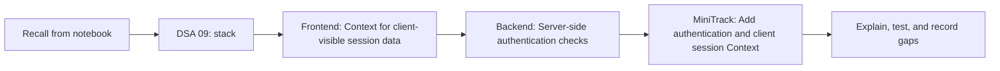
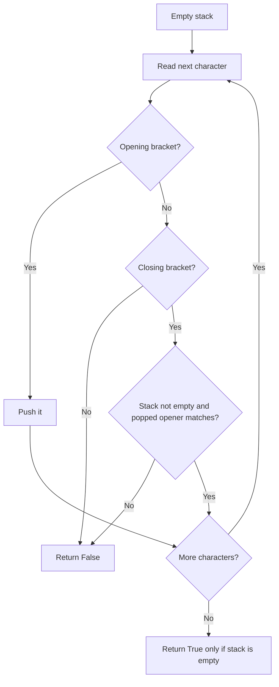
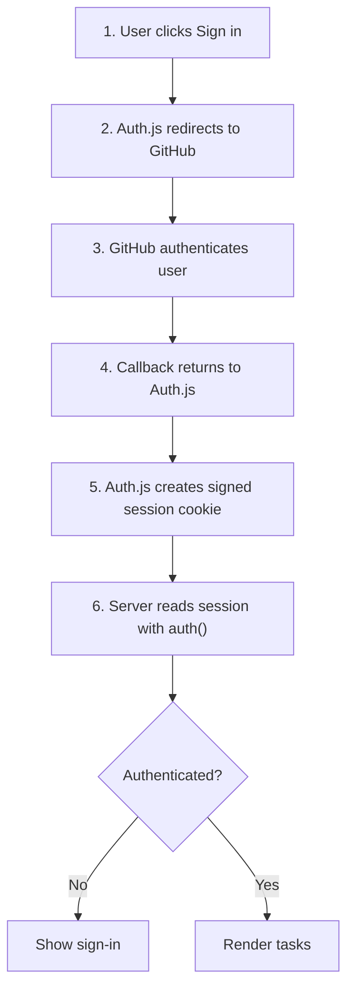
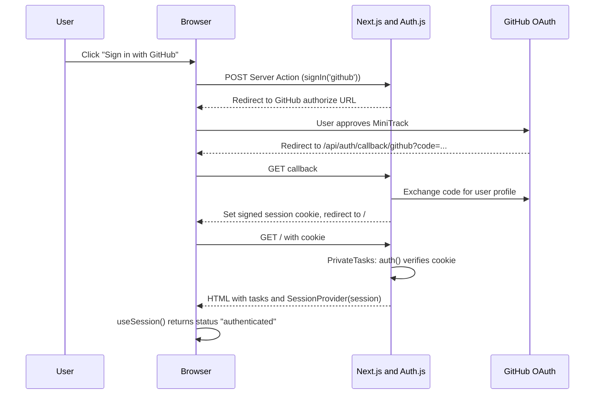

# Prep Day 09 — Add authentication and client session Context

> **Architecture transition:** This lesson still uses server-rendered task
> data and has not yet been adapted to the client-fetch page from Prep Days
> 01–08. Its page code cannot be applied directly without further changes.

**Date:** Friday, December 4, 2026  
**Time:** 7 study hours plus breaks  
**Starting point:** App Days 1–4 are complete. Continue from the current learner workspace and the previous preparation-day exit checklist.  
**Goal:** Add authentication and client session Context.

[Prep Day 08](prep-day-08.md) · [Preparation plan](../../docs/FULL_STACK_INTERVIEW_PREP_PLAN.md) · [Track home](README.md) · [Prep Day 10](prep-day-10.md)

**Everything to read today is below.** The original [App Day 10](../day-10.md)
and [DSA Day 09](../../dsa-python/lessons/dsa-day-09.md) remain available for
comparison. This prep day covers GitHub sign-in and sign-out, the server-side
`auth()` check on the page, and client session Context. Returning `401` from
the task API routes and the first mock interview belong to Prep Day 10; task
ownership (`owner_id`) belongs to Prep Days 11–12. Write runnable code in the
named project and practice files, not in this Markdown file.

## Learning objectives

- explain context for client-visible session data in beginner-friendly language;
- explain server-side authentication checks and its failure boundary;
- implement or verify the listed MiniTrack milestone;
- solve DSA Day 09 using the stack pattern;
- record the result in your rough notebook and explain it without reading.

## 1. Start with notebook recall (45 minutes)

Before opening a lesson, write answers in
[`checkpoints/ROUGH/Notes.md`](../../checkpoints/ROUGH/Notes.md):

1. What did yesterday's browser action send to the server?
2. Where is persistent task data stored, and what state is only temporary?
3. What error or edge case can you already predict for today's topic?
4. What do you remember about the **stack** pattern?

Use this format:

```md
## Friday, December 4, 2026

- What:
- Why:
- How MiniTrack uses it:
- What can go wrong:
- First task:
```

Do not copy the source paragraph. Write what you remember, then compare.

## 2. Understand today's full-stack boundary (20 minutes)

**Frontend focus — Context for client-visible session data:** SessionProvider uses React Context to make session state available to descendants without passing props through every level. It improves client ergonomics but is not a security boundary.

**Backend focus — Server-side authentication checks:** Protected Server Components and Route Handlers obtain the verified session on the server. Hiding a button in the browser does not stop a direct HTTP request.

**Today's connection:** The identity provider establishes a session; React Context distributes a display-friendly view while server code enforces access.



## 3. Python DSA practice (1 hour 45 minutes)

**Practice file:** [`dsa-python/practice/day-09.py`](../../dsa-python/practice/day-09.py)  
**Pattern:** stack

### Problem: Valid Parentheses

Given a string `s` made only of the bracket characters `(`, `)`, `[`, `]`,
`{`, and `}`, return `True` if the brackets are **balanced and correctly
nested**, otherwise `False`.

Correctly nested means every closing bracket matches the **most recent**
opening bracket that is still open. `([])` is valid; `([)]` is not, even
though it has one of each kind.

Assumptions: the empty string is valid. Any character that is not a bracket
makes the input invalid (the reference returns `False`).

```python
solve('()[]{}')  # True
solve('([)]')    # False
solve('(((')     # False, three brackets are never closed
```

Counting is not enough: `([)]` has matching counts but the wrong order. You
need to remember the order of unclosed openers, and the one you must close
next is always the **last** one you opened. That "last in, first out"
behaviour is exactly what a **stack** gives you.

### Start coding

In the practice file, replace the `raise NotImplementedError` line with your
own implementation. This is the starting shape:

```python
def solve(s):
    # Return True if every bracket closes the most recent unmatched opener.
    raise NotImplementedError
```

Python helpers you can use:

- A Python **list** works as a stack. `stack.append(x)` pushes `x` on top;
  `stack.pop()` removes and returns the top item.
- A **dictionary** can map each closer to its opener:
  `pairs = {')': '(', ']': '[', '}': '{'}`. Then `pairs[')']` is `'('`.
- `pairs.values()` gives the openers; `set(...)` turns them into a set so
  `ch in opening` is a fast membership check.
- `not stack` is `True` when the list is empty.



### Invariant to say aloud

Push opening delimiters and require every closing delimiter to match the most recent unmatched opening one.

### Work in this order

1. Restate the problem and ask about constraints.
2. Give a brute-force approach and its cost before optimizing.
3. Write the invariant above in your own words.
4. Implement without opening the solution for 25 minutes.
5. Test empty, smallest, typical, duplicate, and boundary cases where relevant.
6. Use a small hint if blocked; do not spend the entire block stuck.
7. Compare with the commented reference and re-code the key loop from memory.

From the repository root:

```bash
python3 dsa-python/scripts/check_practice.py 9
python3 -m unittest discover -s dsa-python/tests -v
```

**Expected observation:** the day-specific checker prints `Case 1 passed`
through `Case 3 passed`, and the completed reference suite still passes. The
three supplied cases do not cover a lone closing bracket or an empty string,
so add your own checks.

You can also temporarily add these checks below your `solve` function in the
practice file, then run `python3 dsa-python/practice/day-09.py`:

```python
if __name__ == '__main__':
    assert solve('()[]{}') is True
    assert solve('([)]') is False
    assert solve('(((') is False
    assert solve('') is True          # nothing to close
    assert solve(')') is False        # closer with an empty stack
    assert solve('{[]}') is True      # nested correctly
    assert solve('(]') is False       # wrong kind
    assert solve('(a)') is False      # not a bracket: outside the contract
    print('All checks passed')
```

### Brute-force code — reveal after attempting

<details>
<summary>Show the simple solution</summary>

```python
def solve(s):
    if any(ch not in '()[]{}' for ch in s):
        return False
    previous = None
    while s != previous:
        previous = s
        # Remove every adjacent matching pair, then try again.
        s = s.replace('()', '').replace('[]', '').replace('{}', '')
    return s == ''
```

</details>

A valid string always contains at least one adjacent pair such as `[]`.
Removing pairs repeatedly eventually empties a valid string; an invalid one
gets stuck. Each pass is O(n), and there can be about n / 2 passes (for
`((((...))))`), so the worst case is O(n²) time and O(n) extra space for the
new strings.

### Optimized code — reveal after attempting

<details>
<summary>Show the stack solution</summary>

```python
def solve(s):
    pairs = {')': '(', ']': '[', '}': '{'}  # closer -> its opener
    opening = set(pairs.values())
    stack = []
    for ch in s:
        if ch in opening:
            stack.append(ch)
        elif ch in pairs:
            # The closer must match the most recent unclosed opener.
            if not stack or stack.pop() != pairs[ch]:
                return False
        else:
            return False  # input contract: brackets only
    return not stack
```

</details>

Each character is pushed at most once and popped at most once: O(n) time.
In the worst case (all openers) the stack holds n characters: O(n) space.

Trace for `solve('([)]')`:

| Step | Character | Kind | Stack before | Action | Stack after |
|---:|---|---|---|---|---|
| 1 | `(` | opener | `[]` | push | `['(']` |
| 2 | `[` | opener | `['(']` | push | `['(', '[']` |
| 3 | `)` | closer | `['(', '[']` | pop `[`; needs `(`; mismatch | return `False` |

For `solve('()[]{}')` the stack goes `['(']` → `[]` → `['[']` → `[]` →
`['{']` → `[]`, and the final empty stack returns `True`.

### DSA interview questions and answers

#### DSA Q1. What is the brute-force approach?

**Interview-ready answer:** “I repeatedly delete adjacent matching pairs such
as `()`, `[]`, and `{}` until the string stops changing. If it ends empty, it
was valid. Each pass is linear and there can be about n / 2 passes, so it is
O(n²) time.”

**Example:** `{[]}` → remove `[]` → `{}` → remove `{}` → empty, so `True`.
`([)]` has no adjacent pair, so it is stuck and returns `False`.

**Follow-up:** Why is this still correct? A valid nested string always has an
innermost adjacent pair, and removing it leaves a valid string, so the
process can only empty valid strings.

#### DSA Q2. Why is a stack the right data structure?

**Interview-ready answer:** “The bracket I must close next is always the most
recently opened one that is still open. A stack gives me exactly that item in
O(1) with `pop()`, so I push openers and pop on every closer.”

**Example:** In `{[]}`, after pushing `{` and `[`, the closer `]` must match
`[`, the top of the stack, not `{`.

**Follow-up:** Why not just count each type? Counts ignore order. `([)]`
has equal counts but crosses its brackets.

#### DSA Q3. Why is the stack solution correct?

**Interview-ready answer:** “The invariant is that the stack holds exactly the
unmatched openers, in the order they were opened. A closer is valid only if it
matches the top. At the end, the string is valid only if nothing is left
unmatched, so I return `not stack`.”

**Example:** For `(((` every character is pushed and nothing pops, so the
stack ends with three items and the answer is `False`.

**Follow-up:** There are three failure points to name: a closer with an empty
stack (`)`), a closer that does not match the top (`(]`), and leftover openers
at the end (`(((`).

#### DSA Q4. What are the time and space costs?

**Interview-ready answer:** “O(n) time, because each character is pushed at
most once and popped at most once, and dictionary and set lookups are O(1) on
average. O(n) space in the worst case, when the string is all openers.”

**Example:** `'(' * 1000` keeps 1000 items on the stack before returning
`False`.

**Follow-up:** A quick early exit: if `len(s)` is odd, the answer must be
`False`. It does not change the worst-case complexity, but it is worth
mentioning.

#### DSA Q5. What edge cases should I test?

**Interview-ready answer:** “The empty string, a single closer, a single
opener, wrong kinds like `(]`, crossed order like `([)]`, deep nesting, and
characters that are not brackets. I ask whether non-bracket characters should
be ignored or rejected.”

**Example:** `solve('')` is `True`; `solve(')')` is `False`;
`solve('(a)')` is `False` under this contract.

**Follow-up:** If the interviewer says other characters should be ignored,
change the final `else: return False` to `continue`. Confirm the contract
before coding.

#### DSA Q6. What if there is only one bracket type, or I must report where it fails?

**Interview-ready answer:** “With only `(` and `)`, I do not need a stack: a
counter of open brackets is enough, giving O(1) space. I return `False` if it
goes below zero and require it to be zero at the end. To report the error
position, I store indices on the stack instead of characters.”

**Example:** For `())(`, the counter goes 1, 0, -1, so it fails at index 2.

**Follow-up:** A harder variant is "longest valid parentheses substring",
which pushes indices and uses the index below the top as the start of the
current valid run.

## 4. Frontend guided study (1 hour 30 minutes)

### What

SessionProvider uses React Context to make session state available to descendants without passing props through every level. It improves client ergonomics but is not a security boundary.

### Why

The browser layer should make state and feedback understandable without taking
ownership of persistent data or security decisions that belong on the server.

### How

**Authentication** answers "who are you?". MiniTrack uses **Auth.js** (the
`next-auth` package) with **GitHub OAuth**: GitHub checks the user's
password, then sends them back to MiniTrack, and Auth.js stores a signed
session cookie.



There are two ways to read the session:

| Where | How | Trusted for security? |
|---|---|---|
| Server Component, Route Handler, Server Action | `await auth()` from `frontend/auth.ts` | Yes; it verifies the signed cookie on the server. |
| Client Component | `useSession()` inside `SessionProvider` | No; it is display data the browser can change. |

**React Context** lets a parent component make a value available to every
descendant without passing it as a prop through each level. `SessionProvider`
is a Context provider; `useSession()` is the hook that reads it. Today's
example is small, a "Signed in as ..." line, so you can see the mechanism.

Files you will create or change in section 6:

- `frontend/auth.ts`
- `frontend/app/api/auth/[...nextauth]/route.ts`
- `frontend/app/AuthControls.tsx`
- `frontend/app/AuthSessionProvider.tsx`
- `frontend/app/ClientSessionSummary.tsx`
- `frontend/app/page.tsx`

Answer before coding:

- Which value is persistent (the signed session cookie and GitHub identity), and which value is temporary interaction state (`useSession()`'s `status`)?
- What starts this behavior? (Clicking **Sign in with GitHub** submits a Server Action form.)
- What should the user see while work is pending? (`Checking session...` from Suspense or `useSession()`'s `loading` status.)
- What should remain unchanged when the operation fails? (No cookie is set; the page still shows the sign-in screen.)

## 5. Backend guided study (1 hour 30 minutes)

### What

Protected Server Components and Route Handlers obtain the verified session on the server. Hiding a button in the browser does not stop a direct HTTP request.

### Boundary checklist

- Validate untrusted path, query, and body values.
- Authenticate identity when the route is protected.
- Authorize the resource separately from authentication.
- Bind SQL values rather than concatenating untrusted data.
- Return an explicit success or error status.
- Log internal failures on the server without exposing secrets.

### Secrets stay on the server

Auth.js needs three secret values. They live only in the ignored
`frontend/.env.local`, never in code, commits, logs, or the browser:

| Variable | What it is | Where it comes from |
|---|---|---|
| `AUTH_SECRET` | Key that signs the session cookie | `npx auth secret` writes it for you |
| `AUTH_GITHUB_ID` | Your GitHub OAuth App's client ID | GitHub developer settings |
| `AUTH_GITHUB_SECRET` | Your GitHub OAuth App's client secret | GitHub developer settings |

Auth.js reads these names automatically, which is why `frontend/auth.ts` can
be only a few lines.

### The server check

Every private **server** entry point calls `auth()` and treats a missing
`session.user` as "not signed in":

```ts
const session = await auth();
if (!session?.user) {
  // Not signed in: show the sign-in screen (page) or return 401 (API, Prep Day 10).
}
```

Today you add this check to the page in `frontend/app/page.tsx`. The task API
routes in `frontend/app/api/tasks/` are **still open** at the end of today;
section 8 shows why that is a real gap, and Prep Day 10 closes it.

## 6. MiniTrack implementation (1 hour)

**Milestone source:** Day 10 Auth.js, SessionProvider, and useSession

Run every command from `frontend/`.

### Step 1: Install Auth.js and create the cookie secret

```bash
npm install next-auth@beta
npx auth secret
```

`npx auth secret` adds a strong `AUTH_SECRET` to your local environment file.
Never copy it into a lesson, commit, browser bundle, log, or chat.

Auth.js package and provider instructions can change. Recheck the
[official installation guide](https://authjs.dev/getting-started/installation)
and [GitHub provider guide](https://authjs.dev/guides/configuring-github)
before you begin.

### Step 2: Create a GitHub OAuth App

In GitHub → **Settings** → **Developer settings** → **OAuth Apps** → **New
OAuth App**:

- Homepage URL: `http://localhost:3000`
- Authorization callback URL: `http://localhost:3000/api/auth/callback/github`

Add the issued values to `frontend/.env.local` (these are placeholders; use
your own values and never commit them):

```env
AUTH_GITHUB_ID=YOUR_GITHUB_CLIENT_ID
AUTH_GITHUB_SECRET=YOUR_GITHUB_CLIENT_SECRET
```

Keep the existing `DATABASE_URL`. Confirm the file is still ignored:

```bash
git check-ignore .env.local
```

### Step 3: Configure Auth.js

Create `frontend/auth.ts` (at the `frontend/` root, next to `package.json`):

```ts
import NextAuth from 'next-auth';
import GitHub from 'next-auth/providers/github';

// Auth.js creates the route handlers, server session reader, and server actions.
export const { handlers, auth, signIn, signOut } = NextAuth({
  providers: [GitHub],
});
```

- `handlers` answers Auth.js's own HTTP routes (sign-in, callback, sign-out).
- `auth()` reads and verifies the session on the server.
- `signIn` and `signOut` start or end a session from a Server Action.

Create `frontend/app/api/auth/[...nextauth]/route.ts`:

```ts
import { handlers } from '@/auth';

// The catch-all route receives Auth.js sign-in, callback, and session requests.
export const { GET, POST } = handlers;
```

`[...nextauth]` is a **catch-all** segment: it matches
`/api/auth/signin`, `/api/auth/callback/github`, and every other path under
`/api/auth/`. `@/auth` means `frontend/auth.ts`; the `@/*` alias was set when
the project was created. The route contains no provider secret.

### Step 4: Add sign-in and sign-out controls

Create `frontend/app/AuthControls.tsx`:

```tsx
import { auth, signIn, signOut } from '@/auth';

export default async function AuthControls() {
  const session = await auth();

  if (!session?.user) {
    return (
      <form
        action={async () => {
          'use server';
          await signIn('github', { redirectTo: '/' });
        }}
      >
        <button className="rounded-lg bg-violet-500 px-4 py-2 font-bold">
          Sign in with GitHub
        </button>
      </form>
    );
  }

  return (
    <div className="flex items-center gap-3">
      <span className="text-sm text-slate-300">
        {session.user.name ?? session.user.email ?? 'Signed in'}
      </span>
      <form
        action={async () => {
          'use server';
          await signOut({ redirectTo: '/' });
        }}
      >
        <button className="rounded-lg border border-slate-700 px-4 py-2">
          Sign out
        </button>
      </form>
    </div>
  );
}
```

This is a Server Component (no `'use client'`). The `'use server'` line turns
each inline function into a **Server Action**: the form posts to the server,
which runs `signIn` or `signOut`, so provider logic and secrets never reach
the browser.

### Step 5: Add client session Context

Create `frontend/app/AuthSessionProvider.tsx`:

```tsx
'use client';

import type { Session } from 'next-auth';
import { SessionProvider } from 'next-auth/react';
import type { ReactNode } from 'react';

export default function AuthSessionProvider({
  children,
  session,
}: {
  children: ReactNode;
  session: Session | null;
}) {
  return (
    // Passing the server-verified session avoids an extra client fetch on load.
    <SessionProvider session={session}>
      {children}
    </SessionProvider>
  );
}
```

Create `frontend/app/ClientSessionSummary.tsx`, a descendant Client Component
that reads the Context-backed hook:

```tsx
'use client';

import { useSession } from 'next-auth/react';

export default function ClientSessionSummary() {
  // status is 'loading', 'authenticated', or 'unauthenticated'.
  const { data: session, status } = useSession();

  if (status === 'loading') return <p>Checking session...</p>;
  if (!session?.user) return <p>Not signed in</p>;

  return <p>Signed in as {session.user.name ?? session.user.email}</p>;
}
```

`SessionProvider` must be a Client Component because Context only works in
the client tree; that is why it needs its own `'use client'` wrapper file.

### Step 6: Protect the page

Replace `frontend/app/page.tsx` with the version below. It keeps the Prep
Day 06 search page (`SearchForm`, `searchTasks`, `normalizeTaskFilters`) and
adds the server check before any task is read:

```tsx
import { Suspense } from 'react';
import { auth } from '@/auth';
import AuthControls from './AuthControls';
import AuthSessionProvider from './AuthSessionProvider';
import ClientSessionSummary from './ClientSessionSummary';
import SearchForm from './SearchForm';
import TaskBoard from './TaskBoard';
import { searchTasks } from '../lib/tasks';
import { normalizeTaskFilters } from '../lib/validation';

type PageProps = {
  searchParams: Promise<{
    q?: string;
    status?: string;
  }>;
};

async function PrivateTasks({ searchParams }: PageProps) {
  // auth() reads the signed session cookie on the server.
  const session = await auth();

  if (!session?.user) {
    return (
      <section className="rounded-2xl border border-slate-700 bg-slate-900 p-8">
        <h2 className="text-2xl font-bold">Sign in to open MiniTrack</h2>
        <div className="mt-5">
          <AuthControls />
        </div>
      </section>
    );
  }

  // Only a signed-in request reaches the database read.
  const params = await searchParams;
  const filters = normalizeTaskFilters(params.q, params.status);
  const tasks = await searchTasks(filters);

  return (
    <>
      <div className="flex flex-wrap items-center justify-between gap-3">
        {/* Context wraps only the interactive subtree that needs it. */}
        <AuthSessionProvider session={session}>
          <ClientSessionSummary />
        </AuthSessionProvider>
        <AuthControls />
      </div>
      <SearchForm filters={filters} />
      <TaskBoard tasks={tasks} />
    </>
  );
}

export default function Home({ searchParams }: PageProps) {
  return (
    <main className="mx-auto min-h-screen w-full max-w-5xl px-5 py-12">
      <h1 className="mb-8 text-4xl font-bold">MiniTrack</h1>
      <Suspense fallback={<p className="text-slate-400">Checking session...</p>}>
        <PrivateTasks searchParams={searchParams} />
      </Suspense>
    </main>
  );
}
```

`auth()` reads request cookies, so `PrivateTasks` is request-time work inside
`Suspense`, which is what Cache Components require. Do not add
`'use cache'` here: private session output must never be cached and shared,
and do not add `dynamic = 'force-dynamic'`.

### Step 7: Run and verify

```bash
npm run lint
npx tsc --noEmit
npm run dev
```

In a private/incognito window, open `http://localhost:3000`:

1. Signed out: the page shows **Sign in to open MiniTrack** and no tasks.
2. Click **Sign in with GitHub**, approve the app, and return to MiniTrack.
3. The page shows `Signed in as <your name>`, **Sign out**, the search form,
   and your tasks.
4. Refresh: you stay signed in (the cookie persists).
5. Click **Sign out**: the sign-in screen returns.

**Expected observation:** sign-in and sign-out work and the page never shows
tasks to a signed-out visitor. Note what is **not** fixed yet: in a separate
terminal, `curl -i http://localhost:3000/api/tasks` still returns `200` with
task JSON. That is today's gap, closed on Prep Day 10. Also expect
`npm run test:e2e` from Prep Day 08 to fail now, because an anonymous browser
sees the sign-in screen instead of the `Task title` input; Prep Day 10 updates
the browser test.

Failure checks:

| Symptom | Likely cause |
|---|---|
| GitHub reports that the `redirect_uri` must match the registered callback URL | The callback URL in the OAuth App is not exactly `http://localhost:3000/api/auth/callback/github`. |
| `MissingSecret` error | `AUTH_SECRET` is missing; rerun `npx auth secret` and restart the dev server. |
| `Cannot find module '@/auth'` | `auth.ts` is not in `frontend/`, or the `@/*` path alias is missing from `tsconfig.json`. |
| `useSession must be wrapped in a <SessionProvider />` | `ClientSessionSummary` was rendered outside `AuthSessionProvider`. |
| Changes to `.env.local` have no effect | Restart `npm run dev`; environment files are read at startup. |

## 7. Trace the event or request



Trace one concrete input. Name every boundary, value, and possible failure.
For example: a wrong callback URL fails at the GitHub step; a missing
`AUTH_SECRET` fails when Auth.js tries to sign the cookie.

## 8. Deliberate debugging exercise (25 minutes)

**Break it:** Protect a mutation only by hiding its button when useSession reports no user.

**Predict before running:** write the expected symptom in your notebook.

**Expected symptom:** An attacker can call the Route Handler directly.

**Root cause:** Browser state is controlled by the client and cannot authorize server resources.

**Restore and verify:** Call auth() at the server boundary and reject missing identity.

Concretely: sign out, then from a terminal (which has no browser cookie) run:

```bash
curl -i -X POST http://localhost:3000/api/tasks \
  -H 'Content-Type: application/json' -d '{"title":"Added without signing in"}'
```

It returns `201`, and the task appears after you sign in again. No button was
needed. Delete that task. The repair, a server `auth()` check returning `401`
in every task Route Handler, is Prep Day 10's first step; write down which
four handlers need it (`GET`/`POST` in `app/api/tasks/route.ts`,
`PATCH`/`DELETE` in `app/api/tasks/[id]/route.ts`).

Do not stop after making the symptom disappear. Explain why the repair restores
the intended invariant.

## 9. Interview questions and answers (30 minutes)

### Q1. What is context for client-visible session data?

**Interview-ready answer:** SessionProvider uses React Context to make session state available to descendants without passing props through every level. It improves client ergonomics but is not a security boundary.

**Example:** `frontend/app/page.tsx` passes the server-verified `session` into
`AuthSessionProvider`; `ClientSessionSummary` calls `useSession()` and renders
`Signed in as ...` without any prop. A Client Component deeper in the tree
could read the same value.

**Senior follow-up:** Context re-renders every consumer when its value
changes, so keep the provider around only the subtree that needs it, as
`page.tsx` does. If many unrelated components needed different session
fields, measure re-renders first; a Server Component passing a small prop is
often simpler than more Context.

### Q2. How should the backend handle server-side authentication checks?

**Interview-ready answer:** Protected Server Components and Route Handlers obtain the verified session on the server. Hiding a button in the browser does not stop a direct HTTP request.

**Example:** `PrivateTasks` in `frontend/app/page.tsx` calls `await auth()`
and returns the sign-in section before `searchTasks(filters)` runs, so a
signed-out visitor never triggers the SQL. The `curl -X POST /api/tasks` in
section 8 shows that the API still needs the same check.

**Senior follow-up:** Secrets such as `AUTH_SECRET` and
`AUTH_GITHUB_SECRET` stay in server environment variables and must never be
logged. If GitHub is down, sign-in fails but existing signed cookies still
verify locally; log the provider error on the server without the code or
token.

### Q3. What invariant makes the stack solution correct?

**Interview-ready answer:** Push opening delimiters and require every closing delimiter to match the most recent unmatched opening one.

**Example:** For `([)]`, the stack is `['(', '[']` when `)` arrives. Popping
gives `[`, which does not match `(`, so the answer is `False` at step 3.

**Senior follow-up:** O(n) time and O(n) space assume average O(1) dictionary
and set lookups. With only one bracket type, a counter replaces the stack and
space drops to O(1).

### Q4. How does today's work fit the complete MiniTrack system?

**Interview-ready answer:** The identity provider establishes a session; React Context distributes a display-friendly view while server code enforces access.

**Example:** GitHub verifies the user, Auth.js sets a signed cookie, `auth()`
in `page.tsx` reads it to decide whether to render tasks, and
`useSession()` only drives the `Signed in as ...` text.

**Senior follow-up:** The first security risk is the still-open task API
(fixed on Prep Day 10), and the next is that every signed-in user still shares
one `tasks` table (fixed with `owner_id` on Prep Days 11–12). Measure how often
`auth()` runs per request before worrying about its cost.

## 10. Complexity and operational cost

- **DSA:** O(n) time and O(n) worst-case space.
- **Application:** Session verification adds work to protected requests. Cache and database choices depend on the configured session strategy.
- **Learning:** Attempting, retrieving, and correcting is more valuable than
  copying several solutions. Keep the scope to one understood pattern today.

## Exit checklist

- [ ] I completed DSA Day 09 before reading its solution.
- [ ] I can state the invariant and complexity without notes.
- [ ] I completed or verified the MiniTrack milestone.
- [ ] I tested one success path and one failure path.
- [ ] I completed the deliberate debugging exercise.
- [ ] I answered all four interview questions aloud.
- [ ] I recorded what remains confusing and tomorrow's first task.

**Suggested commit:** `prep day 09: add authentication and client session context`
