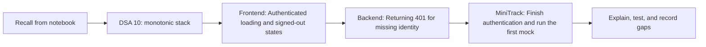
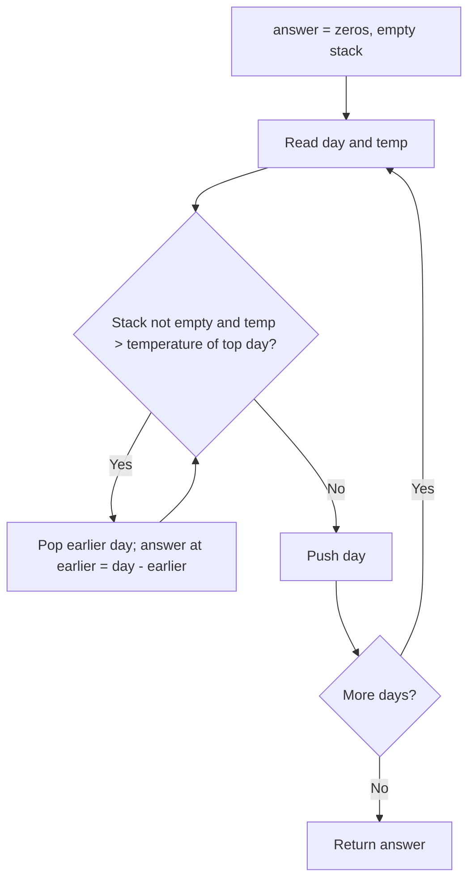
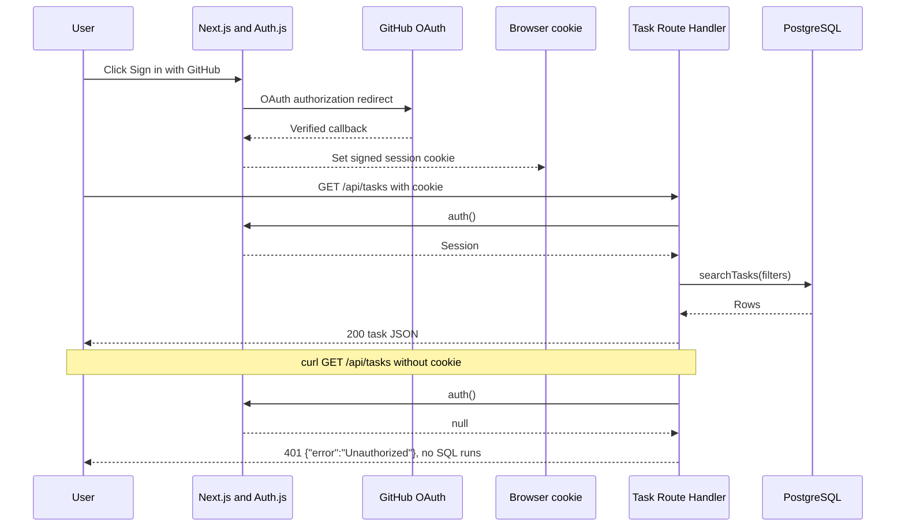

# Prep Day 10 — Finish authentication and run the first mock

**Date:** Saturday, December 5, 2026  
**Time:** 7 study hours plus breaks  
**Starting point:** App Days 1–4 are complete. Continue from the current learner workspace and the previous preparation-day exit checklist.  
**Goal:** Finish authentication and run the first mock.

[Prep Day 09](prep-day-09.md) · [Preparation plan](../../docs/FULL_STACK_INTERVIEW_PREP_PLAN.md) · [Track home](README.md) · [Prep Day 11](prep-day-11.md)

**Everything to read today is below.** The original [App Day 10](../day-10.md),
[Interview index](../../docs/INTERVIEW_INDEX.md), and
[DSA Day 10](../../dsa-python/lessons/dsa-day-10.md) remain available for
comparison. This prep day closes the task API to anonymous callers with
`401`, verifies the whole sign-in flow, updates the Prep Day 08 browser test,
and runs your first 30-minute mock. Sign-in, sign-out, and `SessionProvider`
were built on Prep Day 09. Task ownership (`owner_id`, `403`/`404` for another
user's task) belongs to Prep Days 11–12. Write runnable code in the named
project and practice files, not in this Markdown file.

## Learning objectives

- explain authenticated loading and signed-out states in beginner-friendly language;
- explain returning 401 for missing identity and its failure boundary;
- implement or verify the listed MiniTrack milestone;
- solve DSA Day 10 using the monotonic stack pattern;
- record the result in your rough notebook and explain it without reading.

## 1. Start with notebook recall (45 minutes)

Before opening a lesson, write answers in
[`checkpoints/ROUGH/Notes.md`](../../checkpoints/ROUGH/Notes.md):

1. What did yesterday's browser action send to the server?
2. Where is persistent task data stored, and what state is only temporary?
3. What error or edge case can you already predict for today's topic?
4. What do you remember about the **monotonic stack** pattern?

Use this format:

```md
## Saturday, December 5, 2026

- What:
- Why:
- How MiniTrack uses it:
- What can go wrong:
- First task:
```

Do not copy the source paragraph. Write what you remember, then compare.

## 2. Understand today's full-stack boundary (20 minutes)

**Frontend focus — Authenticated loading and signed-out states:** The UI should represent loading, authenticated, and unauthenticated states explicitly. Rendering the signed-out state is not a substitute for server enforcement.

**Backend focus — Returning 401 for missing identity:** A Route Handler returns 401 when no valid identity is present. Authorization for a particular task is a separate Day 11 decision.

**Today's connection:** Authentication proves who is making a request but does not yet prove which task that user may access.



## 3. Python DSA practice (1 hour 45 minutes)

**Practice file:** [`dsa-python/practice/day-10.py`](../../dsa-python/practice/day-10.py)  
**Pattern:** monotonic stack

### Problem: Daily Temperatures

You are given a list of daily temperatures. For each day, return how many
days you must wait until a **strictly warmer** temperature. If no warmer day
comes later, use `0` for that day. The answer list has the same length as the
input.

Assumptions: temperatures are integers; an equal temperature is **not**
warmer.

```python
solve([73, 74, 75, 71, 69, 72, 76, 73])  # [1, 1, 4, 2, 1, 1, 0, 0]
```

For example, day 2 is `75`. The next warmer day is day 6 (`76`), so the
answer for day 2 is `6 - 2 = 4`.

The simple approach scans forward from every day: O(n²) time. A faster idea:
keep a **stack of days that are still waiting** for a warmer day. When a warm
day arrives, it answers every waiting day on top of the stack that is colder.
The waiting temperatures on the stack always get colder from bottom to top,
which is why it is called a **monotonic** (one-direction) stack.

### Start coding

In the practice file, replace the `raise NotImplementedError` line with your
own implementation. This is the starting shape:

```python
def solve(temperatures):
    # Return days to wait for a strictly warmer temperature, or 0 for each day.
    raise NotImplementedError
```

Python helpers you can use:

- `[0] * len(temperatures)` makes a list of zeros with the same length, so
  days that never find a warmer day already hold `0`.
- `stack[-1]` reads the top of the stack **without** removing it;
  `stack.pop()` removes and returns it.
- `while stack and ...` stops safely when the stack becomes empty, because
  Python checks `stack` first and skips the rest if it is empty.
- Store **indices** (day numbers) on the stack, not temperatures: you need
  the index to compute the distance `day - earlier`, and you can always look
  the temperature up with `temperatures[index]`.



### Invariant to say aloud

Keep indices whose temperatures form a decreasing stack; a warmer day resolves entries from the top.

### Work in this order

1. Restate the problem and ask about constraints.
2. Give a brute-force approach and its cost before optimizing.
3. Write the invariant above in your own words.
4. Implement without opening the solution for 25 minutes.
5. Test empty, smallest, typical, duplicate, and boundary cases where relevant.
6. Use a small hint if blocked; do not spend the entire block stuck.
7. Compare with the commented reference and re-code the key loop from memory.

From the repository root:

```bash
python3 dsa-python/scripts/check_practice.py 10
python3 -m unittest discover -s dsa-python/tests -v
```

**Expected observation:** the day-specific checker prints `Case 1 passed`,
and the completed reference suite still passes. There is only one supplied
case, so the asserts below matter.

You can also temporarily add these checks below your `solve` function in the
practice file, then run `python3 dsa-python/practice/day-10.py`:

```python
if __name__ == '__main__':
    assert solve([73, 74, 75, 71, 69, 72, 76, 73]) == [1, 1, 4, 2, 1, 1, 0, 0]
    assert solve([]) == []                    # no days
    assert solve([50]) == [0]                 # one day, nothing later
    assert solve([30, 30, 30]) == [0, 0, 0]   # equal is not warmer
    assert solve([30, 40, 50]) == [1, 1, 0]   # rising
    assert solve([50, 40, 30]) == [0, 0, 0]   # falling: stack only grows
    print('All checks passed')
```

### Brute-force code — reveal after attempting

<details>
<summary>Show the simple solution</summary>

```python
def solve(temperatures):
    answer = [0] * len(temperatures)
    for day in range(len(temperatures)):
        for later in range(day + 1, len(temperatures)):
            if temperatures[later] > temperatures[day]:
                answer[day] = later - day
                break  # the first warmer day is the answer
    return answer
```

</details>

For each day this scans forward until it finds a warmer day. A falling list
like `[50, 40, 30]` never breaks early, so the worst case is O(n²) time with
O(1) extra space besides the answer list.

### Optimized code — reveal after attempting

<details>
<summary>Show the monotonic stack solution</summary>

```python
def solve(temperatures):
    answer = [0] * len(temperatures)
    stack = []  # indices with monotonically decreasing temperatures
    for day, temp in enumerate(temperatures):
        # Today answers every colder day that is still waiting.
        while stack and temp > temperatures[stack[-1]]:
            earlier = stack.pop()
            answer[earlier] = day - earlier
        stack.append(day)
    return answer
```

</details>

Each index is pushed once and popped at most once, so the total work is O(n)
time. The stack can hold all n indices (falling temperatures): O(n) space.

Trace for `solve([73, 74, 75, 71, 69, 72, 76, 73])` (stack shown as
`index:temp`):

| day | temp | Popped (answer set) | Stack after push |
|---:|---:|---|---|
| 0 | 73 | none | `0:73` |
| 1 | 74 | 0 → `answer[0] = 1` | `1:74` |
| 2 | 75 | 1 → `answer[1] = 1` | `2:75` |
| 3 | 71 | none (71 < 75) | `2:75, 3:71` |
| 4 | 69 | none | `2:75, 3:71, 4:69` |
| 5 | 72 | 4 → `answer[4] = 1`; 3 → `answer[3] = 2` | `2:75, 5:72` |
| 6 | 76 | 5 → `answer[5] = 1`; 2 → `answer[2] = 4` | `6:76` |
| 7 | 73 | none | `6:76, 7:73` |

Days 6 and 7 are never popped, so they keep `0`. Result:
`[1, 1, 4, 2, 1, 1, 0, 0]`.

### DSA interview questions and answers

#### DSA Q1. What is the brute-force approach?

**Interview-ready answer:** “For each day I scan forward until I find a
strictly warmer temperature and record the distance. If I never find one, the
answer stays 0. In the worst case, a falling list, every scan goes to the end,
so it is O(n²) time.”

**Example:** For day 2 (`75`) the scan checks `71`, `69`, `72`, and then
finds `76` at day 6, so the answer is 4.

**Follow-up:** What repeated work is wasted? Days 3, 4, and 5 are scanned
again from each earlier day. The stack lets each later day answer many
earlier days at once.

#### DSA Q2. How does the monotonic stack work?

**Interview-ready answer:** “I keep a stack of days still waiting for a
warmer day. For each new day, while it is warmer than the day on top, I pop
that day and record the distance. Then I push the new day, because it is now
waiting too.”

**Example:** On day 5 (`72`), the stack is `2:75, 3:71, 4:69`. `72` pops
day 4 (answer 1) and day 3 (answer 2), stops at `75`, and pushes day 5.

**Follow-up:** Why store indices? The answer is a distance, so you need the
index; the temperature can be read with `temperatures[index]`.

#### DSA Q3. Why is it correct?

**Interview-ready answer:** “The invariant is that the stack holds, from
bottom to top, days with decreasing temperatures that have not seen a warmer
day yet. When a day pops an earlier day, it is the **first** warmer day for
it, because every day in between was not warmer, or the earlier day would
already have been popped.”

**Example:** Day 3 (`71`) waits through day 4 (`69`, colder) and is popped by
day 5 (`72`), the first warmer day, giving 2.

**Follow-up:** Why does the stack stay in order? A day is pushed only after
every strictly colder day on top has been popped, so every day below it is at
least as warm. Equal temperatures can sit next to each other, so strictly
speaking the stack is non-increasing from bottom to top.

#### DSA Q4. What are the time and space costs?

**Interview-ready answer:** “O(n) time, because each index is pushed once and
popped at most once; the inner `while` loop's total work across the whole run
is at most n pops. O(n) extra space for the stack, plus the O(n) answer.”

**Example:** For `[50, 40, 30]` nothing is ever popped and the stack grows to
three items; for `[30, 40, 50]` the stack never holds more than one item.

**Follow-up:** This is amortized reasoning: day 6 pops two items in one
iteration, but the total number of pops can never exceed the number of pushes.

#### DSA Q5. What edge cases should I test?

**Interview-ready answer:** “An empty list, one day, equal temperatures, a
strictly rising list, a strictly falling list, and a warm day at the very end.
Equal temperatures are the trap: the problem says strictly warmer, so I use
`>` and not `>=`.”

**Example:** `solve([30, 30, 30])` is `[0, 0, 0]`. If the comparison were
`>=`, it would wrongly return `[1, 1, 0]`.

**Follow-up:** Days left on the stack at the end never found a warmer day.
Because `answer` starts as zeros, no extra loop is needed to fill them.

#### DSA Q6. What realistic variant uses the same idea?

**Interview-ready answer:** “Next Greater Element in a circular array. I loop
over the indices twice using `i % n`, so a day near the end can find a warmer
day at the start. It is still O(n) time and O(n) space.”

**Example:** For circular `[3, 1, 2]`, index 2 (`2`) wraps around and finds
`3` at index 0, so its next greater value is `3`; index 0 has none, `-1`.

**Follow-up:** Stock Span ("how many consecutive previous days were at most
today's price") uses the mirror image: pop while the top is less than or
equal to today, and measure the distance backwards.

## 4. Frontend guided study (1 hour 30 minutes)

### What

The UI should represent loading, authenticated, and unauthenticated states explicitly. Rendering the signed-out state is not a substitute for server enforcement.

### Why

The browser layer should make state and feedback understandable without taking
ownership of persistent data or security decisions that belong on the server.

### How

MiniTrack already shows all three states from the Prep Day 09 code. Find each
one before writing anything new:

| State | Where it comes from | What the user sees |
|---|---|---|
| Loading | `Suspense` fallback in `frontend/app/page.tsx` while `auth()` runs; `status === 'loading'` in `ClientSessionSummary.tsx` | `Checking session...` |
| Unauthenticated | `PrivateTasks` returns early when `!session?.user` | **Sign in to open MiniTrack** and the GitHub button |
| Authenticated | `PrivateTasks` continues to `searchTasks(filters)` | `Signed in as ...`, **Sign out**, search, and tasks |

The relevant excerpt from `frontend/app/page.tsx` (no change today):

```tsx
async function PrivateTasks({ searchParams }: PageProps) {
  const session = await auth();

  if (!session?.user) {
    // Unauthenticated: render sign-in and stop before any task query.
    return (
      <section className="rounded-2xl border border-slate-700 bg-slate-900 p-8">
        <h2 className="text-2xl font-bold">Sign in to open MiniTrack</h2>
        <div className="mt-5">
          <AuthControls />
        </div>
      </section>
    );
  }
  // Authenticated: read filters and tasks...
}
```

And from `frontend/app/ClientSessionSummary.tsx`:

```tsx
const { data: session, status } = useSession();

if (status === 'loading') return <p>Checking session...</p>;
if (!session?.user) return <p>Not signed in</p>;
return <p>Signed in as {session.user.name ?? session.user.email}</p>;
```

The signed-out screen is a **courtesy**. `TaskBoard.tsx` still sends
`fetch('/api/tasks', ...)` requests, and anyone can send the same requests
with curl. The real protection is today's backend change.

Files to open deliberately:

- `frontend/auth.ts`
- `frontend/app/api/tasks/route.ts`
- `frontend/app/api/tasks/[id]/route.ts`
- `frontend/test/e2e/tasks.spec.ts`

Answer before coding:

- Which value is persistent (the signed session cookie), and which value is temporary interaction state (`useSession()`'s `status`)?
- What starts this behavior? (Any HTTP request to `/api/tasks`, from the app or from curl.)
- What should the user see while work is pending? (`Checking session...`.)
- What should remain unchanged when the operation fails? (A `401` must not create, update, or delete any row.)

## 5. Backend guided study (1 hour 30 minutes)

### What

A Route Handler returns 401 when no valid identity is present. Authorization for a particular task is a separate Day 11 decision.

### Boundary checklist

- Validate untrusted path, query, and body values.
- Authenticate identity when the route is protected.
- Authorize the resource separately from authentication.
- Bind SQL values rather than concatenating untrusted data.
- Return an explicit success or error status.
- Log internal failures on the server without exposing secrets.

### Choosing the status code

| Status | Meaning | MiniTrack example |
|---|---|---|
| `401 Unauthorized` | No valid identity: "sign in first" | Anonymous `GET /api/tasks` (today) |
| `403 Forbidden` | Identity known, but not allowed | A signed-in user editing someone else's task (Prep Days 11–12 may use this or `404`) |
| `404 Not Found` | The resource does not exist (or is hidden) | `PATCH /api/tasks/999999` when no such row exists |
| `400 Bad Request` | Input is invalid | `PATCH /api/tasks/abc` |

### The check, placed first

At the **start** of every task Route Handler, before reading the body or the
ID:

```ts
import { auth } from '@/auth';

const session = await auth();
if (!session?.user) {
  return Response.json(
    { error: 'Unauthorized' },
    { status: 401 },
  );
}
```

Putting it first means an anonymous caller learns nothing else: not whether
the JSON was valid, and not whether a task ID exists. Apply it to collection
`GET`/`POST` and item `PATCH`/`DELETE`. Do not trust a user ID sent in request
JSON; identity comes only from `auth()`.

### Important limitation after today

- anonymous users cannot access tasks;
- authenticated users can access tasks;
- **all authenticated users still share the same task table**.

Authentication answers **who are you?** It does not yet answer **which rows
may you access?** Prep Days 11–12 add an owner column and enforce ownership in
every query.

## 6. MiniTrack implementation (1 hour)

**Milestone source:** Day 10 protected requests and authentication review

Run every command from `frontend/`.

### Step 1: Protect the collection routes

Replace `frontend/app/api/tasks/route.ts` with the version below. It is the
Prep Day 06 search-aware `GET` and the Prep Day 01 `POST`, each with the
session check added first:

```ts
import type { NextRequest } from 'next/server';
import { auth } from '@/auth';
import { createTask, searchTasks } from '../../../lib/tasks';
import {
  isRecord,
  normalizeTaskFilters,
  normalizeTitle,
} from '../../../lib/validation';

export async function GET(request: NextRequest): Promise<Response> {
  // Authenticate before doing any other work.
  const session = await auth();
  if (!session?.user) {
    return Response.json({ error: 'Unauthorized' }, { status: 401 });
  }

  const filters = normalizeTaskFilters(
    request.nextUrl.searchParams.get('q'),
    request.nextUrl.searchParams.get('status'),
  );

  try {
    return Response.json(await searchTasks(filters));
  } catch (error: unknown) {
    console.error('GET /api/tasks failed:', error);
    return Response.json({ error: 'Internal server error' }, { status: 500 });
  }
}

export async function POST(request: Request): Promise<Response> {
  const session = await auth();
  if (!session?.user) {
    return Response.json({ error: 'Unauthorized' }, { status: 401 });
  }

  // JSON from the network is untrusted, so keep it unknown until validation.
  let parsingBody = true;
  try {
    const body: unknown = await request.json();
    parsingBody = false;
    const title = normalizeTitle(isRecord(body) ? body.title : undefined);
    if (!title) {
      return Response.json({ error: 'title must be 1–200 characters' }, { status: 400 });
    }
    return Response.json(await createTask(title), { status: 201 });
  } catch (error: unknown) {
    if (parsingBody) {
      return Response.json({ error: 'Invalid JSON' }, { status: 400 });
    }
    console.error('POST /api/tasks failed:', error);
    return Response.json({ error: 'Internal server error' }, { status: 500 });
  }
}
```

### Step 2: Protect the item routes

Replace `frontend/app/api/tasks/[id]/route.ts` with the version below. It is
the Prep Day 03 `PATCH` (title **or** done) and Prep Day 02 `DELETE`, with the
session check added first:

```ts
import { auth } from '@/auth';
import { deleteTask, renameTask, setDone } from '../../../../lib/tasks';
import { isRecord, isValidId, normalizeTitle } from '../../../../lib/validation';

type RouteContext = { params: Promise<{ id: string }> };

export async function PATCH(request: Request, { params }: RouteContext): Promise<Response> {
  const session = await auth();
  if (!session?.user) {
    return Response.json({ error: 'Unauthorized' }, { status: 401 });
  }

  // Dynamic route parameters are asynchronous in this Next.js version.
  const { id } = await params;
  if (!isValidId(id)) {
    return Response.json({ error: 'Invalid task ID' }, { status: 400 });
  }

  let parsingBody = true;
  try {
    const body: unknown = await request.json();
    parsingBody = false;
    if (!isRecord(body)) {
      return Response.json({ error: 'Request body must be an object' }, { status: 400 });
    }

    const hasDone = Object.hasOwn(body, 'done');
    const hasTitle = Object.hasOwn(body, 'title');
    // One operation per request keeps update validation unambiguous.
    if (hasDone === hasTitle) {
      return Response.json({ error: 'Provide either done or title' }, { status: 400 });
    }

    let updateTask: () => ReturnType<typeof renameTask>;
    if (hasTitle) {
      const title = normalizeTitle(body.title);
      if (!title) {
        return Response.json({ error: 'title must be 1–200 characters' }, { status: 400 });
      }
      updateTask = () => renameTask(id, title);
    } else if (typeof body.done === 'boolean') {
      const done = body.done;
      updateTask = () => setDone(id, done);
    } else {
      return Response.json({ error: 'done must be boolean' }, { status: 400 });
    }
    const task = await updateTask();
    return task
      ? Response.json(task)
      : Response.json({ error: 'Task not found' }, { status: 404 });
  } catch (error: unknown) {
    if (parsingBody) {
      return Response.json({ error: 'Invalid JSON' }, { status: 400 });
    }
    console.error(`PATCH /api/tasks/${id} failed:`, error);
    return Response.json({ error: 'Internal server error' }, { status: 500 });
  }
}

export async function DELETE(_request: Request, { params }: RouteContext): Promise<Response> {
  const session = await auth();
  if (!session?.user) {
    return Response.json({ error: 'Unauthorized' }, { status: 401 });
  }

  const { id } = await params;
  if (!isValidId(id)) {
    return Response.json({ error: 'Invalid task ID' }, { status: 400 });
  }

  try {
    const deleted = await deleteTask(id);
    return deleted
      ? Response.json({ deleted: true })
      : Response.json({ error: 'Task not found' }, { status: 404 });
  } catch (error: unknown) {
    console.error(`DELETE /api/tasks/${id} failed:`, error);
    return Response.json({ error: 'Internal server error' }, { status: 500 });
  }
}
```

The four checks are repeated on purpose so each handler's behavior is visible
in one place. Later you may extract a small server-only helper, but keep the
`401` response explicit.

### Step 3: Verify behavior

```bash
npm run lint
npx tsc --noEmit
npm run dev
```

In a second terminal (plain curl does not share the browser cookie, which
makes it ideal for anonymous checks):

```bash
curl -i http://localhost:3000/api/tasks
curl -i -X POST http://localhost:3000/api/tasks \
  -H 'Content-Type: application/json' -d '{"title":"Should fail"}'
curl -i -X PATCH http://localhost:3000/api/tasks/1 \
  -H 'Content-Type: application/json' -d '{"done":true}'
curl -i -X DELETE http://localhost:3000/api/tasks/1
curl -i -X PATCH http://localhost:3000/api/tasks/abc \
  -H 'Content-Type: application/json' -d 'not json'
```

**Expected observation:** all five return `HTTP/1.1 401` with
`{"error":"Unauthorized"}`. The last one proves the auth check runs before ID
and JSON validation. `psql -d minitrack -c 'SELECT id, title, done FROM tasks'`
shows no new or changed row.

Then in a private/incognito window, check the full list:

1. The anonymous page shows sign-in.
2. GitHub sign-in returns to MiniTrack.
3. Refresh preserves the session.
4. Add, complete, rename, and delete a task: all still work, because the
   browser sends the session cookie with each `fetch`.
5. Sign-out removes private access.
6. No token, cookie, secret, or provider response appears in the server logs.

### Step 4: Update the browser tests

The Prep Day 08 journey now meets the sign-in screen, so it cannot find
`Task title`. App Day 10 does not provide an authenticated Playwright setup,
so park that test honestly and add an anonymous test that should pass.

In `frontend/test/e2e/tasks.spec.ts`, change only the test line:

```ts
// Parked until the browser test can sign in; anonymous users now see sign-in.
test.fixme('creates, completes, and persists a task', async ({ page }) => {
```

Create `frontend/test/e2e/auth.spec.ts`:

```ts
import { expect, test } from '@playwright/test';

test('anonymous visitors see sign-in and the API returns 401', async ({ page, request }) => {
  await page.goto('/');

  await expect(
    page.getByRole('heading', { name: 'Sign in to open MiniTrack' }),
  ).toBeVisible();
  await expect(page.getByRole('button', { name: 'Sign in with GitHub' })).toBeVisible();
  // No task form is rendered for an anonymous visitor.
  await expect(page.getByLabel('Task title')).toHaveCount(0);

  // `request` sends HTTP without the browser's cookies.
  const response = await request.get('/api/tasks');
  expect(response.status()).toBe(401);
});
```

```bash
npm run test:unit
npm run test:integration
npm run test:e2e
npm run build
```

**Expected observation:** unit and integration tests still pass (they call
`lib/` functions directly, below the Route Handlers). Playwright reports
`1 passed` and `1 skipped`. `npm run build` succeeds.

Failure checks:

| Symptom | Likely cause |
|---|---|
| Anonymous curl returns `200` | The check is missing from that handler, or the file was not saved. |
| Anonymous `PATCH /api/tasks/abc` returns `400` | The auth check is placed after ID validation; move it to the top. |
| Signed-in browser actions now fail with `401` | The session cookie is missing; sign out and in again, and confirm `AUTH_SECRET` did not change. |
| `auth.spec.ts` fails with `MissingSecret` | The dev server could not read `AUTH_SECRET`; confirm it is in `frontend/.env.local`. |

### Step 5: Run the first 30-minute mock (React and API)

Set a timer. Use a partner, or record yourself and play it back. Do **not**
read the model answers until the timer ends.

- **0–3 min:** Pitch MiniTrack in one minute, then name its four layers.
- **3–23 min:** Answer the eight questions below aloud, about 2 minutes each.
  For every answer, name a real MiniTrack file.
- **23–30 min:** Score yourself and write the two weakest answers in
  `checkpoints/ROUGH/Notes.md`.

Score each answer 0–2: **0** = could not explain, **1** = correct but vague
or no file named, **2** = clear answer, a MiniTrack example, and one
trade-off. A total of 12/16 or more is a good first mock.

<details>
<summary>Q1. Why is the task title input "controlled", and why not mutate the tasks array?</summary>

**Model answer:** In `frontend/app/TaskBoard.tsx` the input's `value` comes
from `title` state and `onChange` calls `setTitle`, so React is the single
source of truth for what is typed. The `tasks` array comes from the Server
Component as props; mutating it would not trigger a re-render and would drift
from PostgreSQL. After a successful request, `router.refresh()` asks the
server for fresh data instead.

</details>

<details>
<summary>Q2. What happens, step by step, when a signed-in user adds a task?</summary>

**Model answer:** `onSubmit` calls `preventDefault()`, trims the title, and
`fetch`es `POST /api/tasks` with JSON. The browser attaches the session
cookie. The Route Handler calls `auth()`, parses the body, validates it with
`normalizeTitle`, calls `createTask`, which runs a parameterized `INSERT ...
RETURNING`, and returns `201`. The client clears the input and calls
`router.refresh()`, so `page.tsx` re-runs `searchTasks` and renders the new
row.

</details>

<details>
<summary>Q3. Which status codes does the task API return, and why each?</summary>

**Model answer:** `200` for a successful read or update, `201` for a created
task, `400` for invalid JSON, title, or ID, `401` when `auth()` finds no
session, `404` when `renameTask`, `setDone`, or `deleteTask` finds no row, and
`500` for an unexpected database error that is logged on the server with a
generic message to the client.

</details>

<details>
<summary>Q4. Why use $1 placeholders, and do they escape % and _ in search?</summary>

**Model answer:** In `frontend/lib/tasks.ts`, values are sent separately from
the SQL text, so a title like `'); DROP TABLE tasks; --` is stored as text,
not run. Placeholders do **not** change `LIKE` meaning: `%` and `_` are still
wildcards inside the pattern, so `escapeLike` adds a backslash before them and
the query uses `ILIKE $1 ESCAPE '\'`.

</details>

<details>
<summary>Q5. Why disable the button while a request is pending, and is that enough?</summary>

**Model answer:** `busy` disables the button to stop accidental double
submits and show progress. It is not enough on its own: `POST` is not
idempotent, so a network retry could still create two tasks. A real fix would
be a server-side idempotency key or a unique constraint.

</details>

<details>
<summary>Q6. What is authentication versus authorization in MiniTrack today?</summary>

**Model answer:** Authentication proves identity: GitHub OAuth through
Auth.js, checked with `auth()`. Authorization decides which rows that
identity may touch. Today every signed-in user can read and change every task,
because `tasks` has no owner. Prep Days 11–12 add `owner_id` and filter every
query by it.

</details>

<details>
<summary>Q7. Can React Context or a hidden button protect the API?</summary>

**Model answer:** No. `SessionProvider` and `useSession()` only distribute a
display copy of the session to Client Components. The browser can be modified,
and curl does not run React at all. The protection is the `auth()` check at
the top of each handler in `app/api/tasks/route.ts` and
`app/api/tasks/[id]/route.ts`, which returns `401`.

</details>

<details>
<summary>Q8. Why does MiniTrack have unit, integration, and browser tests?</summary>

**Model answer:** Unit tests check `normalizeTitle` and `normalizeTaskFilters`
in milliseconds without a database. The integration test proves
`renameTask` really updates `minitrack_test`. The Playwright tests prove a
user journey and, from today, that an anonymous visitor sees sign-in and gets
`401`. Each level catches different failures at a different cost.

</details>

### Step 6: Weekly DSA review (part of the 1 hour 45 minute DSA block)

Pick the two DSA days from this week (Days 05–10) with the lowest confidence
in your notebook. Reattempt each in its practice file for 20 minutes without
looking at the solution, then run `python3 dsa-python/scripts/check_practice.py N`.
Write the invariant for each from memory.

## 7. Trace the event or request



Trace one concrete input. Name every boundary, value, and possible failure.
Draw this diagram once from memory on paper; it is today's system-design
drill.

## 8. Deliberate debugging exercise (25 minutes)

**Break it:** Return 404 whenever the session is missing.

**Predict before running:** write the expected symptom in your notebook.

**Expected symptom:** Clients cannot distinguish missing authentication from a missing resource.

**Root cause:** The response does not describe the failed boundary accurately.

**Restore and verify:** Use 401 for missing or invalid authentication and reserve 404 for resource policy.

Concretely: in `GET` of `app/api/tasks/route.ts`, change `401` to `404` and
`'Unauthorized'` to `'Not found'`. Run `curl -i http://localhost:3000/api/tasks`
and `npm run test:e2e`. The new `auth.spec.ts` fails on
`expect(response.status()).toBe(401)`. A client seeing `404` would show
"task list not found" instead of sending the user to sign in. Restore `401`
and rerun both.

Do not stop after making the symptom disappear. Explain why the repair restores
the intended invariant.

## 9. Interview questions and answers (30 minutes)

### Q1. What is authenticated loading and signed-out states?

**Interview-ready answer:** The UI should represent loading, authenticated, and unauthenticated states explicitly. Rendering the signed-out state is not a substitute for server enforcement.

**Example:** `frontend/app/page.tsx` shows `Checking session...` as the
`Suspense` fallback, returns **Sign in to open MiniTrack** when
`auth()` returns no user, and renders `SearchForm` and `TaskBoard` otherwise.
`ClientSessionSummary.tsx` mirrors this with `status === 'loading'`.

**Senior follow-up:** Hiding states in the client can flash the wrong UI or
leak data if the server sent it anyway. Deciding on the server in
`PrivateTasks` means signed-out HTML never contains tasks. If the loading
state is visible too often, measure `auth()` latency before redesigning.

### Q2. How should the backend handle returning 401 for missing identity?

**Interview-ready answer:** A Route Handler returns 401 when no valid identity is present. Authorization for a particular task is a separate Day 11 decision.

**Example:** `curl -i -X DELETE http://localhost:3000/api/tasks/1` without a
cookie hits `DELETE` in `app/api/tasks/[id]/route.ts`; `auth()` returns
`null`, the handler returns `401 {"error":"Unauthorized"}`, and
`deleteTask` never runs.

**Senior follow-up:** Put the check before validation so anonymous callers
learn nothing about IDs. Log internal `500` errors, but never log the cookie,
`AUTH_SECRET`, or provider tokens. A `401` for every anonymous request is
expected, not an error to alert on; a sudden spike of them may be worth a
metric.

### Q3. What invariant makes the monotonic stack solution correct?

**Interview-ready answer:** Keep indices whose temperatures form a decreasing stack; a warmer day resolves entries from the top.

**Example:** For `[73, 74, 75, 71, 69, 72, 76, 73]`, day 5 (`72`) pops day 4
(`69`, answer 1) and day 3 (`71`, answer 2), then stops at day 2 (`75`).

**Senior follow-up:** O(n) time holds because each index is pushed and popped
at most once. Using `>=` instead of `>` changes the meaning for equal
temperatures, so confirm "strictly warmer" with the interviewer.

### Q4. How does today's work fit the complete MiniTrack system?

**Interview-ready answer:** Authentication proves who is making a request but does not yet prove which task that user may access.

**Example:** Signed in as user A, `PATCH /api/tasks/7 {"done":true}` passes the
`auth()` check and `setDone('7', true)` updates task 7, even if user B
created it. That is the gap Prep Days 11–12 close with `owner_id`.

**Senior follow-up:** The first security risk is this shared table (an
insecure direct object reference). Before adding infrastructure, measure the
`401` rate and `auth()` latency per request; with the default cookie session
strategy, verification is local and no database lookup is needed.

## 10. Complexity and operational cost

- **DSA:** O(n) time and O(n) space.
- **Application:** A monotonic stack processes each index at most twice. Authentication cost should be measured at the protected boundary, not guessed.
- **Learning:** Attempting, retrieving, and correcting is more valuable than
  copying several solutions. Keep the scope to one understood pattern today.

## Exit checklist

- [ ] I completed DSA Day 10 before reading its solution.
- [ ] I can state the invariant and complexity without notes.
- [ ] I completed or verified the MiniTrack milestone.
- [ ] I tested one success path and one failure path.
- [ ] I completed the deliberate debugging exercise.
- [ ] I answered all four interview questions aloud.
- [ ] I recorded what remains confusing and tomorrow's first task.

**Suggested commit:** `prep day 10: finish authentication and run the first mock`
