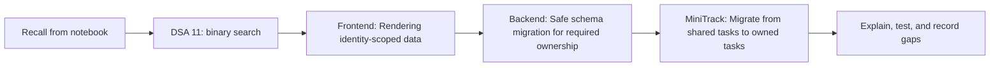
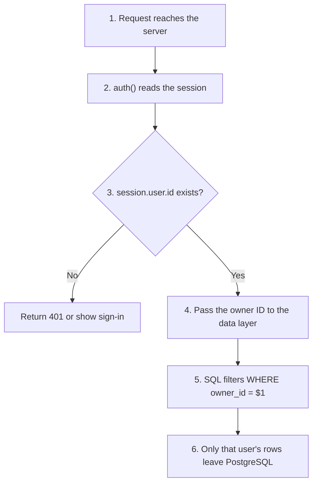
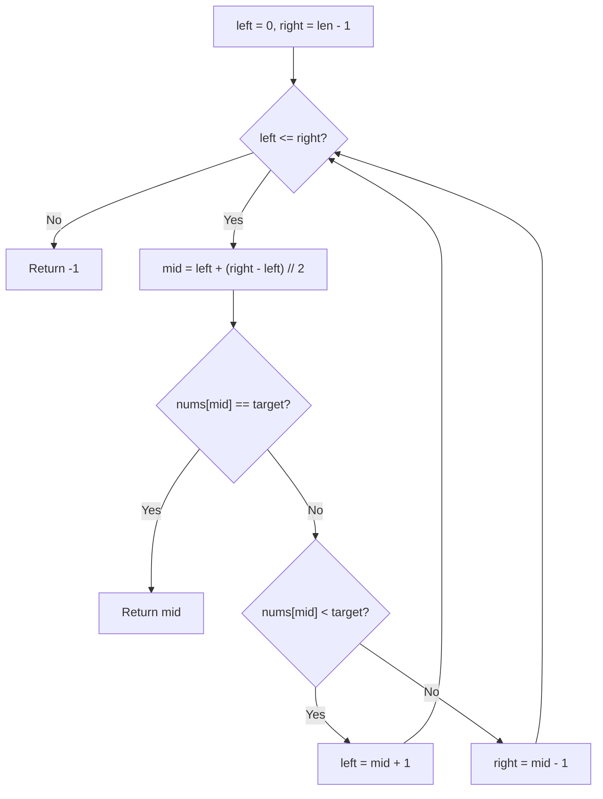
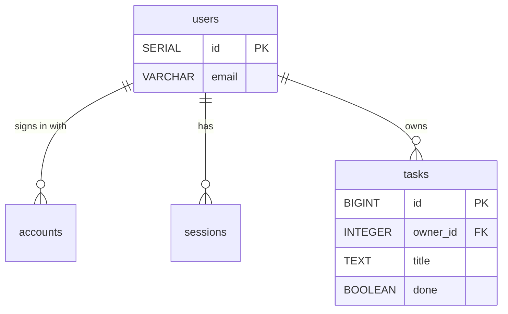
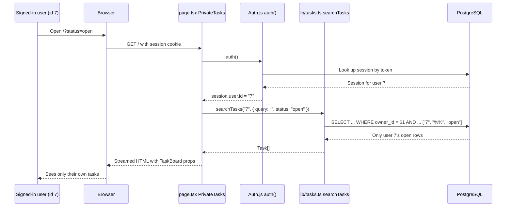

# Prep Day 11 — Migrate from shared tasks to owned tasks

**Date:** Monday, December 7, 2026  
**Time:** 7 study hours plus breaks  
**Starting point:** Prep Day 10 is complete: GitHub sign-in works through Auth.js and anonymous task requests return `401`. All signed-in users still share one task table.  
**Goal:** Migrate from shared tasks to owned tasks.

[Prep Day 10](prep-day-10.md) · [Track home](README.md) · [Preparation plan](../../docs/FULL_STACK_INTERVIEW_PREP_PLAN.md) · [Prep Day 12](prep-day-12.md)

**Everything to read today is below.** The original [App Day 11](../day-11.md)
and [DSA Day 11](../../dsa-python/lessons/dsa-day-11.md) remain available for
comparison. This prep day covers the user tables, the `owner_id` migration,
creating tasks with an owner, and owner-scoped **reads** (the page and
`GET /api/tasks`). Scoping the item mutations (`PATCH` and `DELETE` on
`/api/tasks/[id]`) and closing the IDOR gap belong to Prep Day 12; automated
authorization tests belong to Prep Day 13. Write runnable code in the named
project and practice files, not in this Markdown file.

## Learning objectives

- explain rendering identity-scoped data in beginner-friendly language;
- explain safe schema migration for required ownership and its failure boundary;
- implement or verify the listed MiniTrack milestone;
- solve DSA Day 11 using the binary search pattern;
- record the result in your rough notebook and explain it without reading.

## 1. Start with notebook recall (45 minutes)

Before reading further, write answers in
[`checkpoints/ROUGH/Notes.md`](../../checkpoints/ROUGH/Notes.md):

1. What did yesterday's browser action send to the server?
2. Where is persistent task data stored, and what state is only temporary?
3. What error or edge case can you already predict for today's topic?
4. What do you remember about the **binary search** pattern?

Use this format:

```md
## Monday, December 7, 2026

- What:
- Why:
- How MiniTrack uses it:
- What can go wrong:
- First task:
```

Do not copy the source paragraph. Write what you remember, then compare.

## 2. Understand today's full-stack boundary (20 minutes)

**Frontend focus — Rendering identity-scoped data:** The page should receive only tasks selected for the authenticated owner. The client should not download every user's tasks and filter them locally.

**Backend focus — Safe schema migration for required ownership:** Adding a required owner to existing rows needs an ordered migration: create compatible schema, backfill or deliberately remove teaching data, add constraints, and verify before relying on them.

**Today's connection:** Identity becomes a foreign-key relationship used by every task data operation.



Prep Day 10 answered **who is this user?** Today starts answering **which rows
belong to this user?**



## 3. Python DSA practice (1 hour 45 minutes)

**Practice file:** [`dsa-python/practice/day-11.py`](../../dsa-python/practice/day-11.py)  
**Pattern:** binary search

### Problem: Binary Search

Given a list of integers sorted in ascending order and a target, return the
index of the target. Return `-1` if the target is not in the list. Assume the
values are distinct; if duplicates exist, any matching index is acceptable.

```python
solve([-1, 0, 3, 5, 9, 12], 9)  # 4
solve([-1, 0, 3, 5, 9, 12], 2)  # -1
```

The simple approach checks every element from left to right: O(n) time. Because
the list is **sorted**, one comparison with the middle element tells you which
half cannot contain the target, so you can throw that half away.

### Start coding

In the practice file, replace the `raise NotImplementedError` line with your
own implementation. This is the starting shape:

```python
def solve(nums, target):
    # Return the index of target, or -1 if it is absent.
    raise NotImplementedError
```

Two Python details you will use:

- `//` is **integer division**: `7 // 2` is `3`, not `3.5`. List indices must
  be whole numbers.
- `left + (right - left) // 2` is the middle index between `left` and `right`.
  For `left = 3` and `right = 5`, it is `3 + 2 // 2 = 4`.

`left` and `right` are the first and last indices that could still hold the
target. When `left > right`, nothing is left to search.



### Invariant to say aloud

Maintain a search interval that is guaranteed to contain the target if it exists, and discard half after each comparison.

### Work in this order

1. Restate the problem and ask about constraints.
2. Give a brute-force approach and its cost before optimizing.
3. Write the invariant above in your own words.
4. Implement without opening the solution for 25 minutes.
5. Test empty, smallest, typical, duplicate, and boundary cases where relevant.
6. Use a small hint if blocked; do not spend the entire block stuck.
7. Compare with the commented reference and re-code the key loop from memory.

From the repository root:

```bash
python3 dsa-python/scripts/check_practice.py 11
python3 -m unittest discover -s dsa-python/tests -v
```

**Expected observation:** the day-specific checker prints `Case 1 passed` and
`Case 2 passed`, and the completed reference suite still passes. The checker
only tests the two sample calls above, so add your own edge cases.

You can also temporarily add these checks below your `solve` function in the
practice file, then run `python3 dsa-python/practice/day-11.py`:

```python
if __name__ == '__main__':
    assert solve([-1, 0, 3, 5, 9, 12], 9) == 4
    assert solve([-1, 0, 3, 5, 9, 12], 2) == -1
    assert solve([], 5) == -1                     # Empty list.
    assert solve([5], 5) == 0                     # One element, found.
    assert solve([5], 1) == -1                    # One element, missing.
    assert solve([-1, 0, 3, 5, 9, 12], -1) == 0   # First element.
    assert solve([-1, 0, 3, 5, 9, 12], 12) == 5   # Last element.
    assert solve([-1, 0, 3, 5, 9, 12], 13) == -1  # Larger than all.
    assert solve([-1, 0, 3, 5, 9, 12], -5) == -1  # Smaller than all.
    print('All checks passed')
```

### Brute-force code — reveal after attempting

<details>
<summary>Show the simple solution</summary>

```python
def solve(nums, target):
    for i, value in enumerate(nums):
        if value == target:
            return i
    return -1
```

</details>

This linear scan ignores the fact that the list is sorted. In the worst case
(target missing or last), it compares all `n` elements, so time is O(n). It
uses O(1) extra space and also works on unsorted input.

### Optimized code — reveal after attempting

<details>
<summary>Show the binary search solution</summary>

```python
def solve(nums, target):
    left, right = 0, len(nums) - 1  # inclusive search interval
    while left <= right:
        mid = left + (right - left) // 2
        if nums[mid] == target:
            return mid
        if nums[mid] < target:
            left = mid + 1   # target can only be to the right of mid
        else:
            right = mid - 1  # target can only be to the left of mid
    return -1
```

</details>

Each comparison removes `mid` and at least half of the remaining interval. A
list of one million values needs at most about 20 comparisons. Time is
O(log n); extra space is O(1).

Trace `solve([-1, 0, 3, 5, 9, 12], 9)`:

| Step | left | right | mid | nums[mid] | Action |
|---:|---:|---:|---:|---:|---|
| 1 | 0 | 5 | 2 | 3 | `3 < 9`; set `left = 3` |
| 2 | 3 | 5 | 4 | 9 | Equal; return `4` |

For target `2`: `mid = 2` (`3 > 2`, so `right = 1`), then `mid = 0`
(`-1 < 2`, so `left = 1`), then `mid = 1` (`0 < 2`, so `left = 2`). Now
`left > right`, so return `-1`.

### DSA interview questions and answers

#### DSA Q1. What is the brute-force approach?

**Interview-ready answer:** “I scan from left to right and return the first
index whose value equals the target. If I reach the end, I return -1. That is
O(n) time and O(1) extra space, and it does not use the sorted order.”

**Example:** For `[-1, 0, 3, 5, 9, 12]` and target `9`, the scan checks five
values before returning `4`.

**Follow-up:** When is the linear scan the right choice? When the data is
unsorted and searched once; sorting first costs O(n log n), which is more than
one O(n) scan.

#### DSA Q2. How does binary search use the sorted order?

**Interview-ready answer:** “I compare the target with the middle value. If
the middle is smaller, every value to its left is also smaller, so the target
can only be on the right. If it is larger, the target can only be on the left.
Each comparison discards about half of the remaining values.”

**Example:** Searching for `9`, the first middle value is `3`. Since the list
is sorted, `-1`, `0`, and `3` can all be discarded at once.

**Follow-up:** The requirement is a **monotonic** condition, not literally a
list. Binary search also works on answers such as “smallest capacity that
works” when larger answers stay valid.

#### DSA Q3. Why is the loop `left <= right`, and why `mid + 1` and `mid - 1`?

**Interview-ready answer:** “I use an inclusive interval: both `left` and
`right` can still hold the target. The interval is empty only when
`left > right`. After checking `mid`, I exclude it with `mid + 1` or
`mid - 1`, so the interval always shrinks and the loop terminates.”

**Example:** With `[5]` and target `5`, `left = right = 0`. Using
`left < right` would skip the only element and wrongly return `-1`.

**Follow-up:** Writing `left = mid` with an inclusive interval can loop forever
when `left` and `right` are adjacent. Pick one interval convention and keep
every update consistent with it.

#### DSA Q4. What are the time and space costs?

**Interview-ready answer:** “The iterative version takes O(log n) time
because the interval halves after each comparison, and O(1) extra space
because it stores only three indices.”

**Example:** For one million values, about 20 comparisons are enough because
2²⁰ is about one million.

**Follow-up:** O(log n) assumes O(1) random access by index. On a linked list,
reaching the middle costs O(n). Python integers do not overflow, but in Java or
C++ `left + (right - left) // 2` avoids overflow from `left + right`.

#### DSA Q5. What edge cases should I test?

**Interview-ready answer:** “I test an empty list, one element found and
missing, the first and last positions, a target smaller or larger than every
value, and duplicates if the interviewer allows them.”

**Example:** `solve([], 5)` returns `-1` immediately because `right` starts at
`-1`; `solve([5], 5)` returns `0`.

**Follow-up:** With duplicates such as `[1, 2, 2, 2, 3]`, this version returns
*some* index of `2`, not necessarily the first. Clarify whether the first or
last occurrence is required.

#### DSA Q6. How would you find the first index where the target could be inserted?

**Interview-ready answer:** “I search for the lower bound: the first index
whose value is greater than or equal to the target. I use a half-open interval
`[left, right)` starting with `right = len(nums)`. If `nums[mid] < target`,
I move `left = mid + 1`; otherwise `right = mid`. When they meet, `left` is the
answer.”

**Example:** In `[1, 3, 5, 7]`, the lower bound for `4` is index `2`; for `8`
it is index `4`, the end of the list.

**Follow-up:** Python's `bisect.bisect_left` implements this. It also finds
the first occurrence of a duplicate value: check that the returned index is in
range and holds the target.

## 4. Frontend guided study (1 hour 30 minutes)

### What

The page should receive only tasks selected for the authenticated owner. The client should not download every user's tasks and filter them locally.

### Why

The browser layer should make state and feedback understandable without taking
ownership of persistent data or security decisions that belong on the server.
Anything sent to the browser can be read in DevTools, even if React never
renders it.

### How

Compare these two designs. The first is a data leak even though the screen
looks correct:

```tsx
// WRONG: every user's rows reach the browser, then React hides some of them.
const allTasks = await searchTasks(filters);
<TaskBoard tasks={allTasks.filter(task => task.ownerId === session.user.id)} />
```

```tsx
// RIGHT: PostgreSQL returns only the signed-in user's rows.
const tasks = await searchTasks(session.user.id, filters);
<TaskBoard tasks={tasks} />
```

In the right version, the Server Component reads the verified session with
`auth()`, passes `session.user.id` to the data layer, and sends only owned
rows to the `TaskBoard` Client Component. `TaskBoard` does not change today:
it still receives `tasks` as props and never learns other users exist. The
`Task` type also does not gain an `ownerId` field, because the browser does
not need it.

Files to open deliberately:

- `frontend/app/page.tsx` (the Server Component that reads the session)
- `frontend/lib/tasks.ts` (the data functions that receive the owner ID)
- `frontend/auth.ts` (where `session.user.id` is created)

Answer before coding:

- Which value is persistent (`tasks.owner_id` in PostgreSQL), and which value
  is temporary interaction state (the search box and pending flags)?
- What starts this behavior? (A request for `/`, carrying the session cookie.)
- What should the user see while work is pending? (`Checking session...` from
  the Suspense fallback.)
- What should remain unchanged when the operation fails? (No rows are shown;
  no other user's data is ever sent.)

## 5. Backend guided study (1 hour 30 minutes)

### What

Adding a required owner to existing rows needs an ordered migration: create compatible schema, backfill or deliberately remove teaching data, add constraints, and verify before relying on them.

### Boundary checklist

- Validate untrusted path, query, and body values.
- Authenticate identity when the route is protected.
- Authorize the resource separately from authentication.
- Bind SQL values rather than concatenating untrusted data.
- Return an explicit success or error status.
- Log internal failures on the server without exposing secrets.

### Why Auth.js needs database tables

On Prep Day 10, Auth.js stored the session in a signed cookie and had no user
table. A foreign key needs a real row to point to, so today Auth.js gets the
official PostgreSQL adapter. The adapter creates a `users` row the first time
someone signs in and stores linked provider accounts and sessions. Each user
gets a stable integer `id` (a `SERIAL` column), and that is what
`tasks.owner_id` will reference.



### Why a required column needs an ordered migration

`ALTER TABLE tasks ADD COLUMN owner_id INTEGER NOT NULL` asks PostgreSQL to
give **every existing row** a non-null owner. The existing rows have none, so
the statement fails. You must decide what happens to old rows first.

For this local learning database, the deliberate choice is to delete the
sample tasks inside one transaction. For production data, never delete rows;
use the staged sequence instead:

```sql
-- Production-style sequence (illustration; do not run it today).
-- 1. Compatible change: the column may be NULL for now.
ALTER TABLE tasks
ADD COLUMN owner_id INTEGER REFERENCES users(id) ON DELETE CASCADE;

-- 2. Backfill with an approved mapping, for example one known account.
UPDATE tasks SET owner_id = :owner_id WHERE owner_id IS NULL;

-- 3. Verify: this must return 0 before continuing.
SELECT count(*) FROM tasks WHERE owner_id IS NULL;

-- 4. Enforce the rule only after the data satisfies it.
ALTER TABLE tasks ALTER COLUMN owner_id SET NOT NULL;
```

`:owner_id` is a `psql` variable (set with `\set owner_id 1`), not a value
typed by an end user. Take a backup and plan rollback before step 4.

## 6. MiniTrack implementation (1 hour)

### Step 1: Install the adapter and create the user tables

From `frontend/`:

```bash
npm install @auth/pg-adapter
```

Create `backend/sql/migrations/002-auth-users.sql`. This is the schema from
the official
[Auth.js PostgreSQL adapter guide](https://authjs.dev/getting-started/adapters/pg);
recheck the guide before installing because adapter schemas can change:

```sql
-- Tables required by @auth/pg-adapter. Column names are case-sensitive.
CREATE TABLE verification_token
(
  identifier TEXT NOT NULL,
  expires TIMESTAMPTZ NOT NULL,
  token TEXT NOT NULL,

  PRIMARY KEY (identifier, token)
);

CREATE TABLE accounts
(
  id SERIAL,
  "userId" INTEGER NOT NULL,
  type VARCHAR(255) NOT NULL,
  provider VARCHAR(255) NOT NULL,
  "providerAccountId" VARCHAR(255) NOT NULL,
  refresh_token TEXT,
  access_token TEXT,
  expires_at BIGINT,
  id_token TEXT,
  scope TEXT,
  session_state TEXT,
  token_type TEXT,

  PRIMARY KEY (id)
);

CREATE TABLE sessions
(
  id SERIAL,
  "userId" INTEGER NOT NULL,
  expires TIMESTAMPTZ NOT NULL,
  "sessionToken" VARCHAR(255) NOT NULL,

  PRIMARY KEY (id)
);

CREATE TABLE users
(
  id SERIAL,
  name VARCHAR(255),
  email VARCHAR(255),
  "emailVerified" TIMESTAMPTZ,
  image TEXT,

  PRIMARY KEY (id)
);
```

### Step 2: Add `owner_id` to tasks

Create `backend/sql/migrations/003-task-owners.sql`:

```sql
BEGIN;

-- Learning-only choice: remove unowned sample data.
DELETE FROM tasks;

ALTER TABLE tasks
ADD COLUMN owner_id INTEGER NOT NULL
REFERENCES users(id)
ON DELETE CASCADE;

-- Supports "this owner's tasks" reads and "this owner's task N" lookups.
CREATE INDEX tasks_owner_id_id_idx
ON tasks (owner_id, id);

COMMIT;
```

`INTEGER` matches the adapter's `users.id SERIAL`. `ON DELETE CASCADE` removes
a user's tasks when the user row is deleted. `BEGIN`/`COMMIT` make the delete
and the new column one all-or-nothing change.

Apply both files in order from the repository root. `ON_ERROR_STOP=1` makes
`psql` stop at the first error instead of running later statements:

```bash
psql -d minitrack -v ON_ERROR_STOP=1 -f backend/sql/migrations/002-auth-users.sql
psql -d minitrack -v ON_ERROR_STOP=1 -f backend/sql/migrations/003-task-owners.sql
psql -d minitrack -c '\d tasks'
```

**Expected observation:** `\d tasks` lists `owner_id | integer | not null`,
the index `tasks_owner_id_id_idx`, and a foreign-key constraint referencing
`users(id)`.

These migration files are not re-runnable: running `002` twice fails with
`relation "verification_token" already exists`. Do not re-run
`backend/sql/schema.sql` on this database either; its starter `INSERT`s have
no `owner_id` and would now fail the `NOT NULL` constraint.

### Step 3: Connect Auth.js to PostgreSQL

Replace `frontend/auth.ts`. It reuses the existing server-only pool from
`frontend/lib/db.ts`:

```ts
import PostgresAdapter from '@auth/pg-adapter';
import NextAuth from 'next-auth';
import GitHub from 'next-auth/providers/github';
import { getPool } from './lib/db';

export const { handlers, auth, signIn, signOut } = NextAuth({
  adapter: PostgresAdapter(getPool()),
  providers: [GitHub],
  callbacks: {
    session({ session, user }) {
      // The database adapter supplies the stable Auth.js user ID.
      session.user.id = user.id;
      return session;
    },
  },
});
```

TypeScript does not know about `session.user.id` yet. Create
`frontend/types/next-auth.d.ts` to extend the Auth.js `Session` type:

```ts
import 'next-auth';

declare module 'next-auth' {
  interface Session {
    user: {
      id: string;
      name?: string | null;
      email?: string | null;
      image?: string | null;
    };
  }
}
```

### Step 4: Give the read and create functions an owner

In `frontend/lib/tasks.ts`, make `ownerId` the **first, required** argument
of every read function and of `createTask`. Replace only these three functions
and keep the rest of the file (`toTask`, `escapeLike`, `setDone`,
`renameTask`, `deleteTask`) unchanged today:

```ts
export async function listTasks(ownerId: string): Promise<Task[]> {
  const result = await getPool().query<TaskRow>(
    'SELECT id, title, done, created_at FROM tasks WHERE owner_id = $1 ORDER BY id',
    [ownerId],
  );
  return result.rows.map(toTask);
}

export async function searchTasks(
  ownerId: string,
  filters: TaskFilters,
): Promise<Task[]> {
  const pattern = `%${escapeLike(filters.query)}%`;

  const result = await getPool().query<TaskRow>(
    `
      SELECT id, title, done, created_at
      FROM tasks
      WHERE owner_id = $1
        AND title ILIKE $2 ESCAPE '\\'
        AND (
          $3::text = 'all'
          OR done = ($3::text = 'done')
        )
      ORDER BY id
    `,
    [ownerId, pattern, filters.status],
  );

  return result.rows.map(toTask);
}

export async function createTask(
  ownerId: string,
  title: string,
): Promise<Task> {
  const result = await getPool().query<TaskRow>(
    `
      INSERT INTO tasks (owner_id, title)
      VALUES ($1, $2)
      RETURNING id, title, done, created_at
    `,
    [ownerId, title],
  );

  const row = result.rows[0];
  if (!row) throw new Error('Inserted task was not returned by PostgreSQL');
  return toTask(row);
}
```

`session.user.id` is a string in TypeScript, while `owner_id` is an
`INTEGER`; `pg` sends the bound value and PostgreSQL converts `'7'` to `7`.
Making the owner a required parameter means TypeScript reports every caller you
forgot to update. If `listTasks` has no callers left after Prep Day 06's
search work, you may delete it instead.

**Known gap until tomorrow:** `setDone`, `renameTask`, and `deleteTask` still
match only `WHERE id = $1`. A signed-in user who guesses another task ID could
still change it. Prep Day 12 closes this gap.

### Step 5: Use the session owner in the collection API

Replace `frontend/app/api/tasks/route.ts`. It keeps Prep Day 10's `401`
checks and passes the verified owner to the data layer:

```ts
import type { NextRequest } from 'next/server';
import { auth } from '@/auth';
import { createTask, searchTasks } from '../../../lib/tasks';
import {
  isRecord,
  normalizeTaskFilters,
  normalizeTitle,
} from '../../../lib/validation';

export async function GET(request: NextRequest): Promise<Response> {
  const session = await auth();
  if (!session?.user?.id) {
    return Response.json({ error: 'Unauthorized' }, { status: 401 });
  }

  const filters = normalizeTaskFilters(
    request.nextUrl.searchParams.get('q'),
    request.nextUrl.searchParams.get('status'),
  );

  try {
    return Response.json(await searchTasks(session.user.id, filters));
  } catch (error: unknown) {
    console.error('GET /api/tasks failed:', error);
    return Response.json({ error: 'Internal server error' }, { status: 500 });
  }
}

export async function POST(request: Request): Promise<Response> {
  const session = await auth();
  if (!session?.user?.id) {
    return Response.json({ error: 'Unauthorized' }, { status: 401 });
  }

  let body: unknown;
  try {
    body = await request.json();
  } catch {
    return Response.json({ error: 'Invalid JSON' }, { status: 400 });
  }

  const title = normalizeTitle(isRecord(body) ? body.title : undefined);
  if (!title) {
    return Response.json({ error: 'title must be 1–200 characters' }, { status: 400 });
  }

  try {
    // The owner comes from the verified session, never from the request body.
    return Response.json(await createTask(session.user.id, title), { status: 201 });
  } catch (error: unknown) {
    console.error('POST /api/tasks failed:', error);
    return Response.json({ error: 'Internal server error' }, { status: 500 });
  }
}
```

Even if a caller sends `{"title":"x","ownerId":"1"}`, the handler ignores
`ownerId` because it reads only `body.title`.

### Step 6: Render only the owner's tasks on the page

Replace `frontend/app/page.tsx`. It combines Prep Day 10's sign-in gate with
the URL search filters and passes the owner ID into `searchTasks`:

```tsx
import { Suspense } from 'react';
import { auth } from '@/auth';
import AuthControls from './AuthControls';
import SearchForm from './SearchForm';
import TaskBoard from './TaskBoard';
import { searchTasks } from '../lib/tasks';
import { normalizeTaskFilters } from '../lib/validation';
import type { Task } from './types';

type PageProps = {
  searchParams: Promise<{
    q?: string;
    status?: string;
  }>;
};

async function PrivateTasks({ searchParams }: PageProps) {
  // auth() reads the session cookie, so this subtree is request-time work.
  const session = await auth();
  const ownerId = session?.user?.id;

  if (!ownerId) {
    return (
      <section className="rounded-2xl border border-slate-700 bg-slate-900 p-8">
        <h2 className="text-2xl font-bold">Sign in to open MiniTrack</h2>
        <div className="mt-5">
          <AuthControls />
        </div>
      </section>
    );
  }

  const params = await searchParams;
  const filters = normalizeTaskFilters(params.q, params.status);

  let tasks: Task[] = [];
  let error: string | null = null;
  try {
    // PostgreSQL filters by owner; other users' rows never reach React.
    tasks = await searchTasks(ownerId, filters);
  } catch {
    error = 'Unable to load tasks';
  }

  return (
    <>
      <AuthControls />
      <SearchForm filters={filters} />
      {error ? (
        <p
          className="rounded-xl border border-rose-400/30 bg-rose-400/10 p-4 text-rose-200"
          role="alert"
        >
          Could not load tasks. Check PostgreSQL and DATABASE_URL.
        </p>
      ) : (
        <TaskBoard tasks={tasks} />
      )}
    </>
  );
}

export default function Home({ searchParams }: PageProps) {
  return (
    <main className="mx-auto min-h-screen w-full max-w-5xl px-5 py-12">
      <h1 className="mb-8 text-4xl font-bold">MiniTrack</h1>
      <Suspense fallback={<p className="text-slate-400">Checking session...</p>}>
        <PrivateTasks searchParams={searchParams} />
      </Suspense>
    </main>
  );
}
```

With Cache Components, `auth()` and `searchParams` are request-time APIs, so
they belong inside `Suspense`. Do not add `dynamic = 'force-dynamic'`, and do
not cache private output with `"use cache"`.

### Step 7: Run and verify

From `frontend/`:

```bash
npx tsc --noEmit
npm run lint
npm run dev
```

1. Restart the dev server, open `http://localhost:3000`, **sign out, then sign
   in again**. With the adapter, Auth.js now creates a database user and a
   database session.
2. Add a task named `Owned task`.
3. In another terminal, prove that PostgreSQL recorded the owner:

```bash
psql -d minitrack -c 'SELECT id, name, email FROM users;'
psql -d minitrack -c 'SELECT id, owner_id, title FROM tasks ORDER BY id;'
```

**Expected observation:** one `users` row for your GitHub account, and every
task row has that user's `id` as `owner_id`. Anonymous
`curl -i http://localhost:3000/api/tasks` still returns `401`.

**Failure checks:**

- `column "owner_id" of relation "tasks" contains null values`: you ran
  `ALTER TABLE ... NOT NULL` without deleting or backfilling rows (today's
  debugging exercise).
- `Property 'id' does not exist on type ...`: `frontend/types/next-auth.d.ts`
  is missing or not included by `tsconfig.json`.
- `relation "users" does not exist` while signing in: migration `002` was not
  applied to the database in `DATABASE_URL`.
- `Expected 2 arguments, but got 1` from `tsc`: a caller of `createTask` or
  `searchTasks` still omits the owner. Fix the caller; do not make the owner
  optional.

## 7. Trace the event or request



Trace one concrete input. Name every boundary, value, and possible failure.
For example: a missing session cookie stops at `auth()` and shows the sign-in
section; a stopped PostgreSQL stops at `searchTasks` and shows the alert.

## 8. Deliberate debugging exercise (25 minutes)

**Break it:** Add a NOT NULL owner_id column immediately to a populated table without a backfill.

Use a throwaway copy so your real data is safe:

```bash
psql -d minitrack -c 'CREATE TABLE tasks_copy AS SELECT id, title FROM tasks;'
psql -d minitrack -c "INSERT INTO tasks_copy (id, title) VALUES (999, 'old row');"
psql -d minitrack -c 'ALTER TABLE tasks_copy ADD COLUMN owner_id INTEGER NOT NULL;'
```

**Predict before running:** write the expected symptom in your notebook.

**Expected symptom:** The migration fails because existing rows have no owner.
PostgreSQL reports `column "owner_id" of relation "tasks_copy" contains null values`.

**Root cause:** The new constraint is incompatible with current data.

**Restore and verify:** Use an explicit compatibility and backfill sequence before enforcing NOT NULL.

```bash
psql -d minitrack -c 'ALTER TABLE tasks_copy ADD COLUMN owner_id INTEGER;'
psql -d minitrack -c 'UPDATE tasks_copy SET owner_id = (SELECT min(id) FROM users);'
psql -d minitrack -c 'SELECT count(*) FROM tasks_copy WHERE owner_id IS NULL;'
psql -d minitrack -c 'ALTER TABLE tasks_copy ALTER COLUMN owner_id SET NOT NULL;'
psql -d minitrack -c 'DROP TABLE tasks_copy;'
```

The count must be `0` before `SET NOT NULL` succeeds. Do not stop after making
the symptom disappear. Explain why the repair restores the intended invariant:
every row has an owner at the moment the rule starts being enforced.

## 9. Interview questions and answers (30 minutes)

### Q1. What is rendering identity-scoped data?

**Interview-ready answer:** The page should receive only tasks selected for the authenticated owner. The client should not download every user's tasks and filter them locally.

**Example:** In `frontend/app/page.tsx`, `PrivateTasks` calls `auth()`, then
`searchTasks(ownerId, filters)`, and passes the result to `<TaskBoard
tasks={tasks} />`. `TaskBoard` never receives another user's row, so there is
nothing to leak through DevTools or the React props payload.

**Senior follow-up:** Client-side filtering looks fine in a demo but leaks data
and wastes bandwidth as the table grows. If the page later becomes a client-side
fetch, the same rule applies to `GET /api/tasks`: scope on the server, and
never cache private, per-user output in a shared cache.

### Q2. How should the backend handle safe schema migration for required ownership?

**Interview-ready answer:** Adding a required owner to existing rows needs an ordered migration: create compatible schema, backfill or deliberately remove teaching data, add constraints, and verify before relying on them.

**Example:** `backend/sql/migrations/003-task-owners.sql` deliberately deletes
local sample rows inside `BEGIN`/`COMMIT`, then adds `owner_id INTEGER NOT NULL
REFERENCES users(id)`. In production you would add a nullable column, run
`UPDATE tasks SET owner_id = ...`, verify `SELECT count(*) ... IS NULL` returns
`0`, and only then `SET NOT NULL`.

**Senior follow-up:** On a large table, `SET NOT NULL` scans every row while
holding a strong lock. Backfill in batches, consider adding a
`CHECK (owner_id IS NOT NULL) NOT VALID` constraint and validating it
separately, rehearse on a copy of production data, and prepare a backup and
rollback plan before the irreversible step.

### Q3. What invariant makes the binary search solution correct?

**Interview-ready answer:** Maintain a search interval that is guaranteed to contain the target if it exists, and discard half after each comparison.

**Example:** For `solve([-1, 0, 3, 5, 9, 12], 9)`: the interval starts as
indices `0..5`; `nums[2] = 3 < 9`, so it becomes `3..5`; `nums[4] = 9`, so
return `4`.

**Senior follow-up:** O(log n) assumes sorted data with O(1) index access. If
the data changes often, keeping it sorted may cost more than the searches save;
a hash set gives expected O(1) membership but no ordering or range queries.

### Q4. How does today's work fit the complete MiniTrack system?

**Interview-ready answer:** Identity becomes a foreign-key relationship used by every task data operation.

**Example:** GitHub sign-in creates a `users` row with `id = 7`; Auth.js copies
it into `session.user.id`; `POST /api/tasks` calls `createTask("7", title)`,
which inserts `owner_id = 7`; the page calls `searchTasks("7", filters)`,
which reads only `WHERE owner_id = $1`.

**Senior follow-up:** The first thing to measure is query plans for
owner-scoped reads (`EXPLAIN ANALYZE` should use `tasks_owner_id_id_idx`). The
first security risk is the item routes still matching only by `id`; Prep Day
12 closes that IDOR gap.

## 10. Complexity and operational cost

- **DSA:** O(log n) time and O(1) iterative space.
- **Application:** Migration cost grows with row count and lock behavior. Rehearse on representative data and define recovery before production execution.
- **Learning:** Attempting, retrieving, and correcting is more valuable than
  copying several solutions. Keep the scope to one understood pattern today.

## Exit checklist

- [ ] I completed DSA Day 11 before reading its solution.
- [ ] I can state the invariant and complexity without notes.
- [ ] I completed or verified the MiniTrack milestone.
- [ ] I tested one success path and one failure path.
- [ ] I completed the deliberate debugging exercise.
- [ ] I answered all four interview questions aloud.
- [ ] I recorded what remains confusing and tomorrow's first task.

**Suggested commit:** `prep day 11: migrate from shared tasks to owned tasks`
