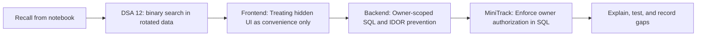
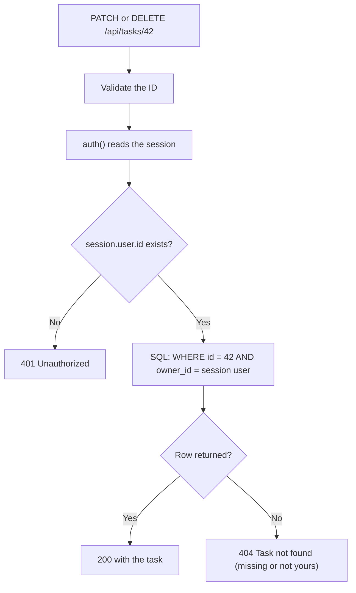
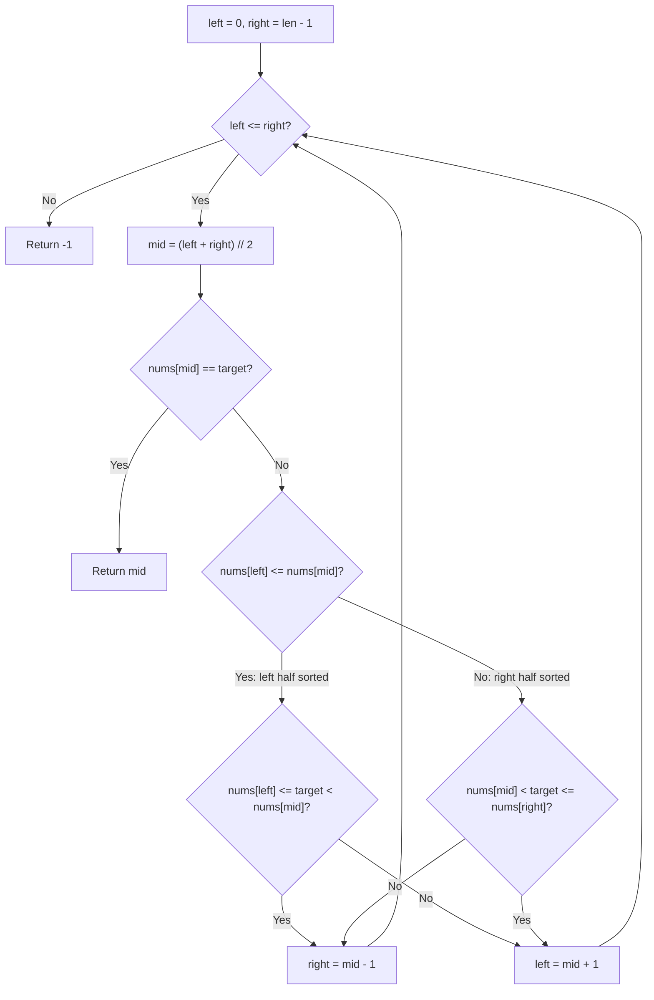

# Prep Day 12 — Enforce owner authorization in SQL

**Date:** Tuesday, December 8, 2026  
**Time:** 7 study hours plus breaks  
**Starting point:** Prep Day 11 is complete: Auth.js users persist in PostgreSQL, every task has a required `owner_id`, and the page and `GET`/`POST /api/tasks` are scoped to the signed-in owner. Item `PATCH`/`DELETE` still match only the task ID.  
**Goal:** Enforce owner authorization in SQL.

[Prep Day 11](prep-day-11.md) · [Track home](README.md) · [Preparation plan](../../docs/FULL_STACK_INTERVIEW_PREP_PLAN.md) · [Prep Day 13](prep-day-13.md)

**Everything to read today is below.** The original [App Day 11](../day-11.md)
(sections 4–6) and [DSA Day 12](../../dsa-python/lessons/dsa-day-12.md) remain
available for comparison. This prep day scopes every task mutation by owner,
closes the IDOR gap left on Prep Day 11, and checks it manually with a second
user. The user tables and the `owner_id` migration belong to Prep Day 11;
automated authorization tests and clearer `401`/`404` UI messages belong to
Prep Day 13. Write runnable code in the named project and practice files, not
in this Markdown file.

## Learning objectives

- explain treating hidden UI as convenience only in beginner-friendly language;
- explain owner-scoped SQL and IDOR prevention and its failure boundary;
- implement or verify the listed MiniTrack milestone;
- solve DSA Day 12 using the binary search in rotated data pattern;
- record the result in your rough notebook and explain it without reading.

## 1. Start with notebook recall (45 minutes)

Before reading further, write answers in
[`checkpoints/ROUGH/Notes.md`](../../checkpoints/ROUGH/Notes.md):

1. What did yesterday's browser action send to the server?
2. Where is persistent task data stored, and what state is only temporary?
3. What error or edge case can you already predict for today's topic?
4. What do you remember about the **binary search in rotated data** pattern?

Use this format:

```md
## Tuesday, December 8, 2026

- What:
- Why:
- How MiniTrack uses it:
- What can go wrong:
- First task:
```

Do not copy the source paragraph. Write what you remember, then compare.

## 2. Understand today's full-stack boundary (20 minutes)

**Frontend focus — Treating hidden UI as convenience only:** The UI may hide actions a user cannot take, but that only improves usability. Every request must still be authorized on the server.

**Backend focus — Owner-scoped SQL and IDOR prevention:** Include owner ID in the same SELECT, UPDATE, or DELETE predicate as the task ID. Fetching by ID and checking later creates avoidable race and omission risks.

**Today's connection:** Authorization is enforced where the database operation selects the row, closing the direct-object-reference gap.





## 3. Python DSA practice (1 hour 45 minutes)

**Practice file:** [`dsa-python/practice/day-12.py`](../../dsa-python/practice/day-12.py)  
**Pattern:** binary search in rotated data

### Problem: Search in Rotated Sorted Array

A sorted list of **distinct** integers was rotated: it was cut at some point
and the two parts were swapped. For example, `[0, 1, 2, 4, 5, 6, 7]` rotated
at index 4 becomes `[4, 5, 6, 7, 0, 1, 2]`. Given the rotated list and a target,
return the target's index, or `-1` if it is absent. Aim for O(log n) time.

```python
solve([4, 5, 6, 7, 0, 1, 2], 0)  # 4
solve([4, 5, 6, 7, 0, 1, 2], 3)  # -1
```

A plain linear scan is O(n). Ordinary binary search fails because the whole
list is not sorted. The key observation: if you split a rotated list at any
`mid`, **at least one half is still sorted**, and for a sorted half you can
check with two comparisons whether the target lies inside it.

### Start coding

In the practice file, replace the `raise NotImplementedError` line with your
own implementation. This is the starting shape:

```python
def solve(nums, target):
    # Return the index of target in the rotated list, or -1.
    raise NotImplementedError
```

Two Python details you will use:

- `(left + right) // 2` is the middle index using integer division.
- A **chained comparison** such as `nums[left] <= target < nums[mid]` means
  `nums[left] <= target and target < nums[mid]`. It is true only when the
  target falls in that range.

How to tell which half is sorted: if `nums[left] <= nums[mid]`, the values
from `left` to `mid` rise without a break, so the left half is sorted.
Otherwise the break is in the left half, so the right half (`mid` to `right`)
is sorted.



### Invariant to say aloud

At least one side is sorted; use bounds to decide whether the target lies inside that sorted half.

### Work in this order

1. Restate the problem and ask about constraints.
2. Give a brute-force approach and its cost before optimizing.
3. Write the invariant above in your own words.
4. Implement without opening the solution for 25 minutes.
5. Test empty, smallest, typical, duplicate, and boundary cases where relevant.
6. Use a small hint if blocked; do not spend the entire block stuck.
7. Compare with the commented reference and re-code the key loop from memory.

From the repository root:

```bash
python3 dsa-python/scripts/check_practice.py 12
python3 -m unittest discover -s dsa-python/tests -v
```

**Expected observation:** the day-specific checker prints `Case 1 passed` and
`Case 2 passed`, and the completed reference suite still passes. Two samples
cannot cover every rotation point, so add your own cases.

You can also temporarily add these checks below your `solve` function in the
practice file, then run `python3 dsa-python/practice/day-12.py`:

```python
if __name__ == '__main__':
    assert solve([4, 5, 6, 7, 0, 1, 2], 0) == 4
    assert solve([4, 5, 6, 7, 0, 1, 2], 3) == -1
    assert solve([4, 5, 6, 7, 0, 1, 2], 4) == 0   # First element.
    assert solve([4, 5, 6, 7, 0, 1, 2], 2) == 6   # Last element.
    assert solve([], 1) == -1                     # Empty list.
    assert solve([1], 1) == 0                     # One element, found.
    assert solve([1], 0) == -1                    # One element, missing.
    assert solve([3, 1], 1) == 1                  # Two elements, rotated.
    assert solve([1, 2, 3, 4, 5], 4) == 3         # Not rotated at all.
    assert solve([5, 1, 3], 5) == 0
    assert solve([5, 1, 3], 3) == 2
    print('All checks passed')
```

### Brute-force code — reveal after attempting

<details>
<summary>Show the simple solution</summary>

```python
def solve(nums, target):
    for i, value in enumerate(nums):
        if value == target:
            return i
    return -1
```

</details>

The linear scan is always correct, rotated or not, but it checks up to all
`n` values: O(n) time and O(1) extra space. A middle-ground alternative is two
passes: binary-search for the rotation point (the smallest value), then run
ordinary binary search on the correct sorted part. That is also O(log n) but
has more code and more boundaries to get wrong.

### Optimized code — reveal after attempting

<details>
<summary>Show the rotated binary search solution</summary>

```python
def solve(nums, target):
    left, right = 0, len(nums) - 1
    while left <= right:
        mid = (left + right) // 2
        if nums[mid] == target:
            return mid
        if nums[left] <= nums[mid]:  # left half is sorted
            if nums[left] <= target < nums[mid]:
                right = mid - 1
            else:
                left = mid + 1
        else:  # right half is sorted
            if nums[mid] < target <= nums[right]:
                left = mid + 1
            else:
                right = mid - 1
    return -1
```

</details>

Only the **sorted** half can be checked reliably with two comparisons. If the
target is inside it, search there; otherwise the target can only be in the
other half. Each step still discards half the interval: O(log n) time and O(1)
extra space.

Trace `solve([4, 5, 6, 7, 0, 1, 2], 0)`:

| Step | left | right | mid | nums[mid] | Sorted half | Target inside it? | Action |
|---:|---:|---:|---:|---:|---|---|---|
| 1 | 0 | 6 | 3 | 7 | Left (`4 <= 7`): `[4, 5, 6, 7]` | `4 <= 0 < 7`? No | `left = 4` |
| 2 | 4 | 6 | 5 | 1 | Left (`0 <= 1`): `[0, 1]` | `0 <= 0 < 1`? Yes | `right = 4` |
| 3 | 4 | 4 | 4 | 0 | — | — | Equal; return `4` |

### DSA interview questions and answers

#### DSA Q1. What is the brute-force approach?

**Interview-ready answer:** “I scan every index and return the first one whose
value equals the target, or -1 at the end. It is O(n) time and O(1) space. It
is correct but ignores the fact that each part of the list is sorted.”

**Example:** For `[4, 5, 6, 7, 0, 1, 2]` and target `0`, the scan checks five
values before returning `4`.

**Follow-up:** Why mention it if it is slow? It gives a correct baseline to
test the optimized version against, for example on many random rotations.

#### DSA Q2. What is the core idea of the O(log n) solution?

**Interview-ready answer:** “When I split a rotated sorted list at `mid`, at
least one half is sorted, because the single rotation break can be in only one
half. I identify the sorted half by comparing its endpoints. If the target is
within that half's range I search there; otherwise I search the other half.”

**Example:** At `mid = 3` in `[4, 5, 6, 7, 0, 1, 2]`, the left half
`[4, 5, 6, 7]` is sorted. Target `0` is not between `4` and `7`, so it must be
in the right half.

**Follow-up:** The sorted half gives a *range test*; the unsorted half does
not. That is why the decision always starts from the sorted side.

#### DSA Q3. Why is the check `nums[left] <= nums[mid]` with `<=`, not `<`?

**Interview-ready answer:** “When `left == mid`, the left half has one element
and is trivially sorted. With `<`, I would wrongly treat the right half as
sorted and could discard the target.”

**Example:** `solve([3, 1], 1)`: `left = 0`, `mid = 0`. With `<=`, the left
half `[3]` is sorted; `3 <= 1 < 3` is false, so `left = 1`, and index `1` is
found. With `<`, the code would test `3 < 1 <= 1`, which is false, set
`right = -1`, and wrongly return `-1`.

**Follow-up:** The strict comparisons in `target < nums[mid]` and
`nums[mid] < target` are correct because `nums[mid] == target` was already
handled.

#### DSA Q4. What are the time and space costs?

**Interview-ready answer:** “Each iteration discards about half of the
interval, so it is O(log n) time. It stores a few indices, so O(1) extra
space.”

**Example:** A rotated list of one million distinct values needs about 20
iterations.

**Follow-up:** The O(log n) bound depends on **distinct** values. With
duplicates, `nums[left] == nums[mid] == nums[right]` hides which half is
sorted, and the worst case becomes O(n).

#### DSA Q5. What edge cases should I test?

**Interview-ready answer:** “An empty list, one element, two elements, a list
that was not rotated at all, the target at the first and last index, the
target on each side of the rotation point, and a missing target.”

**Example:** `solve([1, 2, 3, 4, 5], 4)` returns `3` because an unrotated list
always takes the “left half sorted” branch correctly; `solve([], 1)` returns
`-1` because `right` starts at `-1`.

**Follow-up:** Also test every rotation of a small list against the brute-force
version. That catches off-by-one boundary bugs quickly.

#### DSA Q6. What changes if duplicates are allowed?

**Interview-ready answer:** “If `nums[left]`, `nums[mid]`, and `nums[right]`
are all equal, I cannot tell which half is sorted. I shrink both ends by one,
`left += 1` and `right -= 1`, and continue. Otherwise I use the same logic.”

**Example:** In `[1, 1, 1, 3, 1]`, the endpoints and middle are all `1`, so
the first step cannot decide which side contains `3`.

**Follow-up:** That makes the worst case O(n), for example a list of all `1`s
except one value. A related variant is finding the minimum of a rotated list:
compare `nums[mid]` with `nums[right]` to decide which side holds the break.

## 4. Frontend guided study (1 hour 30 minutes)

### What

The UI may hide actions a user cannot take, but that only improves usability. Every request must still be authorized on the server.

### Why

The browser layer should make state and feedback understandable without taking
ownership of persistent data or security decisions that belong on the server.
The browser is fully controlled by the user: they can open DevTools, edit HTML,
or call `fetch` directly.

### How

After Prep Day 11, `TaskBoard` shows only your own tasks, so there is no
complete or delete button for another user's task. That is good usability, but
it is not protection. Task IDs are sequential numbers (`41`, `42`, ...), so
anyone signed in can try another ID. In the browser DevTools console on
`http://localhost:3000`, while signed in, this sends a real request with your
session cookie:

```js
await fetch('/api/tasks/42', {
  method: 'PATCH',
  headers: { 'Content-Type': 'application/json' },
  body: JSON.stringify({ title: 'Changed from the console' }),
}).then(response => response.status);
```

No React component was involved, so no hidden button or disabled state can
stop it. Only the Route Handler and its SQL can. Today you will use exactly
this request to prove the fix: after the change, it must return `404` for a
task you do not own.

`TaskBoard` itself does not change today. It already sends
`PATCH /api/tasks/${taskId}` and `DELETE /api/tasks/${taskId}` with only the
task ID and the requested change, never an owner ID; the server derives the
owner from the session.

Files to open deliberately:

- `frontend/lib/tasks.ts` (every query must include `owner_id`)
- `frontend/app/api/tasks/route.ts` (already scoped on Prep Day 11)
- `frontend/app/api/tasks/[id]/route.ts` (today's change)

Answer before coding:

- Which value is persistent (the task row and its `owner_id`), and which value
  is temporary interaction state (`busy`, `error`, `editingId`)?
- What starts this behavior? (A click, or any HTTP request to `/api/tasks/[id]`.)
- What should the user see while work is pending? (Disabled controls from the
  existing `busy` state.)
- What should remain unchanged when the operation fails? (The other user's row,
  every column of it.)

## 5. Backend guided study (1 hour 30 minutes)

### What

Include owner ID in the same SELECT, UPDATE, or DELETE predicate as the task ID. Fetching by ID and checking later creates avoidable race and omission risks.

### Boundary checklist

- Validate untrusted path, query, and body values.
- Authenticate identity when the route is protected.
- Authorize the resource separately from authentication.
- Bind SQL values rather than concatenating untrusted data.
- Return an explicit success or error status.
- Log internal failures on the server without exposing secrets.

### IDOR in one sentence

**Insecure direct object reference (IDOR)** happens when the server checks
*who you are* but not *whether this object is yours*, so changing an ID in a
URL reaches someone else's data. The current item route is vulnerable:

```sql
-- Current Prep Day 11 query: any signed-in user can update task 42.
UPDATE tasks SET title = $1 WHERE id = $2 RETURNING id, title, done, created_at;
```

### Fetch-then-check versus a single scoped statement

This version looks reasonable, but has two weaknesses:

```ts
// Avoid: two steps, and the check is easy to forget on another route.
const task = await getTaskById(id);            // SELECT ... WHERE id = $1
if (task.ownerId !== session.user.id) return 404;
await renameTaskById(id, title);               // UPDATE ... WHERE id = $1
```

1. **Omission risk:** every route must remember the separate `if`. One missed
   route is a vulnerability.
2. **Race risk:** the row can change between the `SELECT` and the `UPDATE`.

Put the rule inside the one statement that selects the row:

```sql
UPDATE tasks
SET title = $1
WHERE id = $2 AND owner_id = $3
RETURNING id, title, done, created_at;
```

PostgreSQL returns the updated row only if it exists **and** belongs to the
owner. Zero rows means “not found for you”. The route returns `404` in both
cases (missing or someone else's), so an attacker cannot learn which IDs
exist. The `(owner_id, id)` index added on Prep Day 11 serves this lookup.

## 6. MiniTrack implementation (1 hour)

### Step 1: Scope every data function

Replace `frontend/lib/tasks.ts` with this complete version. It keeps the Prep
Day 11 owner-scoped reads and `createTask`, and adds `ownerId` as the first
required argument of every mutation:

```ts
import type { Task } from '../app/types';
import { getPool } from './db';
import type { TaskFilters } from './validation';

type TaskRow = Omit<Task, 'created_at'> & { created_at: Date };

function toTask(row: TaskRow): Task {
  return { ...row, created_at: row.created_at.toISOString() };
}

function escapeLike(value: string): string {
  // Escape the escape character first, then PostgreSQL wildcard characters.
  return value.replace(/[\\%_]/g, '\\$&');
}

export async function listTasks(ownerId: string): Promise<Task[]> {
  const result = await getPool().query<TaskRow>(
    'SELECT id, title, done, created_at FROM tasks WHERE owner_id = $1 ORDER BY id',
    [ownerId],
  );
  return result.rows.map(toTask);
}

export async function searchTasks(
  ownerId: string,
  filters: TaskFilters,
): Promise<Task[]> {
  const pattern = `%${escapeLike(filters.query)}%`;

  const result = await getPool().query<TaskRow>(
    `
      SELECT id, title, done, created_at
      FROM tasks
      WHERE owner_id = $1
        AND title ILIKE $2 ESCAPE '\\'
        AND (
          $3::text = 'all'
          OR done = ($3::text = 'done')
        )
      ORDER BY id
    `,
    [ownerId, pattern, filters.status],
  );

  return result.rows.map(toTask);
}

export async function createTask(
  ownerId: string,
  title: string,
): Promise<Task> {
  const result = await getPool().query<TaskRow>(
    `
      INSERT INTO tasks (owner_id, title)
      VALUES ($1, $2)
      RETURNING id, title, done, created_at
    `,
    [ownerId, title],
  );

  const row = result.rows[0];
  if (!row) throw new Error('Inserted task was not returned by PostgreSQL');
  return toTask(row);
}

export async function setDone(
  ownerId: string,
  id: string,
  done: boolean,
): Promise<Task | null> {
  const result = await getPool().query<TaskRow>(
    `
      UPDATE tasks
      SET done = $1
      WHERE id = $2 AND owner_id = $3
      RETURNING id, title, done, created_at
    `,
    [done, id, ownerId],
  );

  const row = result.rows[0];
  return row ? toTask(row) : null;
}

export async function renameTask(
  ownerId: string,
  id: string,
  title: string,
): Promise<Task | null> {
  const result = await getPool().query<TaskRow>(
    `
      UPDATE tasks
      SET title = $1
      WHERE id = $2 AND owner_id = $3
      RETURNING id, title, done, created_at
    `,
    [title, id, ownerId],
  );

  const row = result.rows[0];
  // No row means "missing or not yours"; the route reports both as 404.
  return row ? toTask(row) : null;
}

export async function deleteTask(ownerId: string, id: string): Promise<boolean> {
  const result = await getPool().query(
    'DELETE FROM tasks WHERE id = $1 AND owner_id = $2 RETURNING id',
    [id, ownerId],
  );
  return result.rowCount !== null && result.rowCount > 0;
}
```

Every function now has `ownerId` first. A caller that forgets it gets a
TypeScript error instead of a silent security hole.

### Step 2: Use the session owner in the item Route Handler

Replace `frontend/app/api/tasks/[id]/route.ts`. It keeps Prep Day 10's `401`
check and Prep Day 03's “exactly one of `done` or `title`” contract:

```ts
import { auth } from '@/auth';
import type { Task } from '../../../types';
import { deleteTask, renameTask, setDone } from '../../../../lib/tasks';
import { isRecord, isValidId, normalizeTitle } from '../../../../lib/validation';

type RouteContext = { params: Promise<{ id: string }> };

export async function PATCH(request: Request, { params }: RouteContext): Promise<Response> {
  const session = await auth();
  if (!session?.user?.id) {
    return Response.json({ error: 'Unauthorized' }, { status: 401 });
  }
  // Only the verified session decides the owner.
  const ownerId = session.user.id;

  const { id } = await params;
  if (!isValidId(id)) {
    return Response.json({ error: 'Invalid task ID' }, { status: 400 });
  }

  let parsingBody = true;
  try {
    const body: unknown = await request.json();
    parsingBody = false;
    if (!isRecord(body)) {
      return Response.json({ error: 'Provide either done or title' }, { status: 400 });
    }

    const hasDone = Object.hasOwn(body, 'done');
    const hasTitle = Object.hasOwn(body, 'title');
    if (hasDone === hasTitle) {
      return Response.json({ error: 'Provide either done or title' }, { status: 400 });
    }

    let updateTask: () => Promise<Task | null>;
    if (hasTitle) {
      const title = normalizeTitle(body.title);
      if (!title) {
        return Response.json({ error: 'title must be 1–200 characters' }, { status: 400 });
      }
      updateTask = () => renameTask(ownerId, id, title);
    } else if (typeof body.done === 'boolean') {
      const done = body.done;
      updateTask = () => setDone(ownerId, id, done);
    } else {
      return Response.json({ error: 'done must be boolean' }, { status: 400 });
    }
    const task = await updateTask();
    // null means missing OR owned by someone else; both are 404 on purpose.
    return task
      ? Response.json(task)
      : Response.json({ error: 'Task not found' }, { status: 404 });
  } catch (error: unknown) {
    if (parsingBody) {
      return Response.json({ error: 'Invalid JSON' }, { status: 400 });
    }
    console.error(`PATCH /api/tasks/${id} failed:`, error);
    return Response.json({ error: 'Internal server error' }, { status: 500 });
  }
}

export async function DELETE(_request: Request, { params }: RouteContext): Promise<Response> {
  const session = await auth();
  if (!session?.user?.id) {
    return Response.json({ error: 'Unauthorized' }, { status: 401 });
  }

  const { id } = await params;
  if (!isValidId(id)) {
    return Response.json({ error: 'Invalid task ID' }, { status: 400 });
  }

  try {
    const deleted = await deleteTask(session.user.id, id);
    return deleted
      ? Response.json({ deleted: true })
      : Response.json({ error: 'Task not found' }, { status: 404 });
  } catch (error: unknown) {
    console.error(`DELETE /api/tasks/${id} failed:`, error);
    return Response.json({ error: 'Internal server error' }, { status: 500 });
  }
}
```

`const ownerId = session.user.id` copies the value into a `const` so the
`updateTask` closures keep a definitely-string value. The collection route
`frontend/app/api/tasks/route.ts` from Prep Day 11 is already scoped and stays
unchanged.

### Step 3: Type-check and run

From `frontend/`:

```bash
npx tsc --noEmit
npm run lint
npm run dev
```

**Expected observation:** no type errors. If `tsc` reports
`Expected 3 arguments, but got 2` (or similar), a caller still uses an old
signature; pass the session owner rather than loosening the type.

### Step 4: Prove cross-user isolation by hand

You need a task owned by somebody else. Create a second user and task directly
in PostgreSQL (a fake email, not a real account):

```bash
psql -d minitrack -c "INSERT INTO users (name, email) VALUES ('Other user', 'other@example.test') RETURNING id;"
psql -d minitrack -c "INSERT INTO tasks (owner_id, title) SELECT id, 'Other user private task' FROM users WHERE email = 'other@example.test' RETURNING id;"
```

Note the returned task ID; this example uses `42`. Signed in as yourself in the
browser, open `http://localhost:3000` and confirm the other task is not listed.
Then run in the DevTools console:

```js
await fetch('/api/tasks/42', {
  method: 'PATCH',
  headers: { 'Content-Type': 'application/json' },
  body: JSON.stringify({ title: 'Stolen' }),
}).then(response => response.status);  // 404

await fetch('/api/tasks/42', { method: 'DELETE' })
  .then(response => response.status);  // 404
```

Then confirm the row is unchanged:

```bash
psql -d minitrack -c "SELECT id, owner_id, title, done FROM tasks WHERE id = 42;"
```

**Expected observation:** both requests return `404`, and the row still has
the title `Other user private task`. Your own tasks can still be completed,
renamed, and deleted from the UI. Anonymous
`curl -i -X DELETE http://localhost:3000/api/tasks/42` still returns `401`.

**Failure checks:**

- A cross-user request returns `200`: one SQL statement is missing
  `AND owner_id = $n`. Search `frontend/lib/tasks.ts` for `WHERE id` and check
  each match.
- Your own toggle returns `404`: the argument order is wrong, for example
  `setDone(id, ownerId, done)`. The parameter array must match `$1`, `$2`, `$3`.
- `401` in the browser: your session expired or was created before Prep Day
  11's adapter change. Sign out and sign in again.

Remove the fake user when finished (its task is removed by `ON DELETE CASCADE`):

```bash
psql -d minitrack -c "DELETE FROM users WHERE email = 'other@example.test';"
```

## 7. Trace the event or request

```mermaid
sequenceDiagram
  participant B as User 7 browser console
  participant R as PATCH /api/tasks/[id] route.ts
  participant A as Auth.js auth()
  participant D as lib/tasks.ts renameTask
  participant P as PostgreSQL
  B->>R: PATCH /api/tasks/42 {"title":"Stolen"}
  R->>A: auth()
  A-->>R: session.user.id = "7"
  R->>R: isValidId("42"); normalizeTitle("Stolen")
  R->>D: renameTask("7", "42", "Stolen")
  D->>P: UPDATE ... WHERE id = $2 AND owner_id = $3 ["Stolen", "42", "7"]
  P-->>D: zero rows (task 42 belongs to user 8)
  D-->>R: null
  R-->>B: 404 {"error":"Task not found"}
```

Trace one concrete input. Name every boundary, value, and possible failure.
Repeat the trace for your own task: the same `UPDATE` returns one row and the
route returns `200`.

## 8. Deliberate debugging exercise (25 minutes)

**Break it:** Update a task using only WHERE id = $1.

In `renameTask`, temporarily change the predicate to `WHERE id = $2` and the
parameter array to `[title, id]`. Recreate the fake user and task from Step 4
and run the console `PATCH` again.

**Predict before running:** write the expected symptom in your notebook.

**Expected symptom:** Any authenticated user who learns another task ID can mutate it.
The console request returns `200`, and `psql` shows the other user's title is
now `Stolen`.

**Root cause:** Authentication was mistaken for resource authorization.

**Restore and verify:** Bind both task ID and verified owner ID in the mutation predicate.
Restore `WHERE id = $2 AND owner_id = $3` with `[title, id, ownerId]`, reset
the title in `psql`, rerun the request, and confirm `404` plus an unchanged
row.

Do not stop after making the symptom disappear. Explain why the repair restores
the intended invariant: a mutation can touch a row only if the row's owner is
the verified session user.

## 9. Interview questions and answers (30 minutes)

### Q1. What is treating hidden UI as convenience only?

**Interview-ready answer:** The UI may hide actions a user cannot take, but that only improves usability. Every request must still be authorized on the server.

**Example:** `TaskBoard` never renders a button for task `42` because the page
only receives owned tasks, yet `fetch('/api/tasks/42', { method: 'PATCH', ...
})` from the console still reaches the Route Handler. Only
`WHERE id = $2 AND owner_id = $3` in `renameTask` turns it into a `404`.

**Senior follow-up:** Hiding controls is still worth doing for clarity, but
the UI and server rules can drift. When permissions become richer (shared
projects, roles), compute them on the server and send the allowed actions as
data, while the server re-checks every request.

### Q2. How should the backend handle owner-scoped SQL and IDOR prevention?

**Interview-ready answer:** Include owner ID in the same SELECT, UPDATE, or DELETE predicate as the task ID. Fetching by ID and checking later creates avoidable race and omission risks.

**Example:** `PATCH /api/tasks/42` calls `auth()`, gets
`session.user.id = "7"`, and calls `renameTask("7", "42", title)`, which runs
`UPDATE tasks SET title = $1 WHERE id = $2 AND owner_id = $3`. Zero rows
becomes `404 Task not found`.

**Senior follow-up:** Return the same `404` for missing and not-owned rows so
IDs cannot be enumerated. Log the internal error for `500`s but never log
session cookies or tokens. PostgreSQL Row-Level Security can add defense in
depth, and opaque IDs make guessing harder, but neither replaces the scoped
predicate.

### Q3. What invariant makes the binary search in rotated data solution correct?

**Interview-ready answer:** At least one side is sorted; use bounds to decide whether the target lies inside that sorted half.

**Example:** `solve([4, 5, 6, 7, 0, 1, 2], 0)`: at `mid = 3`, the left half
`[4..7]` is sorted and excludes `0`, so `left = 4`; at `mid = 5`, the left half
`[0, 1]` is sorted and includes `0`, so `right = 4`; at `mid = 4`, return `4`.

**Senior follow-up:** O(log n) assumes distinct values. With duplicates,
`nums[left] == nums[mid] == nums[right]` hides the sorted side, and shrinking
both ends makes the worst case O(n).

### Q4. How does today's work fit the complete MiniTrack system?

**Interview-ready answer:** Authorization is enforced where the database operation selects the row, closing the direct-object-reference gap.

**Example:** Every function in `frontend/lib/tasks.ts` now takes `ownerId`
first, and both Route Handler files pass `session.user.id`. Reads, creates,
completion, renaming, and deletion all touch only the signed-in user's rows.

**Senior follow-up:** The first thing to measure is query latency per owner
(`EXPLAIN ANALYZE` on the scoped `UPDATE` should use `tasks_owner_id_id_idx`).
The remaining risk is regression: a new route that forgets the owner. Prep Day
13 adds automated cross-user tests to catch that.

## 10. Complexity and operational cost

- **DSA:** O(log n) time and O(1) space.
- **Application:** Use an index that matches measured owner-scoped query patterns. Extra indexes improve some reads but increase write and storage cost.
- **Learning:** Attempting, retrieving, and correcting is more valuable than
  copying several solutions. Keep the scope to one understood pattern today.

## Exit checklist

- [ ] I completed DSA Day 12 before reading its solution.
- [ ] I can state the invariant and complexity without notes.
- [ ] I completed or verified the MiniTrack milestone.
- [ ] I tested one success path and one failure path.
- [ ] I completed the deliberate debugging exercise.
- [ ] I answered all four interview questions aloud.
- [ ] I recorded what remains confusing and tomorrow's first task.

**Suggested commit:** `prep day 12: enforce owner authorization in sql`
