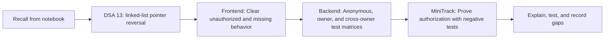
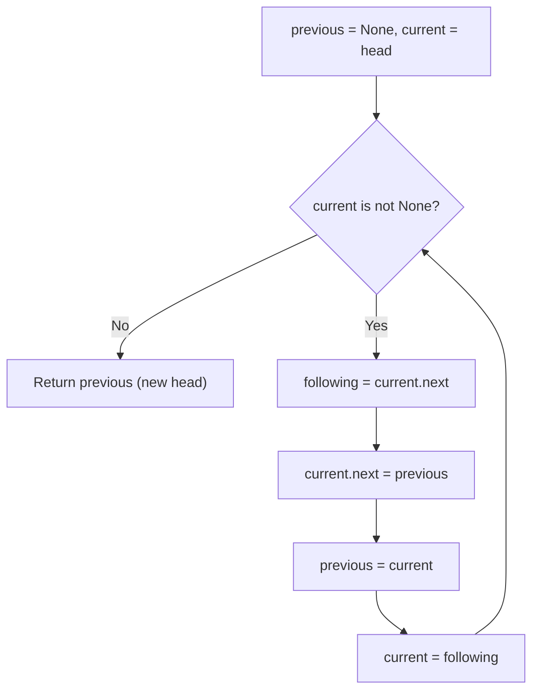
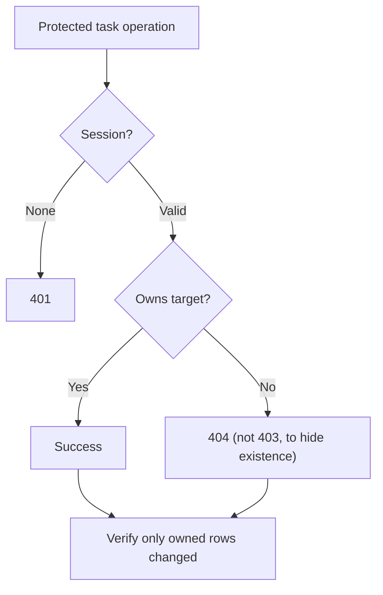

# Prep Day 13 — Prove authorization with negative tests

**Date:** Wednesday, December 9, 2026  
**Time:** 7 study hours plus breaks  
**Starting point:** Prep Day 12 is complete: every function in `frontend/lib/tasks.ts` takes `ownerId` first, and every task Route Handler returns `401` without a session and `404` for a task the user does not own. Prep Days 07–08's unit and integration test setup (`node:test`, `tsx`, `minitrack_test`) exists.  
**Goal:** Prove authorization with negative tests.

[Prep Day 12](prep-day-12.md) · [Track home](README.md) · [Preparation plan](../../docs/FULL_STACK_INTERVIEW_PREP_PLAN.md) · [Prep Day 14](prep-day-14.md)

**Everything to read today is below.** The original [App Day 12](../day-12.md)
and [DSA Day 13](../../dsa-python/lessons/dsa-day-13.md) remain available for
comparison. This prep day turns owner isolation into automated tests (data
layer and Route Handlers), adds a test-only session seam without any
production bypass, and gives the UI clear `401` and `404` messages. The owner
column and scoped SQL belong to Prep Days 11–12; keyboard, focus, and ARIA work
belongs to Prep Day 14. Write runnable code in the named project and practice
files, not in this Markdown file.

## Learning objectives

- explain clear unauthorized and missing behavior in beginner-friendly language;
- explain anonymous, owner, and cross-owner test matrices and its failure boundary;
- implement or verify the listed MiniTrack milestone;
- solve DSA Day 13 using the linked-list pointer reversal pattern;
- record the result in your rough notebook and explain it without reading.

## 1. Start with notebook recall (45 minutes)

Before reading further, write answers in
[`checkpoints/ROUGH/Notes.md`](../../checkpoints/ROUGH/Notes.md):

1. What did yesterday's browser action send to the server?
2. Where is persistent task data stored, and what state is only temporary?
3. What error or edge case can you already predict for today's topic?
4. What do you remember about the **linked-list pointer reversal** pattern?

Use this format:

```md
## Wednesday, December 9, 2026

- What:
- Why:
- How MiniTrack uses it:
- What can go wrong:
- First task:
```

Do not copy the source paragraph. Write what you remember, then compare.

## 2. Understand today's full-stack boundary (20 minutes)

**Frontend focus — Clear unauthorized and missing behavior:** The interface should not expose another user's data and should respond safely when a resource disappears. Exact status details may be intentionally limited to avoid leaking existence.

**Backend focus — Anonymous, owner, and cross-owner test matrices:** Test each operation as anonymous, owner, and other user. For forbidden mutations, verify both the response and that the database row remained unchanged.

**Today's connection:** Negative tests turn owner isolation from an assumption into repeatable evidence.



## 3. Python DSA practice (1 hour 45 minutes)

**Practice file:** [`dsa-python/practice/day-13.py`](../../dsa-python/practice/day-13.py)  
**Pattern:** linked-list pointer reversal

### Problem: Reverse Linked List

A **singly linked list** is a chain of nodes. Each node stores a value `val`
and a reference `next` to the following node; the last node's `next` is
`None`. You receive only the first node, the `head`. Reverse the list and
return the new head. An empty list is `None`.

```text
Input:  1 -> 2 -> 3 -> None
Output: 3 -> 2 -> 1 -> None
```

```python
solve(build([1, 2, 3]))  # head of 3 -> 2 -> 1, so to_list(...) == [3, 2, 1]
solve(None)               # None
```

(`build` and `to_list` are small helpers defined below.) Unlike a Python list,
you cannot jump to index `i`; you can only follow `next` one node at a time.

### Start coding

The practice file already defines the node class. Replace the
`raise NotImplementedError` line with your own implementation:

```python
class ListNode:
    def __init__(self, val=0, next=None):
        self.val, self.next = val, next

def solve(head):
    # Return the head of the reversed list.
    raise NotImplementedError
```

`ListNode(1, ListNode(2))` creates a node with value `1` whose `next` is a
node with value `2`. `self.val, self.next = val, next` assigns both attributes
in one line. `while current:` keeps looping while `current` is a node and
stops when it becomes `None`.

The idea: walk the list once and turn each arrow around. You need three
references: `previous` (the already-reversed part), `current` (the node being
changed), and `following` (the rest of the list, saved before its only link is
overwritten).



### Invariant to say aloud

Before changing current.next, save the next node; then reverse the pointer and advance both references.

At the top of every loop iteration, `previous` is the head of a correctly
reversed list of all nodes already visited, and `current` is the head of the
untouched remainder.

### Work in this order

1. Restate the problem and ask about constraints.
2. Give a brute-force approach and its cost before optimizing.
3. Write the invariant above in your own words.
4. Implement without opening the solution for 25 minutes.
5. Test empty, smallest, typical, duplicate, and boundary cases where relevant.
6. Use a small hint if blocked; do not spend the entire block stuck.
7. Compare with the commented reference and re-code the key loop from memory.

From the repository root:

```bash
python3 dsa-python/scripts/check_practice.py 13
python3 -m unittest discover -s dsa-python/tests -v
```

**Expected observation:** the checker prints `This problem uses
linked-list/tree structures; write your own object-based tests.` and does
**not** test your code, because it has no list samples for linked lists. The
reference suite reverses `1 -> 2 -> 3` and expects `[3, 2, 1]`. Your real
check is the assert block below.

Temporarily add these helpers and checks below your `solve` function, then run
`python3 dsa-python/practice/day-13.py`. `build` turns a Python list into
linked nodes (it builds from the back so each new node can point at the
previous head); `to_list` walks the nodes and collects the values:

```python
def build(values):
    head = None
    for value in reversed(values):
        head = ListNode(value, head)
    return head

def to_list(head):
    values = []
    while head:
        values.append(head.val)
        head = head.next
    return values

if __name__ == '__main__':
    assert to_list(solve(build([1, 2, 3]))) == [3, 2, 1]
    assert solve(None) is None                          # Empty list.
    assert to_list(solve(build([7]))) == [7]            # One node.
    assert to_list(solve(build([1, 2]))) == [2, 1]      # Two nodes.
    assert to_list(solve(build([1, 1, 2]))) == [2, 1, 1]  # Duplicates.
    original_head = build([1, 2, 3])
    new_head = solve(original_head)
    assert original_head.next is None   # Old head is now the tail.
    assert new_head.val == 3
    print('All checks passed')
```

### Brute-force code — reveal after attempting

<details>
<summary>Show the simple solution</summary>

```python
def solve(head):
    nodes = []
    while head:
        nodes.append(head)
        head = head.next
    # Relink from the back: each node points at the one before it.
    for i in range(len(nodes) - 1, 0, -1):
        nodes[i].next = nodes[i - 1]
    if nodes:
        nodes[0].next = None
        return nodes[-1]
    return None
```

</details>

There is no slow brute force here; the simpler alternative stores every node
in a Python list so it can use indices, then relinks them. It is O(n) time but
uses O(n) extra space. Creating brand-new reversed nodes from the values is
also simple but uses O(n) extra memory and returns copies instead of reversing
the original nodes.

### Optimized code — reveal after attempting

<details>
<summary>Show the in-place reversal solution</summary>

```python
class ListNode:
    def __init__(self, val=0, next=None):
        self.val = val
        self.next = next

def solve(head):
    previous = None
    current = head
    while current:
        following = current.next  # save rest before changing link
        current.next = previous
        previous = current
        current = following
    return previous
```

</details>

Each node's `next` is changed exactly once. Time is O(n); extra space is O(1)
because only three references are stored, whatever the list length.

Trace `1 -> 2 -> 3`:

| Step | previous before | current | following saved | Link changed | Reversed part after |
|---:|---|---:|---:|---|---|
| 1 | `None` | 1 | 2 | `1.next = None` | `1` |
| 2 | 1 | 2 | 3 | `2.next = 1` | `2 -> 1` |
| 3 | 2 | 3 | `None` | `3.next = 2` | `3 -> 2 -> 1` |
| End | 3 | `None` | — | — | return node `3` |

### DSA interview questions and answers

#### DSA Q1. What is the simple approach before optimizing?

**Interview-ready answer:** “I walk the list once and put every node into a
Python list. Then I relink them from the back so each node points to the
previous one, set the old head's `next` to `None`, and return the last node.
That is O(n) time and O(n) extra space.”

**Example:** For `1 -> 2 -> 3`, the array is `[n1, n2, n3]`; set
`n3.next = n2`, `n2.next = n1`, `n1.next = None`, and return `n3`.

**Follow-up:** Both approaches are O(n) time; the in-place version wins on
memory, which matters for very long lists or memory-constrained systems.

#### DSA Q2. What is the core idea of the in-place solution?

**Interview-ready answer:** “I keep two lists at once: a reversed list starting
at `previous` and the unvisited remainder starting at `current`. Each step I
move one node from the front of the remainder to the front of the reversed
list by pointing its `next` at `previous`.”

**Example:** After step 2 for `1 -> 2 -> 3`, `previous` is `2 -> 1` and
`current` is `3`.

**Follow-up:** This is the same as popping from one stack and pushing onto
another, but done by rewiring references instead of copying values.

#### DSA Q3. Why must `following` be saved first?

**Interview-ready answer:** “`current.next` is the only reference to the rest
of the list. If I overwrite it with `previous` first, I lose the remainder and
cannot continue. Saving it first keeps the invariant: `current` always points
to the untouched remainder.”

**Example:** At node `1` in `1 -> 2 -> 3`, writing `current.next = None`
before saving would leave nothing pointing at node `2`; the loop would stop
and return just `1`.

**Follow-up:** The loop ends when `current` is `None`. At that moment the
remainder is empty, so `previous` heads the fully reversed list, which is why
we return `previous`, not `current` or `head`.

#### DSA Q4. What are the time and space costs?

**Interview-ready answer:** “O(n) time because each node is visited once and
each link is changed once. O(1) extra space because I only keep three
references.”

**Example:** A list of one million nodes still needs only `previous`,
`current`, and `following`.

**Follow-up:** A recursive version is shorter but uses O(n) call-stack space.
Python's default recursion limit is about 1,000 frames, so a long list would
raise `RecursionError`.

#### DSA Q5. What edge cases should I test?

**Interview-ready answer:** “An empty list returns `None`, a single node
returns itself, two nodes swap, duplicates keep their relative reversed order,
and the old head must end with `next = None` so there is no cycle.”

**Example:** `solve(None)` returns `None` because the loop never runs and
`previous` is still `None`. For `[7]`, the loop runs once and returns node `7`.

**Follow-up:** Forgetting to break the old head's link (in hand-written
relinking code) creates a two-node cycle, and any later traversal loops
forever. Prep Day 14's fast and slow pointers detect that kind of cycle.

#### DSA Q6. How would you reverse only positions `left` to `right`?

**Interview-ready answer:** “I walk to the node just before position `left`,
reverse exactly `right - left + 1` nodes with the same three-pointer loop, then
reconnect: the node before the segment points to the new segment head, and
the old segment head points to the node after the segment. A dummy node
before the head avoids a special case when `left` is 1.”

**Example:** Reversing positions 2–4 of `1 -> 2 -> 3 -> 4 -> 5` gives
`1 -> 4 -> 3 -> 2 -> 5`.

**Follow-up:** Reversing in groups of `k` repeats the same segment reversal;
the hard part is always saving and reconnecting the boundaries, still in O(n)
time and O(1) space.

## 4. Frontend guided study (1 hour 30 minutes)

### What

The interface should not expose another user's data and should respond safely when a resource disappears. Exact status details may be intentionally limited to avoid leaking existence.

### Why

The browser layer should make state and feedback understandable without taking
ownership of persistent data or security decisions that belong on the server.

Since Prep Day 12, a mutation can fail with `401` (no valid session) or `404`
(the task is missing **or** belongs to someone else). The server deliberately
does not say which `404` case happened. The UI should turn these into clear,
honest messages, without guessing or revealing more than the server said.

| Status | Meaning for the user | What the UI should do |
|---|---|---|
| `401` | Signed out or session expired | Ask the user to sign in again |
| `404` | Task no longer available | Say so, and refresh the list so the stale row disappears |
| `400` | The request was invalid | Ask the user to check the input |
| other | Unexpected server failure | Show a generic retry message |

### How

Keep the message rules in one small, testable function instead of scattering
`if` statements across `TaskBoard`. Create `frontend/app/task-errors.ts`:

```ts
export type TaskAction = 'add' | 'update' | 'delete';

export function describeTaskError(action: TaskAction, status: number): string {
  if (status === 401) {
    return 'Your session has ended. Refresh the page and sign in again.';
  }
  if (status === 404) {
    // Do not claim "someone else owns it": the server deliberately hides that.
    return 'That task is no longer available. The list has been refreshed.';
  }
  if (status === 400) {
    return `Could not ${action} the task. Check the title and try again.`;
  }
  return `Could not ${action} the task (${status}). Please try again.`;
}
```

In `frontend/app/TaskBoard.tsx`, change only the `!response.ok` branches.
Replace each ``setError(`Could not ... task (${response.status})`)`` line with
the helper, and refresh the server data after a `404`. For example, the toggle
branch becomes:

```tsx
if (!response.ok) {
  setError(describeTaskError('update', response.status));
  if (response.status === 404) {
    // Reload PostgreSQL-backed props so the unavailable row disappears.
    router.refresh();
  }
  setBusy(false);
  return;
}
```

Use `'add'` in the add-task branch, `'update'` in the toggle and rename
branches, and `'delete'` in the delete branch. Add the import at the top of
`TaskBoard.tsx`:

```tsx
import { describeTaskError } from './task-errors';
```

The existing `role="alert"` paragraph already announces `error` to screen
readers, so no new markup is needed.

Add `frontend/test/unit/task-errors.test.ts`:

```ts
import assert from 'node:assert/strict';
import test from 'node:test';
import { describeTaskError } from '../../app/task-errors';

test('401 asks the user to sign in again', () => {
  assert.match(describeTaskError('update', 401), /sign in again/);
});

test('404 does not reveal whether another user owns the task', () => {
  const message = describeTaskError('delete', 404);
  assert.match(message, /no longer available/);
  assert.doesNotMatch(message, /another user|forbidden|owner/i);
});

test('unexpected statuses show a generic retry message', () => {
  assert.equal(
    describeTaskError('add', 500),
    'Could not add the task (500). Please try again.',
  );
});
```

Files to open deliberately:

- `frontend/app/TaskBoard.tsx` and the new `frontend/app/task-errors.ts`
- `frontend/app/api/tasks/[id]/route.ts` (where `401` and `404` come from)
- `frontend/test/` (unit and integration tests)

Answer before coding:

- Which value is persistent (task rows), and which value is temporary
  interaction state (`error`, `busy`)?
- What starts this behavior? (A toggle, rename, or delete whose response is
  not OK.)
- What should the user see while work is pending? (Disabled controls.)
- What should remain unchanged when the operation fails? (The database row and
  every other visible task.)

## 5. Backend guided study (1 hour 30 minutes)

### What

Test each operation as anonymous, owner, and other user. For forbidden mutations, verify both the response and that the database row remained unchanged.

### Boundary checklist

- Validate untrusted path, query, and body values.
- Authenticate identity when the route is protected.
- Authorize the resource separately from authentication.
- Bind SQL values rather than concatenating untrusted data.
- Return an explicit success or error status.
- Log internal failures on the server without exposing secrets.

### Write the security matrix first

Authorization is a **negative** property: the system must *prevent* actions.
A passing happy-path test (“User A can rename A's task”) says nothing about
whether User A can rename User B's task. So list every actor and operation
before writing code:



| Actor | Operation | Expected |
|---|---|---|
| Anonymous | list / create / update / delete | `401`, no rows changed |
| User A | own task | success |
| User A | User B's task | `404`, User B's row unchanged |
| User A or B | list / search | only that user's rows |

### Two rules that make these tests trustworthy

1. **Use two distinct owners.** If both fixtures belong to one user, every
   “cross-user” test is really a same-user test and passes for the wrong reason.
2. **Check the database after a rejected mutation.** A buggy route could
   update the row and *then* return `404`. Only a fresh `SELECT` proves the
   security invariant.

### A test seam, not a bypass

Tests cannot click “Sign in with GitHub”. Never add something like
`if (process.env.TEST_MODE) return fakeUser` to production code; one
misconfigured deployment would grant access to everyone. Instead, move the
handler logic into a function that **receives** a session reader. Production
passes the real `auth()`; tests pass a small function that returns a chosen
session or `null`.

## 6. MiniTrack implementation (1 hour)

### Step 1: Rebuild the test database with the owner migrations

The Prep Day 08 test database has no `users` table or `owner_id` column.
Recreate it from the repository root. These commands delete **only**
`minitrack_test`; double-check the name before running:

```bash
dropdb --if-exists minitrack_test
createdb minitrack_test
psql -d minitrack_test -v ON_ERROR_STOP=1 -f backend/sql/schema.sql
psql -d minitrack_test -v ON_ERROR_STOP=1 -f backend/sql/migrations/002-auth-users.sql
psql -d minitrack_test -v ON_ERROR_STOP=1 -f backend/sql/migrations/003-task-owners.sql
```

The order matters: `schema.sql` creates `tasks` with starter rows, and `003`
deletes them before adding the required `owner_id`. `frontend/.env.test.local`
must still point `DATABASE_URL` at `minitrack_test`, and
`frontend/test/helpers/test-database.ts` (`requireTestDatabase`) still refuses
any other database name.

### Step 2: Add owner fixtures

Create `frontend/test/helpers/owners.ts`:

```ts
import type { Session } from 'next-auth';
import type { Pool } from 'pg';

export async function resetOwnedTables(pool: Pool): Promise<void> {
  // Only safe because the pool was created from requireTestDatabase().
  await pool.query(
    'TRUNCATE tasks, sessions, accounts, users RESTART IDENTITY CASCADE',
  );
}

export async function createTestUser(
  pool: Pool,
  email: string,
): Promise<string> {
  const result = await pool.query<{ id: string }>(
    `
      INSERT INTO users (email)
      VALUES ($1)
      RETURNING id::text AS id
    `,
    [email],
  );

  const row = result.rows[0];
  if (!row) throw new Error('Test user was not created');
  return row.id;
}

export function sessionFor(userId: string): Session {
  // A fake, in-memory session: no cookie, token, or GitHub account involved.
  return {
    user: { id: userId, email: `${userId}@example.test` },
    expires: new Date(Date.now() + 60_000).toISOString(),
  };
}
```

`users.id` is an `INTEGER`, which `pg` returns as a JavaScript number.
`RETURNING id::text` makes PostgreSQL return a string, matching the `string`
type used by `session.user.id` and the data functions.

### Step 3: Update the existing integration test

Prep Day 08's `frontend/test/integration/tasks.test.ts` calls
`createTask('Before')`, which no longer compiles. Replace it:

```ts
import assert from 'node:assert/strict';
import test, { after, beforeEach } from 'node:test';
import { Pool } from 'pg';
import { getPool } from '../../lib/db';
import { createTask, renameTask } from '../../lib/tasks';
import { createTestUser, resetOwnedTables } from '../helpers/owners';
import { requireTestDatabase } from '../helpers/test-database';

const pool = new Pool({ connectionString: requireTestDatabase() });

beforeEach(async () => {
  // Isolation makes every test independent of execution order.
  await resetOwnedTables(pool);
});

after(async () => {
  await pool.end();
  await getPool().end();
});

test('renames a persisted task', async () => {
  const owner = await createTestUser(pool, 'owner@example.test');
  const created = await createTask(owner, 'Before');
  const updated = await renameTask(owner, created.id, 'After');

  assert.equal(updated?.title, 'After');

  const result = await pool.query(
    'SELECT title FROM tasks WHERE id = $1',
    [created.id],
  );
  assert.equal(result.rows[0]?.title, 'After');
});
```

`getPool().end()` closes the application's pool too, so the test process can
exit promptly.

### Step 4: Extract testable Route Handler logic

Next.js only allows HTTP method exports (and route config) in `route.ts`
files, so put the testable functions in a sibling `handlers.ts` file. Create
`frontend/app/api/tasks/handlers.ts`:

```ts
import type { NextRequest } from 'next/server';
import type { Session } from 'next-auth';
import { auth } from '@/auth';
import { searchTasks } from '../../../lib/tasks';
import { normalizeTaskFilters } from '../../../lib/validation';

// Production uses Auth.js; tests pass a function returning a chosen session.
export type SessionReader = () => Promise<Session | null>;

export async function handleGetTasks(
  request: NextRequest,
  readSession: SessionReader = () => auth(),
): Promise<Response> {
  const session = await readSession();
  if (!session?.user?.id) {
    return Response.json({ error: 'Unauthorized' }, { status: 401 });
  }

  const filters = normalizeTaskFilters(
    request.nextUrl.searchParams.get('q'),
    request.nextUrl.searchParams.get('status'),
  );

  try {
    return Response.json(await searchTasks(session.user.id, filters));
  } catch (error: unknown) {
    console.error('GET /api/tasks failed:', error);
    return Response.json({ error: 'Internal server error' }, { status: 500 });
  }
}
```

Replace `frontend/app/api/tasks/route.ts`. `GET` now delegates to the handler;
`POST` is unchanged from Prep Day 11:

```ts
import type { NextRequest } from 'next/server';
import { auth } from '@/auth';
import { createTask } from '../../../lib/tasks';
import { isRecord, normalizeTitle } from '../../../lib/validation';
import { handleGetTasks } from './handlers';

export async function GET(request: NextRequest): Promise<Response> {
  return handleGetTasks(request);
}

export async function POST(request: Request): Promise<Response> {
  const session = await auth();
  if (!session?.user?.id) {
    return Response.json({ error: 'Unauthorized' }, { status: 401 });
  }

  let parsingBody = true;
  try {
    const body: unknown = await request.json();
    parsingBody = false;
    const title = normalizeTitle(isRecord(body) ? body.title : undefined);
    if (!title) {
      return Response.json({ error: 'title must be 1–200 characters' }, { status: 400 });
    }
    // The owner comes from the verified session, never from the request body.
    return Response.json(await createTask(session.user.id, title), { status: 201 });
  } catch (error: unknown) {
    if (parsingBody) {
      return Response.json({ error: 'Invalid JSON' }, { status: 400 });
    }
    console.error('POST /api/tasks failed:', error);
    return Response.json({ error: 'Internal server error' }, { status: 500 });
  }
}
```

Do the same for the item `PATCH`. Create
`frontend/app/api/tasks/[id]/handlers.ts`; its body is Prep Day 12's `PATCH`
logic with `auth()` replaced by `readSession()`:

```ts
import { auth } from '@/auth';
import type { Task } from '../../../types';
import { renameTask, setDone } from '../../../../lib/tasks';
import { isRecord, isValidId, normalizeTitle } from '../../../../lib/validation';
import type { SessionReader } from '../handlers';

export type RouteContext = { params: Promise<{ id: string }> };

export async function handlePatchTask(
  request: Request,
  { params }: RouteContext,
  readSession: SessionReader = () => auth(),
): Promise<Response> {
  const session = await readSession();
  if (!session?.user?.id) {
    return Response.json({ error: 'Unauthorized' }, { status: 401 });
  }
  const ownerId = session.user.id;

  const { id } = await params;
  if (!isValidId(id)) {
    return Response.json({ error: 'Invalid task ID' }, { status: 400 });
  }

  let parsingBody = true;
  try {
    const body: unknown = await request.json();
    parsingBody = false;
    if (!isRecord(body)) {
      return Response.json({ error: 'Provide either done or title' }, { status: 400 });
    }

    const hasDone = Object.hasOwn(body, 'done');
    const hasTitle = Object.hasOwn(body, 'title');
    if (hasDone === hasTitle) {
      return Response.json({ error: 'Provide either done or title' }, { status: 400 });
    }

    let updateTask: () => Promise<Task | null>;
    if (hasTitle) {
      const title = normalizeTitle(body.title);
      if (!title) {
        return Response.json({ error: 'title must be 1–200 characters' }, { status: 400 });
      }
      updateTask = () => renameTask(ownerId, id, title);
    } else if (typeof body.done === 'boolean') {
      const done = body.done;
      updateTask = () => setDone(ownerId, id, done);
    } else {
      return Response.json({ error: 'done must be boolean' }, { status: 400 });
    }
    const task = await updateTask();
    return task
      ? Response.json(task)
      : Response.json({ error: 'Task not found' }, { status: 404 });
  } catch (error: unknown) {
    if (parsingBody) {
      return Response.json({ error: 'Invalid JSON' }, { status: 400 });
    }
    console.error(`PATCH /api/tasks/${id} failed:`, error);
    return Response.json({ error: 'Internal server error' }, { status: 500 });
  }
}
```

Replace `frontend/app/api/tasks/[id]/route.ts`. `PATCH` delegates; `DELETE`
is unchanged from Prep Day 12:

```ts
import { auth } from '@/auth';
import { deleteTask } from '../../../../lib/tasks';
import { isValidId } from '../../../../lib/validation';
import { handlePatchTask, type RouteContext } from './handlers';

export async function PATCH(request: Request, context: RouteContext): Promise<Response> {
  return handlePatchTask(request, context);
}

export async function DELETE(_request: Request, { params }: RouteContext): Promise<Response> {
  const session = await auth();
  if (!session?.user?.id) {
    return Response.json({ error: 'Unauthorized' }, { status: 401 });
  }

  const { id } = await params;
  if (!isValidId(id)) {
    return Response.json({ error: 'Invalid task ID' }, { status: 400 });
  }

  try {
    const deleted = await deleteTask(session.user.id, id);
    return deleted
      ? Response.json({ deleted: true })
      : Response.json({ error: 'Task not found' }, { status: 404 });
  } catch (error: unknown) {
    console.error(`DELETE /api/tasks/${id} failed:`, error);
    return Response.json({ error: 'Internal server error' }, { status: 500 });
  }
}
```

Production behavior is identical: the real routes call the handlers with the
default `() => auth()` reader.

### Step 5: Write the authorization tests

Create `frontend/test/integration/authorization.test.ts`. It covers the data
layer directly and the Route Handlers through the session seam, and it always
re-reads the protected row with its own pool:

```ts
import assert from 'node:assert/strict';
import test, { after, beforeEach } from 'node:test';
import { NextRequest } from 'next/server';
import { Pool } from 'pg';
import { handleGetTasks } from '../../app/api/tasks/handlers';
import { handlePatchTask } from '../../app/api/tasks/[id]/handlers';
import type { Task } from '../../app/types';
import { getPool } from '../../lib/db';
import {
  createTask,
  deleteTask,
  renameTask,
  searchTasks,
  setDone,
} from '../../lib/tasks';
import type { TaskFilters } from '../../lib/validation';
import {
  createTestUser,
  resetOwnedTables,
  sessionFor,
} from '../helpers/owners';
import { requireTestDatabase } from '../helpers/test-database';

const pool = new Pool({ connectionString: requireTestDatabase() });
const allTasks: TaskFilters = { query: '', status: 'all' };

beforeEach(async () => {
  await resetOwnedTables(pool);
});

after(async () => {
  await pool.end();
  await getPool().end();
});

// Read the row independently of the code under test.
async function readRow(id: string) {
  const result = await pool.query<{ title: string; done: boolean }>(
    'SELECT title, done FROM tasks WHERE id = $1',
    [id],
  );
  return result.rows[0];
}

function patchRequest(id: string, body: unknown) {
  const request = new Request(`http://localhost/api/tasks/${id}`, {
    method: 'PATCH',
    headers: { 'Content-Type': 'application/json' },
    body: JSON.stringify(body),
  });
  return { request, context: { params: Promise.resolve({ id }) } };
}

test('data layer: users cannot read or mutate one another tasks', async () => {
  const userA = await createTestUser(pool, 'a@example.test');
  const userB = await createTestUser(pool, 'b@example.test');
  const taskA = await createTask(userA, 'A private task');
  const taskB = await createTask(userB, 'B private task');

  const visibleToA = await searchTasks(userA, allTasks);
  assert.deepEqual(visibleToA.map(task => task.id), [taskA.id]);

  assert.equal(await renameTask(userA, taskB.id, 'Stolen'), null);
  assert.equal(await setDone(userA, taskB.id, true), null);
  assert.equal(await deleteTask(userA, taskB.id), false);

  // The most important assertion: User B's row is exactly as it was.
  assert.deepEqual(await readRow(taskB.id), {
    title: 'B private task',
    done: false,
  });
});

test('GET /api/tasks: anonymous request returns 401', async () => {
  const request = new NextRequest('http://localhost/api/tasks');
  const response = await handleGetTasks(request, async () => null);

  assert.equal(response.status, 401);
});

test('GET /api/tasks: each user sees only their own rows', async () => {
  const userA = await createTestUser(pool, 'a@example.test');
  const userB = await createTestUser(pool, 'b@example.test');
  await createTask(userA, 'Shared word A');
  const taskB = await createTask(userB, 'Shared word B');

  const request = new NextRequest('http://localhost/api/tasks?q=shared');
  const response = await handleGetTasks(request, async () => sessionFor(userB));
  const tasks = (await response.json()) as Task[];

  assert.equal(response.status, 200);
  assert.deepEqual(tasks.map(task => task.id), [taskB.id]);
});

test('PATCH: anonymous request returns 401 and changes nothing', async () => {
  const owner = await createTestUser(pool, 'owner@example.test');
  const task = await createTask(owner, 'Original');
  const { request, context } = patchRequest(task.id, { title: 'Changed' });

  const response = await handlePatchTask(request, context, async () => null);

  assert.equal(response.status, 401);
  assert.equal((await readRow(task.id))?.title, 'Original');
});

test('PATCH: cross-user request returns 404 and changes nothing', async () => {
  const userA = await createTestUser(pool, 'a@example.test');
  const userB = await createTestUser(pool, 'b@example.test');
  const taskB = await createTask(userB, 'B private task');
  const { request, context } = patchRequest(taskB.id, { done: true });

  const response = await handlePatchTask(
    request,
    context,
    async () => sessionFor(userA),
  );

  assert.equal(response.status, 404);
  assert.deepEqual(await readRow(taskB.id), {
    title: 'B private task',
    done: false,
  });
});

test('PATCH: the owner can update their own task', async () => {
  const owner = await createTestUser(pool, 'owner@example.test');
  const task = await createTask(owner, 'Mine');
  const { request, context } = patchRequest(task.id, { done: true });

  const response = await handlePatchTask(
    request,
    context,
    async () => sessionFor(owner),
  );

  assert.equal(response.status, 200);
  assert.equal((await readRow(task.id))?.done, true);
});
```

### Step 6: Run the tests one file at a time

Both integration files `TRUNCATE` the same test database. Node's test runner
runs files in parallel by default, which would let one file wipe the other's
fixtures mid-test. In `frontend/package.json`, add `--test-concurrency=1` to
the integration script (keep your other scripts):

```json
{
  "scripts": {
    "test:integration": "dotenv -e .env.test.local -- tsx --test --test-concurrency=1 test/integration/*.test.ts"
  }
}
```

Then, from `frontend/`:

```bash
npx tsc --noEmit
npm run test:unit
npm run test:integration
```

**Expected observation:** the unit run includes the three `task-errors` tests,
and the integration run reports `renames a persisted task` plus the five
authorization tests as passing. In the browser, toggling a task that was
deleted in another tab shows `That task is no longer available...` and the
row disappears after the refresh.

Do not run the Prep Day 08 Playwright journey today: it predates sign-in and
now stops at the sign-in screen. Browser tests that need a real session are a
later topic; injected sessions do not verify the GitHub OAuth configuration,
so keep a manual sign-in smoke test.

**Failure checks:**

- `Refusing to test against /minitrack`: `DATABASE_URL` in
  `.env.test.local` points at the development database. Good, the guard worked;
  fix the file.
- `relation "users" does not exist`: Step 1 migrations were not applied to
  `minitrack_test`.
- `Cannot find module 'server-only'`: Next.js bundles its own copy, but plain
  Node needs the package. Run `npm install server-only` in `frontend/`.
- `This module cannot be imported from a Client Component module`: the
  `server-only` import in `frontend/lib/db.ts` throws outside Next.js. Add
  `--conditions=react-server` after `tsx` in the test scripts so Node resolves
  `server-only` to its empty server build.
- Random failures that disappear when run alone: integration files ran in
  parallel; check `--test-concurrency=1`.
- The test process hangs after passing: a pool is still open; check both
  `pool.end()` and `getPool().end()` in `after`.

## 7. Trace the event or request

```mermaid
sequenceDiagram
  participant T as authorization.test.ts
  participant H as handlePatchTask
  participant D as lib/tasks.ts setDone
  participant P as minitrack_test PostgreSQL
  T->>P: createTestUser A (id 1), B (id 2); createTask(B, "B private task")
  T->>H: PATCH task 1 {done: true}, readSession returns User A
  H->>H: session.user.id = "1"; isValidId("1"); body has only done
  H->>D: setDone("1", "1", true)
  D->>P: UPDATE ... WHERE id = $2 AND owner_id = $3 [true, "1", "1"]
  P-->>D: zero rows (task 1 is owned by user 2)
  D-->>H: null
  H-->>T: 404 Task not found
  T->>P: SELECT title, done FROM tasks WHERE id = 1
  P-->>T: "B private task", done = false (unchanged)
```

Trace one concrete input. Name every boundary, value, and possible failure.
Notice that the test talks to PostgreSQL twice: once through the code under
test and once directly, so a bug in the code cannot hide its own damage.

## 8. Deliberate debugging exercise (25 minutes)

**Break it:** Assert only that a cross-user PATCH returns an error.

Temporarily delete the final `assert.deepEqual(await readRow(taskB.id), ...)`
from the cross-user `PATCH` test. Then simulate a route that mutates first and
reports an error afterwards:

1. In `frontend/lib/tasks.ts`, change `setDone`'s predicate to `WHERE id = $2`
   and its parameter array to `[done, id]` (the owner check is gone).
2. In `frontend/app/api/tasks/[id]/handlers.ts`, directly after
   `const task = await updateTask();`, add
   `return Response.json({ error: 'Task not found' }, { status: 404 });`.

**Predict before running:** write the expected symptom in your notebook.

**Expected symptom:** A bug could still modify the row before returning the error.
The weakened test still passes, even though User B's task is now `done = true`.

**Root cause:** The test checks the HTTP surface but not the security invariant.

**Restore and verify:** Read the row afterward and assert all protected values are unchanged.
Put the `readRow` assertion back and confirm the test now **fails** against the
broken code. Then restore the owner predicate and the normal `404` logic and
confirm it passes.

Also try the two other false-confidence traps from the canonical lesson: create
both fixtures with the same user (the cross-user test now tests nothing), and
temporarily log the fake session object to see what would leak if a real
session were logged.

Do not stop after making the symptom disappear. Explain why the repair restores
the intended invariant: a rejected request leaves every protected column of
another user's row unchanged.

## 9. Interview questions and answers (30 minutes)

### Q1. What is clear unauthorized and missing behavior?

**Interview-ready answer:** The interface should not expose another user's data and should respond safely when a resource disappears. Exact status details may be intentionally limited to avoid leaking existence.

**Example:** `describeTaskError('update', 404)` in `frontend/app/task-errors.ts`
returns `That task is no longer available...`, and `TaskBoard` calls
`router.refresh()` so the stale row disappears. It never says “owned by another
user”, because the server deliberately returns the same `404` for missing and
not-owned tasks. A `401` asks the user to sign in again.

**Senior follow-up:** Centralising messages in one tested function keeps them
consistent as more routes appear. If product later needs “you were removed from
this project”, that is an explicit permission feature with its own API design,
not something the client should infer from status codes.

### Q2. How should the backend handle anonymous, owner, and cross-owner test matrices?

**Interview-ready answer:** Test each operation as anonymous, owner, and other user. For forbidden mutations, verify both the response and that the database row remained unchanged.

**Example:** In `frontend/test/integration/authorization.test.ts`, the
cross-user test calls `handlePatchTask(request, context, async () =>
sessionFor(userA))` on User B's task, asserts `404`, and then runs its own
`SELECT title, done FROM tasks WHERE id = $1` to prove the row is still
`{ title: 'B private task', done: false }`.

**Senior follow-up:** The session reader is a documented seam, not an
environment-flag bypass, so production always calls Auth.js. Extend the matrix
to every surface that returns task data: list, search, exports, background
jobs, and caches. Keep secrets, cookies, and session tokens out of test logs and
CI artifacts, and keep one manual or deployed smoke test of real GitHub sign-in.

### Q3. What invariant makes the linked-list pointer reversal solution correct?

**Interview-ready answer:** Before changing current.next, save the next node; then reverse the pointer and advance both references.

**Example:** For `1 -> 2 -> 3`: save `2`, set `1.next = None`; save `3`, set
`2.next = 1`; save `None`, set `3.next = 2`; `current` is now `None`, so
return `previous`, which is node `3` heading `3 -> 2 -> 1`.

**Senior follow-up:** The iterative version is O(n) time and O(1) space. A
recursive version uses O(n) stack and hits Python's recursion limit on long
lists. If other code holds references to the nodes, in-place reversal changes
what they see; return a copy if the original must stay intact.

### Q4. How does today's work fit the complete MiniTrack system?

**Interview-ready answer:** Negative tests turn owner isolation from an assumption into repeatable evidence.

**Example:** `npm run test:integration` creates two users in `minitrack_test`,
exercises `searchTasks`, `renameTask`, `setDone`, `deleteTask`,
`handleGetTasks`, and `handlePatchTask` as anonymous, owner, and other user,
and fails if a future change drops `AND owner_id = $n` from any of them.

**Senior follow-up:** These tests are the regression net for later refactors.
Run them in CI against a freshly migrated database (`schema.sql`, `002`, `003`
in order), measure their run time as the matrix grows, and share setup helpers
such as `createTestUser` rather than copying fixtures.

## 10. Complexity and operational cost

- **DSA:** O(n) time and O(1) space.
- **Application:** The authorization matrix multiplies cases, but table-driven setup keeps the suite understandable. Real-database tests cost more and should share safe setup helpers.
- **Learning:** Attempting, retrieving, and correcting is more valuable than
  copying several solutions. Keep the scope to one understood pattern today.

## Exit checklist

- [ ] I completed DSA Day 13 before reading its solution.
- [ ] I can state the invariant and complexity without notes.
- [ ] I completed or verified the MiniTrack milestone.
- [ ] I tested one success path and one failure path.
- [ ] I completed the deliberate debugging exercise.
- [ ] I answered all four interview questions aloud.
- [ ] I recorded what remains confusing and tomorrow's first task.

**Suggested commit:** `prep day 13: prove authorization with negative tests`
