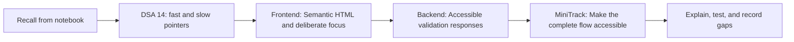
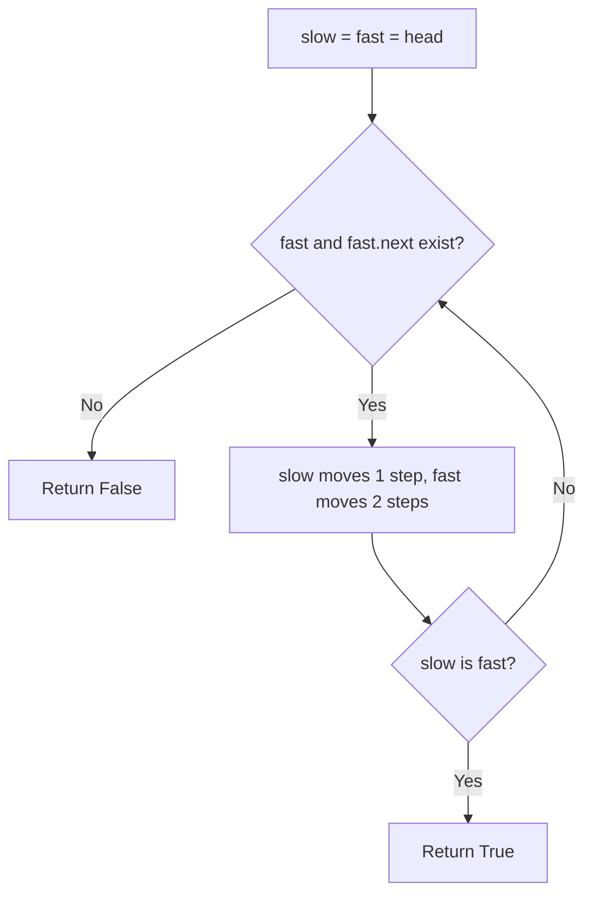

# Prep Day 14 — Make the complete flow accessible

**Date:** Thursday, December 10, 2026  
**Time:** 7 study hours plus breaks  
**Starting point:** App Days 1–4 are complete. Continue from the current learner workspace and the previous preparation-day exit checklist.  
**Goal:** Make the complete flow accessible.

[Prep Day 13](prep-day-13.md) · [Preparation plan](../../docs/FULL_STACK_INTERVIEW_PREP_PLAN.md) · [Track home](README.md) · [Prep Day 15](prep-day-15.md)

**Everything to read today is below.** The original [App Day 13](../day-13.md)
and [DSA Day 14](../../dsa-python/lessons/dsa-day-14.md) remain available for
comparison. This prep day covers the accessibility half of App Day 13:
semantic page regions, labels, accessible names, error messages tied to their
fields, and deliberate keyboard focus. Mobile-first row layout and measured
memoization belong to Prep Day 15; the full quality gate and mock interview
belong to Prep Day 16. Write runnable code in the named project and practice
files, not in this Markdown file.

## Learning objectives

- explain semantic HTML and deliberate focus in beginner-friendly language;
- explain accessible validation responses and their failure boundary;
- implement or verify the listed MiniTrack milestone;
- solve DSA Day 14 using the fast and slow pointers pattern;
- record the result in your rough notebook and explain it without reading.

## 1. Start with notebook recall (45 minutes)

Before opening a lesson, write answers in
[`checkpoints/ROUGH/Notes.md`](../../checkpoints/ROUGH/Notes.md):

1. What did yesterday's browser action send to the server?
2. Where is persistent task data stored, and what state is only temporary?
3. What error or edge case can you already predict for today's topic?
4. What do you remember about the **fast and slow pointers** pattern?

Use this format:

```md
## Thursday, December 10, 2026

- What:
- Why:
- How MiniTrack uses it:
- What can go wrong:
- First task:
```

Do not copy the source paragraph. Write what you remember, then compare.

## 2. Understand today's full-stack boundary (20 minutes)

**Frontend focus — Semantic HTML and deliberate focus:** Native controls provide keyboard behavior, roles, and states automatically. Use ARIA to add missing meaning, not to recreate a button from a generic element.

**Backend focus — Accessible validation responses:** The server should return stable, non-secret error information that the client can associate with the affected control and announce appropriately.

**Today's connection:** Accessible behavior spans browser semantics, React state, async feedback, and predictable server errors.



## 3. Python DSA practice (1 hour 45 minutes)

**Practice file:** [`dsa-python/practice/day-14.py`](../../dsa-python/practice/day-14.py)  
**Pattern:** fast and slow pointers

### Problem: Linked List Cycle

You receive the first node (the **head**) of a singly linked list. Return
`True` if following `.next` links ever brings you back to a node you already
visited (a **cycle**). Return `False` if the links eventually reach `None`.

Assumptions:

- `head` may be `None` (an empty list);
- node values may repeat, so a cycle is about **the same node object**, not the
  same value;
- do not change the list while checking it.

A linked list is built from small objects. The practice file defines this
class, so you do not need to write it yourself:

```python
class ListNode:
    def __init__(self, val=0, next=None):
        self.val, self.next = val, next
```

`ListNode(1)` creates one node holding `1` whose `next` is `None`.
`ListNode(1, ListNode(2))` creates `1 -> 2 -> None`. You can also connect
nodes later by assigning `node.next = other_node`.

The day checker has no built-in examples for linked lists, so use these sample
calls (the same shape the reference tests use):

```python
a = ListNode(1); b = ListNode(2); c = ListNode(3)
a.next = b; b.next = c
solve(a)     # False: 1 -> 2 -> 3 -> None
c.next = b
solve(a)     # True: 1 -> 2 -> 3 -> back to 2 -> ...
solve(None)  # False: an empty list has no cycle
```

The simple approach remembers every node it has visited: O(n) time and O(n)
extra memory. Today's pattern uses two pointers instead and needs O(1) extra
memory.

### Start coding

In the practice file, replace the `raise NotImplementedError` line with your
own implementation. This is the starting shape:

```python
def solve(head):
    # Return True if following .next ever revisits a node; otherwise False.
    raise NotImplementedError
```

Three Python details you will need:

- `None` counts as false in a condition, so `while fast and fast.next:` keeps
  looping only while **both** `fast` and `fast.next` are real nodes. Python
  checks `fast` first and stops early if it is `None`, so `fast.next` is never
  read from `None`.
- `slow is fast` asks “are these the **same object**?” Comparing values with
  `slow.val == fast.val` would be wrong, because two different nodes can hold
  the same value.
- `fast.next.next` moves two links at once. It is safe only after checking that
  `fast.next` exists.

The idea: `slow` moves one node per step and `fast` moves two. Without a cycle,
`fast` falls off the end. With a cycle, `fast` laps around and catches `slow`.



### Invariant to say aloud

Advance one pointer twice as fast; if a cycle exists, the pointers eventually meet.

### Work in this order

1. Restate the problem and ask about constraints.
2. Give a brute-force approach and its cost before optimizing.
3. Write the invariant above in your own words.
4. Implement without opening the solution for 25 minutes.
5. Test empty, smallest, typical, duplicate, and boundary cases where relevant.
6. Use a small hint if blocked; do not spend the entire block stuck.
7. Compare with the commented reference and re-code the key loop from memory.

From the repository root:

```bash
python3 dsa-python/scripts/check_practice.py 14
python3 -m unittest discover -s dsa-python/tests -v
```

**Expected observation:** for Day 14 the checker only loads your file and
prints `This problem uses linked-list/tree structures; write your own
object-based tests.` It does **not** test your answer, so use the assert block
below. The completed reference suite still passes (`test_linked_lists` covers
Days 13–15).

To create test lists quickly, add this helper **above** your asserts. It builds
a list from Python values and, if `pos` is not `-1`, connects the last node
back to the node at index `pos` to make a cycle:

```python
def build_with_cycle(values, pos):
    nodes = [ListNode(value) for value in values]  # one node per value
    for i in range(len(nodes) - 1):
        nodes[i].next = nodes[i + 1]               # link each node to the next
    if nodes and pos >= 0:
        nodes[-1].next = nodes[pos]                # last node points back
    return nodes[0] if nodes else None
```

`[ListNode(value) for value in values]` is a **list comprehension**: it makes a
new list containing one `ListNode` for each value. `nodes[-1]` means the last
item in the list.

Now temporarily add these checks at the bottom of the practice file, then run
`python3 dsa-python/practice/day-14.py`:

```python
if __name__ == '__main__':
    assert solve(build_with_cycle([1, 2, 3], -1)) is False
    assert solve(build_with_cycle([1, 2, 3], 1)) is True
    assert solve(None) is False                              # empty list
    assert solve(build_with_cycle([1], -1)) is False         # one node, no loop
    assert solve(build_with_cycle([1], 0)) is True           # node points to itself
    assert solve(build_with_cycle([1, 2], 0)) is True        # whole list is the cycle
    assert solve(build_with_cycle([7, 7, 7], -1)) is False   # repeated values, no cycle
    assert solve(build_with_cycle(list(range(1000)), 500)) is True
    print('All checks passed')
```

### Brute-force code — reveal after attempting

<details>
<summary>Show the simple solution</summary>

```python
def solve(head):
    seen = set()          # node objects we have already visited
    node = head
    while node:
        if node in seen:  # same object reached twice -> cycle
            return True
        seen.add(node)
        node = node.next
    return False          # reached None, so the list ends
```

</details>

A `set` stores items and answers “is this item already inside?” quickly. A
plain `ListNode` is stored by **identity**, so two different nodes with the
same value are still different set items. This visits each node at most once:
O(n) time and O(n) extra space for the set.

### Optimized code — reveal after attempting

<details>
<summary>Show the Linked List Cycle solution</summary>

```python
class ListNode:
    def __init__(self, val=0, next=None):
        self.val = val
        self.next = next

def solve(head):
    slow = fast = head
    while fast and fast.next:   # fast needs two real links to move
        slow = slow.next        # one step
        fast = fast.next.next   # two steps
        if slow is fast:        # identity, not matching values
            return True
    return False
```

</details>

Trace `1 -> 2 -> 3 -> back to 2` (`build_with_cycle([1, 2, 3], 1)`). Call
the nodes A(1), B(2), and C(3); C's `next` is B.

| Step | `slow` after move | `fast` after move | `slow is fast`? | Action |
|---:|---|---|---|---|
| start | A(1) | A(1) | not checked | Enter loop: A and A.next exist |
| 1 | B(2) | C(3) | No | Continue: C and C.next (B) exist |
| 2 | C(3) | C(3) (C → B → C) | Yes | Return `True` |

Without the cycle (`C.next is None`), step 1 leaves `fast` at C, and
`fast.next` is `None`, so the loop stops and returns `False`. Time is O(n);
extra space is O(1) because only two variables are used.

### DSA interview questions and answers

#### DSA Q1. What is the brute-force approach?

**Interview-ready answer:** “I walk the list and put each node object into a
set. If I ever reach a node that is already in the set, the list has a cycle.
If I reach `None`, it does not. That is O(n) time and O(n) extra space.”

**Example:** For A(1) → B(2) → C(3) → B, the set grows to `{A, B, C}`, then the
walk reaches B again and returns `True`.

**Follow-up:** Why store nodes instead of values? Values can repeat:
`[7, 7, 7]` has no cycle, but a value set would wrongly report one on the
second `7`.

#### DSA Q2. What is the core idea of fast and slow pointers?

**Interview-ready answer:** “Two pointers start at the head. Slow moves one
node per step and fast moves two. If the list ends, fast reaches `None` first
and there is no cycle. If there is a cycle, both pointers end up inside it and
fast eventually lands on the same node as slow.”

**Example:** In `build_with_cycle([1, 2, 3], 1)`, the pointers meet at C after
two steps.

**Follow-up:** This is often called Floyd's cycle detection or the “tortoise
and hare” algorithm.

#### DSA Q3. Why must the pointers meet, and why can't fast skip over slow?

**Interview-ready answer:** “Once both pointers are inside the cycle, each
step moves fast two nodes and slow one node, so the distance from fast to slow
along the cycle shrinks by exactly one per step. A distance that shrinks by one
each time must reach zero; it cannot jump from one to minus one.”

**Example:** If fast is 3 nodes behind slow in the cycle, after one step it is
2 behind, then 1 behind, then on the same node.

**Follow-up:** Slow enters the cycle within n steps, and they meet within one
more trip around the cycle, so the total number of steps is O(n).

#### DSA Q4. What are the time and space costs?

**Interview-ready answer:** “Time is O(n) because slow visits at most about n
nodes before the pointers meet or fast reaches the end. Extra space is O(1)
because I keep only two references, unlike the set version, which stores up to
n nodes.”

**Example:** For a 1,000-node list whose tail points to node 500, the set
version stores 1,000 nodes; the pointer version stores two variables.

**Follow-up:** The constant factor is slightly higher because fast does two
moves per step, but it uses no hashing and no extra memory, which matters for
very long lists.

#### DSA Q5. What edge cases should I test?

**Interview-ready answer:** “An empty list, one node without a cycle, one node
pointing to itself, a two-node cycle, a long list with a cycle starting in the
middle, and repeated values without a cycle. The guard must check both
`fast` and `fast.next` before moving.”

**Example:** `solve(None)` returns `False` without entering the loop;
`build_with_cycle([1], 0)` returns `True` because slow and fast both move back
to the same node.

**Follow-up:** Checking only `while fast.next:` crashes on an empty list with
`AttributeError: 'NoneType' object has no attribute 'next'`.

#### DSA Q6. How would you return the node where the cycle starts?

**Interview-ready answer:** “After slow and fast meet, I move one pointer back
to the head and then move both one step at a time. The node where they meet
again is the start of the cycle. It is still O(n) time and O(1) space.”

**Example:** For `build_with_cycle([3, 2, 0, -4], 1)`, the second phase meets
at the node with value `2`.

**Follow-up:** Why does it work? If the head is `x` steps from the cycle start
and the meeting point is `y` steps past it, the math shows that `x` steps from
the head and `x` steps from the meeting point land on the same node. The same
fast/slow idea also finds the middle of a list.

## 4. Frontend guided study (1 hour 30 minutes)

### What

Native controls provide keyboard behavior, roles, and states automatically. Use ARIA to add missing meaning, not to recreate a button from a generic element.

### Why

The browser layer should make state and feedback understandable without taking
ownership of persistent data or security decisions that belong on the server.
A person using only a keyboard, a screen reader, or browser zoom must be able
to create, edit, complete, filter, and delete a task just like a mouse user.

### How

Learn these ideas one at a time before you change any code.

**1. Semantic HTML.** HTML elements carry meaning. `<button>` is announced as
a button, can be reached with Tab, and responds to Enter and Space with no
extra code. `<header>`, `<nav>`, and `<main>` are **landmarks**: screen-reader
users can jump straight to them. A `<div onClick>` looks the same on screen
but has none of these behaviors.

**2. Accessible name.** Every control needs a name that assistive technology
reads aloud. A `<label htmlFor="task-title">` names the input whose `id` is
`task-title`. A button's visible text is its name. If many rows each have an
“Edit” button, add `aria-label={`Edit ${task.title}`}` so each name is unique,
and keep the visible word at the start of the name.

**3. ARIA attributes.** ARIA adds meaning HTML cannot express on its own:

| Attribute | What it tells assistive technology | MiniTrack use |
|---|---|---|
| `aria-invalid={true}` | “The value in this field is not accepted.” | Title input after a rejected save |
| `aria-describedby="id"` | “Read this other element as extra description.” | Connects the input to its error text |
| `role="alert"` | “Announce this new message now.” | A failed create, edit, toggle, or delete |
| `role="status"` | “Announce this politely when the user is idle.” | Task count and “Saving…” |
| `aria-disabled={true}` | “This control is unavailable right now,” but it stays focusable. | Buttons while a request is pending |

**4. Deliberate focus.** **Focus** is the element that receives keyboard
input. A `disabled` element cannot keep focus, so disabling the button you
just pressed throws focus back to the top of the page. Today you will keep
controls focusable with `aria-disabled` and `readOnly`, move focus into the
edit input when editing starts, and return focus to the same Edit button after
Save, Cancel, or Escape.

**5. Visible focus.** The Tailwind classes
`focus-visible:outline-2 focus-visible:outline-offset-2 focus-visible:outline-violet-400`
draw a ring only when the browser decides the user is navigating by keyboard.

Files to open deliberately:

- `frontend/app/TaskBoard.tsx`
- `frontend/app/page.tsx`

Answer before coding:

- Which value is persistent, and which value is temporary interaction state?
  (Saved titles live in PostgreSQL; `editingId`, the draft title, and error
  messages are temporary React state.)
- What starts this behavior? (A key press: Tab, Enter, Space, or Escape.)
- What should the user see while work is pending? (“Saving…” in a status
  region, and controls that ignore repeat presses but keep focus.)
- What should remain unchanged when the operation fails? (The saved task, the
  typed draft, and the position of keyboard focus.)

## 5. Backend guided study (1 hour 30 minutes)

### What

The server should return stable, non-secret error information that the client can associate with the affected control and announce appropriately.

### Boundary checklist

- Validate untrusted path, query, and body values.
- Authenticate identity when the route is protected.
- Authorize the resource separately from authentication.
- Bind SQL values rather than concatenating untrusted data.
- Return an explicit success or error status.
- Log internal failures on the server without exposing secrets.

### The error contract MiniTrack already has

You do not need new backend code today. Since App Days 5–11, every task Route
Handler answers with a status code and a small JSON body such as
`{ "error": "Task not found" }`. Review this existing collection `POST`
handler in `frontend/app/api/tasks/route.ts` (Day 10 added the session check;
Day 11 added the owner):

```ts
export async function POST(request: Request): Promise<Response> {
  const session = await auth();
  if (!session?.user?.id) {
    return Response.json({ error: 'Unauthorized' }, { status: 401 });
  }

  let body: unknown;
  try {
    body = await request.json();
  } catch {
    return Response.json({ error: 'Invalid JSON' }, { status: 400 });
  }

  const title = normalizeTitle(isRecord(body) ? body.title : undefined);
  if (!title) {
    return Response.json({ error: 'title must be 1–200 characters' }, { status: 400 });
  }

  try {
    return Response.json(await createTask(session.user.id, title), { status: 201 });
  } catch (error: unknown) {
    // Full details stay in the server log; the browser gets a generic message.
    console.error('POST /api/tasks failed:', error);
    return Response.json({ error: 'Internal server error' }, { status: 500 });
  }
}
```

The item handler in `frontend/app/api/tasks/[id]/route.ts` follows the same
contract for `PATCH` and `DELETE`.

| Status | Example `error` text | Where today's UI shows it |
|---:|---|---|
| 400 | `title must be 1–200 characters` | Under the field that was submitted |
| 400 | `Invalid task ID` | Above the task list |
| 401 | `Unauthorized` | Next to the action; the user must sign in again |
| 404 | `Task not found` | Under the edit field, or above the list for toggle/delete |
| 500 | `Internal server error` | Next to the action; details stay in the server log |

Why this is accessible **and** safe:

- The text is stable and human-readable, so the client can show it as-is.
- It never contains SQL, stack traces, session cookies, or whether another
  user owns a task (`404` for both “missing” and “not yours”).
- The status code lets the client choose where to show it; the `error` text
  tells the person what happened.

The client still validates first (blank title) for fast feedback, but the
server check is the real rule because anyone can send HTTP requests directly.

## 6. MiniTrack implementation (1 hour)

**Milestone source:** Day 13 semantics, keyboard behavior, names, states, and focus

**Starting state:** After Prep Day 13, users sign in with GitHub, every task
query and mutation is scoped by `session.user.id`, and negative authorization
tests pass. `frontend/app/page.tsx` reads the URL filters (App Day 8) and the
session (App Day 10). `SearchForm.tsx`, `AuthControls.tsx`, `lib/tasks.ts`, and
`lib/validation.ts` stay unchanged today.

Goals:

1. Complete create, edit, filter, and delete using only the keyboard.
2. Verify every control has an accessible name and visible focus.
3. Associate errors with fields and announce important async failures.

### Step 1: Audit before changing anything (15 minutes)

Run the app, put the mouse away, and try the whole journey with Tab,
Shift+Tab, Enter, Space, and Escape. Write each failure in your notebook. Use
this checklist from App Day 13:

- Can Tab reach controls in a logical order?
- Is focus visible on every control?
- Does each input have a label?
- Are errors announced and visible?
- Is completion communicated beyond color?
- Where does focus go after Save, Cancel, and Delete?

Open your browser's developer tools, choose the **Accessibility** panel (Chrome:
Elements → Accessibility; Firefox: Accessibility tab), and inspect the name and
role of the Edit and Delete buttons.

### Step 2: Add semantic page regions to `frontend/app/page.tsx`

First try it yourself: put the site name and account controls in
`<header><nav>`, the page title and tasks in `<main>`, and keep both
request-time parts inside `Suspense`. Then compare with this complete file:

```tsx
import Link from 'next/link';
import { Suspense } from 'react';
import { auth } from '@/auth';
import AuthControls from './AuthControls';
import SearchForm from './SearchForm';
import TaskBoard from './TaskBoard';
import { searchTasks } from '../lib/tasks';
import { normalizeTaskFilters } from '../lib/validation';
import type { Task } from './types';

type PageProps = {
  searchParams: Promise<{
    q?: string;
    status?: string;
  }>;
};

// Request-time subtree: reads the session cookie, the URL, and PostgreSQL.
async function TaskContent({ searchParams }: PageProps) {
  const session = await auth();
  if (!session?.user?.id) {
    return (
      <section
        aria-labelledby="sign-in-heading"
        className="mt-8 rounded-2xl border border-slate-700 bg-slate-900 p-8"
      >
        <h2 className="text-2xl font-bold" id="sign-in-heading">
          Sign in to open MiniTrack
        </h2>
        <p className="mt-2 text-slate-300">
          Use the Sign in with GitHub button at the top of the page.
        </p>
      </section>
    );
  }

  const params = await searchParams;
  const filters = normalizeTaskFilters(params.q, params.status);

  let tasks: Task[] = [];
  let loadFailed = false;
  try {
    tasks = await searchTasks(session.user.id, filters);
  } catch (error) {
    // Prep Day 14: log details on the server; show a stable, non-secret message.
    console.error('Loading tasks failed:', error);
    loadFailed = true;
  }

  if (loadFailed) {
    return (
      <p
        className="mt-8 rounded-xl border border-rose-400/30 bg-rose-400/10 p-4 text-rose-200"
        role="alert"
      >
        Could not load tasks. Check that PostgreSQL is running, then reload.
      </p>
    );
  }

  return (
    <>
      <SearchForm filters={filters} />
      <TaskBoard tasks={tasks} />
    </>
  );
}

export default function Home({ searchParams }: PageProps) {
  return (
    <>
      {/* Prep Day 14: landmarks let screen-reader users jump between regions. */}
      <header className="border-b border-slate-800">
        <nav
          aria-label="Account"
          className="mx-auto flex max-w-5xl items-center justify-between gap-4 px-4 py-4"
        >
          <Link
            className="font-bold focus-visible:outline-2 focus-visible:outline-offset-2 focus-visible:outline-violet-400"
            href="/"
          >
            MiniTrack
          </Link>
          {/* AuthControls calls auth(), which reads cookies, so it needs Suspense too. */}
          <Suspense fallback={<span className="text-sm text-slate-400">Checking session…</span>}>
            <AuthControls />
          </Suspense>
        </nav>
      </header>

      <main className="mx-auto w-full max-w-5xl px-4 py-8 sm:px-6" id="main-content">
        <h1 className="text-3xl font-bold sm:text-4xl">My tasks</h1>
        <Suspense fallback={<p className="mt-8 text-slate-400" role="status">Loading tasks…</p>}>
          <TaskContent searchParams={searchParams} />
        </Suspense>
      </main>
    </>
  );
}
```

What changed and why:

- `<header>`, `<nav aria-label="Account">`, and `<main>` create landmarks. There
  is exactly one `<h1>`; `TaskBoard` adds `<h2>` headings below it.
- `Link` from `next/link` renders a real `<a href="/">` (so it is a normal,
  keyboard-focusable link) and lets Next.js navigate without a full reload.
  `npm run lint` rejects a plain `<a href="/">` for internal pages.
- `AuthControls` moved into the header. It calls `auth()`, which reads request
  cookies, so with Cache Components it must sit inside its own `Suspense`.
  Do not add `dynamic = 'force-dynamic'`.
- `searchParams` and `auth()` already make `TaskContent` request-time work, so
  it needs no `io()` call.
- The load error no longer shows the raw database message to the user; the
  details go to the server log instead.
- `frontend/app/layout.tsx` already has `<html lang="en">`; keep it so screen
  readers use the correct pronunciation.

`SearchForm.tsx` from App Day 8 already uses a real `<form method="GET">`,
labelled `<input type="search">` and `<select>`, and a native submit button,
so URL filtering is keyboard-accessible without changes.

### Step 3: Make `frontend/app/TaskBoard.tsx` keyboard- and screen-reader-friendly

First try each change yourself, one at a time, re-testing with the keyboard
after each:

1. a visible `<label>` for the title input and a list heading;
2. separate error messages for the add form, the edit form, and row actions,
   each connected to its control;
3. readable server error text instead of only a status code;
4. controls that stay focusable while a request is pending;
5. focus into the edit input on Edit, and back to the Edit button afterwards;
6. unique names for Edit, Delete, and the checkbox, and completion text that
   is not only a color.

Then compare with this complete file. It keeps the App Day 5–7 behavior
(create, complete, edit, delete, `router.refresh()`), keeps status filtering
in the URL through `SearchForm` (App Day 8), and marks today's changes with
`Prep Day 14` comments. If your styling classes differ, keep yours and copy
only the marked behavior.

```tsx
'use client';

import { useEffect, useRef, useState, type FormEvent } from 'react';
import { useRouter } from 'next/navigation';
import type { Task } from './types';

// Prep Day 14: one shared style so every control shows keyboard focus.
const focusRing =
  'focus-visible:outline-2 focus-visible:outline-offset-2 focus-visible:outline-violet-400';
const actionClass = `min-h-10 rounded-lg px-3 text-sm text-slate-200 hover:bg-slate-800 aria-disabled:cursor-not-allowed aria-disabled:opacity-50 ${focusRing}`;
const errorClass = 'rounded-lg border border-rose-400/30 bg-rose-400/10 p-3 text-sm text-rose-200';

// Prep Day 14: turn the server's JSON body, such as { "error": "Task not found" },
// into text a person can read. Fall back to the status code if there is no message.
async function readErrorMessage(response: Response): Promise<string> {
  try {
    const body: unknown = await response.json();
    if (
      typeof body === 'object' &&
      body !== null &&
      'error' in body &&
      typeof body.error === 'string'
    ) {
      return body.error;
    }
  } catch {
    // The body was not JSON.
  }
  return `Request failed (${response.status})`;
}

export default function TaskBoard({ tasks }: { tasks: Task[] }) {
  const [title, setTitle] = useState('');
  const [editingId, setEditingId] = useState<string | null>(null);
  const [editTitle, setEditTitle] = useState('');
  const [busy, setBusy] = useState(false);
  // Prep Day 14: each error appears next to the control it describes.
  const [titleError, setTitleError] = useState('');
  const [editError, setEditError] = useState('');
  const [listError, setListError] = useState('');
  const router = useRouter();

  const titleInputRef = useRef<HTMLInputElement>(null);
  const editInputRef = useRef<HTMLInputElement>(null);
  const listHeadingRef = useRef<HTMLHeadingElement>(null);
  // Prep Day 14: remember every Edit button so focus can return to the right one.
  const editButtons = useRef(new Map<string, HTMLButtonElement>());
  const returnFocusTo = useRef<string | null>(null);

  const openCount = tasks.filter(task => !task.done).length;

  useEffect(() => {
    if (editingId) {
      editInputRef.current?.focus();
      editInputRef.current?.select();
    } else if (returnFocusTo.current) {
      // Prep Day 14: after Save, Cancel, or Escape, focus returns to that row's Edit button.
      editButtons.current.get(returnFocusTo.current)?.focus();
      returnFocusTo.current = null;
    }
  }, [editingId]);

  // One helper for every request. showError decides where the message appears.
  async function request(
    path: string,
    options: RequestInit,
    showError: (message: string) => void,
  ): Promise<boolean> {
    setTitleError('');
    setEditError('');
    setListError('');
    setBusy(true);
    try {
      const response = await fetch(path, options);
      if (!response.ok) {
        showError(await readErrorMessage(response));
        return false;
      }
      router.refresh(); // Re-run the Server Component to read PostgreSQL again.
      return true;
    } catch {
      showError('Could not connect to the server.');
      return false;
    } finally {
      setBusy(false);
    }
  }

  async function addTask(event: FormEvent<HTMLFormElement>) {
    event.preventDefault();
    if (busy) return; // Prep Day 14: ignore repeats instead of disabling (keeps focus).
    const cleanTitle = title.trim();
    if (!cleanTitle) {
      setTitleError('Enter a task title.');
      titleInputRef.current?.focus();
      return;
    }
    const ok = await request(
      '/api/tasks',
      {
        method: 'POST',
        headers: { 'Content-Type': 'application/json' },
        body: JSON.stringify({ title: cleanTitle }),
      },
      setTitleError,
    );
    if (ok) setTitle('');
    titleInputRef.current?.focus();
  }

  async function toggleTask(taskId: string, done: boolean) {
    if (busy) return;
    await request(
      `/api/tasks/${taskId}`,
      {
        method: 'PATCH',
        headers: { 'Content-Type': 'application/json' },
        body: JSON.stringify({ done }),
      },
      setListError,
    );
  }

  async function removeTask(taskId: string) {
    if (busy) return;
    const ok = await request(`/api/tasks/${taskId}`, { method: 'DELETE' }, setListError);
    // Prep Day 14: the focused row disappears, so move focus to a stable place.
    if (ok) listHeadingRef.current?.focus();
  }

  function startEditing(task: Task) {
    if (busy) return;
    setEditingId(task.id);
    setEditTitle(task.title);
    setEditError('');
  }

  function stopEditing() {
    returnFocusTo.current = editingId; // Prep Day 14: remember where to send focus.
    setEditingId(null);
    setEditTitle('');
    setEditError('');
  }

  async function saveTask(event: FormEvent<HTMLFormElement>) {
    event.preventDefault();
    if (!editingId || busy) return;
    const cleanTitle = editTitle.trim();
    if (!cleanTitle) {
      setEditError('Task title cannot be empty.');
      editInputRef.current?.focus();
      return;
    }
    const ok = await request(
      `/api/tasks/${editingId}`,
      {
        method: 'PATCH',
        headers: { 'Content-Type': 'application/json' },
        body: JSON.stringify({ title: cleanTitle }),
      },
      setEditError,
    );
    if (ok) {
      stopEditing();
    } else {
      editInputRef.current?.focus(); // Keep the user in the field they must fix.
    }
  }

  return (
    <section aria-labelledby="add-task-heading" className="mt-6 rounded-2xl border border-slate-700 bg-slate-900 p-5">
      <h2 className="text-lg font-semibold" id="add-task-heading">
        Add a task
      </h2>
      <form className="mt-3 flex flex-col gap-2 sm:flex-row sm:items-start" noValidate onSubmit={addTask}>
        <div className="flex flex-1 flex-col gap-2">
          {/* Prep Day 14: a visible label names the input for everyone. */}
          <label className="text-sm font-medium" htmlFor="task-title">
            Task title
          </label>
          <input
            aria-describedby={titleError ? 'task-title-error' : undefined}
            aria-invalid={Boolean(titleError)}
            className={`min-h-11 rounded-lg border border-slate-600 bg-slate-950 px-3 ${focusRing}`}
            id="task-title"
            maxLength={200}
            name="title"
            onChange={event => setTitle(event.target.value)}
            readOnly={busy}
            ref={titleInputRef}
            value={title}
          />
          {titleError ? (
            <p className={errorClass} id="task-title-error" role="alert">
              {titleError}
            </p>
          ) : null}
        </div>
        <button
          aria-disabled={busy}
          className={`min-h-11 rounded-lg bg-violet-500 px-5 font-bold text-white sm:mt-7 aria-disabled:opacity-50 ${focusRing}`}
          type="submit"
        >
          Add task
        </button>
      </form>

      {/* tabIndex={-1} lets code focus this heading without adding it to the Tab order. */}
      <h2 className="mt-8 text-lg font-semibold" id="task-list-heading" ref={listHeadingRef} tabIndex={-1}>
        Tasks
      </h2>

      {listError ? (
        <p className={`mt-3 ${errorClass}`} role="alert">
          {listError}
        </p>
      ) : null}

      {tasks.length === 0 ? (
        <p className="mt-3 text-slate-400">No tasks match this view.</p>
      ) : (
        <ul aria-labelledby="task-list-heading" className="mt-3 border-t border-slate-700">
          {tasks.map(task => (
            <li className="flex items-center gap-3 border-b border-slate-700 py-3" key={task.id}>
              <input
                aria-disabled={busy}
                aria-label={`Complete ${task.title}`}
                checked={task.done}
                className={`size-5 accent-violet-400 ${focusRing}`}
                onChange={event => {
                  void toggleTask(task.id, event.target.checked);
                }}
                type="checkbox"
              />

              {editingId === task.id ? (
                <form
                  className="flex min-w-0 flex-1 flex-wrap items-center gap-2"
                  noValidate
                  onKeyDown={event => {
                    // Prep Day 14: Escape cancels, as users expect from an edit box.
                    if (event.key === 'Escape' && !busy) stopEditing();
                  }}
                  onSubmit={saveTask}
                >
                  <label className="sr-only" htmlFor={`edit-${task.id}`}>
                    Edit {task.title}
                  </label>
                  <input
                    aria-describedby={editError ? `edit-${task.id}-error` : undefined}
                    aria-invalid={Boolean(editError)}
                    className={`min-h-10 min-w-0 flex-1 rounded-lg border border-violet-400 bg-slate-950 px-3 ${focusRing}`}
                    id={`edit-${task.id}`}
                    maxLength={200}
                    onChange={event => setEditTitle(event.target.value)}
                    readOnly={busy}
                    ref={editInputRef}
                    value={editTitle}
                  />
                  <button aria-disabled={busy} className={actionClass} type="submit">
                    Save
                  </button>
                  <button
                    aria-disabled={busy}
                    className={actionClass}
                    onClick={() => {
                      if (!busy) stopEditing();
                    }}
                    type="button"
                  >
                    Cancel
                  </button>
                  {editError ? (
                    <p className={`w-full ${errorClass}`} id={`edit-${task.id}-error`} role="alert">
                      {editError}
                    </p>
                  ) : null}
                </form>
              ) : (
                <>
                  <span className={`min-w-0 flex-1 break-words ${task.done ? 'text-slate-400 line-through' : ''}`}>
                    {task.title}
                    {/* Prep Day 14: completion is announced, not shown only by color. */}
                    <span className="sr-only">{task.done ? ' (completed)' : ' (open)'}</span>
                  </span>
                  <button
                    aria-disabled={busy}
                    aria-label={`Edit ${task.title}`}
                    className={actionClass}
                    onClick={() => startEditing(task)}
                    ref={node => {
                      if (node) editButtons.current.set(task.id, node);
                      else editButtons.current.delete(task.id);
                    }}
                    type="button"
                  >
                    Edit
                  </button>
                  <button
                    aria-disabled={busy}
                    aria-label={`Delete ${task.title}`}
                    className={actionClass}
                    onClick={() => {
                      void removeTask(task.id);
                    }}
                    type="button"
                  >
                    Delete
                  </button>
                </>
              )}
            </li>
          ))}
        </ul>
      )}

      {/* Prep Day 14: a polite status region announces progress and the new count. */}
      <p className="mt-4 text-sm text-slate-400" role="status">
        {busy ? 'Saving…' : `${tasks.length} ${tasks.length === 1 ? 'task' : 'tasks'} · ${openCount} open`}
      </p>
    </section>
  );
}
```

Read the important decisions slowly:

- **`aria-disabled` plus `if (busy) return`** replaces `disabled={busy}` on
  buttons and the checkbox. The control stays focusable, looks unavailable
  (`aria-disabled:opacity-50`), and ignores repeat presses. The server is still
  the real protection against duplicates.
- **`readOnly={busy}`** stops typing during a save but, unlike `disabled`,
  lets the input keep focus.
- **Three error states** (`titleError`, `editError`, `listError`) let each
  message sit next to the control it describes. `aria-describedby` points the
  input at the error's `id`, and `aria-invalid` marks the field.
- **`readErrorMessage`** shows the server's stable text, such as
  `Task not found`, instead of only `Request failed (404)`.
- **`noValidate`** turns off the browser's own pop-up bubbles so React's
  connected error message is the single source of feedback.
- **Focus moves on purpose:** into the edit input on Edit; back to that row's
  Edit button after Save, Cancel, or Escape; to the “Tasks” heading after a
  delete removes the focused row; and back to the field after a failure.
- **The ref callback** `ref={node => ...}` runs when the button appears
  (`node` is the element) and when it disappears (`node` is `null`), keeping
  the `Map` of Edit buttons up to date.
- The Playwright test from App Day 9 still finds `getByLabel('Task title')`,
  `getByRole('button', { name: /add task/i })`, and
  `getByLabel('Complete Practice testing')`.

If your Day 5 version still has a client-side `<select>` filter inside
`TaskBoard`, remove it: since App Day 8 the status filter lives in the URL
through `SearchForm`, and two filters would disagree.

### Step 4: Run and verify

From `frontend/`, with PostgreSQL running:

```bash
npm run lint
npx tsc --noEmit
npm run dev
```

Open `http://localhost:3000`, sign in, and complete this keyboard-only script:

1. Tab to **Task title**, type `Keyboard only`, press Enter. The task appears
   and focus stays in the title field.
2. Press Enter on an empty title. Expect `Enter a task title.` under the field,
   and a screen reader announces it.
3. Tab to **Edit Keyboard only**, press Enter. Focus moves into the edit input
   with the text selected. Press Escape: focus returns to the same Edit button.
4. Edit again, change the title, press Enter. Focus returns to the Edit button.
5. Press Space on the checkbox. The status line says `Saving…`, then the new
   count; focus stays on the checkbox.
6. Tab to the search form, choose **Done**, and press Enter. The URL changes to
   `?q=&status=done`.
7. Tab to **Delete**, press Enter. Focus moves to the **Tasks** heading.
8. Zoom to 200% and repeat step 1. Nothing should be hidden or cut off.

Failure checks:

- **Server message:** open two tabs. In tab A, start editing a task. In tab B,
  delete it. In tab A, press Enter. Expect `Task not found` under the edit
  field, `aria-invalid="true"` on the input, and focus still in the input.
- **Server validation:** in the browser console while signed in, run:

  ```js
  await fetch('/api/tasks', {
    method: 'POST',
    headers: { 'Content-Type': 'application/json' },
    body: JSON.stringify({ title: '   ' }),
  }).then(response => response.json());
  ```

  Expect `{ error: 'title must be 1–200 characters' }`. The same text appears
  under the title field if this request comes from the form.
- **Database down:** stop PostgreSQL and reload. Expect the alert
  `Could not load tasks. Check that PostgreSQL is running, then reload.` and no
  SQL details on the page; the details appear in the `npm run dev` terminal.

Then run the browser suite from App Day 9 if your Day 12 setup supports signed-in
tests:

```bash
npm run test:e2e
```

**Expected observation:** the user-visible milestone works, its important
failure path is explicit, and existing behavior remains intact. Automated
checks find some problems; your keyboard script proves the journey.

## 7. Trace the event or request

```mermaid
sequenceDiagram
  participant K as Keyboard user
  participant B as Browser
  participant R as TaskBoard (React)
  participant A as PATCH /api/tasks/42
  participant P as PostgreSQL
  K->>B: Tab to "Edit Buy milk" and press Enter
  B->>R: onClick → startEditing(task 42)
  R-->>B: Render edit input; effect focuses and selects it
  K->>B: Type "Buy oat milk", press Enter
  B->>R: onSubmit → saveTask()
  R-->>B: readOnly input, status "Saving…"
  R->>A: PATCH {"title":"Buy oat milk"}
  A->>A: auth(), isValidId, normalizeTitle
  A->>P: UPDATE ... WHERE id=42 AND owner_id=$owner
  alt row updated
    P-->>A: Updated row
    A-->>R: 200 task JSON
    R->>R: router.refresh(), stopEditing()
    R-->>B: Focus returns to "Edit Buy oat milk"
  else row missing or not owned
    P-->>A: zero rows
    A-->>R: 404 {"error":"Task not found"}
    R-->>B: role="alert" message under input; focus stays in input
  end
  B-->>K: Screen reader announces the result
```

Trace one concrete input. Name every boundary, value, and possible failure.

## 8. Deliberate debugging exercise (25 minutes)

**Break it:** Replace a button with a div that has only an onClick handler.

For example, change the Delete `<button ... type="button">` to
`<div className={actionClass} onClick={...}>Delete</div>`.

**Predict before running:** write the expected symptom in your notebook.

**Expected symptom:** Keyboard activation and button semantics disappear.
Tab skips the “button”, Enter and Space do nothing, and the Accessibility panel
shows no `button` role and no `Delete Buy milk` name.

**Root cause:** A visual shape was used instead of the correct interactive element.

**Restore and verify:** Restore a native button and style it as needed. Tab
reaches it again and Enter deletes the task.

A second quick break: change `aria-disabled={busy}` back to `disabled={busy}` on
the checkbox, press Space, and watch focus jump to the top of the page.

Do not stop after making the symptom disappear. Explain why the repair restores
the intended invariant.

## 9. Interview questions and answers (30 minutes)

### Q1. What is semantic HTML and deliberate focus?

**Interview-ready answer:** “Semantic HTML means using the element that already
means what I need—`button`, `label`, `form`, `nav`, `main`—so the browser
gives me keyboard support, roles, and states for free. Deliberate focus means I
decide where keyboard focus goes after the screen changes, instead of letting
it fall back to the top of the page.”

**Example:** In `frontend/app/TaskBoard.tsx`, Edit is a native `<button>` with
`aria-label={`Edit ${task.title}`}`. When editing starts, a `useEffect` on
`editingId` focuses the edit input; after Save, Cancel, or Escape it focuses
the same Edit button again using the `editButtons` `Map` of refs.

**Senior follow-up:** “Manual focus code grows with every new dynamic view. If
we add dialogs, menus, or comboboxes, I would use a well-tested accessible
component library or the native `<dialog>` element rather than custom focus
traps, and I would add keyboard Playwright tests to catch regressions.”

### Q2. How should the backend handle accessible validation responses?

**Interview-ready answer:** “The Route Handler returns a specific status code
and a short, stable JSON message. The client shows that message next to the
control that caused it and announces it. The message must never include SQL,
stack traces, secrets, or whether another user owns a resource.”

**Example:** `POST /api/tasks` with `{"title":"   "}` returns `400` and
`{ "error": "title must be 1–200 characters" }`. `TaskBoard` reads it with
`readErrorMessage`, stores it in `titleError`, renders it with
`id="task-title-error"` and `role="alert"`, and the input points to it through
`aria-describedby`.

**Senior follow-up:** “For multi-field forms I would return a machine-readable
code per field, for example `{ field: 'title', code: 'too_long' }`, so the
client can localize text. Internal failures still return a generic `500` while
the server logs details with a request ID, never the session cookie.”

### Q3. What invariant makes the fast and slow pointers solution correct?

**Interview-ready answer:** “Slow moves one node and fast moves two. If there
is no cycle, fast reaches `None`. If there is a cycle, once both are inside it
the gap between them shrinks by exactly one each step, so fast must land on
slow. I compare with `is`, not values.”

**Example:** For A(1) → B(2) → C(3) → B, after step 1 slow is B and fast is C;
after step 2 both are C, so `solve` returns `True`.

**Senior follow-up:** “It is O(n) time and O(1) space, assuming the list is not
modified while we walk it. If I also need the cycle's start, I reset one pointer
to the head and advance both one step until they meet.”

### Q4. How does today's work fit the complete MiniTrack system?

**Interview-ready answer:** “Accessibility runs through every layer: the server
renders landmarks and headings, React manages focus and announces status, and
the Route Handlers return predictable errors that the UI can attach to the
right field. Keyboard users get the same create, edit, filter, and delete flow
backed by the same owner-scoped PostgreSQL queries.”

**Example:** A keyboard user presses Enter on **Edit Buy milk**, types a new
title, presses Enter, and `PATCH /api/tasks/42` runs
`UPDATE ... WHERE id = $2 AND owner_id = $3`. On success `router.refresh()`
reloads the list and focus returns to **Edit Buy oat milk**; on `404` the
message appears under the input.

**Senior follow-up:** “Before adding infrastructure I would measure user
signals: the keyboard Playwright journey in CI, an automated axe scan for
machine-detectable issues, and support tickets. Automated tools cannot prove
usability, so I would still test with a screen reader and with disabled users.”

## 10. Complexity and operational cost

- **DSA:** O(n) time and O(1) space.
- **Application:** Accessibility checks add development time but reduce duplicated custom interaction code and costly late fixes.
- **Learning:** Attempting, retrieving, and correcting is more valuable than
  copying several solutions. Keep the scope to one understood pattern today.

## Exit checklist

- [ ] I completed DSA Day 14 before reading its solution.
- [ ] I can state the invariant and complexity without notes.
- [ ] I completed or verified the MiniTrack milestone.
- [ ] I tested one success path and one failure path.
- [ ] I completed the deliberate debugging exercise.
- [ ] I answered all four interview questions aloud.
- [ ] I recorded what remains confusing and tomorrow's first task.

**Suggested commit:** `prep day 14: make the complete flow accessible`
