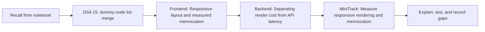
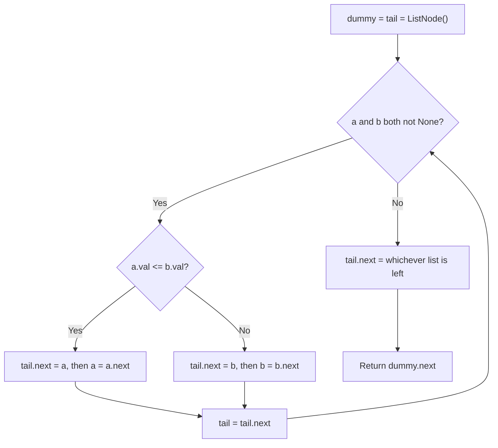
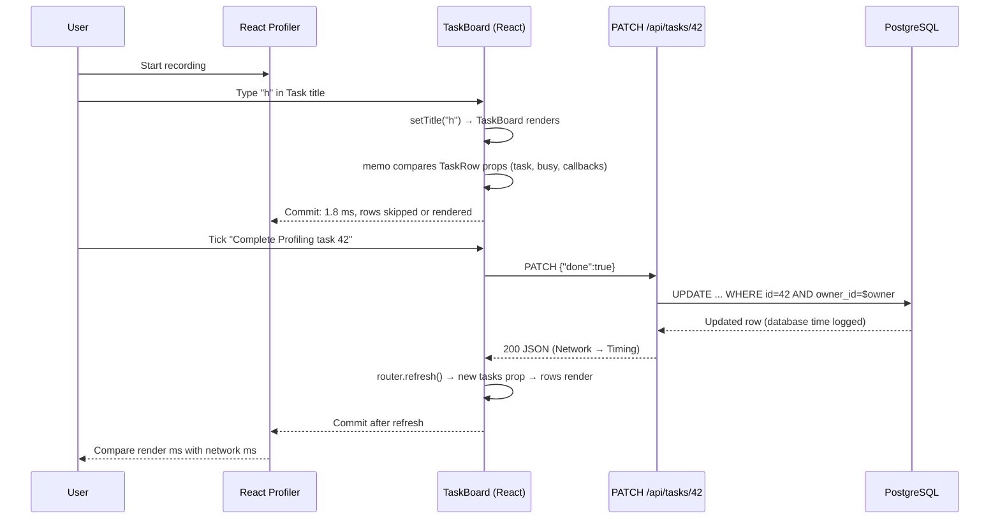

# Prep Day 15 — Measure responsive rendering and memoization

**Date:** Friday, December 11, 2026  
**Time:** 7 study hours plus breaks  
**Starting point:** App Days 1–4 are complete. Continue from the current learner workspace and the previous preparation-day exit checklist.  
**Goal:** Measure responsive rendering and memoization.

[Prep Day 14](prep-day-14.md) · [Preparation plan](../../docs/FULL_STACK_INTERVIEW_PREP_PLAN.md) · [Track home](README.md) · [Prep Day 16](prep-day-16.md)

**Everything to read today is below.** The original [App Day 13](../day-13.md)
and [DSA Day 15](../../dsa-python/lessons/dsa-day-15.md) remain available for
comparison. This prep day covers the second half of App Day 13: mobile-first
task rows, the React Profiler, one measured memoization experiment, and
separating render time from API and SQL time. Semantic HTML, labels, and focus
were Prep Day 14; the full quality gate and mock belong to Prep Day 16.
Production deployment starts on Prep Day 17. Write runnable code in the named
project and practice files, not in this Markdown file.

## Learning objectives

- explain responsive layout and measured memoization in beginner-friendly language;
- explain separating render cost from API latency and its failure boundary;
- implement or verify the listed MiniTrack milestone;
- solve DSA Day 15 using the dummy-node list merge pattern;
- record the result in your rough notebook and explain it without reading.

## 1. Start with notebook recall (45 minutes)

Before opening a lesson, write answers in
[`checkpoints/ROUGH/Notes.md`](../../checkpoints/ROUGH/Notes.md):

1. What did yesterday's browser action send to the server?
2. Where is persistent task data stored, and what state is only temporary?
3. What error or edge case can you already predict for today's topic?
4. What do you remember about the **dummy-node list merge** pattern?

Use this format:

```md
## Friday, December 11, 2026

- What:
- Why:
- How MiniTrack uses it:
- What can go wrong:
- First task:
```

Do not copy the source paragraph. Write what you remember, then compare.

## 2. Understand today's full-stack boundary (20 minutes)

**Frontend focus — Responsive layout and measured memoization:** Start with the narrow layout, then add breakpoint changes where content needs them. useMemo caches a value, useCallback caches a function reference, and React.memo may skip a child render when props remain shallowly equal.

**Backend focus — Separating render cost from API latency:** A slow interaction may come from rendering, network latency, server work, or SQL. Profile the layer before optimizing it.

**Today's connection:** Performance work uses evidence across React, HTTP, server, and database layers.



## 3. Python DSA practice (1 hour 45 minutes)

**Practice file:** [`dsa-python/practice/day-15.py`](../../dsa-python/practice/day-15.py)  
**Pattern:** dummy-node list merge

### Problem: Merge Two Sorted Lists

You receive the heads of two linked lists, `a` and `b`. Each list is already
sorted from smallest to largest. Return the head of **one** sorted list that
contains every node from both lists.

Assumptions:

- either list (or both) may be `None` (empty);
- values may repeat, inside one list or across both;
- reuse the existing nodes by changing their `.next` links; do not create a
  new node for every value;
- when two values are equal, take the node from `a` first.

The practice file already defines the node class you met on Prep Day 14:

```python
class ListNode:
    def __init__(self, val=0, next=None):
        self.val, self.next = val, next
```

The day checker has no built-in examples for linked lists. These sample calls
match the reference test:

```python
a = ListNode(1, ListNode(2, ListNode(3)))  # 1 -> 2 -> 3
b = ListNode(1, ListNode(4))               # 1 -> 4
solve(a, b)                           # 1 -> 1 -> 2 -> 3 -> 4
solve(None, ListNode(1, ListNode(4)))  # 1 -> 4 (the non-empty list as is)
solve(None, None)                     # None
```

Use a fresh list in the second call: after `solve(a, b)`, the original nodes
of `a` and `b` have been relinked into the merged list.

The simple approach copies all values into a Python list, sorts it, and builds
new nodes: O((n + m) log(n + m)) time and O(n + m) extra space. Because both
inputs are already sorted, you can do better by walking them together once.

### Start coding

In the practice file, replace the `raise NotImplementedError` line with your
own implementation. This is the starting shape:

```python
def solve(a, b):
    # Return the head of one sorted list made by relinking the nodes of a and b.
    raise NotImplementedError
```

Two ideas make the code short:

- **Dummy node.** `dummy = ListNode()` is a throwaway node placed before the
  answer. You always attach the next node to `tail.next`, so the first node
  needs no special `if`. At the end, the real head is `dummy.next`.
- **Tuple assignment.** `tail.next, a = a, a.next` first reads both
  right-hand values (`a` and `a.next`), then assigns them. It attaches the
  current `a` node to the output **and** moves `a` forward in one line.



### Invariant to say aloud

Append the smaller current node to a stable dummy-headed output and advance only that source pointer.

### Work in this order

1. Restate the problem and ask about constraints.
2. Give a brute-force approach and its cost before optimizing.
3. Write the invariant above in your own words.
4. Implement without opening the solution for 25 minutes.
5. Test empty, smallest, typical, duplicate, and boundary cases where relevant.
6. Use a small hint if blocked; do not spend the entire block stuck.
7. Compare with the commented reference and re-code the key loop from memory.

From the repository root:

```bash
python3 dsa-python/scripts/check_practice.py 15
python3 -m unittest discover -s dsa-python/tests -v
```

**Expected observation:** for Day 15 the checker only loads your file and
prints `This problem uses linked-list/tree structures; write your own
object-based tests.` It does **not** test your answer, so use the assert block
below. The completed reference suite still passes (`test_linked_lists` covers
Days 13–15).

Add these two helpers **above** your asserts. `build` turns a Python list into
a linked list, and `to_list` turns a linked list back into a Python list so
you can compare results with `==`:

```python
def build(values):
    head = None
    for value in reversed(values):  # build from the back: 3, then 2, then 1
        head = ListNode(value, head)
    return head

def to_list(head):
    values = []
    while head:
        values.append(head.val)
        head = head.next
    return values
```

`reversed(values)` walks a list from its last item to its first. Building from
the back lets each new node point at the list built so far.

Now temporarily add these checks at the bottom of the practice file, then run
`python3 dsa-python/practice/day-15.py`:

```python
if __name__ == '__main__':
    assert to_list(solve(build([1, 2, 3]), build([1, 4]))) == [1, 1, 2, 3, 4]
    assert to_list(solve(build([1, 2, 4]), build([1, 3, 4]))) == [1, 1, 2, 3, 4, 4]
    assert solve(None, None) is None                             # both empty
    assert to_list(solve(None, build([0]))) == [0]               # one empty
    assert to_list(solve(build([5]), None)) == [5]
    assert to_list(solve(build([-3, 10]), build([-5, 0, 20]))) == [-5, -3, 0, 10, 20]
    assert to_list(solve(build([1, 2]), build([3, 4]))) == [1, 2, 3, 4]  # no overlap
    first, second = ListNode(2), ListNode(2)
    merged = solve(first, second)
    assert merged is first and merged.next is second             # nodes reused; ties take a first
    print('All checks passed')
```

### Brute-force code — reveal after attempting

<details>
<summary>Show the simple solution</summary>

```python
def solve(a, b):
    values = []
    for head in (a, b):              # copy every value from both lists
        while head:
            values.append(head.val)
            head = head.next
    values.sort()
    dummy = tail = ListNode()
    for value in values:             # build brand-new nodes
        tail.next = ListNode(value)
        tail = tail.next
    return dummy.next
```

</details>

This ignores the fact that the inputs are sorted. Sorting `n + m` values costs
O((n + m) log(n + m)) time, and the copied values plus new nodes cost
O(n + m) extra space. It also returns new nodes instead of reusing the
originals, so `merged is first` would be `False`.

### Optimized code — reveal after attempting

<details>
<summary>Show the Merge Two Sorted Lists solution</summary>

```python
class ListNode:
    def __init__(self, val=0, next=None):
        self.val = val
        self.next = next

def solve(a, b):
    dummy = tail = ListNode()        # placeholder before the real head
    while a and b:
        if a.val <= b.val:           # <= keeps a's node first on ties
            tail.next, a = a, a.next
        else:
            tail.next, b = b, b.next
        tail = tail.next             # tail is always the last merged node
    tail.next = a if a else b        # attach whatever remains (already sorted)
    return dummy.next
```

</details>

Trace `a = 1 -> 2 -> 3` and `b = 1 -> 4`:

| Step | `a` points at | `b` points at | Choose | Merged list after step |
|---:|---:|---:|---|---|
| 1 | 1 | 1 | `a` (1 <= 1) | 1 |
| 2 | 2 | 1 | `b` | 1 → 1 |
| 3 | 2 | 4 | `a` | 1 → 1 → 2 |
| 4 | 3 | 4 | `a` | 1 → 1 → 2 → 3 |
| end | `None` | 4 | attach rest of `b` | 1 → 1 → 2 → 3 → 4 |

Each loop step moves exactly one node, so time is O(n + m). Extra space is
O(1): only `dummy`, `tail`, `a`, and `b`.

### DSA interview questions and answers

#### DSA Q1. What is the brute-force approach?

**Interview-ready answer:** “I copy every value from both lists into a Python
list, sort it, and build a new linked list. That is O((n + m) log(n + m)) time
and O(n + m) extra space, and it creates new nodes instead of reusing the
existing ones.”

**Example:** `[1, 2, 3]` and `[1, 4]` become `[1, 2, 3, 1, 4]`, sorted to
`[1, 1, 2, 3, 4]`, then turned into five new nodes.

**Follow-up:** Why mention it? It is a correct baseline, and it shows I noticed
that the sorted input is the clue for a linear solution.

#### DSA Q2. What does the dummy node do?

**Interview-ready answer:** “The dummy node is a fixed starting point before
the answer. Because `tail` starts at the dummy, I can always write
`tail.next = node`, even for the very first node. At the end I return
`dummy.next`, which skips the placeholder.”

**Example:** Without a dummy, I would need `if head is None: head = node` before
every attach, plus a special case when one input is empty.

**Follow-up:** The dummy's value (`0`) is never returned, so it does not matter
even if the lists contain `0`.

#### DSA Q3. Why is the result sorted?

**Interview-ready answer:** “At each step the two candidates are the smallest
remaining nodes in each list, because both lists are sorted. I attach the
smaller one, so every attached node is no larger than anything still waiting.
When one list runs out, the other list's remaining nodes are already sorted and
all at least as large as the last attached node, so I attach them in one step.”

**Example:** After attaching `1, 1, 2, 3`, list `a` is empty and `b` still
holds `4`; `tail.next = b` finishes the merge.

**Follow-up:** Using `<=` instead of `<` makes the merge **stable**: equal
values keep `a` before `b`, which matters when nodes carry extra data.

#### DSA Q4. What are the time and space costs?

**Interview-ready answer:** “O(n + m) time, because each loop iteration
attaches one node and every node is attached at most once; the final leftover
attach is O(1). Extra space is O(1), because I only relink existing nodes.”

**Example:** Merging 1,000 and 10 nodes performs at most 10 comparisons
before list `b` is empty, then attaches the remaining `a` nodes at once.

**Follow-up:** A recursive version is shorter but uses O(n + m) call-stack
space, and Python's default recursion limit (about 1,000) can raise
`RecursionError` on long lists.

#### DSA Q5. What edge cases should I test?

**Interview-ready answer:** “Both lists empty, one list empty, lists of
different lengths, duplicate values across lists, negative numbers, and lists
that do not overlap at all. I also check that the original nodes are reused
and that ties keep `a` first.”

**Example:** `solve(None, None)` returns `None` because `dummy.next` was never
set; `solve(build([1, 2]), build([3, 4]))` attaches `1, 2`, then all of `b`.

**Follow-up:** Because nodes are relinked, the caller's original `a` and `b`
lists are changed. Ask the interviewer whether modifying the input is allowed.

#### DSA Q6. How would you merge k sorted lists?

**Interview-ready answer:** “I would put the head of each list in a min-heap.
Each step pops the smallest node, attaches it, and pushes that node's next.
With N total nodes, that is O(N log k) time and O(k) extra space.”

**Example:** For three lists `1→4`, `1→3`, `2→6`, the heap starts with
`1, 1, 2`; popping and refilling produces `1, 1, 2, 3, 4, 6`.

**Follow-up:** Python's `heapq` cannot compare `ListNode` objects, so push
tuples such as `(node.val, index, node)` where `index` breaks ties.
Repeatedly merging pairs of lists is another O(N log k) option.

## 4. Frontend guided study (1 hour 30 minutes)

### What

Start with the narrow layout, then add breakpoint changes where content needs them. useMemo caches a value, useCallback caches a function reference, and React.memo may skip a child render when props remain shallowly equal.

### Why

The browser layer should make state and feedback understandable without taking
ownership of persistent data or security decisions that belong on the server.
A layout that overflows at 320 pixels hides buttons from phone users, and
memoization added without measurement makes code harder to change without
making it faster.

### How

Learn these ideas one at a time.

**1. Mobile-first Tailwind.** A class without a prefix, such as `grid`,
applies at every width. A prefixed class, such as `sm:grid-cols-[auto_1fr_auto]`,
applies only at the `sm` breakpoint (40rem, normally 640 px) **and wider**. So
you write the phone layout first, then add `sm:` or `md:` classes only where
wider screens need a change. `frontend/app/globals.css` already contains
`@import "tailwindcss";`; Tailwind v4 provides these breakpoints with no extra
configuration.

**2. Touch targets and wrapping.** `min-h-11` makes a control at least 44 px
tall, which is easier to tap. `flex-wrap` lets buttons move to a new line
instead of pushing past the screen edge. `min-w-0` lets a grid or flex child
shrink, and `break-words` breaks a very long word instead of overflowing.

**3. What a render is.** When state changes, React calls the component
function again (a **render**), compares the new output with the old one, and
updates only the changed DOM (a **commit**). Typing one letter in the
**Task title** input changes `title` state, so all of `TaskBoard` renders again,
including every task row.

**4. Three memoization tools.**

| Tool | What it remembers | When it helps |
|---|---|---|
| `useMemo(() => value, [deps])` | A calculated **value** | The calculation is measurably slow |
| `useCallback(fn, [deps])` | The same **function object** between renders | A memoized child receives that function as a prop |
| `memo(Component)` | The child's last output | Its props are shallowly equal (`===` for each prop) |

**Shallowly equal** means React compares each prop with `Object.is`, which
works like `===`. A new arrow function created during render is never equal to
the previous one, so it defeats `memo` unless it is wrapped in `useCallback`.

**5. The React Profiler.** Install the React Developer Tools browser
extension. Its **Profiler** tab records each commit and shows how long each
component took to render. In its settings, turn on **Record why each component
rendered while profiling**.

Files to open deliberately:

- `frontend/app/TaskBoard.tsx`
- `frontend/app/globals.css`

Answer before coding:

- Which value is persistent, and which value is temporary interaction state?
  (Tasks are in PostgreSQL; `title`, `editingId`, and `busy` are React state.)
- What starts this behavior? (A keystroke, a click, or a viewport resize.)
- What should the user see while work is pending? (`Saving…` in the status
  line; layout must not jump.)
- What should remain unchanged when the operation fails? (Saved tasks and
  focus; memoization must never change what is displayed.)

## 5. Backend guided study (1 hour 30 minutes)

### What

A slow interaction may come from rendering, network latency, server work, or SQL. Profile the layer before optimizing it.

### Boundary checklist

- Validate untrusted path, query, and body values.
- Authenticate identity when the route is protected.
- Authorize the resource separately from authentication.
- Bind SQL values rather than concatenating untrusted data.
- Return an explicit success or error status.
- Log internal failures on the server without exposing secrets.

### Where the time goes when you tick a checkbox

One click triggers **two** server round trips and one render:

1. `fetch('PATCH /api/tasks/42')` — Route Handler: `auth()`, validation, then
   `UPDATE ... WHERE id = $2 AND owner_id = $3` in PostgreSQL.
2. `router.refresh()` — Next.js requests a new Server Component payload
   (a request with `_rsc=` in the URL), which runs `searchTasks` again.
3. React commits the new `tasks` prop in the browser.

Measure each layer with the matching tool:

| Layer | Tool | Number to record |
|---|---|---|
| Browser render | React Profiler | Commit duration for `TaskBoard` |
| Network + server | DevTools **Network** tab → request → **Timing** | “Waiting for server response” and total time |
| Route Handler | Temporary `performance.now()` log | Database time inside the handler |
| SQL | `EXPLAIN ANALYZE` in `psql` | Planning and execution time; scan type |

Temporary measurement in `frontend/app/api/tasks/[id]/route.ts`: inside
`PATCH`, wrap only the existing database call. Remove these lines after you
record the numbers:

```ts
const dbStarted = performance.now(); // TEMPORARY: Prep Day 15 measurement
const task = await updateTask();
console.info(`PATCH /api/tasks/${id} database: ${(performance.now() - dbStarted).toFixed(1)} ms`);
```

`performance.now()` returns milliseconds with fractions, and it is available in
Node.js and browsers without an import. Log only the timing and the task ID,
never the request body, cookie, or session.

To see how PostgreSQL runs the owner-scoped search, open `psql -d minitrack`:

```sql
SELECT id, email FROM users;  -- find your own user id

EXPLAIN ANALYZE
SELECT id, title, done, created_at
FROM tasks
WHERE owner_id = 1            -- replace 1 with your id from the query above
  AND title ILIKE '%profiling%' ESCAPE '\'
ORDER BY id;
```

**Expected observation:** with a few hundred rows, execution takes well under
a few milliseconds, and PostgreSQL may choose a sequential scan even though
`tasks_owner_id_id_idx` exists, because reading a tiny table directly is
cheaper. A leading-wildcard `ILIKE '%…%'` cannot use a normal B-tree index on
`title`. None of this needs fixing at this size; you are learning to read the
evidence.

## 6. MiniTrack implementation (1 hour)

**Milestone source:** Day 13 responsive design and React profiling lab

**Starting state:** `frontend/app/TaskBoard.tsx` is the Prep Day 14 version:
labelled inputs, three connected error messages, `aria-disabled` controls,
deliberate focus, and a flex row per task. Only `TaskBoard.tsx` changes today;
`page.tsx` and the API stay the same.

Goals:

1. Verify the task row at narrow width and zoom.
2. Record a React Profiler baseline.
3. Try one memoization change, measure again, and remove it if it adds complexity without benefit.

### Step 1: Make task rows mobile-first

First try it yourself: at phone width, put the checkbox and title on the first
line and the action buttons on the next line; from `sm` upward, put the actions
in a third column on the right.

Then compare. In `frontend/app/TaskBoard.tsx`, change the `min-h-10` at the
start of `actionClass` to `min-h-11`:

```tsx
const actionClass = `min-h-11 rounded-lg px-3 text-sm text-slate-200 hover:bg-slate-800 aria-disabled:cursor-not-allowed aria-disabled:opacity-50 ${focusRing}`;
```

Then replace the whole `<ul aria-labelledby="task-list-heading" ...>...</ul>`
block with this version. All behavior from Prep Day 14 is unchanged; only the
layout classes marked `Prep Day 15` are new:

```tsx
        <ul aria-labelledby="task-list-heading" className="mt-3 border-t border-slate-700">
          {/* Prep Day 15: two columns on phones; a third "actions" column from sm (40rem) up. */}
          {tasks.map(task => (
            <li
              className="grid grid-cols-[auto_minmax(0,1fr)] items-start gap-x-3 gap-y-2 border-b border-slate-700 py-3 sm:grid-cols-[auto_minmax(0,1fr)_auto] sm:items-center"
              key={task.id}
            >
              <input
                aria-disabled={busy}
                aria-label={`Complete ${task.title}`}
                checked={task.done}
                className={`mt-0.5 size-5 accent-violet-400 sm:mt-0 ${focusRing}`}
                onChange={event => {
                  void toggleTask(task.id, event.target.checked);
                }}
                type="checkbox"
              />

              {editingId === task.id ? (
                // Prep Day 15: on sm+ the edit form spans the title and actions columns.
                <form
                  className="flex min-w-0 flex-wrap items-center gap-2 sm:col-span-2"
                  noValidate
                  onKeyDown={event => {
                    if (event.key === 'Escape' && !busy) stopEditing();
                  }}
                  onSubmit={saveTask}
                >
                  <label className="sr-only" htmlFor={`edit-${task.id}`}>
                    Edit {task.title}
                  </label>
                  <input
                    aria-describedby={editError ? `edit-${task.id}-error` : undefined}
                    aria-invalid={Boolean(editError)}
                    className={`min-h-11 w-full min-w-0 rounded-lg border border-violet-400 bg-slate-950 px-3 sm:w-auto sm:flex-1 ${focusRing}`}
                    id={`edit-${task.id}`}
                    maxLength={200}
                    onChange={event => setEditTitle(event.target.value)}
                    readOnly={busy}
                    ref={editInputRef}
                    value={editTitle}
                  />
                  <button aria-disabled={busy} className={actionClass} type="submit">
                    Save
                  </button>
                  <button
                    aria-disabled={busy}
                    className={actionClass}
                    onClick={() => {
                      if (!busy) stopEditing();
                    }}
                    type="button"
                  >
                    Cancel
                  </button>
                  {editError ? (
                    <p className={`w-full ${errorClass}`} id={`edit-${task.id}-error`} role="alert">
                      {editError}
                    </p>
                  ) : null}
                </form>
              ) : (
                <>
                  <span className={`min-w-0 break-words ${task.done ? 'text-slate-400 line-through' : ''}`}>
                    {task.title}
                    <span className="sr-only">{task.done ? ' (completed)' : ' (open)'}</span>
                  </span>
                  {/* Prep Day 15: under the title on phones, in column 3 on sm+; buttons wrap. */}
                  <div className="col-start-2 flex flex-wrap gap-2 sm:col-start-3">
                    <button
                      aria-disabled={busy}
                      aria-label={`Edit ${task.title}`}
                      className={actionClass}
                      onClick={() => startEditing(task)}
                      ref={node => {
                        if (node) editButtons.current.set(task.id, node);
                        else editButtons.current.delete(task.id);
                      }}
                      type="button"
                    >
                      Edit
                    </button>
                    <button
                      aria-disabled={busy}
                      aria-label={`Delete ${task.title}`}
                      className={actionClass}
                      onClick={() => {
                        void removeTask(task.id);
                      }}
                      type="button"
                    >
                      Delete
                    </button>
                  </div>
                </>
              )}
            </li>
          ))}
        </ul>
```

Why these classes:

- `grid-cols-[auto_minmax(0,1fr)]` gives the checkbox its natural width and
  the title the rest. `minmax(0,1fr)` lets the title column shrink below the
  width of a long word, so `break-words` can wrap it.
- `col-start-2` puts the action buttons under the title (not under the
  checkbox) on phones; `sm:col-start-3` moves them to a third column.
- `items-start` keeps the checkbox aligned with the first line of a long,
  wrapped title; `sm:items-center` centers the row on wider screens.
- The add form from Prep Day 14 already uses `flex-col sm:flex-row`, so it
  stacks on phones without changes.

### Step 2: Verify at narrow width and zoom

Run the app (`cd frontend && npm run dev`), sign in, and add a task whose title
is a single 60-character word, for example
`Supercalifragilisticexpialidocious-and-even-longer-than-that`.

1. Open DevTools → **Toggle device toolbar**, set the width to **320**.
2. In the Console, check that the page does not scroll sideways:

   ```js
   document.documentElement.scrollWidth <= document.documentElement.clientWidth
   ```

   Expect `true`. If it is `false`, look for an element wider than the screen
   in the Elements panel.
3. Check widths 320, 768 (tablet), and 1280 (desktop). Actions are under the
   title at 320 and on the right at 768 and 1280.
4. Return to desktop width and zoom the browser to 200%. Everything still fits,
   and you can still Tab through every control from Prep Day 14.
5. Commit the layout change before experimenting:

   ```bash
   git add frontend/app/TaskBoard.tsx
   git commit -m "prep day 15: mobile-first task rows"
   ```

### Step 3: Record a Profiler baseline

You need enough rows to see anything. In `psql -d minitrack`, add 200 rows to
**your own** user (replace `1` with your id from `SELECT id, email FROM users;`):

```sql
INSERT INTO tasks (owner_id, title)
SELECT 1, 'Profiling task ' || n
FROM generate_series(1, 200) AS n;
```

Reload the page, then in the React DevTools **Profiler** tab:

1. Click **Record**.
2. Click in **Task title** and type `hello` (5 keystrokes).
3. Click **Stop**.
4. Write down: number of commits, the `TaskBoard` render time in the slowest
   commit, and the “why did this render” reason (`State changed: title`).

Repeat three times and use the middle value. The development build is slower
than production, so compare **before and after** in the same mode, not with
numbers from another computer.

### Step 4: Try one memoization experiment

Each keystroke re-renders all 200 rows even though no task changed. The
experiment: move the row's title and buttons into a memoized `TaskRow` so React
can skip rows whose props did not change.

1. Update the React import:

   ```tsx
   import { memo, useCallback, useEffect, useRef, useState, type FormEvent } from 'react';
   ```

2. Add this component **above** `export default function TaskBoard`:

   ```tsx
   type TaskRowProps = {
     task: Task;
     busy: boolean;
     onEdit: (task: Task) => void;
     onDelete: (taskId: string) => Promise<void>;
     registerEditButton: (taskId: string, node: HTMLButtonElement | null) => void;
   };

   // Prep Day 15 EXPERIMENT: memo skips this row when every prop is === to last time.
   const TaskRow = memo(function TaskRow({
     task,
     busy,
     onEdit,
     onDelete,
     registerEditButton,
   }: TaskRowProps) {
     return (
       <>
         <span className={`min-w-0 break-words ${task.done ? 'text-slate-400 line-through' : ''}`}>
           {task.title}
           <span className="sr-only">{task.done ? ' (completed)' : ' (open)'}</span>
         </span>
         <div className="col-start-2 flex flex-wrap gap-2 sm:col-start-3">
           <button
             aria-disabled={busy}
             aria-label={`Edit ${task.title}`}
             className={actionClass}
             onClick={() => onEdit(task)}
             ref={node => registerEditButton(task.id, node)}
             type="button"
           >
             Edit
           </button>
           <button
             aria-disabled={busy}
             aria-label={`Delete ${task.title}`}
             className={actionClass}
             onClick={() => {
               void onDelete(task.id);
             }}
             type="button"
           >
             Delete
           </button>
         </div>
       </>
     );
   });
   ```

3. Inside `TaskBoard`, the functions passed to `TaskRow` must keep the same
   identity between renders, or `memo` never skips. Replace `request`,
   `removeTask`, and `startEditing` with these `useCallback` versions, and add
   `registerEditButton`:

   ```tsx
   const request = useCallback(
     async (path: string, options: RequestInit, showError: (message: string) => void) => {
       setTitleError('');
       setEditError('');
       setListError('');
       setBusy(true);
       try {
         const response = await fetch(path, options);
         if (!response.ok) {
           showError(await readErrorMessage(response));
           setBusy(false);
           return false;
         }
         router.refresh();
         setBusy(false);
         return true;
       } catch {
         showError('Could not connect to the server.');
         setBusy(false);
         return false;
       }
     },
     [router], // State setters are already stable, so only router is listed.
   );

   const removeTask = useCallback(
     async (taskId: string) => {
       if (busy) return;
       const ok = await request(`/api/tasks/${taskId}`, { method: 'DELETE' }, setListError);
       if (ok) listHeadingRef.current?.focus();
     },
     [busy, request], // New function only when busy flips, not on every keystroke.
   );

   const startEditing = useCallback(
     (task: Task) => {
       if (busy) return;
       setEditingId(task.id);
       setEditTitle(task.title);
       setEditError('');
     },
     [busy],
   );

   const registerEditButton = useCallback((taskId: string, node: HTMLButtonElement | null) => {
     if (node) editButtons.current.set(taskId, node);
     else editButtons.current.delete(taskId);
   }, []);
   ```

4. In the `<ul>` block, replace the whole `<> ... </>` view-mode branch (the
   title `<span>` and the actions `<div>`) with:

   ```tsx
   <TaskRow
     busy={busy}
     onDelete={removeTask}
     onEdit={startEditing}
     registerEditButton={registerEditButton}
     task={task}
   />
   ```

`addTask`, `toggleTask`, and `saveTask` stay plain functions because they are
not passed to `TaskRow`. `useCallback` must be called at the top level of the
component, never inside a condition or loop.

### Step 5: Measure again and decide

Run `npx tsc --noEmit` and `npm run lint`, reload, and repeat the Step 3
recording three times. In the Profiler, `TaskRow` entries should now appear
grey (“Did not render”) for keystrokes in **Task title**.

| Measurement | Baseline | With `memo(TaskRow)` |
|---|---:|---:|
| `TaskBoard` render time, slowest keystroke commit (ms) | | |
| Rows that rendered per keystroke | 200 | |
| Lines of code added | 0 | about 70 |

Decision rule:

- **Keep** the experiment only if typing felt slow before and the numbers show
  a clear, repeatable improvement.
- **Otherwise remove it** and return to the committed plain version:

  ```bash
  git restore frontend/app/TaskBoard.tsx
  ```

Things the memo version cannot avoid: when you press Save or tick a checkbox,
`busy` changes and `router.refresh()` returns **new task objects**, so every
row renders anyway. For 200 short rows the baseline is usually only a few
milliseconds, which is why many teams keep the plain version.

`useMemo` would look like this for the count, but a filter over 200 items is
too cheap to justify it; measure before adding it:

```tsx
const openCount = useMemo(() => tasks.filter(task => !task.done).length, [tasks]);
```

### Step 6: Clean up and run checks

Remove the profiling rows and the temporary `performance.now()` lines:

```sql
DELETE FROM tasks WHERE owner_id = 1 AND title LIKE 'Profiling task %';
```

From `frontend/`:

```bash
npm run lint
npx tsc --noEmit
npm run test:unit
```

**Expected observation:** the user-visible milestone works, its important
failure path is explicit, and existing behavior remains intact. The page has no
sideways scroll at 320 px, you have written baseline and experiment numbers,
and the final `TaskBoard.tsx` contains only memoization you can justify.

Failure checks:

- Pass an inline `onEdit={task => startEditing(task)}` to `TaskRow` and record
  again: every row renders on every keystroke, because the new arrow function is
  never `===` to the old one.
- Remove `busy` from the `removeTask` dependency list. `npm run lint` warns
  (`react-hooks/exhaustive-deps`), and the function keeps reading the old
  `busy` value—a **stale closure**.

## 7. Trace the event or request



Trace one concrete input. Name every boundary, value, and possible failure.

## 8. Deliberate debugging exercise (25 minutes)

**Break it:** Wrap every calculation and callback in memoization before profiling.

For example, wrap `openCount`, `addTask`, `toggleTask`, and `saveTask` in
`useMemo` or `useCallback` and pass the dependencies you guess.

**Predict before running:** write the expected symptom in your notebook.

**Expected symptom:** Dependencies become harder to reason about while performance may not improve.
Lint warns about missing dependencies, and a callback with a forgotten
dependency can read an old `busy` or `editTitle` value.

**Root cause:** Optimization was applied without evidence of a bottleneck.

**Restore and verify:** Return to plain code, capture a baseline, and optimize only measured work.

Do not stop after making the symptom disappear. Explain why the repair restores
the intended invariant.

## 9. Interview questions and answers (30 minutes)

### Q1. What is responsive layout and measured memoization?

**Interview-ready answer:** “Responsive layout means the page stays readable
and usable from a 320-pixel phone to a wide desktop and at 200% zoom. I write
the narrow layout first and add breakpoint classes only where wider screens
need a change. Measured memoization means I profile first and only add
`useMemo`, `useCallback`, or `memo` when the numbers show a real cost.”

**Example:** In `frontend/app/TaskBoard.tsx`, each `<li>` uses
`grid-cols-[auto_minmax(0,1fr)]` on phones and
`sm:grid-cols-[auto_minmax(0,1fr)_auto]` from 640 px up. For memoization, I
recorded typing `hello` with 200 rows in the Profiler before and after
`memo(TaskRow)`, then kept or reverted it based on the numbers.

**Senior follow-up:** “Memoization creates hidden coupling: every callback
passed to a memoized child needs correct dependencies. If the list grew to
thousands of rows, I would first consider pagination or list virtualization,
which reduce the work instead of caching it.”

### Q2. How should the backend handle separating render cost from API latency?

**Interview-ready answer:** “I split one slow interaction into its parts:
React render time from the Profiler, request time from the Network tab, the
handler's database time from a temporary server log, and the query plan from
`EXPLAIN ANALYZE`. I only optimize the part that is actually slow.”

**Example:** Ticking a checkbox sends `PATCH /api/tasks/42`, logs
`PATCH /api/tasks/42 database: 1.3 ms`, then `router.refresh()` sends an
`_rsc` request that runs `searchTasks(ownerId, filters)` again. If the Network
tab shows 300 ms waiting but the database takes 1 ms, the problem is not SQL.

**Senior follow-up:** “In production I would replace `console.info` with
structured metrics or tracing (for example OpenTelemetry spans) and watch p95
latency, not averages. Logs must never include cookies, tokens, or task
content from other users.”

### Q3. What invariant makes the dummy-node list merge solution correct?

**Interview-ready answer:** “`tail` is always the last node of a correctly
sorted merged list that starts at `dummy.next`. Each step I attach the smaller
of the two current nodes and advance only that list, so the merged part stays
sorted and nothing is skipped. When one list ends, I attach the rest of the
other.”

**Example:** For `1→2→3` and `1→4`: attach `a`'s 1, `b`'s 1, then 2 and 3 from
`a`; `a` is empty, so `tail.next = b` attaches 4.

**Senior follow-up:** “It is O(n + m) time and O(1) extra space because nodes
are relinked, which also changes the caller's lists. For k lists I would use a
min-heap with `(val, index, node)` tuples for O(N log k).”

### Q4. How does today's work fit the complete MiniTrack system?

**Interview-ready answer:** “Performance is a full-stack question. A click in
`TaskBoard` becomes a `PATCH` Route Handler, an owner-scoped `UPDATE`, a
`router.refresh()` round trip that re-runs `searchTasks`, and finally a React
commit. Responsive CSS costs no JavaScript, and memoization only affects the
last step.”

**Example:** With 200 rows, typing in **Task title** costs a few milliseconds of
render time, while ticking a checkbox costs two network round trips. The
user-visible delay is the round trips, so `memo(TaskRow)` would not make the
checkbox feel faster.

**Senior follow-up:** “Before adding caching or infrastructure, I would measure
p95 interaction latency in production with real user monitoring. If network
round trips dominate, an optimistic update with `useOptimistic` or a smaller
refresh payload would help more than memoization.”

## 10. Complexity and operational cost

- **DSA:** O(n + m) time and O(1) auxiliary space.
- **Application:** Rendering a small list is O(n) and often cheap. Memoization adds comparison, memory, and cognitive cost that must be justified by measurements.
- **Learning:** Attempting, retrieving, and correcting is more valuable than
  copying several solutions. Keep the scope to one understood pattern today.

## Exit checklist

- [ ] I completed DSA Day 15 before reading its solution.
- [ ] I can state the invariant and complexity without notes.
- [ ] I completed or verified the MiniTrack milestone.
- [ ] I tested one success path and one failure path.
- [ ] I completed the deliberate debugging exercise.
- [ ] I answered all four interview questions aloud.
- [ ] I recorded what remains confusing and tomorrow's first task.

**Suggested commit:** `prep day 15: measure responsive rendering and memoization`
