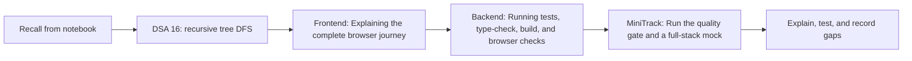
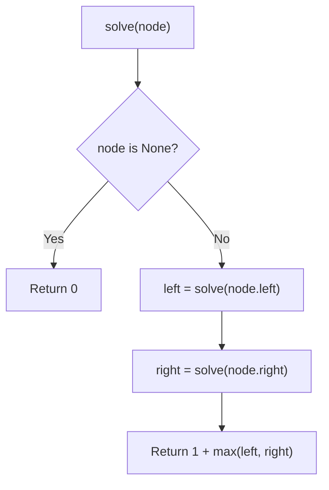
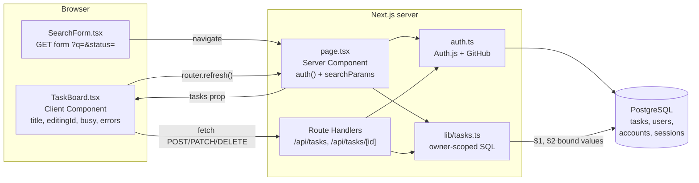
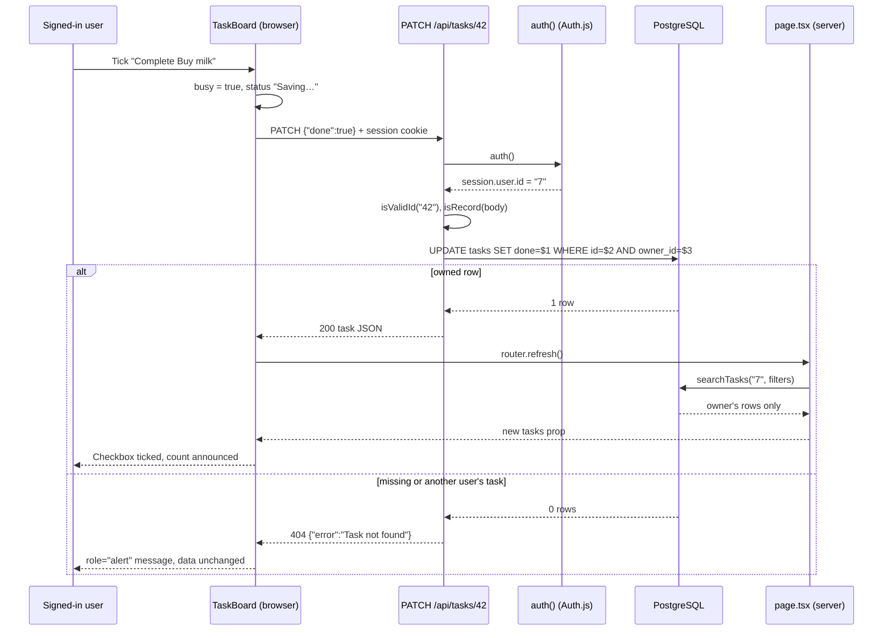

# Prep Day 16 — Run the quality gate and a full-stack mock

**Date:** Saturday, December 12, 2026  
**Time:** 7 study hours plus breaks  
**Starting point:** App Days 1–4 are complete. Continue from the current learner workspace and the previous preparation-day exit checklist.  
**Goal:** Run the quality gate and a full-stack mock.

[Prep Day 15](prep-day-15.md) · [Preparation plan](../../docs/FULL_STACK_INTERVIEW_PREP_PLAN.md) · [Track home](README.md) · [Prep Day 17](prep-day-17.md)

**Everything to read today is below.** The original
[acceptance checklist](../../CHECKLIST.md),
[interview index](../../docs/INTERVIEW_INDEX.md),
[App Day 13](../day-13.md), and
[DSA Day 16](../../dsa-python/lessons/dsa-day-16.md) remain available for
comparison. Today is a **review and mock day**: you write no new feature code.
You run every existing check, walk the complete signed-in journey, explain the
system end to end, and fix only the two most valuable gaps you find. The scope
is App Days 5–13 (Prep Days 01–15). Production deployment (App Day 14) belongs
to Prep Day 17, and release and recovery checks (App Day 15) belong to Prep
Day 18. Write runnable code only in the practice file and in small gap-repair
changes, not in this Markdown file.

## Learning objectives

- explain the complete browser journey in beginner-friendly language;
- explain what tests, type-check, build, and browser checks each prove, and where each stops;
- run and verify the MiniTrack quality gate;
- solve DSA Day 16 using the recursive tree DFS pattern;
- record the result in your rough notebook and explain it without reading.

## 1. Start with notebook recall (45 minutes)

Before opening a lesson, write answers in
[`checkpoints/ROUGH/Notes.md`](../../checkpoints/ROUGH/Notes.md):

1. What did yesterday's browser action send to the server?
2. Where is persistent task data stored, and what state is only temporary?
3. What error or edge case can you already predict for today's topic?
4. What do you remember about the **recursive tree DFS** pattern?

Use this format:

```md
## Saturday, December 12, 2026

- What:
- Why:
- How MiniTrack uses it:
- What can go wrong:
- First task:
```

Do not copy the source paragraph. Write what you remember, then compare.

## 2. Understand today's full-stack boundary (20 minutes)

**Frontend focus — Explaining the complete browser journey:** Start with the user event, describe state and rendering, identify the HTTP request, then explain how the refreshed server data reaches the client.

**Backend focus — Running tests, type-check, build, and browser checks:** Each gate proves a different property: tests prove selected behavior, type-check proves static contracts, build proves production compilation, and browser checks prove the integrated journey.

**Today's connection:** A release candidate needs code, data, security, accessibility, and operational evidence together.



## 3. Python DSA practice (1 hour 45 minutes)

**Practice file:** [`dsa-python/practice/day-16.py`](../../dsa-python/practice/day-16.py)  
**Pattern:** recursive tree DFS

### Problem: Maximum Depth of Binary Tree

You receive the top node (the **root**) of a binary tree. Return its
**maximum depth**: the number of nodes on the longest path from the root down
to a leaf. A **leaf** is a node with no children.

Assumptions:

- `root` may be `None` (an empty tree), whose depth is `0`;
- a tree with only a root has depth `1`;
- the tree is not necessarily balanced or a binary search tree; values do not
  matter, only shape.

A binary tree is built from nodes that each have up to two children. The
practice file defines this class:

```python
class TreeNode:
    def __init__(self, val=0, left=None, right=None):
        self.val, self.left, self.right = val, left, right
```

`TreeNode(2, TreeNode(1), TreeNode(3))` creates a root `2` with a left child
`1` and a right child `3`. A missing child is `None`.

The day checker has no built-in examples for trees. These sample calls match
the reference test and the classic example:

```python
solve(TreeNode(2, TreeNode(1), TreeNode(3)))  # 2
solve(None)                                   # 0
#     3
#    / \
#   9   20
#      /  \
#     15   7
solve(TreeNode(3, TreeNode(9), TreeNode(20, TreeNode(15), TreeNode(7))))  # 3
```

### Start coding

In the practice file, replace the `raise NotImplementedError` line with your
own implementation. This is the starting shape:

```python
def solve(root):
    # Return the number of nodes on the longest root-to-leaf path (0 for None).
    raise NotImplementedError
```

Two Python ideas you need:

- **Recursion** means a function calls itself on a smaller input. Every
  recursive function needs a **base case** that stops without calling itself
  (here: `root is None` returns `0`) and a **recursive case** that combines
  answers to smaller problems.
- `max(a, b)` returns the larger of two numbers, for example `max(1, 2)` is `2`.

The idea: the depth of a tree is one (for the root itself) plus the deeper of
its two subtrees. This is a **depth-first search (DFS)**: each call goes all the
way down one side before returning.



### Invariant to say aloud

The depth of a node is one plus the greater depth of its left and right subtrees, with an empty tree at zero.

### Work in this order

1. Restate the problem and ask about constraints.
2. Give a brute-force approach and its cost before optimizing.
3. Write the invariant above in your own words.
4. Implement without opening the solution for 25 minutes.
5. Test empty, smallest, typical, duplicate, and boundary cases where relevant.
6. Use a small hint if blocked; do not spend the entire block stuck.
7. Compare with the commented reference and re-code the key loop from memory.

From the repository root:

```bash
python3 dsa-python/scripts/check_practice.py 16
python3 -m unittest discover -s dsa-python/tests -v
```

**Expected observation:** for Day 16 the checker only loads your file and
prints `This problem uses linked-list/tree structures; write your own
object-based tests.` It does **not** test your answer, so use the assert block
below. The completed reference suite still passes (`test_tree` covers Days
16–18).

Temporarily add these checks at the bottom of the practice file, then run
`python3 dsa-python/practice/day-16.py`:

```python
if __name__ == '__main__':
    assert solve(TreeNode(2, TreeNode(1), TreeNode(3))) == 2
    assert solve(None) == 0                                   # empty tree
    assert solve(TreeNode(5)) == 1                            # root only
    tree = TreeNode(3, TreeNode(9), TreeNode(20, TreeNode(15), TreeNode(7)))
    assert solve(tree) == 3                                   # deeper right side
    left_only = TreeNode(1, TreeNode(2, TreeNode(3)))
    assert solve(left_only) == 3                              # missing right children
    chain = TreeNode(1, None, TreeNode(2, None, TreeNode(3, None, TreeNode(4))))
    assert solve(chain) == 4                                  # skewed like a list
    assert solve(TreeNode(7, TreeNode(7), TreeNode(7))) == 2  # repeated values
    print('All checks passed')
```

### Brute-force code — reveal after attempting

There is no meaningfully slower “brute force” here: any correct answer must
look at every node once. The useful alternative is an **iterative** DFS that
uses your own stack instead of Python's call stack, which avoids
`RecursionError` on very deep trees.

<details>
<summary>Show the iterative alternative</summary>

```python
def solve(root):
    if root is None:
        return 0
    deepest = 0
    stack = [(root, 1)]                 # pairs of (node, depth of that node)
    while stack:
        node, depth = stack.pop()       # take the most recently added pair
        deepest = max(deepest, depth)
        if node.left:
            stack.append((node.left, depth + 1))
        if node.right:
            stack.append((node.right, depth + 1))
    return deepest
```

</details>

A Python list works as a **stack**: `append` adds to the end and `pop()`
removes from the end. Each node is pushed and popped once, so time is O(n).
The stack holds at most one waiting sibling per level of the current path, so
extra space is O(h), where h is the tree's height.

### Optimized code — reveal after attempting

<details>
<summary>Show the Maximum Depth solution</summary>

```python
class TreeNode:
    def __init__(self, val=0, left=None, right=None):
        self.val, self.left, self.right = val, left, right

def solve(root):
    if root is None:            # base case: empty tree has depth 0
        return 0
    return 1 + max(solve(root.left), solve(root.right))
```

</details>

Trace the tree `3 → (9, 20 → (15, 7))`. Calls finish from the bottom up:

| Order finished | Call | Left result | Right result | Returns |
|---:|---|---:|---:|---:|
| 1 | `solve(9)` | `solve(None)` = 0 | `solve(None)` = 0 | 1 + 0 = **1** |
| 2 | `solve(15)` | 0 | 0 | **1** |
| 3 | `solve(7)` | 0 | 0 | **1** |
| 4 | `solve(20)` | 1 (from 15) | 1 (from 7) | 1 + 1 = **2** |
| 5 | `solve(3)` | 1 (from 9) | 2 (from 20) | 1 + 2 = **3** |

Each node is visited once: O(n) time. The call stack holds one frame per level
of the current path: O(h) space, which is O(log n) for a balanced tree and O(n)
for a tree shaped like a chain.

### DSA interview questions and answers

#### DSA Q1. What is the brute-force approach?

**Interview-ready answer:** “There isn't a slower brute force worth writing:
any correct solution must visit every node, because the deepest leaf could be
anywhere. A naive idea would be to collect every root-to-leaf path as a list
and take the longest, but that copies paths and costs up to O(n·h). The
recursive DFS already visits each node once.”

**Example:** For `3 → (9, 20 → (15, 7))`, the paths are `[3, 9]`,
`[3, 20, 15]`, and `[3, 20, 7]`; the longest has 3 nodes.

**Follow-up:** That is why the interesting comparison is recursive versus
iterative, not slow versus fast.

#### DSA Q2. What is the core idea of recursive DFS here?

**Interview-ready answer:** “I trust the function to answer the same question
for smaller trees. The depth of this tree is one for the current node plus the
larger of the left and right subtree depths. An empty subtree has depth zero,
which stops the recursion.”

**Example:** `solve(20)` asks `solve(15)` and `solve(7)`, both return `1`, so
`solve(20)` returns `2`.

**Follow-up:** This is a **post-order** traversal: each node combines results
after both children have finished.

#### DSA Q3. Why is it correct?

**Interview-ready answer:** “By induction on tree size. The base case is
correct: an empty tree has depth zero. If the calls on both subtrees return
their correct depths, then the longest path through this node goes into the
deeper subtree, so its length is one plus the larger depth.”

**Example:** For a root-only tree, both children return `0`, so the answer is
`1 + max(0, 0) = 1`.

**Follow-up:** Missing children are handled by the base case, so a node with
only a left child still works: `max(left_depth, 0)`.

#### DSA Q4. What are the time and space costs?

**Interview-ready answer:** “O(n) time because every node is visited once,
plus one `None` check per missing child. O(h) extra space for the call stack,
where h is the height: about log n for a balanced tree, and n for a skewed
tree.”

**Example:** A 1,000-node chain needs about 1,000 nested calls; a balanced
1,000-node tree needs about 10.

**Follow-up:** CPython's default recursion limit is about 1,000, so a very deep
chain raises `RecursionError`. Use the iterative stack version, or a
breadth-first level count, when depth is unbounded.

#### DSA Q5. What edge cases should I test?

**Interview-ready answer:** “An empty tree, a single node, a tree that only goes
left, a tree that only goes right, a balanced tree, and repeated values. Values
should not affect the answer, only the shape.”

**Example:** `solve(None)` returns `0`; `solve(TreeNode(5))` returns `1`; a
right-only chain of four nodes returns `4`.

**Follow-up:** Ask whether depth counts nodes or edges. This problem counts
nodes; counting edges would return one less for a non-empty tree.

#### DSA Q6. How would you find the minimum depth instead?

**Interview-ready answer:** “Minimum depth is the shortest path to a **leaf**.
I cannot just replace `max` with `min`, because a missing child is not a leaf.
If one child is `None`, I must use the other child's depth. Breadth-first
search is even better: it stops at the first leaf it reaches.”

**Example:** For `TreeNode(1, None, TreeNode(2))`, `1 + min(0, 1)` would wrongly
give `1`; the correct minimum depth is `2`, because node `1` is not a leaf.

**Follow-up:** BFS with a queue finds the minimum depth without visiting deeper
levels, which matters for very unbalanced trees. Prep Day 17 practises BFS.

## 4. Frontend guided study (1 hour 30 minutes)

### What

Start with the user event, describe state and rendering, identify the HTTP request, then explain how the refreshed server data reaches the client.

### Why

The browser layer should make state and feedback understandable without taking
ownership of persistent data or security decisions that belong on the server.
In an interview, a clear end-to-end explanation shows that you understand how
the pieces you built connect, not just each file on its own.

### How

Use this five-part script for any MiniTrack action. Practise it aloud with the
checkbox example until you can say it without reading:

1. **Event:** what the user does and which handler runs.
2. **Client state:** which React state changes and what the user sees.
3. **Request:** the HTTP method, URL, and body.
4. **Server:** authentication, validation, authorization, and SQL.
5. **Refresh:** how fresh data comes back and React re-renders.

The complete system you built across App Days 3–13:



Review these key excerpts (they are already in your project; do not retype
them). First, the **Server Component** in `frontend/app/page.tsx` reads the
session, the URL, and PostgreSQL on the server:

```tsx
async function TaskContent({ searchParams }: PageProps) {
  const session = await auth();
  if (!session?.user?.id) {
    return /* "Sign in to open MiniTrack" section */;
  }

  const params = await searchParams;
  const filters = normalizeTaskFilters(params.q, params.status);
  // ...try/catch around searchTasks; a failure renders a role="alert" message
  const tasks = await searchTasks(session.user.id, filters);

  return (
    <>
      <SearchForm filters={filters} />
      <TaskBoard tasks={tasks} />
    </>
  );
}
```

Second, the **Client Component** in `frontend/app/TaskBoard.tsx` sends one
request and asks the server for fresh data:

```tsx
async function request(
  path: string,
  options: RequestInit,
  showError: (message: string) => void,
): Promise<boolean> {
  setTitleError('');
  setEditError('');
  setListError('');
  setBusy(true);
  try {
    const response = await fetch(path, options);
    if (!response.ok) {
      showError(await readErrorMessage(response)); // e.g. "Task not found"
      return false;
    }
    router.refresh(); // re-run page.tsx on the server and send new props
    return true;
  } catch {
    showError('Could not connect to the server.');
    return false;
  } finally {
    setBusy(false);
  }
}

async function toggleTask(taskId: string, done: boolean) {
  if (busy) return;
  await request(
    `/api/tasks/${taskId}`,
    {
      method: 'PATCH',
      headers: { 'Content-Type': 'application/json' },
      body: JSON.stringify({ done }),
    },
    setListError,
  );
}
```

Model explanation for **ticking “Complete Buy milk”** (say it in under two
minutes):

> “The checkbox's `onChange` calls `toggleTask('42', true)`. React sets `busy`
> and the status line says ‘Saving…’. The browser sends `PATCH /api/tasks/42`
> with `{"done":true}` and the session cookie. The Route Handler calls
> `auth()`; no session means `401`. It validates the ID with `isValidId` and the
> body with `isRecord`, then runs `UPDATE tasks SET done = $1 WHERE id = $2 AND
> owner_id = $3`. Zero rows means `404` whether the task is missing or belongs
> to someone else. On `200`, `router.refresh()` re-runs `page.tsx` on the
> server, which calls `searchTasks(session.user.id, filters)` again, and React
> renders the new `tasks` prop. The checkbox stays focused, and the status line
> announces the new count. PostgreSQL stays the source of truth; React only
> holds temporary state.”

Files to open deliberately:

- `frontend/package.json`
- `frontend/test`
- `frontend/app`

Answer before the mock:

- Which value is persistent, and which value is temporary interaction state?
- What starts this behavior?
- What should the user see while work is pending?
- What should remain unchanged when the operation fails?

## 5. Backend guided study (1 hour 30 minutes)

### What

Each gate proves a different property: tests prove selected behavior, type-check proves static contracts, build proves production compilation, and browser checks prove the integrated journey.

### Boundary checklist

- Validate untrusted path, query, and body values.
- Authenticate identity when the route is protected.
- Authorize the resource separately from authentication.
- Bind SQL values rather than concatenating untrusted data.
- Return an explicit success or error status.
- Log internal failures on the server without exposing secrets.

### What each gate proves

These scripts were added on App Day 9 in `frontend/package.json`:

```json
{
  "scripts": {
    "test": "npm run test:unit",
    "test:unit": "tsx --test test/unit/*.test.ts",
    "test:integration": "dotenv -e .env.test.local -- tsx --test test/integration/*.test.ts",
    "test:e2e": "dotenv -e .env.test.local -- playwright test"
  }
}
```

| Gate | Command (from `frontend/`) | It proves | It cannot prove |
|---|---|---|---|
| Lint | `npm run lint` | Common React and Next.js mistakes, such as hook rules | That the feature works |
| Type-check | `npx tsc --noEmit` | Values match declared types across files | Runtime data from users or PostgreSQL |
| Unit | `npm run test:unit` | Pure functions such as `normalizeTitle` and `isValidId` | Anything that needs PostgreSQL or a browser |
| Integration | `npm run test:integration` | Owner-scoped SQL and handlers against `minitrack_test` | Real GitHub sign-in, browser behavior |
| End-to-end | `npm run test:e2e` | A real browser journey with persistence across reload | Every edge case; it is slow, so keep it small |
| Build | `npm run build` | Production compilation, including Cache Components rules | Authorization, data correctness |
| Manual | Keyboard and 320 px checks | Usability and accessibility a tool cannot judge | Regressions next week, unless automated |

The negative authorization test from App Day 12 is the gate that proves users
are isolated. Review its core in
`frontend/test/integration/authorization.test.ts`:

```ts
test('users cannot read or mutate one another tasks', async () => {
  const userA = await createTestUser(pool, 'a@example.test');
  const userB = await createTestUser(pool, 'b@example.test');
  const taskA = await createTask(userA, 'A private task');
  const taskB = await createTask(userB, 'B private task');

  const visibleToA = await searchTasks(userA, { query: '', status: 'all' });
  assert.deepEqual(visibleToA.map(task => task.id), [taskA.id]);

  assert.equal(await renameTask(userA, taskB.id, 'Stolen'), null);
  assert.equal(await deleteTask(userA, taskB.id), false);

  const stillVisibleToB = await searchTasks(userB, { query: '', status: 'all' });
  assert.equal(stillVisibleToB[0]?.title, 'B private task');
});
```

It passes only because every data function in `frontend/lib/tasks.ts` puts the
owner in the SQL predicate (App Day 11):

```sql
UPDATE tasks
SET title = $1
WHERE id = $2 AND owner_id = $3
RETURNING id, title, done, created_at;
```

And the anonymous case uses the injectable session reader from App Day 12, so
no test needs real GitHub credentials:

```ts
test('anonymous list returns 401', async () => {
  const request = new NextRequest('http://localhost/api/tasks');
  const response = await handleGetTasks(request, async () => null);

  assert.equal(response.status, 401);
});
```

The Day 9 guard in `frontend/test/helpers/test-database.ts` refuses to run
destructive tests unless `DATABASE_URL` ends in `/minitrack_test`.

## 6. MiniTrack implementation (1 hour)

**Milestone source:** Days 5–13 verification and end-to-end explanation

No new feature code today. Goals:

1. Run the repository's focused tests, type-check, and production build.
2. Complete the critical browser journey as an authenticated user.
3. Run a 45-minute mock and record the two highest-value gaps.

### Step 1: Run the quality gate (20 minutes)

Make sure PostgreSQL is running and `frontend/.env.local` and
`frontend/.env.test.local` exist (never commit them). From the repository root:

```bash
python3 -m unittest discover -s dsa-python/tests -v
cd frontend
npm run lint
npx tsc --noEmit
npm run test:unit
npm run test:integration
npm run test:e2e
npm run build
```

Run them in this order: the fast, cheap checks first, so a typo fails in
seconds instead of after a full build. Record each result in your notebook as
`pass`, `fail`, or `not set up`.

**Expected observation:** every command exits without errors; the integration
run includes `users cannot read or mutate one another tasks`; `npm run build`
ends with a route summary for `/`, `/api/tasks`, and `/api/tasks/[id]`.

If a gate fails, use this table before changing code:

| Symptom | Likely cause | First check |
|---|---|---|
| `Refusing to test against /minitrack` | `.env.test.local` points at the development database | Change it to `.../minitrack_test` |
| Integration `relation "users" does not exist` | Test database is missing the Day 11 migrations | Apply the migrations to `minitrack_test` in numeric order |
| Build: uncached data accessed outside `<Suspense>` | A component calls `auth()` or reads PostgreSQL outside `Suspense` | Wrap it in `Suspense`; do not add `force-dynamic` |
| E2E test stops at “Sign in to open MiniTrack” | The App Day 9 browser test has no signed-in session since Day 10 | Record it as a gap; never add a production auth bypass |
| `tsc` error on `session.user.id` | Missing `frontend/types/next-auth.d.ts` from Day 11 | Restore the module augmentation |

### Step 2: Walk the critical journey (15 minutes)

Run `npm run dev`, then check each item and note anything that fails:

- [ ] Signed out, `/` shows “Sign in to open MiniTrack”.
- [ ] Sign in with GitHub; your name appears in the header.
- [ ] Create a task with only the keyboard; it persists after reload.
- [ ] Edit, save, and cancel with the keyboard; focus returns to Edit.
- [ ] Complete a task; the status line updates.
- [ ] Search `?q=milk&status=open`; reload and Back keep the filter.
- [ ] Delete a task; focus moves to the **Tasks** heading.
- [ ] At 320 px there is no sideways scroll.
- [ ] Sign out; the tasks disappear.

Then prove the API rejects anonymous callers (curl sends no session cookie):

```bash
curl -i http://localhost:3000/api/tasks
curl -i -X PATCH http://localhost:3000/api/tasks/1 \
  -H 'Content-Type: application/json' -d '{"done":true}'
```

Expect `HTTP/1.1 401` and `{"error":"Unauthorized"}` for both. For cross-user
access, rely on the integration test above, or sign in as a second GitHub
account in a private window and try to `PATCH` the first user's task ID from
the browser console: expect `404`.

Compare with the [acceptance checklist](../../CHECKLIST.md) rows for Days 5–13:

- [ ] Day 5 create, complete, filter, and delete from the browser
- [ ] Day 6 task-title PATCH validation and persistence work
- [ ] Day 7 edit, save, cancel, focus, and failure states work in the browser
- [ ] Day 8 search and status filters survive reload through the URL
- [ ] Day 9 unit, isolated integration, and browser tests pass
- [ ] Day 10 GitHub sign-in/sign-out and client session Context work; anonymous task API calls return `401`
- [ ] Day 11 every task query and mutation is scoped by the session owner
- [ ] Day 12 automated tests prove anonymous and cross-user access is blocked
- [ ] Day 13 accessibility checks pass and I can explain measured React memoization
- [ ] `.env` and `.env.local` are NOT committed

### Step 3: Run a timed 45-minute mock (45 minutes, plus review)

Ask a friend to read the questions, or record yourself with a timer. Close
this file during each answer and open it only to score yourself afterwards.

| Minutes | Segment | Prompt |
|---:|---|---|
| 0–5 | Introduction | “Walk me through MiniTrack in two minutes.” |
| 5–15 | System design | “Draw the browser → Next.js → PostgreSQL flow and trace ticking a checkbox.” |
| 15–30 | Deep questions | Pick five questions from the bank below at random. |
| 30–40 | Live coding | Solve Maximum Depth of Binary Tree aloud, then test it. |
| 40–45 | Your questions | Ask the interviewer two questions about their team's testing and deploys. |

Score each answer: **2** = correct, concrete, and includes an example;
**1** = correct but vague; **0** = wrong or stuck.

#### Mock question bank with model answers

1. **What runs on the server and what runs in the browser?**
   `page.tsx` is a Server Component: it calls `auth()`, reads `searchParams`,
   and queries PostgreSQL, and its code never ships to the browser.
   `TaskBoard.tsx` starts with `'use client'` because it needs state and event
   handlers. The server passes `tasks` as a serializable prop.
2. **What happens after a mutation?** The Route Handler changes PostgreSQL and
   returns JSON. The client calls `router.refresh()`, which re-runs the Server
   Component and sends new props. React keeps client state such as the typed
   title, and the list shows the saved data.
3. **Why ignore repeat clicks while busy? Is that enough?** It reduces
   accidental duplicate requests, but it is not idempotency. A retried `POST`
   can still create two tasks; a real fix uses an idempotency key or a
   uniqueness rule on the server.
4. **Why `PATCH` and not `PUT`?** `PATCH` is a partial update: MiniTrack sends
   only `{ "done": true }` or `{ "title": "..." }`. `PUT` conventionally
   replaces the whole resource. Either way, the server still validates fields
   and checks ownership.
5. **Why is focus an effect but filtering is not?** Focus synchronizes React
   with the browser DOM after commit, so it belongs in `useEffect`. Filtering is
   derived from props and state and can be calculated during render, so an
   effect would add an extra render and possible bugs.
6. **Why put filters in the URL?** `/?q=react&status=open` survives reload,
   works with Back, and can be shared. The server must still validate it with
   `normalizeTaskFilters`, because users can edit the URL.
7. **Does a `$1` parameter escape `%` and `_`?** No. Parameters prevent SQL
   injection, but `%` and `_` are still `ILIKE` wildcards. `escapeLike` plus
   `ESCAPE '\'` makes them literal characters.
8. **Unit, integration, or end-to-end?** Unit tests check pure functions fast;
   integration tests check SQL and handlers against an isolated
   `minitrack_test` database; one or two end-to-end tests check a real browser
   journey. Most tests should be the fast kind.
9. **Authentication versus authorization?** Authentication answers “who are
   you?” (`auth()` returns a session). Authorization answers “may you touch this
   row?” (`WHERE id = $2 AND owner_id = $3`). A valid session alone does not
   prove access to task 42.
10. **What is IDOR and why return `404`?** An insecure direct object reference
    is when changing an ID in a URL reaches someone else's data. MiniTrack puts
    the owner in every SQL predicate and returns `404` for both “missing” and
    “not yours”, so attackers cannot discover which IDs exist.
11. **Why test the database after a forbidden request?** A handler can return
    `404` and still have changed the row. The Day 12 test re-reads User B's task
    and asserts the title is still `B private task`.
12. **What can the Auth.js session Context do?** `SessionProvider` and
    `useSession()` let Client Components show the signed-in name without prop
    drilling. They cannot protect data: every Route Handler and the page still
    call `auth()` on the server.
13. **Why native controls over ARIA?** A `<button>` already supports Tab,
    Enter, Space, and the button role. ARIA adds missing meaning, such as
    `aria-describedby` linking an input to its error, but it does not add
    keyboard behavior to a `<div>`.
14. **`useMemo`, `useCallback`, `memo`?** `useMemo` caches a value,
    `useCallback` caches a function's identity, and `memo` skips a child render
    when its props are shallowly equal. Profile first; on Prep Day 15 they
    added code without a meaningful win for 200 rows.
15. **Why a connection pool?** Opening a PostgreSQL connection is slow, so
    `getPool()` reuses a limited set of connections. If every connection is
    busy, new queries wait, so slow queries and leaked clients show up as
    request latency.

### Step 4: Repair only the two highest-value gaps (rest of the block)

List every gap from the gate, the journey, and the mock. Pick two using this
order: **security** (data leak, missing `401`/`404`) → **broken journey** →
**failing gate** → **explanation gap** (a mock answer scored 0). Write:

```md
## Gap repair — Saturday, December 12, 2026

1. Gap:
   Evidence (command or question):
   Smallest fix:
   How I verified it:
2. Gap:
   Evidence:
   Smallest fix:
   How I verified it:
Deferred (not today):
```

Fix code gaps with the smallest change and re-run only the gate that failed.
Fix explanation gaps by re-reading the matching excerpt above and answering
the question aloud again.

**Expected observation:** the user-visible milestone works, its important
failure path is explicit, and existing behavior remains intact. You have a
gate result for every command, a mock score, and two verified repairs.

## 7. Trace the event or request



Trace one concrete input. Name every boundary, value, and possible failure.

## 8. Deliberate debugging exercise (25 minutes)

**Break it:** Treat a successful production build as proof that authorization works.

To see it, temporarily remove `AND owner_id = $3` from the rename `UPDATE` in
`frontend/lib/tasks.ts` (keep the `$3` value in the array or TypeScript will
still compile), then run `npm run build` and `npm run test:integration`.

**Predict before running:** write the expected symptom in your notebook.

**Expected symptom:** Security logic may compile perfectly while allowing cross-user access.
`npm run build` succeeds, but the integration test fails because
`renameTask(userA, taskB.id, 'Stolen')` now returns a task instead of `null`.

**Root cause:** Compilation and behavior verification answer different questions.

**Restore and verify:** Run the negative authorization tests as a separate required gate.
Restore `AND owner_id = $3`, and confirm `npm run test:integration` passes again.

Do not stop after making the symptom disappear. Explain why the repair restores
the intended invariant.

## 9. Interview questions and answers (30 minutes)

### Q1. How do you explain the complete browser journey?

**Interview-ready answer:** “I go in five steps: the user event, the client
state, the HTTP request, the server's auth, validation, and SQL, and then how
fresh data returns. I always say where the source of truth is—PostgreSQL—and
what is only temporary React state.”

**Example:** Ticking a checkbox in `frontend/app/TaskBoard.tsx` calls
`toggleTask`, sets `busy`, sends `PATCH /api/tasks/42` with `{"done":true}`,
the handler runs `UPDATE ... WHERE id = $2 AND owner_id = $3`, and
`router.refresh()` re-runs `page.tsx` so React receives the new `tasks` prop.

**Senior follow-up:** “The design does two round trips per change. If that
became noticeable, I would measure it and consider optimistic UI with
`useOptimistic` plus rollback on error, or returning the updated task and
patching local state—at the cost of more client complexity.”

### Q2. How should the backend handle running tests, type-check, build, and browser checks?

**Interview-ready answer:** “Each gate answers a different question, so I run
all of them and fail fast: lint and `tsc` in seconds, unit tests next, then
integration tests against an isolated `minitrack_test` database, a small
Playwright journey, and finally `next build`. A green build never replaces a
negative authorization test.”

**Example:** Removing `AND owner_id = $3` still passes `npm run build`, but
`npm run test:integration` fails on
`users cannot read or mutate one another tasks`.

**Senior follow-up:** “In CI I would run the same commands on every pull
request with a fresh database created from migrations, keep secrets in the CI
secret store, and make sure test logs and Playwright traces never capture
session cookies.”

### Q3. What invariant makes the recursive tree DFS solution correct?

**Interview-ready answer:** “The depth of a node is one plus the larger depth of
its two subtrees, and an empty tree has depth zero. If each recursive call
returns the right depth for its subtree, combining them gives the right depth
for the whole tree.”

**Example:** For `3 → (9, 20 → (15, 7))`: `solve(9) = 1`,
`solve(20) = 1 + max(1, 1) = 2`, and `solve(3) = 1 + max(1, 2) = 3`.

**Senior follow-up:** “It is O(n) time and O(h) stack space. On very deep or
untrusted trees, Python's recursion limit can raise `RecursionError`, so I
would switch to an explicit stack or a BFS level count.”

### Q4. How does today's work fit the complete MiniTrack system?

**Interview-ready answer:** “Today proves the system is a release candidate,
not just that it works on my machine: code passes lint, types, and build; data
access is owner-scoped and proven by negative tests; the journey works with a
keyboard and on a phone; and I can explain every step. Deployment comes next.”

**Example:** My notebook shows `pass` for `npm run lint`, `npx tsc --noEmit`,
`npm run test:unit`, `npm run test:integration`, and `npm run build`; anonymous
`curl -i http://localhost:3000/api/tasks` returns `401`; and two gaps from the
mock are fixed and re-verified.

**Senior follow-up:** “The first production signals I would add are error-rate
and p95 latency per route, database pool saturation, and a smoke test of the
real GitHub sign-in after each deploy, because injected test sessions do not
verify the OAuth configuration.”

## 10. Complexity and operational cost

- **DSA:** O(n) time and O(h) call-stack space.
- **Application:** A full gate is slower than a focused check, so use focused feedback while coding and the complete gate at milestones.
- **Learning:** Attempting, retrieving, and correcting is more valuable than
  copying several solutions. Keep the scope to one understood pattern today.

## Exit checklist

- [ ] I completed DSA Day 16 before reading its solution.
- [ ] I can state the invariant and complexity without notes.
- [ ] I completed or verified the MiniTrack milestone.
- [ ] I tested one success path and one failure path.
- [ ] I completed the deliberate debugging exercise.
- [ ] I answered all four interview questions aloud.
- [ ] I recorded what remains confusing and tomorrow's first task.

**Suggested commit:** `prep day 16: run the quality gate and a full-stack mock`
