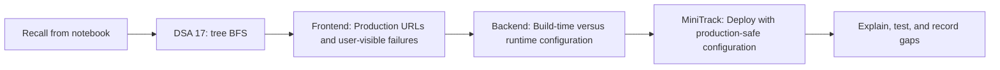
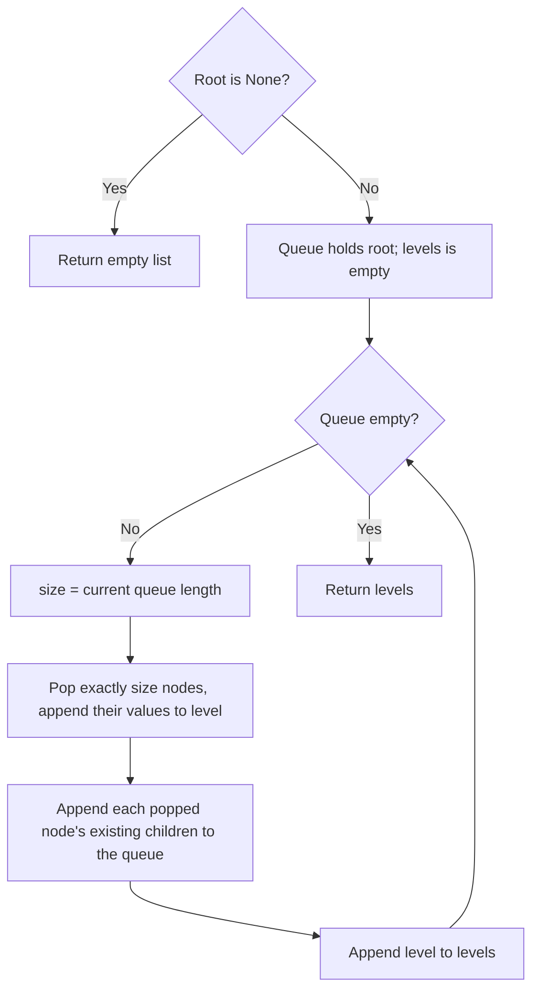
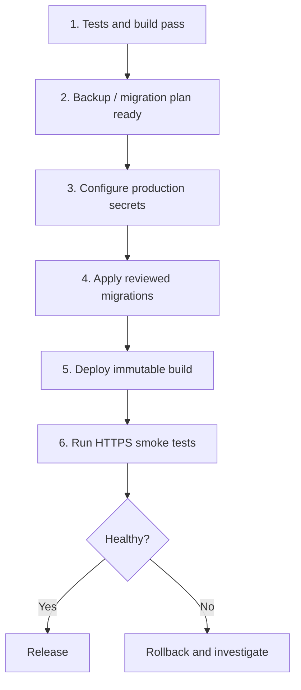
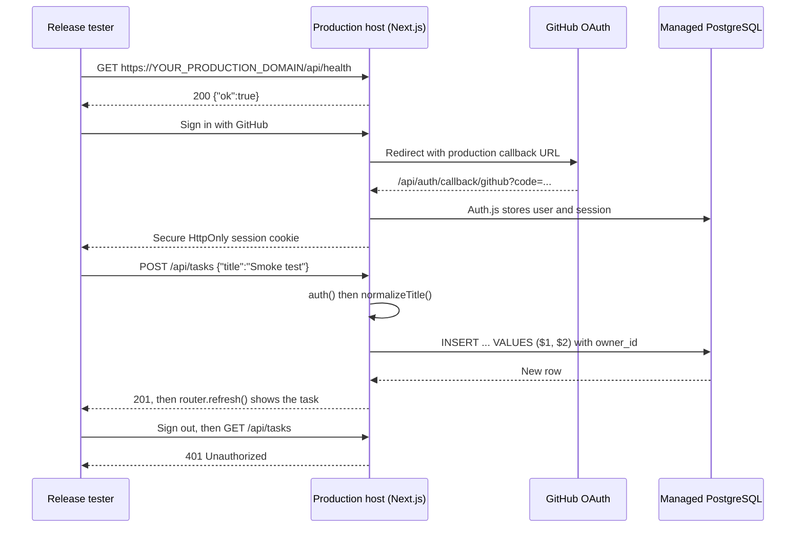

# Prep Day 17 — Deploy with production-safe configuration

**Date:** Monday, December 14, 2026  
**Time:** 7 study hours plus breaks  
**Starting point:** App Days 1–4 are complete. Continue from the current learner workspace and the previous preparation-day exit checklist.  
**Goal:** Deploy with production-safe configuration.

[Prep Day 16](prep-day-16.md) · [Preparation plan](../../docs/FULL_STACK_INTERVIEW_PREP_PLAN.md) · [Track home](README.md) · [Prep Day 18](prep-day-18.md)

**Everything to read today is below.** The original [App Day 14](../day-14.md)
and [DSA Day 17](../../dsa-python/lessons/dsa-day-17.md) remain available for
comparison. This prep day covers only the first production deployment:
separate secrets, deliberate migrations, the OAuth callback, a production
smoke test, and the rollback trigger. The clean-checkout release gate, the
two-user acceptance journey, operations documentation, and recovery drills
belong to Prep Day 18. Hosting products change frequently: choose a current
Next.js-compatible host and managed PostgreSQL service and follow their
official documentation for the clicks; keep this file's security and
verification rules regardless of vendor. Write runnable code in the named
project and practice files, not in this Markdown file.

## Learning objectives

- explain production URLs and user-visible failures in beginner-friendly language;
- explain build-time versus runtime configuration and its failure boundary;
- implement or verify the listed MiniTrack milestone;
- solve DSA Day 17 using the tree BFS pattern;
- record the result in your rough notebook and explain it without reading.

## 1. Start with notebook recall (45 minutes)

Before opening a lesson, write answers in
[`checkpoints/ROUGH/Notes.md`](../../checkpoints/ROUGH/Notes.md):

1. What did yesterday's browser action send to the server?
2. Where is persistent task data stored, and what state is only temporary?
3. What error or edge case can you already predict for today's topic?
4. What do you remember about the **tree BFS** pattern?

Use this format:

```md
## Monday, December 14, 2026

- What:
- Why:
- How MiniTrack uses it:
- What can go wrong:
- First task:
```

Do not copy the source paragraph. Write what you remember, then compare.

## 2. Understand today's full-stack boundary (20 minutes)

**Frontend focus — Production URLs and user-visible failures:** The deployed client must use the correct HTTPS origin and present useful failure states without exposing secrets or server internals.

**Backend focus — Build-time versus runtime configuration:** Build-time values are embedded while compiling; runtime secrets and database URLs must be supplied securely to the running service. Publicly prefixed values are not secrets.

**Today's connection:** Deployment connects immutable code, runtime configuration, database state, identity callbacks, and observable smoke tests.



## 3. Python DSA practice (1 hour 45 minutes)

**Practice file:** [`dsa-python/practice/day-17.py`](../../dsa-python/practice/day-17.py)  
**Pattern:** tree BFS

### Problem: Binary Tree Level Order Traversal

You are given the **root** node of a binary tree. Return a list of lists: the
first inner list holds the value at depth 0 (the root), the next holds every
value at depth 1 from left to right, and so on. Return an empty list for an
empty tree (`root is None`).

Assumptions: each node has a `val`, a `left` child, and a `right` child; a
missing child is `None`. Values may repeat; you return them, you do not
compare them.

```python
#     2
#    / \
#   1   3
solve(TreeNode(2, TreeNode(1), TreeNode(3)))  # [[2], [1, 3]]
solve(None)                                     # []
```

The simple approach is to find the tree's height and then, for each depth,
walk the whole tree again to collect that depth's values. That repeats work.
A **queue** lets you visit every node exactly once, level by level.

### Start coding

The practice file already contains the node class and the function to write.
Replace the `raise NotImplementedError` line with your implementation:

```python
class TreeNode:
    def __init__(self, val=0, left=None, right=None):
        self.val, self.left, self.right = val, left, right

def solve(root):
    # Return a list of levels, each a list of values from left to right.
    raise NotImplementedError
```

`TreeNode(2, TreeNode(1), TreeNode(3))` builds a node with value `2`, left
child `1`, and right child `3`. A leaf is just `TreeNode(5)`, because `left`
and `right` default to `None`.

A **queue** is first-in, first-out: the node added first leaves first.
Python's `collections.deque` is a double-ended queue. Import it before using
it:

```python
from collections import deque

queue = deque([10])   # deque([10])
queue.append(20)      # add on the right: deque([10, 20])
queue.popleft()       # remove from the left and return 10
len(queue)            # 1
```

`popleft()` is O(1). A plain list's `pop(0)` must shift every remaining item,
so it is O(n).



### Invariant to say aloud

Process nodes level by level with a queue, measuring the current queue length before adding the next level.

### Work in this order

1. Restate the problem and ask about constraints.
2. Give a brute-force approach and its cost before optimizing.
3. Write the invariant above in your own words.
4. Implement without opening the solution for 25 minutes.
5. Test empty, smallest, typical, duplicate, and boundary cases where relevant.
6. Use a small hint if blocked; do not spend the entire block stuck.
7. Compare with the commented reference and re-code the key loop from memory.

From the repository root:

```bash
python3 dsa-python/scripts/check_practice.py 17
python3 -m unittest discover -s dsa-python/tests -v
python3 dsa-python/practice/day-17.py
```

**Expected observation:** Day 17 uses tree objects, so the day checker has no
built-in examples. It prints `This problem uses linked-list/tree structures;
write your own object-based tests.` and exits successfully **even if `solve`
is not written yet**. The real check for your code is the third command, which
runs the temporary asserts below. The reference suite should still pass; it
tests the completed solution with the tree `2 → (1, 3)`.

Temporarily add these checks below your `solve` function in the practice file:

```python
if __name__ == '__main__':
    assert solve(None) == []
    assert solve(TreeNode(7)) == [[7]]
    assert solve(TreeNode(2, TreeNode(1), TreeNode(3))) == [[2], [1, 3]]
    #     3
    #    / \
    #   9   20
    #      /  \
    #     15   7
    tree = TreeNode(3, TreeNode(9), TreeNode(20, TreeNode(15), TreeNode(7)))
    assert solve(tree) == [[3], [9, 20], [15, 7]]
    # A left-leaning chain has one node per level.
    chain = TreeNode(1, TreeNode(2, TreeNode(3)))
    assert solve(chain) == [[1], [2], [3]]
    # Duplicates are kept; missing children are skipped.
    assert solve(TreeNode(5, None, TreeNode(5))) == [[5], [5]]
    print('All checks passed')
```

### Brute-force code — reveal after attempting

<details>
<summary>Show the simple solution</summary>

```python
class TreeNode:
    def __init__(self, val=0, left=None, right=None):
        self.val, self.left, self.right = val, left, right

def solve(root):
    def height(node):
        if node is None:
            return 0
        return 1 + max(height(node.left), height(node.right))

    def collect(node, depth, target, out):
        # Walk down until reaching the requested depth.
        if node is None:
            return
        if depth == target:
            out.append(node.val)
            return
        collect(node.left, depth + 1, target, out)
        collect(node.right, depth + 1, target, out)

    levels = []
    for target in range(height(root)):
        level = []
        collect(root, 0, target, level)
        levels.append(level)
    return levels
```

</details>

This is correct because visiting left before right keeps each level in left
to right order. It restarts from the root for every depth, so with height `h`
it costs O(n·h) time. A balanced tree has `h ≈ log n`, but a chain has
`h = n`, so the worst case is O(n²). Recursion uses O(h) call-stack space.

### Optimized code — reveal after attempting

<details>
<summary>Show the level order solution</summary>

```python
from collections import deque

class TreeNode:
    def __init__(self, val=0, left=None, right=None):
        self.val, self.left, self.right = val, left, right

def solve(root):
    if root is None:
        return []
    queue = deque([root])
    levels = []
    while queue:
        level = []
        for _ in range(len(queue)):  # only nodes from this depth
            node = queue.popleft()
            level.append(node.val)
            if node.left:
                queue.append(node.left)
            if node.right:
                queue.append(node.right)
        levels.append(level)
    return levels
```

</details>

`range(len(queue))` is evaluated **once**, when the `for` loop starts, so
children appended during the loop wait for the next level. Every node is
appended and popped exactly once: O(n) time. The queue holds at most about
one level plus part of the next, so extra space is O(w), where `w` is the
maximum width (up to about n/2 in a full tree).

Trace for the tree `3 → (9, 20 → (15, 7))`:

| Level loop | Queue at start | `len(queue)` | Popped in order | Children appended | `levels` after |
|---:|---|---:|---|---|---|
| 1 | `[3]` | 1 | 3 | 9, 20 | `[[3]]` |
| 2 | `[9, 20]` | 2 | 9, 20 | 15, 7 | `[[3], [9, 20]]` |
| 3 | `[15, 7]` | 2 | 15, 7 | none | `[[3], [9, 20], [15, 7]]` |
| — | `[]` | — | loop stops | — | return |

### DSA interview questions and answers

#### DSA Q1. What is the brute-force approach?

**Interview-ready answer:** “I compute the tree's height. Then for each depth
from 0 to height − 1, I do a depth-first walk from the root and collect the
nodes at exactly that depth. It is correct but repeats work: O(n·h) time,
which becomes O(n²) for a chain-shaped tree.”

**Example:** For `1 → 2 → 3` (a chain), depth 2 requires walking past 1 and 2
again, after depth 1 already walked past 1.

**Follow-up:** A one-pass DFS that passes `depth` and appends to
`levels[depth]` is also O(n). It is a valid alternative; BFS is more natural
when the problem says “level by level”.

#### DSA Q2. What is the core idea of the BFS solution?

**Interview-ready answer:** “A queue releases nodes in the order they were
added, so if I add children after their parents, all depth-d nodes leave
before any depth-d+1 node. Before each level, I record how many nodes are in
the queue; that number is exactly the size of the current level.”

**Example:** When the queue is `[9, 20]`, the size is 2. I pop 9 and 20 and
push 15 and 7, but I stop after two pops, so `[9, 20]` becomes one level.

**Follow-up:** Without the size snapshot you still get BFS order, but you lose
the level boundaries. An alternative is to push `(node, depth)` pairs.

#### DSA Q3. Why is the solution correct?

**Interview-ready answer:** “Invariant: at the start of each `while` iteration
the queue contains exactly the nodes of one depth, left to right. It is true
initially because the queue holds only the root. During the iteration I pop
all of them and append their children in left-then-right order, so afterwards
the queue holds exactly the next depth, still left to right.”

**Example:** After the first iteration the queue changes from `[3]` to
`[9, 20]`, the complete depth-1 level.

**Follow-up:** The loop terminates because each node enters the queue once
and every iteration removes at least one node.

#### DSA Q4. What are the time and space costs?

**Interview-ready answer:** “O(n) time, because each node is pushed and popped
once and each pop does constant work. Extra space is O(w) for the queue, where
w is the maximum level width; the output itself also stores all n values.”

**Example:** A perfect tree with 15 nodes has 8 leaves on its last level, so
the queue reaches about n/2. A chain never holds more than one node.

**Follow-up:** Using `list.pop(0)` instead of `deque.popleft()` makes each
pop O(n) and the whole algorithm O(n²) in the worst case.

#### DSA Q5. What edge cases should I test?

**Interview-ready answer:** “An empty tree, a single node, a node with only a
right child, a left-only chain, a complete tree, and repeated values.”

**Example:** `solve(None)` returns `[]`, not `[[]]`. `TreeNode(5, None,
TreeNode(5))` returns `[[5], [5]]`.

**Follow-up:** Why check `if node.left`? Because `None` children must not be
queued; popping `None` and reading `.val` would raise `AttributeError`.

#### DSA Q6. How would you adapt this for zigzag order or the right-side view?

**Interview-ready answer:** “The level loop stays the same. For zigzag I
reverse every second `level` list before saving it. For the right-side view I
keep only the last value of each level.”

**Example:** For `3 → (9, 20 → (15, 7))`, zigzag gives
`[[3], [20, 9], [15, 7]]` and the right-side view gives `[3, 20, 7]`.

**Follow-up:** Minimum depth is another variant: return the current level
number at the first leaf you pop, which can stop early instead of visiting all
n nodes.

## 4. Frontend guided study (1 hour 30 minutes)

### What

The deployed client must use the correct HTTPS origin and present useful failure states without exposing secrets or server internals.

### Why

The browser layer should make state and feedback understandable without taking
ownership of persistent data or security decisions that belong on the server.

### How

**1. MiniTrack's browser code already avoids hard-coded origins.** Every
mutation in `frontend/app/TaskBoard.tsx` uses a relative, same-origin path:

```ts
// Relative URL: the browser sends it to whichever origin served the page.
const response = await fetch('/api/tasks', {
  method: 'POST',
  headers: { 'Content-Type': 'application/json' },
  body: JSON.stringify({ title: cleanTitle }),
});
```

On your laptop that origin is `http://localhost:3000`; in production it is
`https://YOUR_PRODUCTION_DOMAIN`. Nothing in the client needs a configured
API URL, and no CORS policy is needed. If you ever see `localhost` in a
production network request, a hard-coded URL slipped in.

**2. The only origin you must configure is the OAuth callback.** GitHub sends
the user back to an exact URL registered in the GitHub OAuth app. Production
needs its **own** OAuth app:

```text
Homepage: https://YOUR_PRODUCTION_DOMAIN
Callback: https://YOUR_PRODUCTION_DOMAIN/api/auth/callback/github
```

`/api/auth/callback/github` is served by the Auth.js catch-all route you built
on App Day 10 (`frontend/app/api/auth/[...nextauth]/route.ts`).

**3. User-visible failures must be helpful but not revealing.** The Route
Handlers already return a generic body for server failures and log details
only on the server:

```ts
} catch (error: unknown) {
  console.error('POST /api/tasks failed:', error); // server log only
  return Response.json({ error: 'Internal server error' }, { status: 500 });
}
```

The client then shows `Could not add task (500)`: the user learns that the
action failed, and no SQL, host name, or credential reaches the browser.

**Production check for the page:** the App Day 5 version of
`frontend/app/page.tsx` printed the raw database message
(`Could not load tasks: {error}. Check PostgreSQL and DATABASE_URL.`). That is
useful on your laptop but can reveal database host names in production. If
your page still contains that display, change only the `catch` block in
`TaskContent` so the message is generic and the detail stays in the server
log:

```tsx
  } catch (err) {
    console.error('Loading tasks failed:', err); // visible only in host logs
    error = 'Unable to load tasks';
  }
```

The rendered text then reads `Could not load tasks: Unable to load tasks.
Check PostgreSQL and DATABASE_URL.` Mentioning a variable **name** is
acceptable; printing its **value** never is.

Files to open deliberately:

- `frontend/.env.local.example`
- `frontend/package.json`
- `backend/sql`

Answer before deploying:

- Which value is persistent, and which value is temporary interaction state?
  (Tasks live in production PostgreSQL; the input text, `busy`, and `error`
  live only in the browser tab.)
- What starts this behavior? (A user opening the HTTPS URL or pressing
  **Sign in with GitHub**.)
- What should the user see while work is pending? (The Suspense fallback and
  disabled buttons, exactly as locally.)
- What should remain unchanged when the operation fails? (The database rows
  and every secret; only a generic message appears.)

## 5. Backend guided study (1 hour 30 minutes)

### What

Build-time values are embedded while compiling; runtime secrets and database URLs must be supplied securely to the running service. Publicly prefixed values are not secrets.

### Build time versus run time, one idea at a time

- **Build time** is when `npm run build` compiles and bundles the app. Any
  `process.env.NEXT_PUBLIC_SOMETHING` used in client code is **copied into the
  JavaScript files** sent to every visitor. Treat it as public.
- **Run time** is when the deployed server handles a request. Server-only code
  reads `process.env.DATABASE_URL` or `AUTH_SECRET` at that moment, from the
  host's secret manager. The value never enters a browser file.

MiniTrack's database module from App Day 3, `frontend/lib/db.ts`, already
follows the runtime rule:

```ts
import 'server-only'; // build fails if a Client Component imports this file
import { Pool } from 'pg';

// Cache the pool across Next.js development reloads.
const globalForPg = globalThis as typeof globalThis & { taskPool?: Pool };

export function getPool(): Pool {
  // Read on the server when the first query runs, not baked into a bundle.
  const connectionString = process.env.DATABASE_URL;
  if (!connectionString) {
    throw new Error('DATABASE_URL is missing. Copy frontend/.env.local.example to .env.local and edit it.');
  }
  globalForPg.taskPool ??= new Pool({ connectionString, max: 5 });
  return globalForPg.taskPool;
}
```

Because the variable is read inside `getPool()`, a build can succeed with no
database at all. That is why `npm run build` is **not** a smoke test.

Auth.js (App Day 10, `frontend/auth.ts`) reads `AUTH_SECRET`,
`AUTH_GITHUB_ID`, and `AUTH_GITHUB_SECRET` from the server environment by
naming convention; the code contains no secret:

```ts
import NextAuth from 'next-auth';
import GitHub from 'next-auth/providers/github';

export const { handlers, auth, signIn, signOut } = NextAuth({
  providers: [GitHub], // credentials come from AUTH_GITHUB_* at run time
});
```

(Your Day 11 version also passes `adapter: PostgresAdapter(getPool())` and a
`session` callback; that does not change where secrets come from.)

### The production contract

Record names and purposes, never values:

| Setting | Purpose | Where it lives |
|---|---|---|
| Production app URL | HTTPS origin users visit | Host settings / DNS |
| `DATABASE_URL` | Managed production PostgreSQL | Host secret manager |
| `AUTH_SECRET` | Production-only session secret | Host secret manager |
| `AUTH_GITHUB_ID` | Production GitHub OAuth app ID | Host secret manager |
| `AUTH_GITHUB_SECRET` | Production GitHub OAuth secret | Host secret manager |
| Node.js version | Runtime compatible with the app | Host build settings |

Keep `frontend/.env.local.example` as a **names-only** template that is safe
to commit. After App Day 10 it can document every server variable with
placeholders:

```env
# Copy to .env.local for local development. Never commit .env.local.
DATABASE_URL=postgresql://YOUR_MAC_USER@localhost:5432/minitrack
AUTH_SECRET=GENERATE_WITH_npx_auth_secret
AUTH_GITHUB_ID=YOUR_GITHUB_CLIENT_ID
AUTH_GITHUB_SECRET=YOUR_GITHUB_CLIENT_SECRET
```

Localhost and production must not share secrets: create a new `AUTH_SECRET`
and a separate GitHub OAuth app for production. Never upload `.env.local`.

### Boundary checklist

- Validate untrusted path, query, and body values.
- Authenticate identity when the route is protected.
- Authorize the resource separately from authentication.
- Bind SQL values rather than concatenating untrusted data.
- Return an explicit success or error status.
- Log internal failures on the server without exposing secrets.

### Migrations run as a deliberate step

The schema is created by ordered SQL files, not by app startup:

| Order | File | What it does |
|---:|---|---|
| 1 | `backend/sql/schema.sql` | Creates `tasks` (App Day 3) |
| 2 | `backend/sql/migrations/002-auth-users.sql` | Auth.js `users`, `accounts`, `sessions`, `verification_tokens` (App Day 11) |
| 3 | `backend/sql/migrations/003-task-owners.sql` | `DELETE FROM tasks`, then adds required `owner_id` (App Day 11) |

**Warning:** file 3 deletes every task. It is acceptable **only** while
initializing a brand-new, empty production database. Never rerun it after
users have data; use the staged nullable → backfill → `NOT NULL` plan instead.

## 6. MiniTrack implementation (1 hour)

**Milestone source:** Day 14 managed deployment, secrets, migrations, and smoke tests



### Step 1: Pass the local release gate

From `frontend/` (the test scripts were added on App Day 9):

```bash
npm ci
npm run test:unit
npm run test:integration
npm run test:e2e
npx tsc --noEmit
npm run build
```

Then prove that no database URL or public secret variable reached browser
code:

```bash
grep -rn "NEXT_PUBLIC_" app lib auth.ts || echo "OK: no public env variables"
grep -rlE 'postgres(ql)?://' .next/static \
  && echo "STOP: a database URL is in browser assets" \
  || echo "OK: no database URL in browser assets"
```

**Expected observation:** every command passes and both checks print `OK`.

### Step 2: Create production services

1. Create a managed PostgreSQL database and require encrypted connections
   according to the provider's guidance.
2. Create a **separate** GitHub OAuth app with the HTTPS homepage and callback
   shown in section 4.
3. Generate a new production `AUTH_SECRET` (for example with `npx auth
   secret`, copying the value into the host, not into a committed file).
4. Enter `DATABASE_URL`, `AUTH_SECRET`, `AUTH_GITHUB_ID`, and
   `AUTH_GITHUB_SECRET` in the host's secret manager.

### Step 3: Back up, then migrate

Take a provider backup or restore point first, even for a new database. Then
load the production URL into your current terminal **without** saving it in a
file or shell history, and confirm the database is empty:

```bash
read -rs DATABASE_URL   # paste the production URL, press Enter (nothing echoes)
psql "$DATABASE_URL" -c '\dt'
```

**Expected observation:** `Did not find any relations.` Only then run the
ordered migrations from the repository root:

```bash
psql "$DATABASE_URL" -v ON_ERROR_STOP=1 \
  -f backend/sql/schema.sql
psql "$DATABASE_URL" -v ON_ERROR_STOP=1 \
  -f backend/sql/migrations/002-auth-users.sql
psql "$DATABASE_URL" -v ON_ERROR_STOP=1 \
  -f backend/sql/migrations/003-task-owners.sql
psql "$DATABASE_URL" -c '\dt'
```

`ON_ERROR_STOP=1` makes `psql` stop at the first error instead of continuing
with a half-applied schema. The final `\dt` should list `tasks`, `users`,
`accounts`, `sessions`, and `verification_tokens`. Close the terminal when
finished so the variable disappears.

### Step 4: Deploy the tested revision

Deploy the same commit that passed Step 1. In the build logs, variable
**names** may appear; values must not. If the host shows a value, rotate it.

### Step 5: Run the production smoke test

Replace `YOUR_PRODUCTION_DOMAIN` and run:

```bash
curl -i https://YOUR_PRODUCTION_DOMAIN/api/health
curl -i https://YOUR_PRODUCTION_DOMAIN/api/tasks
curl -sI http://YOUR_PRODUCTION_DOMAIN | head -n 1
```

**Expected observations:**

1. `/api/health` returns `200` with `{"ok":true}`. It proves the app is
   serving requests; it does **not** query PostgreSQL.
2. Anonymous `/api/tasks` returns `401` with `{"error":"Unauthorized"}`.
   A `200` with data means authentication is missing; a `500` usually means
   a missing secret or unreachable database.
3. Plain `http://` redirects (`301`/`308`) to HTTPS, or the host refuses it.

Then in a browser:

1. Open `https://YOUR_PRODUCTION_DOMAIN`, choose **Sign in with GitHub**, and
   confirm you return to the production domain, not `localhost`.
2. In developer tools → Application → Cookies, confirm the session cookie is
   `HttpOnly` and `Secure`.
3. Create, complete, filter, and delete one task; reload to confirm it
   persisted in production PostgreSQL.
4. Sign in with a second GitHub account in a private window and confirm the
   first account's task is absent.
5. Sign out and confirm the private page shows the sign-in prompt again.

Do not experiment with destructive SQL in production.

### Step 6: Write the rollback trigger

Add this to your deployment notes:

```md
## Rollback triggers
Roll back the application when any of these happen after a release:
- migrations fail or post-migration data checks fail;
- the OAuth callback loops or rejects valid users;
- one user can see or change another user's tasks;
- the error rate rises materially above the previous release;
- the application cannot reach PostgreSQL.

Owner of the rollback: YOUR_NAME. Previous build: redeploy the last good
revision from the host dashboard. Schema changes are NOT undone by an app
rollback; see the database recovery plan (Prep Day 18).
```

### Failure checks

| Symptom | Most likely cause | Where to look |
|---|---|---|
| GitHub shows `redirect_uri is not associated` | Callback still points to `localhost` | Production OAuth app settings |
| Every task request returns `500` | Missing or wrong `DATABASE_URL` | Host runtime logs (names only) |
| Sign-in fails with a configuration error | Missing `AUTH_SECRET` or `AUTH_GITHUB_*` | Host secret manager |
| Build succeeds but the site errors | Build never touches PostgreSQL or OAuth | Smoke test, not build logs |

**Expected observation:** the user-visible milestone works, its important
failure path is explicit, and existing behavior remains intact.

## 7. Trace the event or request



Trace one concrete input. Name every boundary, value, and possible failure.

## 8. Deliberate debugging exercise (25 minutes)

**Break it:** Place a database password in a public client environment variable.

Do this only locally, with your local database, and never deploy it. In
`frontend/.env.local` add `NEXT_PUBLIC_DATABASE_URL` with the same value as
`DATABASE_URL`, reference `process.env.NEXT_PUBLIC_DATABASE_URL` in a
`console.log` inside `TaskBoard.tsx`, run `npm run build`, then repeat the
`.next/static` check from section 6.

**Predict before running:** write the expected symptom in your notebook.

**Expected symptom:** The credential can be included in browser-delivered code.

**Root cause:** The trust boundary between server configuration and public configuration was violated.

**Restore and verify:** Rotate the credential and keep it only in the deployment platform's server-side secret store.

Locally: delete the line and the `console.log`, rebuild, and confirm the
check prints `OK`. If this had ever reached production, removing the line
would not be enough; anyone who loaded the page could have copied it.

Do not stop after making the symptom disappear. Explain why the repair restores
the intended invariant.

## 9. Interview questions and answers (30 minutes)

### Q1. What is production URLs and user-visible failures?

**Interview-ready answer:** “In production the browser talks to an HTTPS
origin, so nothing in client code should hard-code `localhost`. MiniTrack's
`TaskBoard` uses relative paths like `/api/tasks`, so the same build works on
any origin. The only place the origin must be registered is the GitHub OAuth
callback. When something fails, the user sees a short, actionable message,
and the details go to server logs.”

**Example:** `fetch('/api/tasks', { method: 'POST', ... })` reaches
`https://YOUR_PRODUCTION_DOMAIN/api/tasks`. If PostgreSQL is down, the Route
Handler logs the error and returns `{ error: 'Internal server error' }` with
status 500; the board shows `Could not add task (500)`.

**Senior follow-up:** Once the API becomes a separate service on another
origin, you need a configured base URL, CORS rules, and cookie `SameSite`
decisions. Add a request ID to error responses so support can correlate a
user report with a log line without exposing internals.

### Q2. How should the backend handle build-time versus runtime configuration?

**Interview-ready answer:** “Build-time values are copied into compiled
output; anything prefixed `NEXT_PUBLIC_` becomes public JavaScript. Runtime
values are read by the server while handling a request and come from the
host's secret manager. `DATABASE_URL`, `AUTH_SECRET`, and the GitHub secret
must stay runtime, server-only values.”

**Example:** `getPool()` in `frontend/lib/db.ts` reads
`process.env.DATABASE_URL` on the first query and imports `server-only`, so a
Client Component cannot even import it. That is also why `npm run build`
succeeded with PostgreSQL stopped.

**Senior follow-up:** Know whether your host bakes variables into an image or
injects them when an instance starts: changing a secret may require a restart
or redeploy. Use separate credentials per environment with least privilege,
rotation, and audited access so a leaked preview secret cannot touch
production.

### Q3. What invariant makes the tree BFS solution correct?

**Interview-ready answer:** Process nodes level by level with a queue, measuring the current queue length before adding the next level.

**Example:** For `3 → (9, 20 → (15, 7))`: the queue `[3]` has size 1 and
produces `[3]`; `[9, 20]` has size 2 and produces `[9, 20]`; `[15, 7]`
produces `[15, 7]`. Result: `[[3], [9, 20], [15, 7]]`.

**Senior follow-up:** O(n) time assumes `deque.popleft()` is O(1); with
`list.pop(0)` it degrades to O(n²). Space is O(w) for the queue. For a very
wide tree, a DFS that writes to `levels[depth]` uses O(h) stack instead, but
risks Python's recursion limit on deep trees.

### Q4. How does today's work fit the complete MiniTrack system?

**Interview-ready answer:** Deployment connects immutable code, runtime configuration, database state, identity callbacks, and observable smoke tests.

**Example:** The commit that passed `npm run test:e2e` is deployed unchanged.
The host injects `DATABASE_URL` and `AUTH_*`. Migrations 1–3 were applied by
hand with `ON_ERROR_STOP=1`. GitHub returns to
`/api/auth/callback/github` on the production domain. The smoke test signs
in, creates a task, reloads, and checks that an anonymous `/api/tasks` returns
`401`.

**Senior follow-up:** First measure the production error rate and the
database connection count: each server instance opens up to `max: 5` pooled
connections, so scaling instances can exhaust the managed database's
connection limit before CPU becomes a problem. The first security risk to
check is secret leakage into browser bundles or logs.

## 10. Complexity and operational cost

- **DSA:** O(n) time and O(w) space for maximum tree width.
- **Application:** Managed services trade direct infrastructure control for operational convenience. Track application, database, egress, and build costs separately.
- **Learning:** Attempting, retrieving, and correcting is more valuable than
  copying several solutions. Keep the scope to one understood pattern today.

## Exit checklist

- [ ] I completed DSA Day 17 before reading its solution.
- [ ] I can state the invariant and complexity without notes.
- [ ] I completed or verified the MiniTrack milestone.
- [ ] I tested one success path and one failure path.
- [ ] I completed the deliberate debugging exercise.
- [ ] I answered all four interview questions aloud.
- [ ] I recorded what remains confusing and tomorrow's first task.

**Suggested commit:** `prep day 17: deploy with production-safe configuration`
