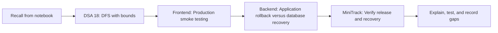
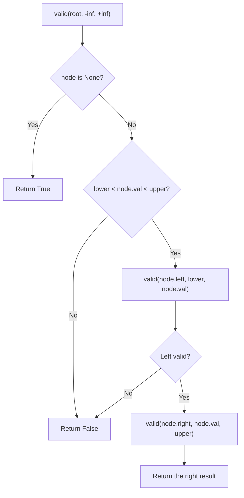
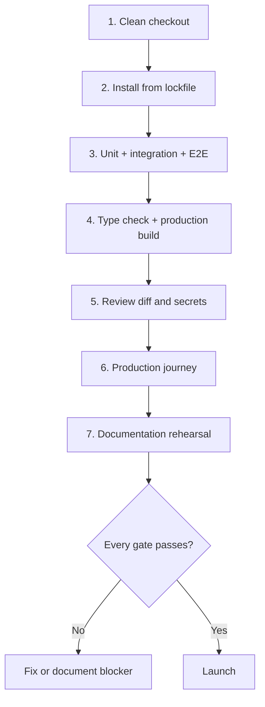
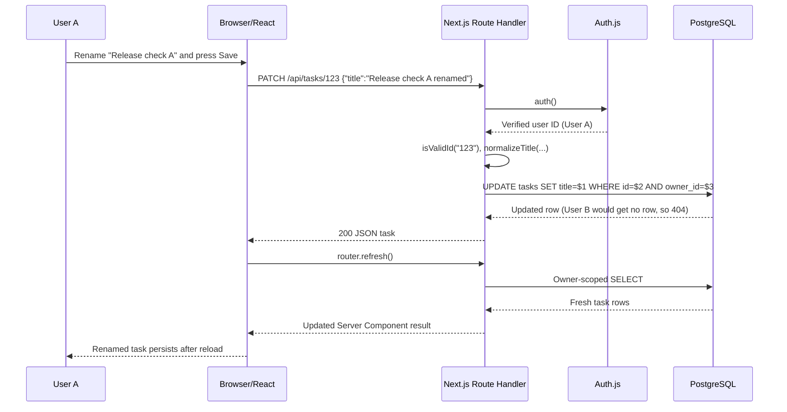

# Prep Day 18 — Verify release and recovery

**Date:** Tuesday, December 15, 2026  
**Time:** 7 study hours plus breaks  
**Starting point:** App Days 1–4 are complete. Continue from the current learner workspace and the previous preparation-day exit checklist.  
**Goal:** Verify release and recovery.

[Prep Day 17](prep-day-17.md) · [Preparation plan](../../docs/FULL_STACK_INTERVIEW_PREP_PLAN.md) · [Track home](README.md) · [Prep Day 19](prep-day-19.md)

**Everything to read today is below.** The original [App Day 15](../day-15.md)
and [DSA Day 18](../../dsa-python/lessons/dsa-day-18.md) remain available for
comparison. This prep day covers verifying the release that Prep Day 17
deployed: the clean-checkout release gate, the two-user acceptance journey,
operations and recovery documentation, a local backup-and-restore drill, and
the five-minute system explanation. It adds no new application feature.
Production configuration and the first deployment belong to Prep Day 17; the
frontend interview review starts on Prep Day 19. Write runnable code in the
named project and practice files, not in this Markdown file.

## Learning objectives

- explain production smoke testing in beginner-friendly language;
- explain application rollback versus database recovery and its failure boundary;
- implement or verify the listed MiniTrack milestone;
- solve DSA Day 18 using the DFS with bounds pattern;
- record the result in your rough notebook and explain it without reading.

## 1. Start with notebook recall (45 minutes)

Before opening a lesson, write answers in
[`checkpoints/ROUGH/Notes.md`](../../checkpoints/ROUGH/Notes.md):

1. What did yesterday's browser action send to the server?
2. Where is persistent task data stored, and what state is only temporary?
3. What error or edge case can you already predict for today's topic?
4. What do you remember about the **DFS with bounds** pattern?

Use this format:

```md
## Tuesday, December 15, 2026

- What:
- Why:
- How MiniTrack uses it:
- What can go wrong:
- First task:
```

Do not copy the source paragraph. Write what you remember, then compare.

## 2. Understand today's full-stack boundary (20 minutes)

**Frontend focus — Production smoke testing:** A smoke test checks the smallest critical journey after deployment: load, sign in, create, update, and read the expected result.

**Backend focus — Application rollback versus database recovery:** Rolling back application code does not automatically reverse a schema or data migration. Database changes need compatibility planning, backups, and tested recovery steps.

**Today's connection:** A release is complete only when the team can verify it, explain it, and recover from failure.



## 3. Python DSA practice (1 hour 45 minutes)

**Practice file:** [`dsa-python/practice/day-18.py`](../../dsa-python/practice/day-18.py)  
**Pattern:** DFS with bounds

### Problem: Validate Binary Search Tree

You are given the **root** of a binary tree. Return `True` if it is a valid
**binary search tree (BST)** and `False` otherwise. In a valid BST, for
**every** node:

- every value in its left subtree is **strictly smaller** than the node's value;
- every value in its right subtree is **strictly larger** than the node's value.

Assumptions: values are numbers; an empty tree (`None`) is valid; duplicates
are **invalid** because the comparison is strict.

```python
#     2
#    / \
#   1   3
solve(TreeNode(2, TreeNode(1), TreeNode(3)))  # True

#     5
#    / \
#   1   4
#      / \
#     3   6
solve(TreeNode(5, TreeNode(1), TreeNode(4, TreeNode(3), TreeNode(6))))  # False
```

The second tree fails because `4` is the right child of `5`, so it must be
**larger** than 5, and it is not. A harder trap is the tree
`5 → (4, 6 → (3, 7))`: every parent–child pair looks correct (`3 < 6`), but
`3` sits in the right subtree of `5`, so it must also be larger than 5. You
need limits passed down from **all** ancestors.

### Start coding

The practice file already contains the node class and the function to write:

```python
class TreeNode:
    def __init__(self, val=0, left=None, right=None):
        self.val, self.left, self.right = val, left, right

def solve(root):
    # Return True when the whole tree is a strict BST.
    raise NotImplementedError
```

Two Python ideas help here.

1. **A helper function inside `solve`.** You may define `def valid(node,
   lower, upper):` inside `solve` and call it recursively. It sees nothing
   special from outside; it simply keeps the extra parameters out of the
   public signature.
2. **Infinity as a starting limit.** `float('inf')` is larger than every
   ordinary number and `float('-inf')` is smaller than every ordinary number.
   Python also allows a chained comparison: `lower < x < upper` means
   `lower < x and x < upper`.

```python
float('-inf') < -1000000 < float('inf')   # True
lower, upper = 5, 10
lower < 7 < upper                          # True
lower < 5 < upper                          # False (5 is not strictly greater)
```



### Invariant to say aloud

Every BST node must remain strictly inside bounds inherited from all ancestors, not only compare with its parent.

### Work in this order

1. Restate the problem and ask about constraints.
2. Give a brute-force approach and its cost before optimizing.
3. Write the invariant above in your own words.
4. Implement without opening the solution for 25 minutes.
5. Test empty, smallest, typical, duplicate, and boundary cases where relevant.
6. Use a small hint if blocked; do not spend the entire block stuck.
7. Compare with the commented reference and re-code the key loop from memory.

From the repository root:

```bash
python3 dsa-python/scripts/check_practice.py 18
python3 -m unittest discover -s dsa-python/tests -v
python3 dsa-python/practice/day-18.py
```

**Expected observation:** Day 18 uses tree objects, so the day checker has no
built-in examples. It prints `This problem uses linked-list/tree structures;
write your own object-based tests.` and exits successfully **even if `solve`
is not written yet**. The third command runs your temporary asserts below and
is the real check. The reference suite should still pass; it checks that
`2 → (1, 3)` is valid.

Temporarily add these checks below your `solve` function in the practice file:

```python
if __name__ == '__main__':
    assert solve(None) is True
    assert solve(TreeNode(1)) is True
    assert solve(TreeNode(2, TreeNode(1), TreeNode(3))) is True
    assert solve(TreeNode(5, TreeNode(1), TreeNode(4, TreeNode(3), TreeNode(6)))) is False
    # Parent-child pairs look fine, but 3 is in the right subtree of 5.
    assert solve(TreeNode(5, TreeNode(4), TreeNode(6, TreeNode(3), TreeNode(7)))) is False
    # Duplicates break the strict rule on either side.
    assert solve(TreeNode(2, TreeNode(2))) is False
    assert solve(TreeNode(2, None, TreeNode(2))) is False
    # Negative values and a right-leaning chain.
    assert solve(TreeNode(-3, None, TreeNode(-1, None, TreeNode(0)))) is True
    print('All checks passed')
```

### Brute-force code — reveal after attempting

<details>
<summary>Show the simple solution</summary>

```python
class TreeNode:
    def __init__(self, val=0, left=None, right=None):
        self.val, self.left, self.right = val, left, right

def solve(root):
    def all_values(node):
        # Every value in this subtree, collected again for each caller.
        if node is None:
            return []
        return all_values(node.left) + [node.val] + all_values(node.right)

    def valid(node):
        if node is None:
            return True
        if any(value >= node.val for value in all_values(node.left)):
            return False
        if any(value <= node.val for value in all_values(node.right)):
            return False
        return valid(node.left) and valid(node.right)

    return valid(root)
```

</details>

This applies the definition literally: for every node, compare it with every
value below it. Each node's values are collected once per ancestor, so the
time is O(n·h), which is O(n²) for a chain. It also builds temporary lists of
up to O(n) values plus O(h) call stack.

### Optimized code — reveal after attempting

<details>
<summary>Show the bounds solution</summary>

```python
class TreeNode:
    def __init__(self, val=0, left=None, right=None):
        self.val, self.left, self.right = val, left, right

def solve(root):
    def valid(node, lower, upper):
        if node is None:
            return True
        # The node must fit inside limits set by ALL its ancestors.
        if not (lower < node.val < upper):
            return False
        # Going left tightens the upper limit; going right tightens the lower.
        return (valid(node.left, lower, node.val)
                and valid(node.right, node.val, upper))
    return valid(root, float('-inf'), float('inf'))
```

</details>

Each node is checked once with two comparisons: O(n) time. The recursion
depth equals the tree height, so extra space is O(h): O(log n) for a
balanced tree and O(n) for a chain. `and` stops early, so the right subtree
is skipped once the left subtree fails.

Trace for the trap tree `5 → (4, 6 → (3, 7))`:

| Call | Node | `lower` | `upper` | `lower < val < upper`? | Result |
|---:|---:|---|---|---|---|
| 1 | 5 | -inf | +inf | yes | check children |
| 2 | 4 (left of 5) | -inf | 5 | yes | leaf: True |
| 3 | 6 (right of 5) | 5 | +inf | yes | check children |
| 4 | 3 (left of 6) | 5 | 6 | **no**, 3 is not > 5 | False |
| — | back to 6, then 5 | — | — | — | `False` returned to the caller |

Call 4 is where a parent-only check would wrongly pass, because `3 < 6`.

### DSA interview questions and answers

#### DSA Q1. What is the brute-force approach?

**Interview-ready answer:** “For every node, I collect all values in its left
subtree and confirm each is smaller, then all values in its right subtree and
confirm each is larger. Then I repeat for the children. It follows the
definition exactly, but each value is re-collected for every ancestor, so it
is O(n·h) time, O(n²) for a chain.”

**Example:** For `5 → (4, 6 → (3, 7))`, the right-subtree values of 5 are
`[3, 6, 7]`; `3 <= 5`, so return `False`.

**Follow-up:** Why not only compare each node with its direct children? That
is O(n) but wrong: the same tree passes every parent–child check.

#### DSA Q2. What is the core idea of the bounds solution?

**Interview-ready answer:** “Every node inherits an allowed open interval
from its ancestors. The root may be anything. Going left, the parent's value
becomes the new upper limit; going right, it becomes the new lower limit. A
node is valid only if it falls strictly inside its interval and both subtrees
are valid.”

**Example:** Node 3 under `5 → right → 6 → left` receives `(5, 6)`. Three is
outside that interval.

**Follow-up:** The interval only gets narrower as you go down, which is why
one comparison per node is enough.

#### DSA Q3. Why is the solution correct?

**Interview-ready answer:** “Claim: `valid(node, lower, upper)` returns True
exactly when every value in that subtree lies strictly between `lower` and
`upper` and the subtree is ordered. By induction on height: `None` is
trivially valid. For a real node, the BST rule for this node and every
ancestor is exactly ‘inside the inherited bounds’, and passing `node.val` as
the new bound enforces this node's rule on all its descendants.”

**Example:** In `2 → (1, 3)`, 1 is checked against `(-inf, 2)` and 3 against
`(2, +inf)`; both pass, so the tree is valid.

**Follow-up:** An equivalent proof: an in-order traversal of a valid BST is
strictly increasing. Both views give O(n) algorithms.

#### DSA Q4. What are the time and space costs?

**Interview-ready answer:** “O(n) time because each node is visited once with
constant work. O(h) extra space for the recursion stack, where h is the
height: O(log n) if balanced, O(n) if the tree is a chain.”

**Example:** A chain of 10,000 nodes would need 10,000 nested calls.

**Follow-up:** Python's default recursion limit is about 1,000, so a deep
chain raises `RecursionError`. In production code use an explicit stack of
`(node, lower, upper)` tuples, which has the same O(h) space without the
interpreter limit.

#### DSA Q5. What edge cases should I test?

**Interview-ready answer:** “An empty tree, a single node, duplicates on the
left and on the right, a violation deep in the tree, negative numbers, and a
skewed chain.”

**Example:** `TreeNode(2, TreeNode(2))` returns `False` because `2 < 2` is
false. `solve(None)` returns `True`.

**Follow-up:** Infinity sentinels have a caveat: a node whose value is itself
`float('inf')` would fail. If that is allowed, pass `None` to mean “no limit”
and check `lower is None or lower < val`.

#### DSA Q6. How would you solve it with an in-order traversal instead?

**Interview-ready answer:** “I visit left, node, right, and remember only the
previous value. If any value is less than or equal to the previous one, the
tree is invalid. That is O(n) time and O(h) stack, and it needs only one
remembered number instead of two bounds.”

**Example:** In-order on `5 → (4, 6 → (3, 7))` gives `4, 5, 3, ...`; `3 <= 5`
fails at the third value.

**Follow-up:** If the interviewer says duplicates are allowed on the left, the
bounds version changes to `lower < val <= upper` on the left side. Clarify the
duplicate rule before coding.

## 4. Frontend guided study (1 hour 30 minutes)

### What

A smoke test checks the smallest critical journey after deployment: load, sign in, create, update, and read the expected result.

### Why

The browser layer should make state and feedback understandable without taking
ownership of persistent data or security decisions that belong on the server.

### How

**Smoke test versus test suite.** Your App Day 9 Playwright test
`frontend/test/e2e/tasks.spec.ts` runs against a **test** database before
release:

```ts
test('creates, completes, and persists a task', async ({ page }) => {
  await page.goto('/');

  await page.getByLabel('Task title').fill('Practice testing');
  await page.getByRole('button', { name: /add task/i }).click();

  await expect(page.getByText('Practice testing')).toBeVisible();
  await page.getByLabel('Complete Practice testing').check();
  await page.reload();

  await expect(page.getByLabel('Complete Practice testing')).toBeChecked();
});
```

It truncates `tasks` before each test, so it must **never** point at
production. A production smoke test is the same idea done gently by a person
(or a non-destructive script) against the real site: a few critical steps,
no data wiping.

**The deployed acceptance journey (App Day 15).** Run it in two browser
profiles or one normal and one private window.

As **User A**:

1. Sign in with GitHub.
2. Create a task called `Release check A`.
3. Rename it to `Release check A renamed` and tick its checkbox.
4. Search with `?q=release&status=done`, copy the URL, and open it in a new
   tab: the same filtered result should appear.
5. Reload and confirm everything persisted.
6. Note the task's ID: in developer tools → Network, click the PATCH request
   and read the number in `/api/tasks/ID`.

As **User B** (the second GitHub account):

1. Sign in separately and confirm User A's task is absent.
2. Try User A's known ID from the browser console:

```js
// Run in User B's tab. Replace 123 with User A's task ID.
await fetch('/api/tasks/123', {
  method: 'PATCH',
  headers: { 'Content-Type': 'application/json' },
  body: JSON.stringify({ done: false }),
}).then(response => response.status);
```

**Expected observation:** `404`. The owner-scoped SQL
`WHERE id = $2 AND owner_id = $3` matched no row, and the response does not
reveal whether the ID exists for someone else. Reload User A's tab: the task
must still be completed and renamed.

Finally, sign out and confirm the private page shows the sign-in prompt and a
console `fetch('/api/tasks').then(r => r.status)` returns `401`.

Files to open deliberately:

- `README.md`
- `docs/ARCHITECTURE.md`
- `docs/APP_OVERVIEW.md`

Answer before verifying:

- Which value is persistent, and which value is temporary interaction state?
  (Tasks and users are in PostgreSQL; the edit draft and `busy` flag are tab
  state that disappears on reload.)
- What starts this behavior? (A release finishing, or a tester opening the
  production URL.)
- What should the user see while work is pending? (Disabled buttons and the
  Suspense fallback, never a blank page.)
- What should remain unchanged when the operation fails? (User A's row when
  User B's PATCH is rejected.)

## 5. Backend guided study (1 hour 30 minutes)

### What

Rolling back application code does not automatically reverse a schema or data migration. Database changes need compatibility planning, backups, and tested recovery steps.

### Boundary checklist

- Validate untrusted path, query, and body values.
- Authenticate identity when the route is protected.
- Authorize the resource separately from authentication.
- Bind SQL values rather than concatenating untrusted data.
- Return an explicit success or error status.
- Log internal failures on the server without exposing secrets.

### Two different undo buttons

- **Application rollback** redeploys an earlier build. It is fast and safe
  when the database still has the shape that older build expects.
- **Database recovery** restores data or schema from a backup or provider
  restore point, or rolls *forward* with a reviewed fix. It is slower, may
  lose writes made after the backup, and must be rehearsed.

Why they differ: App Day 11's `003-task-owners.sql` runs `DELETE FROM tasks`
and adds a required column. Redeploying the App Day 10 build afterwards would
not bring deleted tasks back, and the old `INSERT INTO tasks (title)` would
fail because `owner_id` is now `NOT NULL`.

### Make migrations backward-compatible (expand and contract)

For a database that already holds user data, App Day 11 says: add a nullable
column, backfill, verify, then add `NOT NULL`. Written as separate,
reviewable steps:

```sql
-- Release 1 (expand): old code still works because the column is optional.
ALTER TABLE tasks
ADD COLUMN owner_id INTEGER REFERENCES users(id) ON DELETE CASCADE;

-- Backfill with an approved mapping. 1 is a placeholder owner ID.
UPDATE tasks SET owner_id = 1 WHERE owner_id IS NULL;

-- Verify before tightening. Expect 0.
SELECT COUNT(*) FROM tasks WHERE owner_id IS NULL;

-- Release 2 (contract), only after new code writes owner_id everywhere.
ALTER TABLE tasks ALTER COLUMN owner_id SET NOT NULL;
```

Between the two releases both the old and new application versions can run,
so an application rollback stays safe.

### Rehearse a backup and restore locally

Practice on your **local development** database only. From the repository
root:

```bash
# 1. Back up (custom format can be restored selectively).
pg_dump -d minitrack --format=custom --file=minitrack-backup.dump

# 2. Restore into a separate scratch database, never over the original.
createdb minitrack_restore_drill
pg_restore --no-owner -d minitrack_restore_drill minitrack-backup.dump

# 3. Verify the copy.
psql -d minitrack -c 'SELECT COUNT(*) FROM tasks;'
psql -d minitrack_restore_drill -c 'SELECT COUNT(*) FROM tasks;'

# 4. Clean up the drill.
dropdb minitrack_restore_drill
rm minitrack-backup.dump
```

**Expected observation:** both counts match. Time the drill and write the
duration in your notes: that is your first estimate of recovery time. Never
commit a `.dump` file; it contains real data. In production, prefer the
provider's restore point and its documented procedure.

## 6. MiniTrack implementation (1 hour)

**Milestone source:** Day 15 release checks, documentation, and recovery



### Step 1: Run the release gate from a clean checkout

A clean checkout proves that nothing depends on files only your laptop has.
From the repository root, after committing your work:

```bash
git status --short          # must print nothing
git clone . ../minitrack-release-check
cd ../minitrack-release-check/frontend
cp ../../minitrack-week1/frontend/.env.test.local .env.test.local
npm ci
npm run test:unit
npm run test:integration
npm run test:e2e
npx tsc --noEmit
npm run build
git status --short
```

Replace `minitrack-week1` if your folder has another name. Only the ignored
**test** environment file is copied; it points at `minitrack_test`.

**Expected observation:** every check passes, `npm ci` installs exactly the
lockfile versions, and the final `git status --short` prints nothing. Every
extra step you had to perform is a hidden dependency: write it into the
README in Step 2. Delete `../minitrack-release-check` afterwards.

### Step 2: Document the operating interface

Add an operations section to the main `README.md`. Use names, never values:

````md
## Operating MiniTrack

**Runtime:** Node.js (version from the host settings), PostgreSQL (managed).

### Environment variables (names only)
`DATABASE_URL`, `AUTH_SECRET`, `AUTH_GITHUB_ID`, `AUTH_GITHUB_SECRET`.
Local template: `frontend/.env.local.example`. Tests: `frontend/.env.test.local`.

### Local setup
```bash
createdb minitrack
psql -d minitrack -f backend/sql/schema.sql
psql -d minitrack -f backend/sql/migrations/002-auth-users.sql
psql -d minitrack -f backend/sql/migrations/003-task-owners.sql
cd frontend && npm ci && npm run dev
```

### Tests
`npm run test:unit`, `npm run test:integration`, `npm run test:e2e`
(the last two require `minitrack_test`).

### GitHub OAuth callback
`https://YOUR_DOMAIN/api/auth/callback/github` (separate app per environment).

### API summary
| Route | Authentication | Authorization |
|---|---|---|
| `GET /api/health` | Public | No task data |
| `GET /api/tasks` | Required | Owner-scoped list |
| `POST /api/tasks` | Required | Owner from session |
| `PATCH /api/tasks/:id` | Required | ID and owner predicate |
| `DELETE /api/tasks/:id` | Required | ID and owner predicate |

### Deploy and smoke test
Backup → migrations with `psql -v ON_ERROR_STOP=1` → deploy tested commit →
`/api/health` 200 → anonymous `/api/tasks` 401 → sign in, create, reload →
second user cannot see the task → sign out.

### Recovery
- App rollback: redeploy the previous build from the host dashboard.
- Database: provider restore point taken before each migration; restore is
  rehearsed with `pg_dump`/`pg_restore` locally.
- Access: only YOUR_NAME can read production secrets and logs.
- Failed requests: search host logs for `failed:` lines from Route Handlers.

### Known limitations
No sharing or teams; no pagination; no optimistic concurrency; basic rate
limiting; basic monitoring; one OAuth provider.
````

Known limitations are not failures when they are explicit and appropriate for
the product stage.

### Step 3: Check one failure is actionable and private

Locally, stop PostgreSQL (for example `brew services stop postgresql@17`, or
your installed version), then:

```bash
curl -i http://localhost:3000/api/health
curl -i -X POST http://localhost:3000/api/tasks \
  -H 'Content-Type: application/json' -d '{"title":"While DB is down"}'
```

**Expected observation:** health still returns `200` (it does not query the
database), and the anonymous task request returns `401`. Then, in a signed-in
browser tab, try to add a task: the board shows an error such as
`Could not add task (500)` (Auth.js also stores sessions in PostgreSQL since
App Day 11, so the failure may happen while reading the session). The
terminal running `npm run dev` shows the real error. No response body contains
the database URL. Restart PostgreSQL afterwards.

### Step 4: Rehearse the five-minute explanation

Say this aloud, timing yourself, while pointing at the sequence diagram in
section 7:

1. **Browser (30 s):** `TaskBoard.tsx` holds only temporary state: the input
   text, `editingId`, `busy`, and `error`.
2. **Route Handler (60 s):** `PATCH /api/tasks/:id` validates the ID with
   `isValidId` and the body, and maps results to `200`, `400`, `401`, `404`,
   or `500`.
3. **Auth.js (45 s):** `auth()` reads the signed `HttpOnly` cookie and gives
   a verified user ID; the client never sends an owner ID.
4. **Data layer (45 s):** parameterized SQL with `id = $2 AND owner_id = $3`.
5. **PostgreSQL (30 s):** constraints, persistence, `RETURNING`.
6. **Refresh (30 s):** `router.refresh()` re-runs the Server Component.
7. **Tests and operations (60 s):** unit, integration, and E2E tests;
   separate secrets; smoke test; rollback versus recovery.

**Expected observation:** the user-visible milestone works, its important
failure path is explicit, and existing behavior remains intact.

## 7. Trace the event or request



Trace one concrete input. Name every boundary, value, and possible failure.

## 8. Deliberate debugging exercise (25 minutes)

**Break it:** Assume redeploying the previous commit will undo a destructive migration.

Do this as a **thought experiment and a local drill only**. Take a
`pg_dump` of your local database first, then write in your notebook what
would happen if `003-task-owners.sql` ran in production and you redeployed
the App Day 10 build.

**Predict before running:** write the expected symptom in your notebook.

**Expected symptom:** Old code may start against incompatible or already-lost data.

Concretely: the old build runs `INSERT INTO tasks (title) VALUES ($1)` and
PostgreSQL rejects it with a `NOT NULL` violation on `owner_id`, so every
create returns `500`; and the deleted tasks stay deleted.

**Root cause:** Code rollback and data recovery were treated as the same operation.

**Restore and verify:** Use backward-compatible migrations and a rehearsed database restore or forward-fix plan.

Restore your local dump into `minitrack_restore_drill` as in section 5 and
confirm the row count matches the count you recorded before the drill.

Do not stop after making the symptom disappear. Explain why the repair restores
the intended invariant.

## 9. Interview questions and answers (30 minutes)

### Q1. What is production smoke testing?

**Interview-ready answer:** “A smoke test is a short, non-destructive set of
checks against the real deployed environment, run right after a release. It
proves the critical path works with the real configuration: health, sign-in,
database access, one core user journey, and access control. It complements
the deeper test suite; it does not replace it.”

**Example:** For MiniTrack: `GET /api/health` returns 200, anonymous
`GET /api/tasks` returns 401, User A signs in, creates and renames a task,
reloads, and User B's `PATCH /api/tasks/123` returns 404.

**Senior follow-up:** Automate the safe parts with a dedicated smoke-test
account and run them after every deploy and on a schedule. Never point the
App Day 9 E2E suite at production; it truncates tables. Alert on failures
rather than relying on someone to look.

### Q2. How should the backend handle application rollback versus database recovery?

**Interview-ready answer:** “They are separate operations. Rolling back the
app redeploys old code; it does not change data. If a migration dropped or
transformed data, I need a backup or restore point, or a reviewed forward
fix. I make migrations backward-compatible so that rolling back the app is
always safe.”

**Example:** App Day 11's learning migration runs `DELETE FROM tasks` and adds
`owner_id NOT NULL`. Redeploying the App Day 10 build afterwards fails every
`INSERT INTO tasks (title)` and cannot bring rows back. The production-safe
version adds a nullable `owner_id`, backfills it, verifies zero nulls, and
only then sets `NOT NULL` in a later release.

**Senior follow-up:** Define recovery-point and recovery-time objectives, take
a restore point before each migration, rehearse restores into a scratch
database, and keep evidence (logs, a dump) before changing anything during an
incident. Logs must record request IDs and errors, never task contents or
secrets.

### Q3. What invariant makes the DFS with bounds solution correct?

**Interview-ready answer:** Every BST node must remain strictly inside bounds inherited from all ancestors, not only compare with its parent.

**Example:** For `5 → (4, 6 → (3, 7))`: 5 is checked in `(-inf, inf)`, 4 in
`(-inf, 5)`, 6 in `(5, inf)`, and 3 in `(5, 6)`. Three is not greater than 5,
so the function returns `False`, even though `3 < 6` looks fine locally.

**Senior follow-up:** O(n) time and O(h) stack hold for any shape; for a
skewed tree h = n and Python's recursion limit becomes a real risk, so use an
explicit stack. If values can be infinite, replace the sentinels with `None`.
Clarify whether duplicates are allowed before coding.

### Q4. How does today's work fit the complete MiniTrack system?

**Interview-ready answer:** A release is complete only when the team can verify it, explain it, and recover from failure.

**Example:** A clean clone passes `npm ci`, all three test levels,
`npx tsc --noEmit`, and `npm run build`. The production journey passes for
User A and User B. The README lists environment variable names, the
migration order, the callback URL, the API table, and the recovery steps, and
a local `pg_dump`/`pg_restore` drill matched row counts.

**Senior follow-up:** The first operational signals to measure are the 5xx
rate per route, sign-in failures, and database connection saturation. The
first security risk to re-check after each release is owner isolation, which
is why the User B 404 check is part of every smoke test.

## 10. Complexity and operational cost

- **DSA:** O(n) time and O(h) call-stack space.
- **Application:** Recovery work has ongoing storage and drill cost, but untested backups have little practical value.
- **Learning:** Attempting, retrieving, and correcting is more valuable than
  copying several solutions. Keep the scope to one understood pattern today.

## Exit checklist

- [ ] I completed DSA Day 18 before reading its solution.
- [ ] I can state the invariant and complexity without notes.
- [ ] I completed or verified the MiniTrack milestone.
- [ ] I tested one success path and one failure path.
- [ ] I completed the deliberate debugging exercise.
- [ ] I answered all four interview questions aloud.
- [ ] I recorded what remains confusing and tomorrow's first task.

**Suggested commit:** `prep day 18: verify release and recovery`
