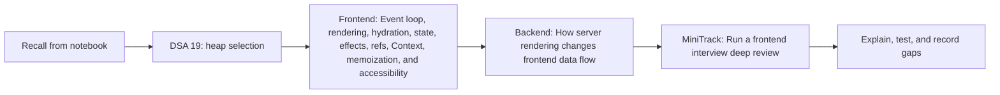
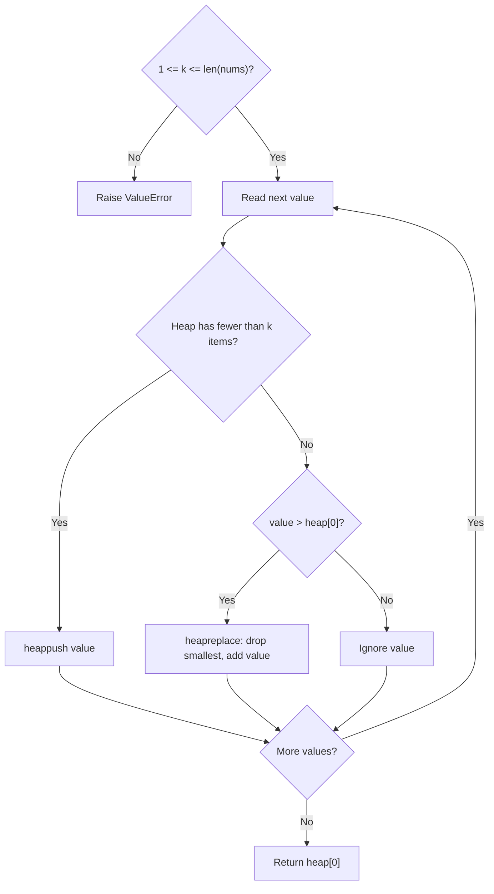
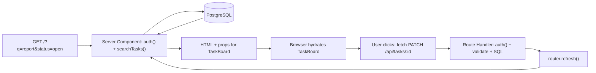

# Prep Day 19 — Run a frontend interview deep review

**Date:** Wednesday, December 16, 2026  
**Time:** 7 study hours plus breaks  
**Starting point:** App Days 1–4 are complete. Continue from the current learner workspace and the previous preparation-day exit checklist.  
**Goal:** Run a frontend interview deep review.

[Prep Day 18](prep-day-18.md) · [Preparation plan](../../docs/FULL_STACK_INTERVIEW_PREP_PLAN.md) · [Track home](README.md) · [Prep Day 20](prep-day-20.md)

**Everything to read today is below.** The original
[interview index](../../docs/INTERVIEW_INDEX.md),
[app architecture](../../docs/ARCHITECTURE.md), and
[DSA Day 19](../../dsa-python/lessons/dsa-day-19.md) remain available for
comparison. This is a **review day: write no new feature code.** It covers
frontend topics only: the event loop, rendering, hydration, state, effects,
refs, Context, memoization, accessibility, and performance, each tied to a
real MiniTrack example. The code below is copied from App Days 1–13 so you
can study without opening other files. The backend speed round (HTTP, SQL,
transactions, pooling, authorization) belongs to Prep Day 20, and system
design starts on Prep Day 21. Write runnable DSA code in the practice file and
your recall answers in your notebook, not in this Markdown file.

## Learning objectives

- explain event loop, rendering, hydration, state, effects, refs, context, memoization, and accessibility in beginner-friendly language;
- explain how server rendering changes frontend data flow and its failure boundary;
- implement or verify the listed MiniTrack milestone;
- solve DSA Day 19 using the heap selection pattern;
- record the result in your rough notebook and explain it without reading.

## 1. Start with notebook recall (45 minutes)

Before opening a lesson, write answers in
[`checkpoints/ROUGH/Notes.md`](../../checkpoints/ROUGH/Notes.md):

1. What did yesterday's browser action send to the server?
2. Where is persistent task data stored, and what state is only temporary?
3. What error or edge case can you already predict for today's topic?
4. What do you remember about the **heap selection** pattern?

Use this format:

```md
## Wednesday, December 16, 2026

- What:
- Why:
- How MiniTrack uses it:
- What can go wrong:
- First task:
```

Do not copy the source paragraph. Write what you remember, then compare.

## 2. Understand today's full-stack boundary (20 minutes)

**Frontend focus — Event loop, rendering, hydration, state, effects, refs, Context, memoization, and accessibility:** A strong frontend explanation connects runtime scheduling to React rendering, distinguishes persistent server data from local interaction state, and uses effects only for external synchronization.

**Backend focus — How server rendering changes frontend data flow:** A Server Component can read server resources directly and send rendered output, while a Client Component adds browser state and events. Mutations still cross an HTTP or server-action boundary.

**Today's connection:** Frontend interviews reward boundary explanations, not isolated hook definitions.



## 3. Python DSA practice (1 hour 45 minutes)

**Practice file:** [`dsa-python/practice/day-19.py`](../../dsa-python/practice/day-19.py)  
**Pattern:** heap selection

### Problem: Kth Largest Element

Given a list of numbers `nums` and a whole number `k`, return the k-th largest
value. Count duplicates: in `[5, 5, 4]` the first and second largest are both
`5`. If `k` is smaller than 1 or larger than `len(nums)`, raise `ValueError`.

```python
solve([3, 2, 1, 5, 6, 4], 2)           # 5
solve([3, 2, 3, 1, 2, 4, 5, 5, 6], 4)  # 4
```

In the second call, sorted from largest the values are
`6, 5, 5, 4, ...`, so the 4th largest is `4`, not the 4th **distinct** value.

The simple approach sorts every value: O(n log n). If `k` is small, you only
need to remember the `k` largest values seen so far.

### Start coding

In the practice file, replace the `raise NotImplementedError` line:

```python
def solve(nums, k):
    # Return the k-th largest value, counting duplicates.
    raise NotImplementedError
```

A **min-heap** is a list arranged so the **smallest** item is always at
index `0`. Python's `heapq` module keeps that arrangement for you. Import it
first:

```python
import heapq

heap = []
heapq.heappush(heap, 5)   # heap[0] is 5
heapq.heappush(heap, 2)   # heap[0] is 2 (smallest moves to the front)
heapq.heappush(heap, 8)   # heap[0] is still 2
heap[0]                   # 2: read the smallest in O(1)
heapq.heapreplace(heap, 7)  # remove 2 and add 7 in one step; returns 2
heap[0]                   # 5
```

`heappush` and `heapreplace` cost O(log size). Only `heap[0]` is guaranteed
to be the smallest; the rest of the list is not fully sorted.

The idea: keep a min-heap of the `k` largest values seen so far. Its smallest
member, `heap[0]`, is then the k-th largest so far.



### Invariant to say aloud

Keep or build a heap so the next most relevant element can be removed without fully sorting all values.

For this problem: after each value, the heap holds the `min(k, seen)` largest
values seen so far, and `heap[0]` is the smallest of them.

### Work in this order

1. Restate the problem and ask about constraints.
2. Give a brute-force approach and its cost before optimizing.
3. Write the invariant above in your own words.
4. Implement without opening the solution for 25 minutes.
5. Test empty, smallest, typical, duplicate, and boundary cases where relevant.
6. Use a small hint if blocked; do not spend the entire block stuck.
7. Compare with the commented reference and re-code the key loop from memory.

From the repository root:

```bash
python3 dsa-python/scripts/check_practice.py 19
python3 -m unittest discover -s dsa-python/tests -v
```

**Expected observation:** the checker prints `Case 1 passed`, `Case 2
passed`, and `All supplied cases passed.` for the two samples above, and the
completed reference suite still passes. The checker does not test invalid
`k`; the asserts below do.

You can also temporarily add these checks below your `solve` function, then
run `python3 dsa-python/practice/day-19.py`:

```python
if __name__ == '__main__':
    assert solve([3, 2, 1, 5, 6, 4], 2) == 5
    assert solve([3, 2, 3, 1, 2, 4, 5, 5, 6], 4) == 4
    assert solve([7], 1) == 7
    assert solve([5, 5, 4], 2) == 5          # duplicates count
    assert solve([-1, -5, -3], 3) == -5      # k == len(nums): the minimum
    assert solve([1, 2, 3], 1) == 3          # k == 1: the maximum
    for bad_k in (0, 4):
        try:
            solve([1, 2, 3], bad_k)
        except ValueError:
            pass
        else:
            raise AssertionError('invalid k must raise ValueError')
    try:
        solve([], 1)
    except ValueError:
        pass
    else:
        raise AssertionError('empty input must raise ValueError')
    print('All checks passed')
```

### Brute-force code — reveal after attempting

<details>
<summary>Show the simple solution</summary>

```python
def solve(nums, k):
    if not (1 <= k <= len(nums)):
        raise ValueError('k must be in [1, len(nums)]')
    ordered = sorted(nums, reverse=True)  # largest first, duplicates kept
    return ordered[k - 1]                 # k is 1-based
```

</details>

Sorting is easy to verify and often fine in practice. It costs O(n log n)
time and O(n) extra space for the sorted copy, and does more work than needed
when `k` is much smaller than `n`.

### Optimized code — reveal after attempting

<details>
<summary>Show the heap solution</summary>

```python
import heapq

def solve(nums, k):
    if not (1 <= k <= len(nums)):
        raise ValueError('k must be in [1, len(nums)]')
    heap = []  # min-heap of the k largest values seen so far
    for value in nums:
        if len(heap) < k:
            heapq.heappush(heap, value)
        elif value > heap[0]:
            # value beats the current k-th largest, so it replaces it.
            heapq.heapreplace(heap, value)
    return heap[0]
```

</details>

Each value causes at most one O(log k) heap operation, so the time is
O(n log k) and the extra space is O(k). Values that are not larger than
`heap[0]` are skipped, because they cannot be among the k largest.

Trace for `solve([3, 2, 1, 5, 6, 4], 2)` (the heap is shown sorted for
readability):

| Value | Heap before | Rule | Heap after | `heap[0]` |
|---:|---|---|---|---:|
| 3 | `[]` | fewer than 2 items: push | `[3]` | 3 |
| 2 | `[3]` | fewer than 2 items: push | `[2, 3]` | 2 |
| 1 | `[2, 3]` | `1 > 2`? no: skip | `[2, 3]` | 2 |
| 5 | `[2, 3]` | `5 > 2`: replace | `[3, 5]` | 3 |
| 6 | `[3, 5]` | `6 > 3`: replace | `[5, 6]` | 5 |
| 4 | `[5, 6]` | `4 > 5`? no: skip | `[5, 6]` | 5 |

Return `heap[0]`, which is `5`.

### DSA interview questions and answers

#### DSA Q1. What is the brute-force approach?

**Interview-ready answer:** “I sort the list from largest to smallest and
return the item at index `k - 1`. It is simple and obviously correct. It takes
O(n log n) time and O(n) extra space for the sorted copy.”

**Example:** `sorted([3, 2, 1, 5, 6, 4], reverse=True)` is
`[6, 5, 4, 3, 2, 1]`; index `1` is `5`.

**Follow-up:** Sorting is the right answer when you need many different `k`
values from the same data: sort once, then each lookup is O(1).

#### DSA Q2. Why a min-heap of size k, and not a max-heap?

**Interview-ready answer:** “I want quick access to the weakest member of my
current top-k, because that is the one a new value might replace. A min-heap
puts that weakest value at `heap[0]`. When the heap is full and a new value is
bigger, I replace the smallest.”

**Example:** With heap `[3, 5]` and new value `6`, `6 > 3`, so 3 leaves and
the heap becomes `[5, 6]`.

**Follow-up:** A max-heap of all n values also works: heapify in O(n), then
pop k − 1 times in O(k log n). It uses O(n) space instead of O(k).

#### DSA Q3. Why is the solution correct?

**Interview-ready answer:** “Invariant: after processing each value, the heap
contains exactly the `min(k, seen)` largest values seen so far. Pushing while
the heap is small keeps it true. When it is full, a value larger than
`heap[0]` belongs in the top-k and `heap[0]` no longer does, so `heapreplace`
keeps it true; a smaller or equal value does not belong, so skipping keeps it
true. At the end the heap holds the k largest values, and its minimum is the
k-th largest.”

**Example:** At value `4` in the trace, the heap `[5, 6]` already holds the
two largest values; `4` is not larger than `5`, so it is skipped.

**Follow-up:** Skipping a value equal to `heap[0]` is safe: the heap already
contains an equal value, so the k-th largest number is unchanged.

#### DSA Q4. What are the time and space costs?

**Interview-ready answer:** “O(n log k) time, because each of n values does at
most one push or replace on a heap of size k. O(k) extra space for the heap.
When k is close to n this is O(n log n), no better than sorting.”

**Example:** For one million values and `k = 10`, each heap operation works
on at most 10 items, so `log k` is about 3.

**Follow-up:** Quickselect has expected O(n) time and can work in place, but
its worst case is O(n²) unless pivots are chosen carefully, and it reorders
the input.

#### DSA Q5. What edge cases should I test?

**Interview-ready answer:** “k equal to 1 and to `len(nums)`, duplicates,
negative numbers, a single element, and invalid k such as 0, a value larger
than the length, or an empty list.”

**Example:** `solve([5, 5, 4], 2)` is `5` because duplicates count;
`solve([1, 2, 3], 0)` raises `ValueError`.

**Follow-up:** Ask whether the interviewer wants the k-th **distinct** value.
If so, deduplicate with `set(nums)` first and re-check that `k` is still in
range.

#### DSA Q6. How would you handle a stream of numbers?

**Interview-ready answer:** “The same size-k min-heap works for a stream
because it never needs earlier values again. I keep it as the state of an
object: each new number does one O(log k) push or replace, and the current
answer is always `heap[0]` once the heap has k items.”

**Example:** With `k = 3`, after seeing `4, 5, 8, 2` the heap is `[4, 5, 8]`
and the answer is `4`; adding `10` replaces `4` and the answer becomes `5`.

**Follow-up:** This is the classic “Kth Largest Element in a Stream” problem.
Memory stays O(k) no matter how long the stream runs, which is why the heap
beats sorting there.

## 4. Frontend guided study (1 hour 30 minutes)

### What

A strong frontend explanation connects runtime scheduling to React rendering, distinguishes persistent server data from local interaction state, and uses effects only for external synchronization.

### Why

The browser layer should make state and feedback understandable without taking
ownership of persistent data or security decisions that belong on the server.

### How

Study each block in order: read the code, close the file, and explain it aloud
in two sentences. Then fill the concept map at the end of this section.

**1. Event loop (App Day 1, `exercises/js-predictions.js`).** Predict the
output before running:

```js
console.log('1. Start');
setTimeout(() => console.log('1. Timer'), 0);
Promise.resolve().then(() => console.log('1. Promise'));
console.log('1. End');

function makeCounter() {
  let count = 0;
  return () => ++count; // Closure retains count between calls.
}
const counter = makeCounter();
console.log('2.', counter(), counter());

async function getValue() { return 7; }
console.log('3. Sync');
getValue().then(value => console.log('3. Async', value));
console.log('3. End');
```

```bash
node exercises/js-predictions.js
```

**Expected observation:**

```text
1. Start
1. End
2. 1 2
3. Sync
3. End
1. Promise
3. Async 7
1. Timer
```

All synchronous lines run first on the call stack. Then the **microtask**
queue (promise callbacks) is emptied, and only then does the **timer**
callback run, even with a `0` delay.

**2. Server and Client Components (App Day 8 `frontend/app/page.tsx`).** The
page is a Server Component: it can await data on the server and never ships
that code to the browser:

```tsx
async function TaskResults({ searchParams }: PageProps) {
  // Awaiting searchParams makes this subtree request-specific.
  const params = await searchParams;
  const filters = normalizeTaskFilters(params.q, params.status);
  const tasks = await searchTasks(filters);

  return (
    <>
      <SearchForm filters={filters} />
      <TaskBoard tasks={tasks} />
    </>
  );
}

export default function Home({ searchParams }: PageProps) {
  return (
    <main className="mx-auto min-h-screen w-full max-w-5xl px-5 py-12">
      <h1 className="text-4xl font-bold">MiniTrack</h1>

      <Suspense fallback={<p className="mt-8 text-slate-400">Filtering tasks...</p>}>
        <TaskResults searchParams={searchParams} />
      </Suspense>
    </main>
  );
}
```

`TaskBoard.tsx` starts with `'use client'`, so it can use state and event
handlers. `Suspense` shows the fallback while the request-time part loads.
With Cache Components, request-time reads go inside `Suspense` (using
`searchParams`, `auth()`, or `io()`); MiniTrack never uses
`dynamic = 'force-dynamic'`.

**3. Hydration (App Day 4).** `'use client'` marks a client boundary, not
“render only in the browser”. The server still sends HTML for `TaskBoard` on
the first load; then React **hydrates** it, attaching state and event handlers
to the existing HTML. A **hydration mismatch** happens when the first client
render differs from the server HTML, for example rendering `Date.now()` during
render.

**4. State, controlled input, and derived data (App Day 5
`frontend/app/TaskBoard.tsx`).**

```tsx
const [title, setTitle] = useState(''); // Controlled input: React owns the value.
const [filter, setFilter] = useState<Filter>('all');
const [busy, setBusy] = useState(false);
const [error, setError] = useState('');
const router = useRouter();

// Derived during render: no extra state and no effect.
let visibleTasks = tasks;
if (filter === 'open') {
  visibleTasks = tasks.filter(task => !task.done);
}
if (filter === 'done') {
  visibleTasks = tasks.filter(task => task.done);
}
```

`tasks` is a prop from the server (persistent data). `title`, `filter`,
`busy`, and `error` are temporary interaction state. After a successful
request, `router.refresh()` re-runs the Server Component so fresh props
arrive; the component never mutates `tasks`.

**5. Refs and effects (App Day 7, App Day 13).**

```tsx
const [editingId, setEditingId] = useState<string | null>(null);
const [editTitle, setEditTitle] = useState('');
const editInputRef = useRef<HTMLInputElement>(null);

useEffect(() => {
  if (editingId) {
    // Focus is a browser DOM operation: a valid reason for an effect.
    editInputRef.current?.focus();
    editInputRef.current?.select();
  }
}, [editingId]);
```

`useRef` holds the input element without causing a re-render. `useEffect`
runs after React has committed the input to the page. Filtering does **not**
need an effect because it can be computed during render.

**6. Context (App Day 10 `frontend/app/AuthSessionProvider.tsx`).**

```tsx
'use client';

import type { Session } from 'next-auth';
import { SessionProvider } from 'next-auth/react';
import type { ReactNode } from 'react';

export default function AuthSessionProvider({
  children,
  session,
}: {
  children: ReactNode;
  session: Session | null;
}) {
  return (
    <SessionProvider session={session}>
      {children}
    </SessionProvider>
  );
}
```

A descendant reads it with `const { data: session, status } = useSession();`.
Context avoids passing the session through every component. It does **not**
protect anything: Route Handlers still call `auth()`. PostgreSQL tasks are not
copied into Context, which would create a second source of truth.

**7. Memoization (App Day 13 lab).**

```tsx
const counts = useMemo(() => {
  return {
    open: tasks.filter(task => !task.done).length,
    done: tasks.filter(task => task.done).length,
  };
}, [tasks]);

const startEditing = useCallback((task: Task) => {
  setEditingId(task.id);
  setEditTitle(task.title);
}, []);

const TaskRow = memo(function TaskRow({
  task,
  onEdit,
}: {
  task: Task;
  onEdit: (task: Task) => void;
}) {
  return (
    <li>
      <span>{task.title}</span>
      <button type="button" onClick={() => onEdit(task)}>
        Edit
      </button>
    </li>
  );
});
```

`useMemo` caches a value, `useCallback` caches a function reference, and
`memo` skips a render when props are shallowly equal. Keep them only when the
React Profiler shows a real improvement.

**8. Accessibility (App Day 13).**

```tsx
const titleErrorId = 'task-title-error';

<label className="font-medium" htmlFor="task-title">
  Task title
</label>
<input
  aria-describedby={error ? titleErrorId : undefined}
  aria-invalid={Boolean(error)}
  className="min-h-11 rounded-lg border border-slate-600 bg-slate-950 px-3 focus-visible:outline-none focus-visible:ring-2 focus-visible:ring-violet-400"
  id="task-title"
  name="title"
/>
{error ? (
  <p className="text-rose-300" id={titleErrorId} role="alert">
    {error}
  </p>
) : null}
```

A real `<label>` names the input; `role="alert"` announces a new error;
native `<button>` and `<input type="checkbox">` give keyboard support for
free. Completion is shown with a checkbox and screen-reader text, not only
color.

### Concept map to fill from memory

Cover the right-hand columns and fill them in your notebook first:

| Concept | MiniTrack example | One-sentence explanation |
|---|---|---|
| Event loop | `exercises/js-predictions.js` | Microtasks run before the `0` ms timer. |
| Closure | `makeCounter()` | The returned function keeps `count` alive. |
| Server Component | `TaskResults` in `page.tsx` | Reads PostgreSQL on the server; no client bundle. |
| Client Component | `TaskBoard.tsx` | `'use client'` enables state and events. |
| Hydration | First load of `TaskBoard` | Server HTML becomes interactive. |
| Controlled input | `value={title}` + `onChange` | React state is the input's single source. |
| Derived data | `visibleTasks` | Calculated during render, never stored. |
| Ref | `editInputRef` | Holds the DOM input without re-rendering. |
| Effect | Focus on `editingId` change | Synchronizes React with the DOM. |
| URL state | `?q=&status=` GET form | Shareable, reload-safe filters. |
| Context | `AuthSessionProvider` | Shares the session; not authorization. |
| Memoization | `useMemo` counts, `memo(TaskRow)` | Performance only, measured first. |
| Accessibility | Label, `role="alert"`, native controls | Usable by keyboard and screen reader. |
| Performance | React Profiler, server reads | Measure before optimizing. |

Files to open deliberately (after answering from memory):

- `frontend/app/page.tsx`
- `frontend/app/TaskBoard.tsx`
- `frontend/app/AuthSessionProvider.tsx` (the Context provider from App Day 10)

Answer before checking:

- Which value is persistent, and which value is temporary interaction state?
  (`tasks` from PostgreSQL versus `title`, `filter`, `editingId`, `busy`.)
- What starts this behavior? (A user event such as submit, or the first page
  request.)
- What should the user see while work is pending? (The Suspense fallback on
  load; disabled buttons during a mutation.)
- What should remain unchanged when the operation fails? (The `tasks` prop;
  the draft text stays so the user can retry.)

## 5. Backend guided study (1 hour 30 minutes)

### What

A Server Component can read server resources directly and send rendered output, while a Client Component adds browser state and events. Mutations still cross an HTTP or server-action boundary.

### How the data flows in MiniTrack



**Reads** happen in the Server Component. The App Day 10 page checks the
session on the server before rendering private content:

```tsx
async function PrivateTasks() {
  // auth() reads the signed session cookie on the server.
  const session = await auth();

  if (!session?.user) {
    return (
      <section className="rounded-2xl border border-slate-700 bg-slate-900 p-8">
        <h2 className="text-2xl font-bold">Sign in to open MiniTrack</h2>
        <div className="mt-5">
          <AuthControls />
        </div>
      </section>
    );
  }

  return (
    <>
      <AuthControls />
      {/* Render the existing request-time task content here. */}
    </>
  );
}
```

From App Day 11 the read also passes the owner:
`searchTasks(session.user.id, filters)`. Because `auth()` reads cookies, this
is request-time work inside `Suspense` and is never cached with
`"use cache"`.

**Mutations** cross an HTTP boundary. Every task Route Handler starts with:

```ts
const session = await auth();
if (!session?.user) {
  return Response.json(
    { error: 'Unauthorized' },
    { status: 401 },
  );
}
```

**Server Actions** are the other boundary. Sign-in in `AuthControls.tsx` uses
one, so provider logic stays on the server:

```tsx
<form
  action={async () => {
    'use server';
    await signIn('github', { redirectTo: '/' });
  }}
>
  <button className="rounded-lg bg-violet-500 px-4 py-2 font-bold">
    Sign in with GitHub
  </button>
</form>
```

Why not fetch tasks from the browser on first load? It would render an empty
page, wait for hydration, and then make another HTTP request. A Server
Component sends the data with the first HTML. A client fetch is still right
for browser-driven updates or data that depends on client-only state.

### Boundary checklist

- Validate untrusted path, query, and body values.
- Authenticate identity when the route is protected.
- Authorize the resource separately from authentication.
- Bind SQL values rather than concatenating untrusted data.
- Return an explicit success or error status.
- Log internal failures on the server without exposing secrets.

## 6. MiniTrack implementation (1 hour)

**Milestone source:** Frontend review across Days 1–15

No application file changes today. Use a timer.

### Step 1: 20-question speed round (35 minutes)

Set a timer for **90 seconds per question**. Answer aloud first, then open
the model answer. Mark each answer ✅ (complete), 🟡 (partial), or ❌ in your
notebook. Repeat every ❌ at the end.

<details>
<summary>1. Why does synchronous code print before callbacks?</summary>

The call stack runs all synchronous code to completion. Callbacks wait in
queues and run only when the stack is empty. In `js-predictions.js`,
`1. Start` and `1. End` print before either callback.

</details>

<details>
<summary>2. Why does a Promise <code>.then</code> beat a <code>setTimeout(..., 0)</code>?</summary>

Promise callbacks are microtasks. After each task, the runtime empties the
whole microtask queue before taking the next timer task. So `1. Promise` and
`3. Async 7` print before `1. Timer`.

</details>

<details>
<summary>3. What is a closure?</summary>

A function that keeps access to variables from the scope where it was
created. `makeCounter()` returns a function that still reads and updates
`count`, so `counter(), counter()` gives `1 2`.

</details>

<details>
<summary>4. What runs on the server and what runs in the browser?</summary>

Server Components (the page, `TaskResults`, `AuthControls`) run only on the
server and can read PostgreSQL and cookies. `TaskBoard.tsx` with
`'use client'` is rendered to HTML on the server for the first load and then
runs in the browser, where it handles events.

</details>

<details>
<summary>5. What is hydration, and what causes a mismatch?</summary>

Hydration attaches React state and event handlers to HTML the server already
sent. A mismatch happens when the first client render produces different
output, for example `Date.now()` or `window` reads during render. Move
browser-only values into an effect or event.

</details>

<details>
<summary>6. What do <code>Suspense</code> and Cache Components do on the MiniTrack page?</summary>

The static shell (heading, layout) can be prerendered. Request-time work
(`searchParams`, `auth()`, `io()`) sits inside `<Suspense>`, which shows a
fallback such as `Filtering tasks...` until the data streams in. MiniTrack
does not use `dynamic = 'force-dynamic'`.

</details>

<details>
<summary>7. What is a controlled input?</summary>

An input whose `value` comes from React state and whose `onChange` updates
that state: `value={title}` and `onChange={event => setTitle(event.target.value)}`.
React is the single source of truth, so the app can trim, validate, and clear
it.

</details>

<details>
<summary>8. Why not mutate the <code>tasks</code> prop?</summary>

Props are owned by the parent and React detects changes by new references.
Writing `task.title = editTitle` would not re-render reliably and would make
the browser a second, unsaved database. MiniTrack sends a PATCH and calls
`router.refresh()`.

</details>

<details>
<summary>9. Why is <code>visibleTasks</code> not stored in state?</summary>

It can be calculated from `tasks` and `filter` during render. Storing it
would require an effect to keep it in sync, adding an extra render and a
chance of stale data.

</details>

<details>
<summary>10. What does <code>router.refresh()</code> do?</summary>

It asks Next.js to re-run the Server Components for the current route and
send new props, while keeping client state such as the input text. MiniTrack
calls it after a successful POST, PATCH, or DELETE.

</details>

<details>
<summary>11. Why disable the submit button while a request is pending?</summary>

`busy` prevents accidental double-clicks from sending two POSTs. It is only a
UX guard: POST is not idempotent, and a retry or a second tab can still
create duplicates, so the server would need an idempotency key for a hard
guarantee.

</details>

<details>
<summary>12. Why <code>key={task.id}</code> instead of the array index?</summary>

The key tells React which item is which between renders. When a filter or
delete changes positions, an index key would attach the wrong state or DOM
node to a task; a stable database ID does not.

</details>

<details>
<summary>13. What is a stale closure in React?</summary>

A callback that captured an old render's values. For example,
`setCount(count + 1)` called twice in one handler uses the same old `count`;
`setCount(c => c + 1)` uses the latest value.

</details>

<details>
<summary>14. When do you use <code>useRef</code> instead of <code>useState</code>?</summary>

Use a ref for a value that must survive renders but should not trigger one,
such as a DOM node. `editInputRef` points at the edit input so an effect can
call `focus()`.

</details>

<details>
<summary>15. When is <code>useEffect</code> appropriate, and when should you avoid it?</summary>

Use it to synchronize with something outside React: focusing the edit input
after `editingId` changes. Avoid it for values computable during render (the
filter) and for logic that belongs in an event handler (sending the PATCH).

</details>

<details>
<summary>16. Why keep search filters in the URL?</summary>

`?q=report&status=open` is bookmarkable, shareable, survives reload, and
works with a plain GET form without JavaScript. The server validates it with
`normalizeTaskFilters` before querying.

</details>

<details>
<summary>17. What can Context do, and what can it not do?</summary>

`SessionProvider` shares the session with distant Client Components without
prop drilling. It cannot secure data: anyone can send HTTP directly, so each
Route Handler still calls `auth()`. Context consumers re-render when the
value changes.

</details>

<details>
<summary>18. Why is hiding a button not protection?</summary>

The browser is controlled by the user. A hidden Delete button does not stop
`fetch('/api/tasks/123', { method: 'DELETE' })` from the console. Protection
is `auth()` plus `WHERE id = $1 AND owner_id = $2` on the server.

</details>

<details>
<summary>19. How do <code>useMemo</code>, <code>useCallback</code>, and <code>React.memo</code> differ?</summary>

`useMemo` caches a computed value (`counts`), `useCallback` caches a function
reference (`startEditing`), and `memo` lets a component (`TaskRow`) skip
rendering when its props are shallowly equal. A new inline callback each
render defeats `memo`. They are performance tools; measure with the Profiler.

</details>

<details>
<summary>20. What makes the MiniTrack task list accessible?</summary>

Native controls (`button`, checkbox), a real label for every input, errors in
`role="alert"` linked with `aria-describedby`, visible focus styles, focus
moved to the edit input and back, completion text for screen readers instead
of color alone, and a layout that works at 320 px and 200% zoom.

</details>

### Step 2: Rebuild one small form from memory (20 minutes)

Without looking, write the add-task form and its submit handler in your
notebook or in a scratch file `checkpoints/ROUGH/add-task-recall.tsx` (not in
`frontend/`, so the app is unchanged). It must include: a controlled input,
`preventDefault`, trimming, a POST with JSON, `busy` and `error` state, and
`router.refresh()` on success. Then compare:

<details>
<summary>Show the App Day 5 add-task form</summary>

```tsx
async function addTask(event: React.FormEvent<HTMLFormElement>) {
  event.preventDefault(); // Prevent browser's default full-page form submission.
  const cleanTitle = title.trim();
  if (!cleanTitle) return;

  setBusy(true);
  setError('');

  try {
    const response = await fetch('/api/tasks', {
      method: 'POST',
      headers: { 'Content-Type': 'application/json' },
      body: JSON.stringify({ title: cleanTitle }),
    });

    if (!response.ok) {
      setError(`Could not add task (${response.status})`);
      setBusy(false);
      return;
    }

    setTitle('');
    router.refresh(); // Load the latest tasks from PostgreSQL.
    setBusy(false);
  } catch {
    setError('Could not connect to the server');
    setBusy(false);
  }
}

// Inside the returned JSX:
<form className="flex flex-col gap-3 sm:flex-row" onSubmit={addTask}>
  <input
    className="min-h-12 flex-1 rounded-xl border border-slate-700 bg-slate-950 px-4 text-white outline-none placeholder:text-slate-500 focus:border-violet-400"
    aria-label="Task title"
    value={title}
    onChange={event => setTitle(event.target.value)}
    placeholder="Add a task"
    maxLength={200}
    disabled={busy}
  />
  <button
    className="min-h-12 rounded-xl bg-violet-500 px-5 font-bold text-white hover:bg-violet-400 disabled:cursor-not-allowed disabled:opacity-50"
    disabled={busy || !title.trim()}
    type="submit"
  >
    Add task
  </button>
</form>
```

</details>

Mark every line you missed and say why it exists.

### Step 3: Confirm nothing changed (5 minutes)

From the repository root:

```bash
node exercises/js-predictions.js
cd frontend
npm run lint
npx tsc --noEmit
git status --short
```

**Expected observation:** the prediction output matches section 4, lint and
type checking pass as they did yesterday, and `git status --short` shows no
changes under `frontend/`. Delete the scratch recall file or keep it under
`checkpoints/ROUGH/` only.

**Expected observation:** the user-visible milestone works, its important
failure path is explicit, and existing behavior remains intact.

## 7. Trace the event or request

```mermaid
sequenceDiagram
  participant U as User
  participant B as Browser/React
  participant S as Server Component (page.tsx)
  participant R as Route Handler
  participant P as PostgreSQL
  U->>B: Open /?status=open
  B->>S: GET /?status=open with session cookie
  S->>S: auth(), normalizeTaskFilters()
  S->>P: Owner-scoped SELECT
  P-->>S: Rows
  S-->>B: Streamed HTML + TaskBoard props
  B->>B: Hydrate TaskBoard (handlers attached)
  U->>B: Click Edit on "Write report"
  B->>B: setEditingId(id), effect focuses editInputRef
  U->>B: Type new title, press Enter
  B->>R: PATCH /api/tasks/42 {"title":"Write final report"}
  R->>P: UPDATE ... WHERE id=$2 AND owner_id=$3
  P-->>R: Updated row
  R-->>B: 200 JSON
  B->>S: router.refresh()
  S-->>B: New tasks prop; edit mode closed
```

Trace one concrete input. Name every boundary, value, and possible failure.

## 8. Deliberate debugging exercise (25 minutes)

**Break it:** Use useEffect to copy every prop into state.

Do this in a scratch copy, or revert immediately afterwards with
`git checkout -- frontend/app/TaskBoard.tsx`. Replace the derived
`visibleTasks` block with:

```tsx
// Anti-pattern: duplicating a prop in state and syncing it with an effect.
const [visibleTasks, setVisibleTasks] = useState<Task[]>([]);

useEffect(() => {
  setVisibleTasks(
    filter === 'all'
      ? tasks
      : tasks.filter(task => (filter === 'done' ? task.done : !task.done)),
  );
}, [filter]); // tasks is missing on purpose
```

Add `useEffect` to the React import. Run `npm run lint` and `npm run dev`,
then add a task.

**Predict before running:** write the expected symptom in your notebook.

**Expected symptom:** State can drift and causes an extra render cycle.

Concretely: on first load the board briefly shows `No tasks in this filter.`
because the first render uses `[]`; lint warns about the missing `tasks`
dependency; and after adding a task, `router.refresh()` sends new `tasks`, but
the list does not show the new task until you change the filter.

**Root cause:** Derived render data was mistaken for external synchronization.

**Restore and verify:** Compute the value during rendering unless the user needs an independent editable draft.

Restore the `let visibleTasks = tasks; ...` block, confirm the new task
appears immediately, and note the exception: `editTitle` **is** copied from a
prop, on purpose, because the user edits an independent draft.

Do not stop after making the symptom disappear. Explain why the repair restores
the intended invariant.

## 9. Interview questions and answers (30 minutes)

### Q1. What is event loop, rendering, hydration, state, effects, refs, context, memoization, and accessibility?

**Interview-ready answer:** “They describe one pipeline. The event loop
decides when JavaScript runs: synchronous code, then microtasks, then timers.
React renders from props and state; the server renders first and the browser
hydrates. State holds temporary interaction data; persistent data stays on the
server. Effects synchronize with outside systems; refs hold values that should
not trigger renders. Context shares values across distant components,
memoization skips measured expensive work, and accessibility makes the result
usable by everyone.”

**Example:** In `TaskBoard.tsx`, clicking **Edit** sets `editingId` (state),
React re-renders, the effect focuses `editInputRef` (ref plus effect), the
input has a label (accessibility), and Save sends a PATCH whose promise
resolves as a microtask.

**Senior follow-up:** When `TaskBoard` grows past a few hundred lines, split
it into `TaskRow` and `TaskForm` components and use `useReducer` for the
`editingId`/`busy`/`error` transitions. Justify `memo` or list virtualization
only with Profiler measurements on a realistic task count.

### Q2. How should the backend handle how server rendering changes frontend data flow?

**Interview-ready answer:** “Reads move to the server: a Server Component
calls `auth()` and queries PostgreSQL directly, then sends HTML and props.
The browser only holds interaction state. Mutations still cross a boundary,
either a Route Handler over HTTP or a Server Action, and each boundary
re-checks identity and validates input. After a mutation, `router.refresh()`
re-runs the server read.”

**Example:** `TaskResults` awaits `searchParams`, calls
`normalizeTaskFilters`, and passes `searchTasks(...)` results to
`<TaskBoard tasks={tasks} />`. Toggling a checkbox sends
`PATCH /api/tasks/42`, which returns `401` without a session.

**Senior follow-up:** If PostgreSQL is unavailable, the Server Component read
fails inside `Suspense`, so the user should see an error state rather than an
empty list that looks like “no tasks”. Log the error with a request ID on the
server; never send the database message or connection string to the browser.

### Q3. What invariant makes the heap selection solution correct?

**Interview-ready answer:** Keep or build a heap so the next most relevant element can be removed without fully sorting all values.

**Example:** For `[3, 2, 1, 5, 6, 4]` and `k = 2`, the size-2 min-heap goes
`[3]`, `[2, 3]`, `[2, 3]`, `[3, 5]`, `[5, 6]`, `[5, 6]`; `heap[0]` is `5`.

**Senior follow-up:** O(n log k) assumes k is much smaller than n; if k is
close to n, sorting or quickselect is simpler. For a stream, the size-k heap
is the natural choice because memory stays O(k).

### Q4. How does today's work fit the complete MiniTrack system?

**Interview-ready answer:** Frontend interviews reward boundary explanations, not isolated hook definitions.

**Example:** “Our page is a Server Component that reads the user's tasks from
PostgreSQL. `TaskBoard` hydrates in the browser and keeps only the input
text, filter, and edit draft. When I rename a task it sends a PATCH; the
server checks `auth()` and the owner in SQL; then `router.refresh()` brings
back the persisted truth. Focus moves to the edit input with a ref and an
effect, and errors are announced with a `role="alert"` paragraph.”

**Senior follow-up:** The first frontend signals to measure are slow
interactions (Interaction to Next Paint), the size of the client JavaScript
bundle, and refresh latency after a mutation. The first security risk is
assuming client checks protect data: always point to the server boundary.

## 10. Complexity and operational cost

- **DSA:** O(n log k) time and O(k) space with a size-k heap.
- **Application:** Review time should target retrieval and explanation. Re-reading familiar prose has lower value than attempting an answer and correcting gaps.
- **Learning:** Attempting, retrieving, and correcting is more valuable than
  copying several solutions. Keep the scope to one understood pattern today.

## Exit checklist

- [ ] I completed DSA Day 19 before reading its solution.
- [ ] I can state the invariant and complexity without notes.
- [ ] I completed or verified the MiniTrack milestone.
- [ ] I tested one success path and one failure path.
- [ ] I completed the deliberate debugging exercise.
- [ ] I answered all four interview questions aloud.
- [ ] I recorded what remains confusing and tomorrow's first task.

**Suggested commit:** `prep day 19: run a frontend interview deep review`
