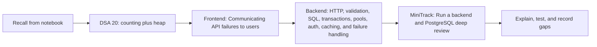
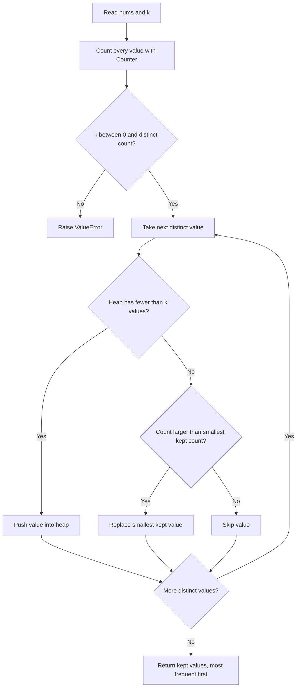
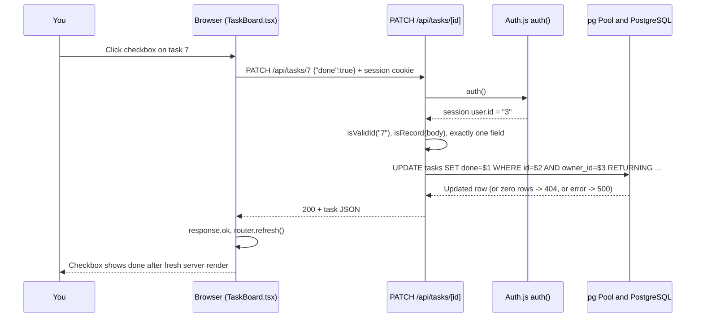

# Prep Day 20 — Run a backend and PostgreSQL deep review

**Date:** Thursday, December 17, 2026  
**Time:** 7 study hours plus breaks  
**Starting point:** App Days 1–4 are complete. Continue from the current learner workspace and the previous preparation-day exit checklist.  
**Goal:** Run a backend and PostgreSQL deep review.

[Prep Day 19](prep-day-19.md) · [Preparation plan](../../docs/FULL_STACK_INTERVIEW_PREP_PLAN.md) · [Track home](README.md) · [Prep Day 21](prep-day-21.md)

**Everything to read today is below.** The original
[interview index](../../docs/INTERVIEW_INDEX.md),
[app architecture](../../docs/ARCHITECTURE.md),
[App Day 3](../day-03.md), [App Day 5](../day-05.md),
[App Day 6](../day-06.md), [App Day 10](../day-10.md),
[App Day 11](../day-11.md), and
[DSA Day 20](../../dsa-python/lessons/dsa-day-20.md) remain available for
comparison. Today is a **review day: there is no new feature code**. You
re-read, trace, and explain the backend code you already built. The frontend
concept review was Prep Day 19; system design and scaling belong to Prep
Day 21; the full four-part mock belongs to Prep Day 22. Write runnable code
only in the named practice file, not in this Markdown file.

## Learning objectives

- explain communicating API failures to users in beginner-friendly language;
- explain HTTP, validation, SQL, transactions, pools, auth, caching, and failure handling and its failure boundary;
- implement or verify the listed MiniTrack milestone;
- solve DSA Day 20 using the counting plus heap pattern;
- record the result in your rough notebook and explain it without reading.

## 1. Start with notebook recall (45 minutes)

Before opening a lesson, write answers in
[`checkpoints/ROUGH/Notes.md`](../../checkpoints/ROUGH/Notes.md):

1. What did yesterday's browser action send to the server?
2. Where is persistent task data stored, and what state is only temporary?
3. What error or edge case can you already predict for today's topic?
4. What do you remember about the **counting plus heap** pattern?

Use this format:

```md
## Thursday, December 17, 2026

- What:
- Why:
- How MiniTrack uses it:
- What can go wrong:
- First task:
```

Do not copy the source paragraph. Write what you remember, then compare.

## 2. Understand today's full-stack boundary (20 minutes)

**Frontend focus — Communicating API failures to users:** The UI needs stable status and error information, but it should not display stack traces, SQL text, or secrets. Map technical failures to actionable user states.

**Backend focus — HTTP, validation, SQL, transactions, pools, auth, caching, and failure handling:** A backend request crosses trust boundaries: validate input, authenticate identity, authorize the resource, perform a bounded data operation, log internal failure safely, and return a deliberate response.

**Today's connection:** Backend reliability comes from explicit contracts and bounded behavior at every trust and resource boundary.



## 3. Python DSA practice (1 hour 45 minutes)

**Practice file:** [`dsa-python/practice/day-20.py`](../../dsa-python/practice/day-20.py)  
**Pattern:** counting plus heap

### Problem: Top K Frequent Elements

Given a list of values `nums` and a whole number `k`, return the `k` values
that appear most often. The result is ordered from most frequent to less
frequent; when two values have the same count, either may come first.
Assumptions used by this course:

- values are hashable (numbers or strings);
- `k` must be between `0` and the number of **distinct** values; otherwise
  the function raises `ValueError('k out of range')`;
- `k = 0` returns an empty list.

```python
solve([1, 1, 1, 2, 2, 3], 2)  # [1, 2]
solve([4, 4, 4], 1)           # [4]
```

The simple approach counts each distinct value separately and then sorts all
of them by count. A faster approach counts everything in **one pass** and then
keeps only the best `k` values in a small **heap**.

### Start coding

In the practice file, replace the `raise NotImplementedError` line with your
own implementation. This is the starting shape:

```python
def solve(nums, k):
    # Return the k most frequent values, most frequent first.
    raise NotImplementedError
```

Three Python helpers make this short. Learn them first:

1. **`Counter`** (from `collections`) counts values for you.
   `Counter([1, 1, 2])` produces `Counter({1: 2, 2: 1})`. It behaves like a
   dictionary: `len(...)` is the number of distinct values, and looping over it
   gives the distinct values (the keys).
2. **`frequency.get`** is a function you can pass around. If
   `frequency = Counter([1, 1, 2])`, then `frequency.get(1)` returns `2`.
3. **`heapq.nlargest(k, items, key=some_function)`** returns the `k` items with
   the largest `some_function(item)`, largest first. Internally it keeps a
   **min-heap** of size `k`: a list arranged so the smallest kept item is
   always at the front and can be replaced in O(log k) time.



### Invariant to say aloud

Count frequencies first, then use a heap or bucket strategy to select the k most frequent values.

More precisely: after processing some distinct values, the size-`k` heap holds
the `k` most frequent values **seen so far**, and its front is the weakest of
them.

### Work in this order

1. Restate the problem and ask about constraints.
2. Give a brute-force approach and its cost before optimizing.
3. Write the invariant above in your own words.
4. Implement without opening the solution for 25 minutes.
5. Test empty, smallest, typical, duplicate, and boundary cases where relevant.
6. Use a small hint if blocked; do not spend the entire block stuck.
7. Compare with the commented reference and re-code the key loop from memory.

From the repository root:

```bash
python3 dsa-python/scripts/check_practice.py 20
python3 -m unittest discover -s dsa-python/tests -v
```

**Expected observation:** the day-specific checker accepts your implementation,
and the completed reference suite still passes. The checker compares exact
lists, so return the most frequent value first. Its two examples have no ties;
they do not test every possible input.

You can also temporarily add these checks below your `solve` function in the
practice file, then run `python3 dsa-python/practice/day-20.py`:

```python
if __name__ == '__main__':
    assert solve([1, 1, 1, 2, 2, 3], 2) == [1, 2]
    assert solve([4, 4, 4], 1) == [4]
    assert solve([5, 6, 5], 0) == []
    assert solve([], 0) == []
    assert solve([-1, -1, 2], 1) == [-1]
    assert sorted(solve([7, 8], 2)) == [7, 8]  # A tie may come back in any order.
    try:
        solve([1, 2], 3)  # Only two distinct values exist.
    except ValueError:
        pass
    else:
        raise AssertionError('expected ValueError when k is too large')
    print('All checks passed')
```

### Brute-force code — reveal after attempting

<details>
<summary>Show the simple solution</summary>

```python
def solve(nums, k):
    distinct = []
    for value in nums:
        if value not in distinct:  # Linear search: O(number of distinct values).
            distinct.append(value)
    if not (0 <= k <= len(distinct)):
        raise ValueError('k out of range')
    # Count each distinct value by scanning the whole list again.
    pairs = [(nums.count(value), value) for value in distinct]
    # Sort by count, largest first. `lambda pair: pair[0]` means "use the count".
    pairs.sort(key=lambda pair: pair[0], reverse=True)
    return [value for _, value in pairs[:k]]
```

</details>

With `n` values and `u` distinct values, finding distinct values and calling
`nums.count` once per distinct value each cost O(n × u), and sorting costs
O(u log u). The worst case (all values distinct) is O(n²) time. Extra space is
O(u).

### Optimized code — reveal after attempting

<details>
<summary>Show the Top K Frequent solution</summary>

```python
from collections import Counter
import heapq

def solve(nums, k):
    frequency = Counter(nums)  # value -> how many times it appears
    if not (0 <= k <= len(frequency)):
        raise ValueError('k out of range')
    # nlargest keeps a size-k heap; values with tied counts may be chosen in any order.
    return heapq.nlargest(k, frequency, key=frequency.get)
```

</details>

Counting is one pass over `nums`: O(n) expected time. Selecting with a size-`k`
heap processes `u` distinct values at O(log k) each. Total: **O(n + u log k)**
time and **O(u + k)** extra space.

Trace for `solve([1, 1, 1, 2, 2, 3], 2)`. After counting,
`frequency = {1: 3, 2: 2, 3: 1}`. The heap below is shown as
`value:count`, with the weakest kept value first:

| Step | Distinct value | Count | Heap before | Action | Heap after |
|---:|---:|---:|---|---|---|
| 1 | 1 | 3 | `[]` | Fewer than 2 kept; push | `[1:3]` |
| 2 | 2 | 2 | `[1:3]` | Fewer than 2 kept; push | `[2:2, 1:3]` |
| 3 | 3 | 1 | `[2:2, 1:3]` | 1 is not larger than weakest count 2; skip | `[2:2, 1:3]` |
| End | — | — | — | Return strongest first | `[1, 2]` |

### DSA interview questions and answers

#### DSA Q1. What is the brute-force approach?

**Interview-ready answer:** “For each distinct value I count how often it
appears by scanning the list, then I sort the distinct values by count and
take the first k. Scanning once per distinct value makes it O(n × u), which is
O(n²) when every value is distinct.”

**Example:** For `[1, 1, 1, 2, 2, 3]`, the counts are `(3, 1)`, `(2, 2)`, and
`(1, 3)`. Sorting by count and taking two returns `[1, 2]`.

**Follow-up:** The first easy improvement is to count everything in one pass
with a dictionary. Then only the selection step remains.

#### DSA Q2. Why combine counting with a heap?

**Interview-ready answer:** “Counting answers *how often*; the heap answers
*which k are best* without sorting everything. I keep a min-heap of at most k
values, so the weakest kept value is at the front. A new value enters only if
its count beats that weakest one.”

**Example:** With `k = 2` and counts `{1: 3, 2: 2, 3: 1}`, the heap keeps
`1` and `2`; value `3` with count 1 cannot beat the weakest kept count 2.

**Follow-up:** Why a *min*-heap for the *largest* counts? Because the
decision each step is “should I evict the weakest kept value?”, so the weakest
must be cheap to find.

#### DSA Q3. Why is the answer correct?

**Interview-ready answer:** “The invariant is: after processing some distinct
values, the heap contains the k most frequent of those values. A value that is
skipped or evicted has a count no larger than k other values already seen, so
it can never be in the final top k. When every value is processed, the heap
holds the top k overall.”

**Example:** Value `3` is skipped because two values, `1` and `2`, already
beat it.

**Follow-up:** With ties, several answers are correct. Tests should compare
sets or sort the result unless the problem defines a tie-break rule.

#### DSA Q4. What are the time and space costs?

**Interview-ready answer:** “Counting is O(n) expected time. The heap step
processes u distinct values at O(log k) each, so the total is O(n + u log k).
Extra space is O(u) for the counts plus O(k) for the heap.”

**Example:** For one million values with only ten distinct values, the heap
work is tiny; counting dominates.

**Follow-up:** O(n) counting assumes average O(1) hashing; heavy collisions can
degrade it. When `k` is close to `u`, simply sorting all counts in
O(u log u) is just as good and simpler; `heapq.nlargest` itself switches to
sorting when `k` is large.

#### DSA Q5. What edge cases should I test?

**Interview-ready answer:** “I test k equal to zero, k equal to the number of
distinct values, k larger than that, an empty list, a single repeated value,
negative numbers, and ties.”

**Example:** `solve([5, 6, 5], 0)` returns `[]`; `solve([1, 2], 3)` raises
`ValueError`; `solve([7, 8], 2)` may return `[7, 8]` or `[8, 7]`.

**Follow-up:** Ask whether an invalid `k` should raise an error, return as many
values as exist, or be impossible by contract. This implementation raises.

#### DSA Q6. How would you reach expected O(n) time?

**Interview-ready answer:** “I use bucket sort. A value can appear at most n
times, so I create buckets indexed by count, put each value in the bucket for
its count, and walk the buckets from high to low until I have k values.”

**Example:**

```python
from collections import Counter

def solve_buckets(nums, k):
    frequency = Counter(nums)
    buckets = [[] for _ in range(len(nums) + 1)]  # index = count
    for value, count in frequency.items():
        buckets[count].append(value)
    result = []
    for count in range(len(nums), 0, -1):
        for value in buckets[count]:
            if len(result) == k:
                return result
            result.append(value)
    return result
```

**Follow-up:** The same question appears in MiniTrack terms as “show the
k most common words in a user's task titles.” In PostgreSQL that would be a
`GROUP BY ... ORDER BY count(*) DESC LIMIT $1` query scoped by `owner_id`, so
the database counts and only k rows leave it.

## 4. Frontend guided study (1 hour 30 minutes)

### What

The UI needs stable status and error information, but it should not display stack traces, SQL text, or secrets. Map technical failures to actionable user states.

### Why

The browser layer should make state and feedback understandable without taking
ownership of persistent data or security decisions that belong on the server.

### How: review the existing error handling

Before reading the code, sketch on paper: the component state, the user event,
the request, the success result, and the failure result for **toggling a
task**.

This is the existing App Day 5 handler in `frontend/app/TaskBoard.tsx`. Do not
change it today; read it and explain each branch:

```tsx
async function toggleTask(taskId: string, done: boolean) {
  setBusy(true);
  setError('');

  try {
    const response = await fetch(`/api/tasks/${taskId}`, {
      method: 'PATCH',
      headers: { 'Content-Type': 'application/json' },
      body: JSON.stringify({ done }),
    });

    // fetch() resolves for 4xx and 5xx responses, so check ok explicitly.
    if (!response.ok) {
      setError(`Could not update task (${response.status})`);
      setBusy(false);
      return;
    }

    router.refresh(); // Ask the Server Component to re-read PostgreSQL.
    setBusy(false);
  } catch {
    // fetch() rejects only when no HTTP response arrived (for example offline).
    setError('Could not connect to the server');
    setBusy(false);
  }
}
```

The message is rendered in an accessible live region, so screen readers
announce it without moving focus:

```tsx
{error && <p role="alert" className="mt-3 text-rose-300">{error}</p>}
```

Three facts to say aloud:

1. **`fetch()` does not throw for HTTP errors.** A `404` or `500` still
   resolves; only `response.ok` (status 200–299) means success.
2. **The UI shows a status number, not the server's internal error.** The
   server's JSON body is a short public message such as
   `{ "error": "Internal server error" }`; the real cause stays in server logs.
3. **On failure, nothing is refreshed.** The previous task list stays on screen,
   which is the truth because PostgreSQL did not change.

### Map each technical failure to a user state

| What happened | Status the browser sees | What the user should be able to do |
|---|---|---|
| Blank or 201-character title | `400` | Fix the input; keep the typed text |
| Session expired or signed out | `401` | Sign in again |
| Task deleted in another tab, or not owned | `404` | Refresh the list; the task is gone |
| PostgreSQL down or a bug | `500` | Try again later; nothing was saved |
| Wi-Fi off, server not running | no response (`catch`) | Check connection; retry |

### Review finding to discuss (do not change code today)

App Day 4's page renders `Could not load tasks: {error}` using
`err.message`. That is helpful while learning locally, but a raw
PostgreSQL or connection message can reveal internal details in production.
Be ready to say: “Locally I show the message to debug; in production I would
show a generic message and log the details with a request ID on the server.”

Files to open deliberately:

- `frontend/app/TaskBoard.tsx`
- `frontend/app/api/tasks/route.ts`
- `frontend/app/api/tasks/[id]/route.ts`
- `frontend/lib/tasks.ts`
- `frontend/lib/db.ts`
- `backend/sql/schema.sql`

Answer before moving on:

- Which value is persistent, and which value is temporary interaction state?
- What starts this behavior?
- What should the user see while work is pending?
- What should remain unchanged when the operation fails?

## 5. Backend guided study (1 hour 30 minutes)

### What

A backend request crosses trust boundaries: validate input, authenticate identity, authorize the resource, perform a bounded data operation, log internal failure safely, and return a deliberate response.

### Boundary checklist

- Validate untrusted path, query, and body values.
- Authenticate identity when the route is protected.
- Authorize the resource separately from authentication.
- Bind SQL values rather than concatenating untrusted data.
- Return an explicit success or error status.
- Log internal failures on the server without exposing secrets.

Review one topic at a time. For each, cover the code, say what it does, then
uncover it and compare.

### 5.1 HTTP: the MiniTrack status contract

| Request | Success | Client error | Server error |
|---|---|---|---|
| `GET /api/tasks?q=&status=` | `200` + task array | `401` anonymous | `500` |
| `POST /api/tasks` `{ "title": "..." }` | `201` + created task | `400` invalid JSON/title, `401` | `500` |
| `PATCH /api/tasks/:id` `{ "done": true }` or `{ "title": "..." }` | `200` + updated task | `400`, `401`, `404` not found or not owned | `500` |
| `DELETE /api/tasks/:id` | `200` + `{ "deleted": true }` | `400`, `401`, `404` | `500` |
| `GET /api/health` | `200` + `{ "ok": true }` | — | — |

`201 Created` tells the client a new resource exists. `404` for another user's
task is deliberate: it does not reveal that the ID exists.

### 5.2 Validation: `frontend/lib/validation.ts`

These are the App Day 5 validation helpers (App Day 8 later added
`normalizeTaskFilters` for search parameters):

```ts
export function normalizeTitle(value: unknown): string | null {
  if (typeof value !== 'string') return null;
  const title = value.trim();
  return title.length >= 1 && title.length <= 200 ? title : null;
}

export function isValidId(raw: string): boolean {
  // Positive whole number without leading zeros, small enough to be exact in JavaScript.
  return /^[1-9]\d*$/.test(raw) && Number.isSafeInteger(Number(raw));
}

export function isRecord(value: unknown): value is Record<string, unknown> {
  return typeof value === 'object' && value !== null && !Array.isArray(value);
}
```

Why validate on the server when the input already has `maxLength={200}`?
Because anyone can send HTTP directly with `curl`; browser checks are for
convenience, server checks are for correctness. The database adds a third
line of defense: `CHECK (char_length(title) BETWEEN 1 AND 200)`.

### 5.3 SQL: every pattern MiniTrack uses

The schema from App Day 3 (`backend/sql/schema.sql`), plus the App Day 11
migration (`backend/sql/migrations/003-task-owners.sql`):

```sql
CREATE TABLE IF NOT EXISTS tasks (
  id BIGINT GENERATED ALWAYS AS IDENTITY PRIMARY KEY,
  title TEXT NOT NULL CHECK (char_length(title) BETWEEN 1 AND 200),
  done BOOLEAN NOT NULL DEFAULT FALSE,
  created_at TIMESTAMPTZ NOT NULL DEFAULT now()
);

-- App Day 11, inside BEGIN ... COMMIT:
ALTER TABLE tasks
ADD COLUMN owner_id INTEGER NOT NULL
REFERENCES users(id)
ON DELETE CASCADE;

CREATE INDEX tasks_owner_id_id_idx
ON tasks (owner_id, id);
```

The owner-scoped queries after App Day 11. Every value is a numbered
placeholder (`$1`, `$2`, ...) and is sent separately from the SQL text:

```sql
-- List and search (App Days 8 + 11): $1 owner, $2 escaped pattern, $3 status
SELECT id, title, done, created_at
FROM tasks
WHERE owner_id = $1
  AND title ILIKE $2 ESCAPE '\'
  AND ($3::text = 'all' OR done = ($3::text = 'done'))
ORDER BY id;

-- Create (App Day 11): $1 owner, $2 title
INSERT INTO tasks (owner_id, title)
VALUES ($1, $2)
RETURNING id, title, done, created_at;

-- Rename (App Days 6 + 11): $1 title, $2 task ID, $3 owner
UPDATE tasks
SET title = $1
WHERE id = $2 AND owner_id = $3
RETURNING id, title, done, created_at;

-- Complete and delete follow the same "id AND owner_id" rule.
```

In the TypeScript files, the search predicate is written as `ESCAPE '\\'`
because a JavaScript template string turns `\\` into one backslash.

- **`$1` placeholders** stop SQL injection through values. They do **not**
  remove the wildcard meaning of `%` and `_` inside `ILIKE`; that is why
  App Day 8 escapes them first with `escapeLike`.
- **`RETURNING`** returns the exact saved row in the same round trip.
- **`AND owner_id = $n`** puts authorization inside the database operation.
  Another user's task simply matches zero rows.

### 5.4 Connection pool: `frontend/lib/db.ts`

```ts
import 'server-only';
import { Pool } from 'pg';

// Cache the pool across Next.js development reloads.
const globalForPg = globalThis as typeof globalThis & { taskPool?: Pool };

export function getPool(): Pool {
  const connectionString = process.env.DATABASE_URL;
  if (!connectionString) {
    throw new Error('DATABASE_URL is missing. Copy frontend/.env.local.example to .env.local and edit it.');
  }
  // Reuse a bounded number of connections instead of reconnecting per request.
  globalForPg.taskPool ??= new Pool({ connectionString, max: 5 });
  return globalForPg.taskPool;
}
```

- `import 'server-only'` makes the build fail if a Client Component imports
  this file, so credentials never reach the browser.
- `max: 5` means at most five queries run at once **per Node process**. The
  sixth waits in the pool's queue. Waiting is backpressure, not failure — but
  without a timeout, a slow database turns into slow pages.
- **Connection budget:** app instances × pool `max` + migrations + admin tools
  must stay below PostgreSQL's connection limit. Ten instances × 5 = 50.

### 5.5 Transactions and indexes

- **Transaction:** a group of statements that succeed or fail together.
  MiniTrack's request handlers each run **one** SQL statement, and PostgreSQL
  already makes a single statement atomic, so the app needs no explicit
  `BEGIN`. The App Day 11 migration uses `BEGIN ... COMMIT` because deleting
  sample rows, adding the column, and creating the index must not half-apply.
- **When would a request need a transaction?** When two writes must agree, for
  example “move a task to another list and update both list counters”. Then you
  would take one client from the pool, run `BEGIN`, the statements, and
  `COMMIT`, or `ROLLBACK` on error, and always release the client.
- **Indexes today:** the primary key on `id`, and `(owner_id, id)` which serves
  “this owner's tasks ordered by id” and “this owner's task with this id”.
- **Not indexed yet:** `title ILIKE '%term%'`. A normal B-tree cannot use a
  leading wildcard. Measure with `EXPLAIN (ANALYZE, BUFFERS)` before adding a
  trigram index (Prep Day 21 covers measurement).

### 5.6 Authentication and authorization

Every task Route Handler starts by asking Auth.js who the caller is
(App Days 10–11):

```ts
const session = await auth();
if (!session?.user?.id) {
  return Response.json({ error: 'Unauthorized' }, { status: 401 });
}
```

- **Authentication** = who are you? (`auth()` verifies the signed session cookie.)
- **Authorization** = may you touch *this* task? (`owner_id` in the SQL predicate.)
- The owner ID **always** comes from `session.user.id`, never from request JSON,
  the URL, or a header.

### 5.7 Caching

- The collection `GET` (App Day 3) sends `Cache-Control: no-store` so browsers
  and proxies do not keep private task lists.
- App Day 10: `auth()` reads cookies, so the task list is request-time work. Do
  not mark private session output with `"use cache"`.
- `router.refresh()` is **not** a cache. It asks the server to render again,
  which re-runs the owner-scoped `SELECT`.
- A shared cache such as Redis is not part of MiniTrack. If measurement ever
  justified one, its keys would have to include the owner ID and be invalidated
  on every mutation (Prep Day 21).

### 5.8 Failure handling

```ts
} catch (error: unknown) {
  console.error('POST /api/tasks failed:', error); // Full detail stays in server logs.
  return Response.json({ error: 'Internal server error' }, { status: 500 });
}
```

- The client receives a stable, generic message; the log keeps the detail.
- Never log secrets, cookies, or `DATABASE_URL`.
- `POST` is **not idempotent**: retrying an uncertain create can insert twice.
  Safe retries need an idempotency key stored with a unique constraint.

## 6. MiniTrack implementation (1 hour)

**Milestone source:** Backend review across Days 1–15

There is no new code today. The three tasks are tracing, recall, and a speed
round.

### Step 1: Trace POST line by line

This is the collection `POST` handler in `frontend/app/api/tasks/route.ts`
after App Days 10–11 (App Day 3's handler plus the session check and owner).
Compare it with your file; do not paste over your file.

```ts
import { auth } from '@/auth';
import { createTask } from '../../../lib/tasks';
import { isRecord, normalizeTitle } from '../../../lib/validation';

export async function POST(request: Request): Promise<Response> {
  // 1. Authenticate: who is calling?
  const session = await auth();
  if (!session?.user?.id) {
    return Response.json({ error: 'Unauthorized' }, { status: 401 });
  }

  // 2. Parse: network JSON is untrusted, so keep it unknown until validated.
  let parsingBody = true;
  try {
    const body: unknown = await request.json();
    parsingBody = false;
    // 3. Validate: a trimmed string of 1–200 characters.
    const title = normalizeTitle(isRecord(body) ? body.title : undefined);
    if (!title) {
      return Response.json({ error: 'title must be 1–200 characters' }, { status: 400 });
    }

    // 4. Persist with the owner from the verified session, then 5. respond.
    return Response.json(await createTask(session.user.id, title), { status: 201 });
  } catch (error: unknown) {
    if (parsingBody) {
      return Response.json({ error: 'Invalid JSON' }, { status: 400 });
    }
    console.error('POST /api/tasks failed:', error);
    return Response.json({ error: 'Internal server error' }, { status: 500 });
  }
}
```

The data function in `frontend/lib/tasks.ts` (App Day 11, keeping App Day 3's
missing-row guard):

```ts
export async function createTask(ownerId: string, title: string): Promise<Task> {
  const result = await getPool().query<TaskRow>(
    `
      INSERT INTO tasks (owner_id, title)
      VALUES ($1, $2)
      RETURNING id, title, done, created_at
    `,
    [ownerId, title],
  );
  const row = result.rows[0];
  if (!row) throw new Error('Inserted task was not returned by PostgreSQL');
  return toTask(row); // Date -> ISO string for JSON.
}
```

Fill in this table in your notebook **without looking**, then compare:

| Line | Boundary | Possible failure | Response |
|---|---|---|---|
| `await auth()` | Identity | No or expired cookie | `401` |
| `await request.json()` | Untrusted input | Body is not JSON | `400` |
| `normalizeTitle(...)` | Validation | Blank, too long, not a string | `400` |
| `createTask(session.user.id, title)` | Data layer + pool | PostgreSQL down, pool timeout | `500`, logged |
| `INSERT ... RETURNING` | Database | `CHECK` violation (should be impossible after validation) | `500`, logged |
| `Response.json(..., { status: 201 })` | HTTP contract | — | `201` + task |

### Step 2: Trace PATCH line by line

The item handler in `frontend/app/api/tasks/[id]/route.ts` combines App Day 5
(ID check, completion), App Day 6 (exactly one field), and App Days 10–11
(session and owner). `DELETE` follows the same pattern.

```ts
import { auth } from '@/auth';
import type { Task } from '../../../types';
import { renameTask, setDone } from '../../../../lib/tasks';
import { isRecord, isValidId, normalizeTitle } from '../../../../lib/validation';

type RouteContext = { params: Promise<{ id: string }> };

export async function PATCH(request: Request, { params }: RouteContext): Promise<Response> {
  const session = await auth();
  if (!session?.user?.id) {
    return Response.json({ error: 'Unauthorized' }, { status: 401 });
  }
  const ownerId = session.user.id;

  // Next.js provides dynamic route params as a Promise.
  const { id } = await params;
  if (!isValidId(id)) {
    return Response.json({ error: 'Invalid task ID' }, { status: 400 });
  }

  let parsingBody = true;
  try {
    const body: unknown = await request.json();
    parsingBody = false;
    if (!isRecord(body)) {
      return Response.json({ error: 'Provide either done or title' }, { status: 400 });
    }

    const hasDone = Object.hasOwn(body, 'done');
    const hasTitle = Object.hasOwn(body, 'title');
    // Both true or both false means the request contract is ambiguous.
    if (hasDone === hasTitle) {
      return Response.json({ error: 'Provide either done or title' }, { status: 400 });
    }

    let updateTask: () => Promise<Task | null>;
    if (hasTitle) {
      const title = normalizeTitle(body.title);
      if (!title) {
        return Response.json({ error: 'title must be 1–200 characters' }, { status: 400 });
      }
      updateTask = () => renameTask(ownerId, id, title);
    } else if (typeof body.done === 'boolean') {
      const done = body.done;
      updateTask = () => setDone(ownerId, id, done);
    } else {
      return Response.json({ error: 'done must be boolean' }, { status: 400 });
    }
    const task = await updateTask();
    // null means "no row with this id AND this owner": not found, not an exception.
    return task
      ? Response.json(task)
      : Response.json({ error: 'Task not found' }, { status: 404 });
  } catch (error: unknown) {
    if (parsingBody) {
      return Response.json({ error: 'Invalid JSON' }, { status: 400 });
    }
    console.error(`PATCH /api/tasks/${id} failed:`, error);
    return Response.json({ error: 'Internal server error' }, { status: 500 });
  }
}
```

The completion data function, owner-scoped the same way App Day 11 scopes
`renameTask`:

```ts
export async function setDone(ownerId: string, id: string, done: boolean): Promise<Task | null> {
  const result = await getPool().query<TaskRow>(
    `
      UPDATE tasks
      SET done = $1
      WHERE id = $2 AND owner_id = $3
      RETURNING id, title, done, created_at
    `,
    [done, id, ownerId],
  );
  const row = result.rows[0];
  return row ? toTask(row) : null;
}
```

Say aloud what each of these requests returns and **which line decides it**:

| Request | Status | Deciding line |
|---|---:|---|
| No cookie, `PATCH /api/tasks/7` `{ "done": true }` | 401 | `!session?.user?.id` |
| Signed in, `PATCH /api/tasks/abc` | 400 | `!isValidId(id)` |
| Signed in, body `{ "title": "x", "done": true }` | 400 | `hasDone === hasTitle` |
| Signed in, body `{ "done": "yes" }` | 400 | `typeof body.done === 'boolean'` fails |
| Signed in as User B, task 42 owned by User A | 404 | `UPDATE` matches zero rows |
| Signed in, own task 7, `{ "done": true }` | 200 | `Response.json(task)` |

### Step 3: Write the SQL patterns from memory

On a blank notebook page, write the list, create, rename, complete, and delete
queries. For **every** placeholder, write what value fills it and where that
value came from (session, URL, or validated body). Compare with section 5.3.

### Step 4: Answer 20 backend questions aloud

Set a timer for 40 minutes (about two minutes per question). Answer aloud, then
reveal the model answers. Mark each as ✅ confident, 🟡 partial, or ❌ missed,
and repair the weakest three by rereading the matching part of section 5.

1. Why does `POST /api/tasks` return `201` instead of `200`?
2. What is the difference between `400`, `404`, and `500` in MiniTrack?
3. What is the difference between `401` and `403`, and why does MiniTrack return `404` for another user's task?
4. Why is the request body typed as `unknown`?
5. Why validate the title on the server if the input has `maxLength`?
6. Why use `$1` instead of a template string in SQL?
7. Does parameterization make `%` and `_` safe inside `ILIKE`?
8. Why use `RETURNING`?
9. Why use a connection pool, and what does `max: 5` mean?
10. What happens when every pooled connection is busy?
11. Why can adding app instances overload PostgreSQL?
12. Which indexes does MiniTrack have, and why not index every column?
13. What is a transaction, and where does MiniTrack use one?
14. What is authentication versus authorization?
15. Where must the owner ID come from?
16. What is IDOR, and how does MiniTrack prevent it?
17. Why `Cache-Control: no-store`, and why not `"use cache"` for task lists?
18. Is retrying a failed `POST` safe?
19. What should happen when PostgreSQL is unavailable?
20. Does `await pool.query(...)` block the Node.js server?

<details>
<summary>Show model answers</summary>

1. `201 Created` says a new resource now exists and the body is that resource;
   `200` would be a generic success.
2. `400`: the request itself is invalid (bad JSON, bad ID, bad title). `404`:
   valid request but no matching task for this owner. `500`: unexpected server
   or database failure; the client should retry later, not change input.
3. `401` means no valid authentication; `403` means known identity without
   permission. MiniTrack's owner-scoped `UPDATE` matches zero rows for another
   user's task and returns `404`, which avoids revealing that ID 42 exists.
4. JSON from the network can be any shape. `unknown` forces narrowing with
   `isRecord` and `typeof` before reading properties.
5. Any client can bypass the browser with `curl`. Browser checks are UX; server
   checks are correctness; the database `CHECK` is the last line.
6. Placeholders send values separately from SQL syntax, so a title like
   `'); DROP TABLE tasks; --` is stored as text, never executed.
7. No. Parameters stop injection, but `%` and `_` are still wildcards inside the
   pattern. `escapeLike` escapes them, and `ESCAPE '\'` tells PostgreSQL which
   escape character is used.
8. It returns the saved row (generated `id`, default `done`, `created_at`) in the
   same round trip, without a racy second `SELECT`.
9. Opening a PostgreSQL connection is expensive; a pool reuses a few. `max: 5`
   caps concurrent connections per Node process.
10. Extra queries wait in the pool queue. Latency rises; with a timeout they fail
    with an explicit error instead of hanging.
11. Each instance has its own pool. 20 instances × 20 connections = 400
    connections, which can exceed the database limit.
12. The primary key on `id` and `(owner_id, id)`. Every index costs storage and
    slows writes, so add one only after `EXPLAIN (ANALYZE, BUFFERS)` shows a
    need.
13. A group of statements that commit or roll back together. Each MiniTrack
    request is one atomic statement; the App Day 11 migration uses
    `BEGIN ... COMMIT`.
14. Authentication proves who you are (Auth.js session). Authorization decides
    which rows you may touch (`owner_id` predicate).
15. From the verified server session (`session.user.id`), never from the body,
    URL, or headers, which the client controls.
16. Insecure direct object reference: changing an ID to reach someone else's
    object. `WHERE id = $2 AND owner_id = $3` makes it impossible in one atomic
    query.
17. Task lists are private and change often. `no-store` stops shared caches
    from keeping them; `"use cache"` on cookie-dependent output could serve one
    user's data to another.
18. Not blindly. The first attempt may have committed before the connection
    failed, so a retry can duplicate the task. Use an idempotency key or retry
    only idempotent operations.
19. The data call rejects; the handler logs the error server-side and returns a
    generic `500` (or `503`). The UI shows a retry message and does not pretend
    the change was saved.
20. No. `await` pauses only that request's function; the event loop keeps
    serving other requests while PostgreSQL works.

</details>

### Step 5: Run the existing checks

From the repository root:

```bash
cd frontend
npm run test:unit
npm run test:integration
npx tsc --noEmit
```

Then, with `npm run dev` running, check the anonymous boundary from a second
terminal (plain `curl` sends no browser cookie):

```bash
curl -i http://localhost:3000/api/tasks
curl -i -X PATCH http://localhost:3000/api/tasks/1 \
  -H 'Content-Type: application/json' -d '{"done":true}'
```

**Expected observation:** both `curl` requests return `401` with
`{"error":"Unauthorized"}`; the tests and type check pass. In the signed-in
browser, open DevTools → Network, toggle a task, and confirm the `PATCH`
returns `200` with the updated task JSON.

**Failure check:** stop PostgreSQL the way you started it (for example, find
the service name with `brew services list` and stop it), then toggle a task in
the browser. Expect `Could not update task (500)` on screen, a
`PATCH /api/tasks/... failed:` line in the Next.js terminal, and no SQL text in
the browser. Restart PostgreSQL afterwards.

## 7. Trace the event or request



Trace one concrete input. Name every boundary, value, and possible failure.

## 8. Deliberate debugging exercise (25 minutes)

**Break it:** Retry every failed POST automatically.

**Predict before running:** write the expected symptom in your notebook.

**Expected symptom:** An uncertain first request may have committed, so a retry can create a duplicate.

**Root cause:** A non-idempotent operation was retried without deduplication.

**Restore and verify:** Use an idempotency key or limit retries to failures and operations with safe semantics.

Do not stop after making the symptom disappear. Explain why the repair restores
the intended invariant.

## 9. Interview questions and answers (30 minutes)

### Q1. What is communicating api failures to users?

**Interview-ready answer:** “I check `response.ok`, because `fetch` resolves
for 4xx and 5xx. I map each class of failure to something the user can act
on — fix the input, sign in again, refresh, or retry later — and I never show
stack traces or SQL. The server returns a short public message and logs the
detail.”

**Example:** In `frontend/app/TaskBoard.tsx`, `toggleTask` sets
`Could not update task (500)` when PostgreSQL is down, and the `catch` branch
sets `Could not connect to the server` when no response arrives. The message
renders in `<p role="alert">`, and the old task list stays visible because
nothing was refreshed.

**Senior follow-up:** Showing only a status code is fine for a learning app.
At scale I would return a stable machine-readable error code plus a request ID,
so support can find the server log line without the UI exposing internals.

### Q2. How should the backend handle http, validation, sql, transactions, pools, auth, caching, and failure handling?

**Interview-ready answer:** “Each Route Handler authenticates with `auth()`,
parses JSON as `unknown`, validates the ID and body, calls a data function that
runs parameterized SQL scoped by `owner_id`, and maps the outcome to `200`,
`201`, `400`, `401`, `404`, or `500`. Unexpected errors are logged on the
server, and the client gets a generic message.”

**Example:** `PATCH /api/tasks/7 {"done":true}` → `auth()` gives owner `3` →
`isValidId('7')` → `setDone('3', '7', true)` runs
`UPDATE ... WHERE id = $2 AND owner_id = $3 RETURNING ...` → `200` with the
row, or `404` if zero rows matched.

**Senior follow-up:** If PostgreSQL is unavailable, the pool call rejects and
the handler returns `500`. The log must not include cookies, `DATABASE_URL`, or
task text. Adding a pool acquisition timeout turns a hanging request into a
fast, explicit failure.

### Q3. What invariant makes the counting plus heap solution correct?

**Interview-ready answer:** “Count frequencies first, then use a heap or
bucket strategy to select the k most frequent values. While scanning distinct
values, the size-k min-heap always holds the k most frequent values seen so
far, with the weakest at the front, so anything skipped or evicted can never be
in the final answer.”

**Example:** For `[1, 1, 1, 2, 2, 3]` and `k = 2`, the counts are
`{1: 3, 2: 2, 3: 1}`. The heap keeps `1:3` and `2:2`; `3:1` cannot beat the
weakest kept count `2`; the result is `[1, 2]`.

**Senior follow-up:** The cost is O(n + u log k) expected time, assuming
average O(1) hashing. If `k` is close to `u`, sorting is equally good. For an
expected O(n) bound, use count buckets.

### Q4. How does today's work fit the complete MiniTrack system?

**Interview-ready answer:** “Backend reliability comes from explicit
contracts and bounded behavior at every trust and resource boundary: the
session for identity, validation for input, `owner_id` in SQL for
authorization, a bounded pool for database load, and stable status codes for
the UI.”

**Example:** A signed-in user clicks a checkbox; `TaskBoard.tsx` sends
`PATCH /api/tasks/7`; the Route Handler authenticates and validates;
`setDone` runs the owner-scoped `UPDATE`; the `200` triggers
`router.refresh()`, which re-runs the owner-scoped `SELECT` and renders the
checked box.

**Senior follow-up:** The first thing I would measure is database time per
request and pool wait time. Those show whether latency comes from slow queries
(fix with indexes or pagination) or too much concurrency for the pool, before
I add any infrastructure.

## 10. Complexity and operational cost

- **DSA:** O(n + u log k) expected time and O(u + k) extra space, where `u` is the number of distinct values; bucket sort reaches expected O(n).
- **Application:** Latency includes queueing, application work, database pool wait, query execution, and network time. Measure the components before scaling.
- **Learning:** Attempting, retrieving, and correcting is more valuable than
  copying several solutions. Keep the scope to one understood pattern today.

## Exit checklist

- [ ] I completed DSA Day 20 before reading its solution.
- [ ] I can state the invariant and complexity without notes.
- [ ] I completed or verified the MiniTrack milestone.
- [ ] I tested one success path and one failure path.
- [ ] I completed the deliberate debugging exercise.
- [ ] I answered all four interview questions aloud.
- [ ] I recorded what remains confusing and tomorrow's first task.

**Suggested commit:** `prep day 20: run a backend and postgresql deep review`
