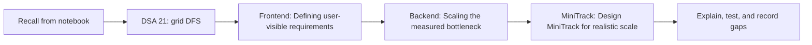
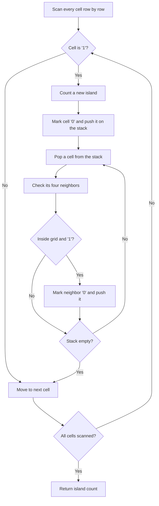
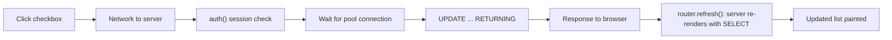
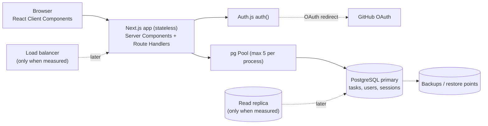

# Prep Day 21 — Design MiniTrack for realistic scale

**Date:** Friday, December 18, 2026  
**Time:** 7 study hours plus breaks  
**Starting point:** App Days 1–4 are complete. Continue from the current learner workspace and the previous preparation-day exit checklist.  
**Goal:** Design MiniTrack for realistic scale.

[Prep Day 20](prep-day-20.md) · [Preparation plan](../../docs/FULL_STACK_INTERVIEW_PREP_PLAN.md) · [Track home](README.md) · [Prep Day 22](prep-day-22.md)

**Everything to read today is below.** The original
[app roadmap](../../docs/APP_BUILD_ROADMAP.md) (including its optional
infrastructure Days 19–25), [app architecture](../../docs/ARCHITECTURE.md),
[App Day 8](../day-08.md), [App Day 11](../day-11.md),
[App Day 15](../day-15.md), and
[DSA Day 21](../../dsa-python/lessons/dsa-day-21.md) remain available for
comparison. Today is a **system-design day: there is no new feature code**.
SQL shown under “design sketch” is for discussion, not for adding to the app.
The line-by-line backend review was Prep Day 20; the timed four-part mock is
Prep Day 22. Write runnable code only in the named practice file, not in this
Markdown file.

## Learning objectives

- explain defining user-visible requirements in beginner-friendly language;
- explain scaling the measured bottleneck and its failure boundary;
- implement or verify the listed MiniTrack milestone;
- solve DSA Day 21 using the grid DFS pattern;
- record the result in your rough notebook and explain it without reading.

## 1. Start with notebook recall (45 minutes)

Before opening a lesson, write answers in
[`checkpoints/ROUGH/Notes.md`](../../checkpoints/ROUGH/Notes.md):

1. What did yesterday's browser action send to the server?
2. Where is persistent task data stored, and what state is only temporary?
3. What error or edge case can you already predict for today's topic?
4. What do you remember about the **grid DFS** pattern?

Use this format:

```md
## Friday, December 18, 2026

- What:
- Why:
- How MiniTrack uses it:
- What can go wrong:
- First task:
```

Do not copy the source paragraph. Write what you remember, then compare.

## 2. Understand today's full-stack boundary (20 minutes)

**Frontend focus — Defining user-visible requirements:** Begin system design with user journeys, scale assumptions, latency expectations, consistency needs, accessibility, and failure behavior before choosing infrastructure.

**Backend focus — Scaling the measured bottleneck:** Start with one stateless application and PostgreSQL. Add indexes, pagination, pool budgets, caching, replicas, load balancing, and observability only when requirements or measurements justify them.

**Today's connection:** System design connects product behavior, data correctness, security, performance, operations, and cost.



## 3. Python DSA practice (1 hour 45 minutes)

**Practice file:** [`dsa-python/practice/day-21.py`](../../dsa-python/practice/day-21.py)  
**Pattern:** grid DFS

### Problem: Number of Islands

A grid is a list of rows; each cell is the **string** `'1'` (land) or `'0'`
(water). An **island** is a group of land cells connected up, down, left, or
right — **not diagonally**. Return how many islands there are.
Assumptions used by this course:

- every row has the same length;
- an empty grid (`[]`) has `0` islands;
- the function may change the grid it receives (it marks visited land as
  `'0'`), so pass a copy if the caller still needs the original.

```python
solve([['1', '1', '0'],
       ['0', '1', '0'],
       ['0', '0', '1']])  # 2
```

The top-left three land cells form one island; the bottom-right cell is a
second island.

### Start coding

In the practice file, replace the `raise NotImplementedError` line with your
own implementation. This is the starting shape:

```python
def solve(grid):
    # Return the number of 4-directionally connected groups of '1' cells.
    raise NotImplementedError
```

Python pieces used below, one at a time:

1. **Rows and columns:** `len(grid)` is the number of rows and `len(grid[0])` is
   the number of columns. `grid[r][c]` is the cell in row `r`, column `c`.
2. **A list as a stack:** `stack.append(item)` puts an item on top and
   `stack.pop()` removes the top item (last in, first out). Exploring with a
   stack is an iterative **depth-first search (DFS)**.
3. **Tuples and unpacking:** `(r, c)` stores a position. `x, y = stack.pop()`
   takes the tuple apart into two variables.
4. **Directions:** `((1, 0), (-1, 0), (0, 1), (0, -1))` means down, up, right,
   and left. Adding `dx, dy` to `x, y` gives a neighbor.
5. **Bounds check:** `0 <= nx < rows` is Python's chained comparison; it is
   true only when `nx` is a valid row index.



### Invariant to say aloud

Visit each land cell once, mark it seen, and recursively or iteratively explore its valid neighbors.

More precisely: a land cell is marked `'0'` **at the moment it is pushed**, so
no cell is pushed twice, and when the stack becomes empty, the whole island
containing the starting cell has been erased.

### Work in this order

1. Restate the problem and ask about constraints.
2. Give a brute-force approach and its cost before optimizing.
3. Write the invariant above in your own words.
4. Implement without opening the solution for 25 minutes.
5. Test empty, smallest, typical, duplicate, and boundary cases where relevant.
6. Use a small hint if blocked; do not spend the entire block stuck.
7. Compare with the commented reference and re-code the key loop from memory.

From the repository root:

```bash
python3 dsa-python/scripts/check_practice.py 21
python3 -m unittest discover -s dsa-python/tests -v
```

**Expected observation:** the day-specific checker accepts your implementation,
and the completed reference suite still passes. The checker has only one
example, so your own edge cases matter today.

You can also temporarily add these checks below your `solve` function in the
practice file, then run `python3 dsa-python/practice/day-21.py`. Each call uses
a fresh grid literal, so marking cells cannot affect the next check:

```python
if __name__ == '__main__':
    assert solve([['1', '1', '0'], ['0', '1', '0'], ['0', '0', '1']]) == 2
    assert solve([]) == 0
    assert solve([['0', '0'], ['0', '0']]) == 0
    assert solve([['1']]) == 1
    assert solve([['1', '0'], ['0', '1']]) == 2  # Diagonal cells are not connected.
    assert solve([['1', '1', '1'], ['0', '1', '0'], ['1', '1', '1']]) == 1
    assert solve([['1', '0', '1', '0', '1']]) == 3
    print('All checks passed')
```

### Brute-force code — reveal after attempting

There is no sensible “slower but simpler” brute force: every correct solution
must look at every cell at least once. The simpler alternative is a
**recursive** DFS that records visited cells in a set and leaves the grid
unchanged.

<details>
<summary>Show the simple recursive solution</summary>

```python
def solve(grid):
    if not grid:
        return 0
    rows, cols = len(grid), len(grid[0])
    seen = set()  # positions already explored

    def explore(r, c):
        if r < 0 or r >= rows or c < 0 or c >= cols:
            return  # outside the grid
        if grid[r][c] != '1' or (r, c) in seen:
            return  # water, or already explored
        seen.add((r, c))
        explore(r + 1, c)
        explore(r - 1, c)
        explore(r, c + 1)
        explore(r, c - 1)

    count = 0
    for r in range(rows):
        for c in range(cols):
            if grid[r][c] == '1' and (r, c) not in seen:
                count += 1
                explore(r, c)
    return count
```

</details>

This is also O(rows × columns) time and O(rows × columns) extra space for the
`seen` set. Its weakness is recursion depth: one long snake-shaped island can
exceed Python's default recursion limit of about 1,000 calls and crash with
`RecursionError`. The iterative stack below avoids that.

### Optimized code — reveal after attempting

<details>
<summary>Show the Number of Islands solution</summary>

```python
def solve(grid):
    if not grid:
        return 0
    rows, cols = len(grid), len(grid[0])
    count = 0
    for r in range(rows):
        for c in range(cols):
            if grid[r][c] != '1':
                continue
            count += 1  # found land not erased by an earlier island
            stack = [(r, c)]
            grid[r][c] = '0'  # mark as soon as discovered
            while stack:
                x, y = stack.pop()
                for dx, dy in ((1, 0), (-1, 0), (0, 1), (0, -1)):
                    nx, ny = x + dx, y + dy
                    if 0 <= nx < rows and 0 <= ny < cols and grid[nx][ny] == '1':
                        grid[nx][ny] = '0'  # mark before pushing so it is pushed once
                        stack.append((nx, ny))
    return count
```

</details>

Every cell is scanned once by the outer loops and pushed at most once, so time
is **O(rows × columns)**. The stack can hold O(rows × columns) cells in the
worst case (a grid that is all land), and no other extra structure is used.

Trace for the sample grid (positions are `(row, column)`):

| Step | Event | Stack after | Cells marked `'0'` so far | Count |
|---:|---|---|---|---:|
| 1 | Scan finds `(0,0)` is `'1'`; start island | `[(0,0)]` | `(0,0)` | 1 |
| 2 | Pop `(0,0)`; neighbor `(0,1)` is land | `[(0,1)]` | `(0,0) (0,1)` | 1 |
| 3 | Pop `(0,1)`; neighbor `(1,1)` is land | `[(1,1)]` | `+ (1,1)` | 1 |
| 4 | Pop `(1,1)`; no land neighbors | `[]` | — | 1 |
| 5 | Scan skips `(0,1)…(2,1)`: all `'0'` now | — | — | 1 |
| 6 | Scan finds `(2,2)`; start island | `[(2,2)]` | `+ (2,2)` | 2 |
| 7 | Pop `(2,2)`; no neighbors | `[]` | — | 2 |
| End | Return | — | — | **2** |

### DSA interview questions and answers

#### DSA Q1. What is the simplest approach?

**Interview-ready answer:** “I scan every cell. When I find unvisited land, I
count a new island and run a recursive flood fill that visits every connected
land cell and records it in a `seen` set. There is no meaningfully slower brute
force, because every cell must be examined anyway.”

**Example:** In `[['1', '0'], ['0', '1']]`, the scan starts a flood fill at
`(0,0)`, which visits only that cell, then another at `(1,1)`: two islands.

**Follow-up:** The recursive version can raise `RecursionError` on a long
island in Python. An explicit stack has the same logic without that limit.

#### DSA Q2. What is the core idea of grid DFS?

**Interview-ready answer:** “Treat each land cell as a graph node with up to
four neighbors. Each time the scan finds land that has not been erased yet, it
is the first cell of a new island; DFS from there erases the whole island so it
is never counted again.”

**Example:** After erasing `(0,0)`, `(0,1)`, and `(1,1)`, the scan passes over
those cells as water and next finds `(2,2)`.

**Follow-up:** BFS with a `deque` works equally well; the order of exploring
does not change which cells belong to the component.

#### DSA Q3. Why mark a cell when it is pushed, not when it is popped?

**Interview-ready answer:** “Marking on push guarantees each cell enters the
stack at most once. If I marked on pop, two neighbors could both push the same
unmarked cell before either pops it, which wastes work and inflates the stack.”

**Example:** In a 2×2 block of land, `(0,1)` and `(1,0)` are both neighbors of
`(1,1)`. Marking on push means only the first of them pushes `(1,1)`.

**Follow-up:** Marking on pop is still *correct* for counting if you skip
already-marked cells after popping, but its worst-case stack can grow toward
O(4 × cells).

#### DSA Q4. What are the time and space costs?

**Interview-ready answer:** “Time is O(rows × columns): each cell is scanned
once and pushed at most once, and each push checks four neighbors. Extra space
is O(rows × columns) in the worst case, for the stack when the grid is all
land.”

**Example:** A 1000 × 1000 grid of all `'1'` produces one island but can hold
many cells on the stack at once.

**Follow-up:** BFS has a different worst-case frontier shape, but the same
O(rows × columns) bound. If space is critical, union-find also uses
O(rows × columns) for its parent array.

#### DSA Q5. What edge cases should I test?

**Interview-ready answer:** “An empty grid, all water, a single land cell,
diagonal-only land, one row, one column, and one large island with a hole or
U-shape. I also confirm whether cells are strings or integers.”

**Example:** `[['1', '0'], ['0', '1']]` returns `2` because diagonals do not
connect; `[['1', '0', '1', '0', '1']]` returns `3`.

**Follow-up:** A grid of integers `1` would silently return `0` here because
`1 != '1'`. Clarify the input type before coding.

#### DSA Q6. How would you avoid changing the input grid?

**Interview-ready answer:** “Keep a separate `seen` set of positions, or copy
the grid first with `[row[:] for row in grid]`. Both cost O(rows × columns)
extra memory but leave the caller's data untouched.”

**Example:** A caller that counts islands and then draws the original map needs
the original `'1'` cells to still be there.

**Follow-up:** If land cells are added one at a time and the count must be
reported after each addition (“Number of Islands II”), rerunning DFS each time
is too slow; union-find merges neighboring islands in nearly constant amortized
time per addition.

## 4. Frontend guided study (1 hour 30 minutes)

### What

Begin system design with user journeys, scale assumptions, latency expectations, consistency needs, accessibility, and failure behavior before choosing infrastructure.

### Why

The browser layer should make state and feedback understandable without taking
ownership of persistent data or security decisions that belong on the server.

### How: write the requirements before any boxes and arrows

Write each list in your notebook from memory first, then compare.

**Functional requirements (what a user can do):**

1. Sign in and out with GitHub.
2. See only their own tasks.
3. Create, rename, complete, and delete a task.
4. Search by title and filter by `all`, `open`, or `done`; the filters live in
   the URL (`/?q=sql&status=open`) so reload and sharing work.

**Non-functional requirements (how well it must behave):**

| Quality | MiniTrack requirement | Where it already shows up |
|---|---|---|
| Correctness | Saved data survives restarts; PostgreSQL is the source of truth | `router.refresh()` re-reads the database |
| Consistency | After my own change, my next view shows it (read-your-own-writes) | Mutation, then refresh reads the same primary database |
| Security | No user can read or change another user's tasks | `owner_id` in every SQL predicate |
| Latency | Target to agree with the interviewer, e.g. p95 server time under 300 ms for list and mutations | Not measured yet — say so |
| Availability | A learning product; brief downtime during deploys is acceptable | One app instance today |
| Accessibility | Keyboard-only use, labelled controls, announced errors | `<label>`, `role="alert"` (App Day 13) |
| Failure behavior | Errors are visible and nothing pretends to be saved | `Could not update task (500)` |

**Out of scope (say it out loud):** teams and sharing, real-time collaboration,
offline mode, mobile apps, multi-region.

**User-visible latency budget for one mutation** (illustrative, to discuss):



The user waits for **two** server round trips (the `PATCH`, then the refresh).
Optimistic UI could hide the second one, but App Day 7 deliberately chose
server-confirmed updates first. Saying this trade-off is part of the design.

Files to open deliberately:

- `docs/ARCHITECTURE.md`
- `docs/APP_BUILD_ROADMAP.md`
- `frontend/lib/db.ts`
- `frontend/lib/tasks.ts`

Answer before moving on:

- Which value is persistent, and which value is temporary interaction state?
- What starts this behavior?
- What should the user see while work is pending?
- What should remain unchanged when the operation fails?

## 5. Backend guided study (1 hour 30 minutes)

### What

Start with one stateless application and PostgreSQL. Add indexes, pagination, pool budgets, caching, replicas, load balancing, and observability only when requirements or measurements justify them.

### Boundary checklist

- Validate untrusted path, query, and body values.
- Authenticate identity when the route is protected.
- Authorize the resource separately from authentication.
- Bind SQL values rather than concatenating untrusted data.
- Return an explicit success or error status.
- Log internal failures on the server without exposing secrets.

### 5.1 Estimate before choosing infrastructure

Rough numbers turn “will it scale?” into arithmetic. These are **assumptions**
to state, not facts:

| Quantity | Assumption | Result |
|---|---|---|
| Registered users | 10,000 | — |
| Daily active users | 20% | 2,000 |
| Requests per active user per day | 40 (page loads + mutations) | 80,000 requests/day |
| Average rate | 80,000 ÷ 86,400 s | about 1 request/second |
| Peak rate | 10 × average | about 10 requests/second |
| Tasks per user | up to 500 | 5 million rows worst case |
| Row size with index overhead | about 200 bytes | about 1 GB |

**Conclusion to say aloud:** “At about 10 requests per second and roughly a
gigabyte of data, one Next.js instance and one managed PostgreSQL database
with backups are enough. I would not add caches, replicas, Kubernetes, or
microservices for this load. I would add measurement first.”

### 5.2 The scaling ladder: each step needs a measured trigger

Climb only as far as evidence requires, and climb in this order:

| Step | Trigger you must observe first | Cost or risk it adds |
|---:|---|---|
| 1. Measure | Always first: p95 latency, error rate, query time, pool wait | Telemetry setup; never log task text or cookies |
| 2. Index | `EXPLAIN (ANALYZE, BUFFERS)` shows a slow scan on a frequent query | Slower writes, more storage |
| 3. Paginate | Lists grow large enough that response size or render time hurts | API and UI change; stable ordering needed |
| 4. Tune pool and timeouts | Pool wait time grows while the database still has headroom | Must fit the connection budget |
| 5. Scale up the database | CPU, memory, or I/O saturated after query fixes | Money |
| 6. Two or more app instances + load balancer | One instance's CPU saturates, or you need availability during deploys | Pools multiply; health checks needed |
| 7. Connection pooler (PgBouncer or managed) | Instances × pool size approaches the database connection limit | Some session features behave differently |
| 8. Read replica | Read load saturates the primary after the steps above | Replication lag breaks read-your-own-writes |
| 9. Cache (for example Redis) | A shared, expensive, read-heavy query dominates | Invalidation bugs; private-data leaks if keys lack owner ID |

**Deferred on purpose:** sharding, microservices, and Kubernetes. MiniTrack has
no measurement showing a need for them. Sharding comes only after query design,
indexes, pagination, pooling, a bigger database, and replicas are exhausted.
Microservices solve team-ownership and independent-deployment problems that a
one-person app does not have. Kubernetes is justified when its operational
cost is smaller than the scale, reliability, or team need it serves.

### 5.3 Indexes and the query plan

MiniTrack's index from App Day 11:

```sql
CREATE INDEX tasks_owner_id_id_idx
ON tasks (owner_id, id);
```

It serves the two most common shapes: “this owner's tasks ordered by `id`” and
“this owner's task with this `id`”. To check a plan on your **local** database
(replace `1` with an owner ID that exists in your `users` table):

```bash
psql -d minitrack -c '\d tasks'
psql -d minitrack -c "EXPLAIN (ANALYZE, BUFFERS) SELECT id, title, done, created_at FROM tasks WHERE owner_id = 1 ORDER BY id;"
```

**Expected observation:** `\d tasks` lists the primary key and
`tasks_owner_id_id_idx`. With only a few rows, the plan may still say
`Seq Scan`: reading a tiny table directly is cheaper than using an index. That
is why plans must be measured with representative data volume.

Search uses `title ILIKE '%term%'`. A normal B-tree index cannot help with a
leading `%`. PostgreSQL's `pg_trgm` trigram index can, but only add it after a
plan proves search is slow.

### 5.4 Pagination (design sketch, not code to add today)

Today `searchTasks` returns every matching row. If lists grew large, the next
step would be **cursor pagination** that reuses the `(owner_id, id)` index:

```sql
-- $1 owner from the session, $2 last id the client saw, $3 page size (bounded)
SELECT id, title, done, created_at
FROM tasks
WHERE owner_id = $1
  AND id > $2
ORDER BY id
LIMIT $3;
```

`OFFSET 10000` would make PostgreSQL read and discard 10,000 rows on every
page; a cursor jumps straight to the right place in the index and stays stable
when new tasks are inserted.

### 5.5 Connection budget

From `frontend/lib/db.ts`, each Node process creates
`new Pool({ connectionString, max: 5 })`. The budget is:

```text
app instances × pool max + migration jobs + admin/monitoring connections
  must stay below PostgreSQL max_connections, with a safety margin
```

Example: 4 instances × 5 + 1 migration + 3 admin = 24 connections. Scaling to
40 instances would ask for 200 + 4, which can exceed a small managed database's
limit. That is the trigger for a pooler (step 7), not for more databases.

### 5.6 Replicas and caching: correctness first

- **Replica lag:** after `PATCH`, `router.refresh()` re-reads the list. If that
  read went to a lagging replica, the user would see the old value. Rule: reads
  right after the user's own write stay on the primary.
- **Cache keys for private data** must include the owner ID and filters, for
  example `tasks:owner:3:q=sql:status=open`, and every create, rename,
  complete, and delete must invalidate that owner's keys. If the cache is down,
  read PostgreSQL instead of failing.

### 5.7 Failure modes and observability

| Failure | What the user sees | Detection signal | Response |
|---|---|---|---|
| PostgreSQL down | `Could not update task (500)`, page shows load error | Error rate, failed health check | Restore service; restore from backup if data lost |
| Pool exhausted | Slow pages, then timeouts | Pool wait time, p95 latency | Find slow query; fix before raising `max` |
| Slow search on large data | Search takes seconds | Query duration by route | `EXPLAIN`, then trigram index or pagination |
| GitHub OAuth outage | Cannot sign in; signed-in sessions continue | Sign-in error rate | Communicate; no workaround that weakens auth |
| Bad deploy | Errors after release | Error rate change at deploy time | Roll back app; schema recovery is separate (App Day 15) |
| Bad migration | Data errors | Integrity checks, user reports | Stop rollout; restore point or reviewed roll-forward |

**Signals to measure first (service-level indicators):** request rate, error
rate, p50/p95/p99 latency per route, pool wait time, query duration, and
database CPU/connections. Logs are structured, carry a request ID, and never
include cookies, secrets, `DATABASE_URL`, or task titles.

## 6. MiniTrack implementation (1 hour)

**Milestone source:** Requirements, APIs, data model, scaling, and observability

1. State functional and non-functional requirements.
2. Draw APIs, schema, read path, write path, and trust boundaries.
3. Discuss bottlenecks, failure modes, metrics, and the next justified scaling step.

There is no new code. The output is a **30–40 minute spoken design** you can
give without notes. Practice it twice with a timer.

### Design script with timeboxes

| Minutes | Section | Say this |
|---:|---|---|
| 0–5 | Requirements | Section 4 functional list, non-functional table, out of scope |
| 5–10 | Estimates | Section 5.1 arithmetic and the conclusion |
| 10–15 | API | Table below |
| 15–20 | Data model | Schema below; why `owner_id` and the index |
| 20–28 | Architecture | Diagram below; read path and write path |
| 28–36 | Bottlenecks and scaling | Section 5.2 ladder with triggers; what is deferred and why |
| 36–40 | Failures and observability | Section 5.7 table and signals |

### API

| Method and path | Purpose | Auth | Success |
|---|---|---|---|
| `GET /` with `?q=&status=` | Server-rendered task page | Session required | HTML stream |
| `GET /api/tasks?q=&status=` | Task list as JSON | Session required | `200` |
| `POST /api/tasks` | Create `{ "title" }` | Session required | `201` |
| `PATCH /api/tasks/:id` | Exactly one of `{ "title" }` or `{ "done" }` | Session + owner | `200` / `404` |
| `DELETE /api/tasks/:id` | Delete | Session + owner | `200` / `404` |
| `GET /api/health` | Liveness | Public | `200 { "ok": true }` |
| `/api/auth/*` | Auth.js sign-in, callback, session | Public | Redirects / session |

### Data model

```sql
-- App Day 3 table, plus App Day 11's owner column and index.
CREATE TABLE IF NOT EXISTS tasks (
  id BIGINT GENERATED ALWAYS AS IDENTITY PRIMARY KEY,
  title TEXT NOT NULL CHECK (char_length(title) BETWEEN 1 AND 200),
  done BOOLEAN NOT NULL DEFAULT FALSE,
  created_at TIMESTAMPTZ NOT NULL DEFAULT now()
);

ALTER TABLE tasks
ADD COLUMN owner_id INTEGER NOT NULL
REFERENCES users(id)
ON DELETE CASCADE;

CREATE INDEX tasks_owner_id_id_idx
ON tasks (owner_id, id);
```

The `users`, `accounts`, `sessions`, and `verification_tokens` tables come from
the Auth.js PostgreSQL adapter schema (App Day 11). One user owns many tasks.

### Architecture: today, and the first justified additions



Solid lines exist today. Dashed components are added **only** when their
trigger in section 5.2 is observed.

- **Write path:** `TaskBoard.tsx` → `PATCH /api/tasks/7` → `auth()` → validation
  → `UPDATE ... WHERE id = $2 AND owner_id = $3 RETURNING ...` → `200` →
  `router.refresh()`.
- **Read path:** `GET /?q=sql&status=open` → Server Component → `auth()` →
  `normalizeTaskFilters` → `searchTasks(ownerId, filters)` → owner-scoped
  `SELECT` → streamed HTML inside `<Suspense>`.
- **Trust boundaries:** browser ↔ server (validate everything), server ↔
  GitHub (Auth.js verifies the callback), server ↔ PostgreSQL (bound
  parameters, credentials only in server environment variables).

### Check your design against the running app

From the repository root, with PostgreSQL running:

```bash
psql -d minitrack -c '\d tasks'
cd frontend
npm run dev
```

In a second terminal:

```bash
curl -i http://localhost:3000/api/health
curl -i http://localhost:3000/api/tasks
```

**Expected observation:** `\d tasks` shows `owner_id` and
`tasks_owner_id_id_idx`; the health check returns `200` with `{"ok":true}`; the
anonymous task request returns `401`. If `owner_id` is missing, your database
has not had the App Day 11 migration applied — say so in the design rather than
assuming.

## 7. Trace the event or request

```mermaid
sequenceDiagram
  participant U as User
  participant B as Browser
  participant S as Server Component (page.tsx)
  participant A as Auth.js auth()
  participant D as searchTasks()
  participant P as pg Pool and PostgreSQL
  U->>B: Submit search form q=sql, status=open
  B->>S: GET /?q=sql&status=open + session cookie
  S->>A: auth()
  A-->>S: session.user.id = "3"
  S->>S: normalizeTaskFilters("sql", "open")
  S->>D: searchTasks("3", { query: "sql", status: "open" })
  D->>P: SELECT ... WHERE owner_id=$1 AND title ILIKE $2 AND done filter $3
  P-->>D: Matching rows (or error -> load error message)
  D-->>S: Task[]
  S-->>B: Streamed HTML inside Suspense
  B-->>U: Filtered list; URL is shareable and reload-safe
```

Trace one concrete input. Name every boundary, value, and possible failure.

## 8. Deliberate debugging exercise (25 minutes)

**Break it:** Begin the design with Kubernetes and microservices before estimating traffic.

**Predict before running:** write the expected symptom in your notebook.

**Expected symptom:** The discussion becomes technology-driven and cannot justify complexity.

**Root cause:** Solutions were chosen before requirements and bottlenecks.

**Restore and verify:** Return to requirements, rough capacity, and the smallest architecture that satisfies them.

Do not stop after making the symptom disappear. Explain why the repair restores
the intended invariant.

## 9. Interview questions and answers (30 minutes)

### Q1. What is defining user-visible requirements?

**Interview-ready answer:** “Before drawing infrastructure, I agree on what
users do, how fast it must feel, how consistent it must be, who must not see
what, how accessible it must be, and what happens when something fails. Those
requirements decide the architecture.”

**Example:** For MiniTrack: sign in, owner-only CRUD, URL-backed search;
read-your-own-writes after a change because `router.refresh()` must show the
new state; keyboard-accessible controls; and visible errors such as
`Could not update task (500)` instead of a fake success.

**Senior follow-up:** Read-your-own-writes is the requirement that later
forbids sending the post-mutation refresh to a lagging read replica. If the
product asked for real-time collaboration, the requirement — not a trend —
would justify adding push updates.

### Q2. How should the backend handle scaling the measured bottleneck?

**Interview-ready answer:** “I start with one stateless Next.js app and one
PostgreSQL database, measure p95 latency, error rate, query time, and pool
wait, and then climb a ladder: indexes, pagination, pool and timeout tuning, a
bigger database, more app instances behind a load balancer, a pooler, replicas,
and caching — each only when a measurement triggers it.”

**Example:** At an estimated 10 requests per second peak and about 1 GB of
data, the first step is `EXPLAIN (ANALYZE, BUFFERS)` on the owner list query,
which `tasks_owner_id_id_idx` already serves. Adding instances would multiply
`max: 5` pools against the same database.

**Senior follow-up:** When PostgreSQL is unavailable, every instance fails
together, so more app instances do not fix it; backups, tested restores, and
managed failover do. Logs must stay privacy-safe and never include
`DATABASE_URL`, cookies, or task titles.

### Q3. What invariant makes the grid DFS solution correct?

**Interview-ready answer:** “Visit each land cell once, mark it seen, and
explore its valid neighbors. Because a cell is marked when it is pushed, it is
never pushed twice, and when the stack empties, the whole island is erased, so
the scan counts each island exactly once.”

**Example:** On `[['1','1','0'],['0','1','0'],['0','0','1']]`, the first DFS
erases `(0,0)`, `(0,1)`, and `(1,1)`; the scan then finds only `(2,2)`, giving
`2`.

**Senior follow-up:** Time is O(rows × columns) and worst-case stack space is
O(rows × columns). If the input must not change, use a `seen` set; if land
arrives incrementally, use union-find.

### Q4. How does today's work fit the complete MiniTrack system?

**Interview-ready answer:** “System design connects product behavior, data
correctness, security, performance, operations, and cost. For MiniTrack that
means owner-scoped SQL for security, PostgreSQL as the source of truth for
correctness, measured indexes and pagination for performance, backups for
recovery, and no extra components without a measured reason.”

**Example:** One user clicks a checkbox: `PATCH /api/tasks/7` → `auth()` →
owner-scoped `UPDATE` through a pool of five connections → `200` →
`router.refresh()` → owner-scoped `SELECT` → updated page. Every box in the
architecture diagram appears on that path.

**Senior follow-up:** The first operational signal I would add is per-route
p95 latency split into pool wait and query time. It tells me whether the next
step is a query fix or a capacity change, before any new infrastructure.

## 10. Complexity and operational cost

- **DSA:** O(rows * columns) time and O(rows * columns) worst-case space.
- **Application:** Every replica, cache, index, and queue has capacity and operational cost. Explain what measured problem pays for that complexity.
- **Learning:** Attempting, retrieving, and correcting is more valuable than
  copying several solutions. Keep the scope to one understood pattern today.

## Exit checklist

- [ ] I completed DSA Day 21 before reading its solution.
- [ ] I can state the invariant and complexity without notes.
- [ ] I completed or verified the MiniTrack milestone.
- [ ] I tested one success path and one failure path.
- [ ] I completed the deliberate debugging exercise.
- [ ] I answered all four interview questions aloud.
- [ ] I recorded what remains confusing and tomorrow's first task.

**Suggested commit:** `prep day 21: design minitrack for realistic scale`
