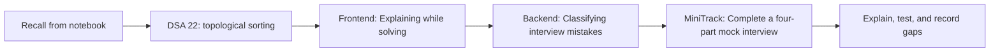
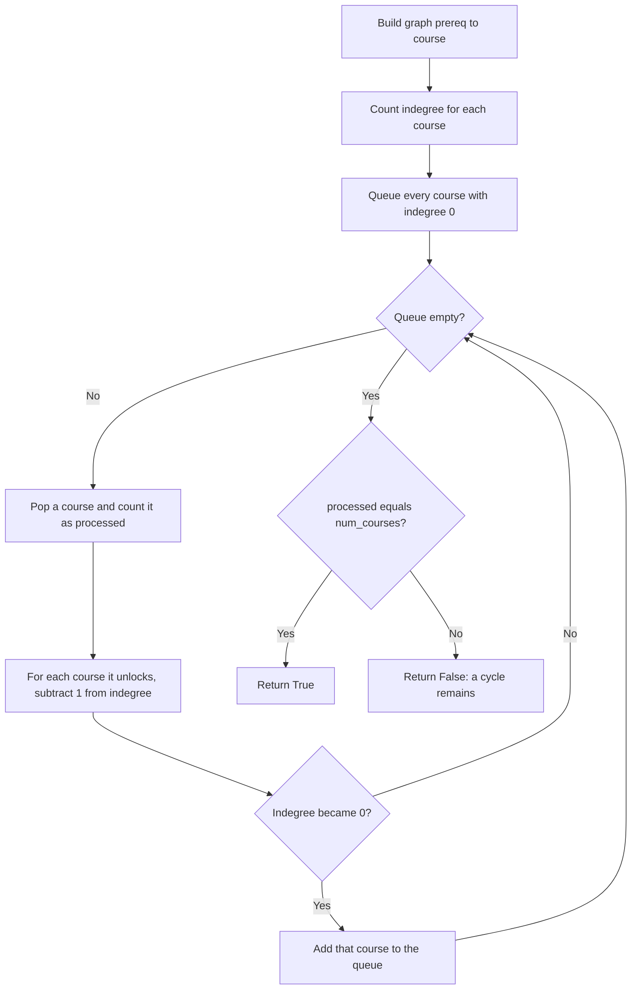

# Prep Day 22 — Complete a four-part mock interview

**Date:** Saturday, December 19, 2026  
**Time:** 7 study hours plus breaks  
**Starting point:** App Days 1–4 are complete. Continue from the current learner workspace and the previous preparation-day exit checklist.  
**Goal:** Complete a four-part mock interview.

[Prep Day 21](prep-day-21.md) · [Preparation plan](../../docs/FULL_STACK_INTERVIEW_PREP_PLAN.md) · [Track home](README.md) · [Prep Day 23](prep-day-23.md)

**Everything to read today is below.** The original
[preparation plan](../../docs/FULL_STACK_INTERVIEW_PREP_PLAN.md),
[interview index](../../docs/INTERVIEW_INDEX.md),
[app roadmap](../../docs/APP_BUILD_ROADMAP.md), and
[DSA Day 22](../../dsa-python/lessons/dsa-day-22.md) remain available for
comparison. Today is a **mock day: there is no new feature code**. The
question banks, code-reading prompts, system-design prompt, and model answers
you need are embedded in section 6, drawn from App Days 4–15 and Prep Days
20–21. Repairing the gaps you find belongs to Prep Days 23–25; today you only
**select** the top three. Write runnable code only in the named practice file
or your rough notebook, not in this Markdown file.

## Learning objectives

- explain explaining while solving in beginner-friendly language;
- explain classifying interview mistakes and its failure boundary;
- implement or verify the listed MiniTrack milestone;
- solve DSA Day 22 using the topological sorting pattern;
- record the result in your rough notebook and explain it without reading.

## 1. Start with notebook recall (45 minutes)

Before opening a lesson, write answers in
[`checkpoints/ROUGH/Notes.md`](../../checkpoints/ROUGH/Notes.md):

1. What did yesterday's browser action send to the server?
2. Where is persistent task data stored, and what state is only temporary?
3. What error or edge case can you already predict for today's topic?
4. What do you remember about the **topological sorting** pattern?

Use this format:

```md
## Saturday, December 19, 2026

- What:
- Why:
- How MiniTrack uses it:
- What can go wrong:
- First task:
```

Do not copy the source paragraph. Write what you remember, then compare.

## 2. Understand today's full-stack boundary (20 minutes)

**Frontend focus — Explaining while solving:** State assumptions, outline the plan, narrate meaningful decisions, and test behavior. Silence and code dumping hide reasoning even when the final answer works.

**Backend focus — Classifying interview mistakes:** Separate knowledge gaps, implementation bugs, communication gaps, and time-management problems because each requires a different repair exercise.

**Today's connection:** A mock tests retrieval, reasoning, coding, communication, and pacing together.



## 3. Python DSA practice (1 hour 45 minutes)

**Practice file:** [`dsa-python/practice/day-22.py`](../../dsa-python/practice/day-22.py)  
**Pattern:** topological sorting

### Problem: Course Schedule

There are `num_courses` courses numbered `0` to `num_courses - 1`. Each pair
`[course, prereq]` in `prerequisites` means “you must take `prereq` before
`course`”. Return `True` if it is possible to finish every course, or `False`
if the requirements contain a cycle (for example, A needs B and B needs A).
Assumptions used by this course:

- every course number is between `0` and `num_courses - 1`;
- pairs may repeat; a course that requires itself (`[0, 0]`) is a cycle;
- courses with no prerequisites can be taken at any time.

```python
solve(2, [[1, 0]])          # True: take 0, then 1
solve(2, [[1, 0], [0, 1]])  # False: 0 and 1 require each other
```

**Edge direction matters:** draw the arrow from prerequisite to course,
`prereq -> course`, because finishing the prerequisite is what unlocks the
course.

### Start coding

In the practice file, replace the `raise NotImplementedError` line with your
own implementation. This is the starting shape:

```python
def solve(num_courses, prerequisites):
    # Return True if every course can be finished, otherwise False.
    raise NotImplementedError
```

Python pieces used below, one at a time:

1. **One empty list per course:** `[[] for _ in range(3)]` creates
   `[[], [], []]` — three *separate* lists. Do **not** write `[[]] * 3`; that
   creates three references to the *same* list, so appending to one appends
   to all.
2. **A list of zeros:** `[0] * 3` creates `[0, 0, 0]`. Numbers are safe to
   repeat this way.
3. **`deque`** (from `collections`) is a queue. `queue.append(x)` adds to the
   back and `queue.popleft()` removes from the front in O(1) time.
   `list.pop(0)` would take O(n) time.
4. **Indegree:** the number of prerequisites a course is still waiting for.
   A course with indegree `0` can be taken now.



### Invariant to say aloud

Track prerequisites with indegrees or DFS states; processing every node proves the dependency graph has no cycle.

More precisely: a course enters the queue only when **all** its prerequisites
have already been processed. A course on a cycle always waits for another
course on the same cycle, so it never reaches indegree `0`.

### Work in this order

1. Restate the problem and ask about constraints.
2. Give a brute-force approach and its cost before optimizing.
3. Write the invariant above in your own words.
4. Implement without opening the solution for 25 minutes.
5. Test empty, smallest, typical, duplicate, and boundary cases where relevant.
6. Use a small hint if blocked; do not spend the entire block stuck.
7. Compare with the commented reference and re-code the key loop from memory.

From the repository root:

```bash
python3 dsa-python/scripts/check_practice.py 22
python3 -m unittest discover -s dsa-python/tests -v
```

**Expected observation:** the day-specific checker accepts your implementation,
and the completed reference suite still passes. Its two examples do not cover
self-loops, longer cycles, or duplicate pairs, so add your own.

You can also temporarily add these checks below your `solve` function in the
practice file, then run `python3 dsa-python/practice/day-22.py`:

```python
if __name__ == '__main__':
    assert solve(2, [[1, 0]]) is True
    assert solve(2, [[1, 0], [0, 1]]) is False
    assert solve(0, []) is True
    assert solve(3, []) is True
    assert solve(1, [[0, 0]]) is False  # A course cannot require itself.
    assert solve(3, [[1, 0], [2, 1]]) is True
    assert solve(3, [[0, 1], [1, 2], [2, 0]]) is False
    assert solve(4, [[1, 0], [1, 0], [3, 2]]) is True  # Duplicate pair, two separate chains.
    print('All checks passed')
```

### Brute-force code — reveal after attempting

<details>
<summary>Show the simple solution</summary>

```python
def solve(num_courses, prerequisites):
    taken = set()
    progress = True
    while progress:  # Keep sweeping while at least one new course was taken.
        progress = False
        for course in range(num_courses):
            if course in taken:
                continue
            # all(...) is True when every prerequisite of this course is already taken.
            if all(pre in taken for c, pre in prerequisites if c == course):
                taken.add(course)
                progress = True
    return len(taken) == num_courses
```

</details>

Each sweep checks every course against every pair: O(V × E), where `V` is the
number of courses and `E` the number of pairs. There can be up to `V` sweeps,
so the worst case is O(V² × E) time. Extra space is O(V) for `taken`.

### Optimized code — reveal after attempting

<details>
<summary>Show the Course Schedule solution</summary>

```python
from collections import deque

def solve(num_courses, prerequisites):
    graph = [[] for _ in range(num_courses)]  # graph[pre] = courses unlocked by pre
    indegree = [0] * num_courses              # prerequisites still unfinished
    for course, pre in prerequisites:
        graph[pre].append(course)
        indegree[course] += 1
    queue = deque(i for i, deg in enumerate(indegree) if deg == 0)
    processed = 0
    while queue:
        pre = queue.popleft()
        processed += 1
        for course in graph[pre]:
            indegree[course] -= 1
            if indegree[course] == 0:  # its last prerequisite just finished
                queue.append(course)
    # Courses on a cycle never reach indegree 0, so they are never processed.
    return processed == num_courses
```

</details>

Building the graph touches each pair once, and the queue loop processes each
course once and each edge once: **O(V + E)** time and **O(V + E)** space.

Trace for `solve(2, [[1, 0]])`. The graph is `graph[0] = [1]`, and
`indegree = [0, 1]`:

| Step | Queue before | Pop | `processed` | Indegree changes | Queue after |
|---:|---|---:|---:|---|---|
| Start | — | — | 0 | — | `[0]` |
| 1 | `[0]` | 0 | 1 | course 1: 1 → 0, enqueue | `[1]` |
| 2 | `[1]` | 1 | 2 | none | `[]` |
| End | — | — | 2 | `2 == 2` | return `True` |

For `solve(2, [[1, 0], [0, 1]])`, `indegree = [1, 1]`. No course starts at
`0`, the queue starts empty, `processed` stays `0`, and `0 != 2` returns
`False`.

### DSA interview questions and answers

#### DSA Q1. What is the brute-force approach?

**Interview-ready answer:** “I repeatedly sweep through the courses and take
any course whose prerequisites are all taken. If a sweep takes nothing new, I
stop. If every course was taken, the answer is True. Each sweep is O(V × E) and
there can be V sweeps, so it is O(V² × E).”

**Example:** For `(3, [[1, 0], [2, 1]])`, the first sweep takes 0, 1, and 2
in order because each prerequisite was just taken; the next sweep takes
nothing and stops.

**Follow-up:** The waste is re-checking courses whose prerequisites have not
changed. Tracking a remaining-prerequisites count (indegree) removes that.

#### DSA Q2. What is the core idea of topological sorting here?

**Interview-ready answer:** “I model courses as a directed graph with edges
from prerequisite to course and count each course's unfinished prerequisites.
Courses at zero go into a queue. Processing a course lowers the count of every
course it unlocks; any that reach zero join the queue. This is Kahn's
algorithm.”

**Example:** In `(2, [[1, 0]])`, course 0 starts at zero. Processing it lowers
course 1 from 1 to 0, so course 1 is processed next.

**Follow-up:** A DFS alternative colors each node unvisited, visiting, or done;
reaching a “visiting” node again means a cycle. Both are O(V + E).

#### DSA Q3. Why does `processed == num_courses` prove there is no cycle?

**Interview-ready answer:** “A course is processed only after all its
prerequisites were processed. On a cycle, every course waits for another
course on the same cycle, so none of them ever reaches zero and they are never
processed. Conversely, an acyclic graph always has some course with no
unfinished prerequisites, so Kahn's algorithm keeps going until everything is
processed.”

**Example:** For `(3, [[0, 1], [1, 2], [2, 0]])`, all three indegrees start at
1, the queue starts empty, and `processed = 0`.

**Follow-up:** Processed courses before the cycle are still a valid partial
order; the leftover courses with nonzero indegree are exactly the ones on, or
blocked by, a cycle.

#### DSA Q4. What are the time and space costs?

**Interview-ready answer:** “O(V + E) time: building the graph is O(E), seeding
the queue is O(V), and the loop processes each course once and each edge once.
Space is O(V + E) for the adjacency lists, plus O(V) for indegrees and the
queue.”

**Example:** 10,000 courses with 50,000 pairs is about 60,000 basic steps.

**Follow-up:** That bound depends on O(1) `popleft()`. Using `list.pop(0)`
would make each removal O(V) and the whole algorithm O(V² + E).

#### DSA Q5. What edge cases should I test?

**Interview-ready answer:** “Zero courses, courses with no pairs, a self-loop,
a two-course cycle, a longer cycle, duplicate pairs, and disconnected groups.
I also ask whether course numbers can be out of range.”

**Example:** `solve(1, [[0, 0]])` is `False`; `solve(4, [[1, 0], [1, 0],
[3, 2]])` is `True` because the duplicate pair adds 2 to the indegree and is
also subtracted twice.

**Follow-up:** An out-of-range pair such as `[5, 0]` with `num_courses = 2`
raises `IndexError`. In an API, validate the input and return a clear error
instead.

#### DSA Q6. How would you return a valid course order?

**Interview-ready answer:** “I record each course as it is popped. If every
course was processed, that list is a valid order; otherwise I return an empty
list.”

**Example:**

```python
from collections import deque

def find_order(num_courses, prerequisites):
    graph = [[] for _ in range(num_courses)]
    indegree = [0] * num_courses
    for course, pre in prerequisites:
        graph[pre].append(course)
        indegree[course] += 1
    queue = deque(i for i, deg in enumerate(indegree) if deg == 0)
    order = []
    while queue:
        pre = queue.popleft()
        order.append(pre)
        for course in graph[pre]:
            indegree[course] -= 1
            if indegree[course] == 0:
                queue.append(course)
    return order if len(order) == num_courses else []
```

`find_order(3, [[1, 0], [2, 1]])` returns `[0, 1, 2]`.

**Follow-up:** The same idea orders MiniTrack's SQL migrations:
`003-task-owners.sql` depends on `002-auth-users.sql` because `owner_id`
references `users(id)`. Numbered filenames encode a simple chain; a real
dependency graph would need a topological order.

## 4. Frontend guided study (1 hour 30 minutes)

### What

State assumptions, outline the plan, narrate meaningful decisions, and test behavior. Silence and code dumping hide reasoning even when the final answer works.

### Why

The browser layer should make state and feedback understandable without taking
ownership of persistent data or security decisions that belong on the server.

### How: a speaking framework you can reuse in every part

Use the same six steps for DSA, frontend, backend, and design answers:

| Step | What to say | Course Schedule example |
|---:|---|---|
| 1 | **Clarify** inputs, outputs, constraints | “Pairs are `[course, prereq]`? Can a course require itself? Are numbers in range?” |
| 2 | **Example** worked by hand | “With `[[1, 0]]` I take 0, then 1, so True.” |
| 3 | **Brute force** and its cost | “Sweep until nothing new is taken: O(V² × E).” |
| 4 | **Plan** the better idea before typing | “Indegree counts plus a queue; a cycle never reaches zero.” |
| 5 | **Code while narrating decisions**, not every keystroke | “I mark the edge `pre -> course` because finishing `pre` unlocks `course`.” |
| 6 | **Test and analyze** | “Run the cycle case; O(V + E) time and space.” |

For frontend and backend questions, steps 1–2 become: **short answer first**,
then **one concrete MiniTrack file or request**, then **a trade-off or failure
case**. Example:

> “Filtering does not need `useEffect`. In `TaskBoard.tsx` the visible list is
> derived during render from `tasks` and the filter, so there is no second
> state to keep in sync. An effect would render once with stale data and then
> again.”

**When you are stuck, keep talking:** “I'm not sure whether X or Y; I'll
assume X because ..., and I'll check it with this test.” Silence is scored as
a communication gap even when you are thinking well.

Files to open deliberately (after the mock, not during it):

- `checkpoints/ROUGH/Notes.md`
- `dsa-python/DSA_PROGRESS.md`
- `docs/MY_NOTES.md`

Answer before moving on:

- Which value is persistent, and which value is temporary interaction state?
- What starts this behavior?
- What should the user see while work is pending?
- What should remain unchanged when the operation fails?

## 5. Backend guided study (1 hour 30 minutes)

### What

Separate knowledge gaps, implementation bugs, communication gaps, and time-management problems because each requires a different repair exercise.

### Boundary checklist

- Validate untrusted path, query, and body values.
- Authenticate identity when the route is protected.
- Authorize the resource separately from authentication.
- Bind SQL values rather than concatenating untrusted data.
- Return an explicit success or error status.
- Log internal failures on the server without exposing secrets.

Use the checklist as a scoring rubric in the backend mock: an answer that skips
a boundary (for example, never mentions `owner_id`) is a knowledge gap, even if
the rest is fluent.

### Classify every mistake into exactly one category

| Category | How it shows up | MiniTrack or DSA example | Repair exercise (Prep Days 23–25) |
|---|---|---|---|
| **Knowledge gap** | You did not know or misremembered the fact | Said `$1` also escapes `%` in `ILIKE` | Reread the topic, then explain it aloud from memory the next day |
| **Implementation bug** | You knew the idea but the code was wrong | Returned `True` after the queue loop without comparing `processed` with `num_courses` | Re-code the key loop from memory three times with a test after each |
| **Communication gap** | Correct idea, but unclear, silent, or no example | Fixed IDOR correctly but never said “the owner comes from the session” | Record a 90-second answer, replay it, and rewrite the first sentence |
| **Time-management problem** | Ran out of time or spent it on the wrong part | 25 minutes on a clever DSA solution, no tests, no complexity | Repeat with a visible timer and checkpoints at 10, 25, and 40 minutes |

### Evidence, not confidence

Write evidence instead of “felt OK”. Copy this table into your notebook and
fill one row per mistake **during review**, not during the mock:

```md
| Part | Question | What happened (evidence) | Category | Impact 1–3 | Frequency 1–3 |
|---|---|---|---|---:|---:|
| Backend | IDOR bug hunt | Found missing owner_id after 6 min; never named IDOR | Communication | 3 | 2 |
```

**Priority score = impact × frequency.** The three highest scores become the
three gaps for the final phase. Ties go to the gap that affects more than one
part of the interview.

## 6. MiniTrack implementation (1 hour)

**Milestone source:** Timed DSA, frontend, backend, and system-design practice

1. Run 45 minutes each of DSA, frontend, backend, and system design.
2. Record evidence instead of a vague confidence score.
3. Select only the three highest-value gaps for final repair.

The mock takes 3 hours plus breaks and replaces most of today's open study time.
Do sections 1–3 first, then run the mock.

### Mock rules

- Keep the timer running for each 45-minute part. Take a 10-minute break
  **between** parts, never inside one.
- No notes, no lesson files, no search. Speak aloud as if an interviewer were
  present; recording yourself on your phone is the best evidence.
- Reveal the model answers only **after** the part ends.
- Score each rubric line 0 (missing), 1 (partial), or 2 (clear).

### Part 1 — DSA (45 minutes)

Choose a problem you solved earlier, at random, so you cannot prepare for it.
From the repository root:

```bash
python3 -c "import random; print(random.randint(1, 21))"
```

Open only that day's practice file. If it already contains your earlier
solution, write the new attempt in a fresh scratch file such as
`checkpoints/ROUGH/mock-dsa.py`, with a temporary
`if __name__ == '__main__':` assert block. For days with a checker example,
`python3 dsa-python/scripts/check_practice.py N` tests the practice file.

| Rubric line | 0–2 |
|---|---:|
| Clarified inputs, outputs, and edge cases before coding | |
| Gave brute force and its complexity | |
| Stated the invariant before coding | |
| Working code by minute 35 | |
| Ran at least three tests including an edge case | |
| Correct time and space complexity, with any caveat | |

### Part 2 — Frontend (45 minutes)

Answer each question aloud in 60–90 seconds (short answer, MiniTrack example,
trade-off). Then do the code-reading prompt.

1. What is the difference between a Server Component and a Client Component?
2. What is hydration, and what causes a hydration mismatch?
3. Why does MiniTrack not load the initial tasks with `useEffect`?
4. What makes an input “controlled”?
5. Why should a component not mutate its `tasks` prop?
6. What does `router.refresh()` do after a mutation — and what does it not do?
7. Why is the filtered task list not stored in state?
8. What is the difference between `useRef` and `useEffect` in the edit flow?
9. Why store search filters in the URL?
10. Can React Context (`SessionProvider`) enforce authentication?
11. How should an async error be exposed accessibly?
12. How do `useMemo`, `useCallback`, and `React.memo` differ?

**Code-reading prompt.** This is App Day 5's handler in
`frontend/app/TaskBoard.tsx`. Explain what the user sees when the server returns
`404`, when the network is offline, and when the request succeeds.

```tsx
async function toggleTask(taskId: string, done: boolean) {
  setBusy(true);
  setError('');

  try {
    const response = await fetch(`/api/tasks/${taskId}`, {
      method: 'PATCH',
      headers: { 'Content-Type': 'application/json' },
      body: JSON.stringify({ done }),
    });

    if (!response.ok) {
      setError(`Could not update task (${response.status})`);
      setBusy(false);
      return;
    }

    router.refresh();
    setBusy(false);
  } catch {
    setError('Could not connect to the server');
    setBusy(false);
  }
}
```

<details>
<summary>Show frontend model answers</summary>

1. A Server Component runs on the server and can read PostgreSQL and private
   environment variables; its code is not sent to the browser. A Client
   Component (`'use client'`) is needed for state, effects, and event handlers.
   `page.tsx` reads tasks; `TaskBoard.tsx` handles clicks.
2. Hydration attaches React's event handlers and state to HTML the server
   already rendered. A mismatch happens when the first client render differs,
   for example rendering `Date.now()` during the first render.
3. The Server Component can read the database directly before HTML is sent, so
   there is no empty first render, no loading flash, and no extra client
   request.
4. React state is the source of truth: `value={title}` plus
   `onChange={event => setTitle(event.target.value)}`.
5. Props are owned by the parent and rendered from server data. Mutating them
   does not trigger a render and makes the UI disagree with PostgreSQL.
   MiniTrack changes data through the API, then refreshes.
6. It asks Next.js to re-render the Server Components for the current route,
   which re-runs the owner-scoped `SELECT` and sends fresh props. It does not
   save data, authorize anything, or act as a cache.
7. It can be derived during render from `tasks` and the filter. Storing it
   would create a second copy that can go stale.
8. `useRef` holds the input DOM node without causing renders; `useEffect` runs
   after the edit input is committed and calls `editInputRef.current?.focus()`.
9. URL state survives reload, can be shared or bookmarked, and works with a
   plain GET form; the server validates `q` and `status`.
10. No. It shares an already-established session with Client Components for
    UI. Security comes from `auth()` in every Route Handler and owner-scoped SQL.
11. Show visible text near the control and use a live region such as
    `role="alert"` so assistive technology announces it; link it with
    `aria-describedby` where relevant.
12. `useMemo` caches a computed value, `useCallback` caches a function
    reference, and `React.memo` may skip a component's render when its props
    are shallowly equal. They are performance tools; measure before using them.

**Code-reading:** `404` → `fetch` resolves, `response.ok` is false, the user
sees `Could not update task (404)` and the list is unchanged. Offline →
`fetch` rejects, the `catch` shows `Could not connect to the server`. Success →
`router.refresh()` re-reads PostgreSQL and the checkbox reflects the saved
value. In every case `busy` returns to `false`.

</details>

| Rubric line | 0–2 |
|---|---:|
| Short answer first for each question | |
| Named a real MiniTrack file or behavior | |
| Mentioned a trade-off or failure case | |
| Code-reading covered all three outcomes | |

### Part 3 — Backend (45 minutes)

Answer aloud, then do the bug hunt.

1. Walk through `POST /api/tasks` from request to response.
2. Why `201`, `400`, `401`, `404`, and `500` — when is each returned?
3. Why are SQL values passed as `$1`, `$2`?
4. Does parameterization escape `%` and `_` in `ILIKE`?
5. Why `UPDATE ... RETURNING`?
6. What happens when the connection pool is exhausted?
7. Authentication versus authorization in MiniTrack?
8. Where does the owner ID come from, and why?
9. Is retrying a failed `POST` safe?
10. What is the recovery plan for a bad migration?

**Bug hunt.** This version of the App Day 11 delete function has a security
bug. Find it, name it, fix it, and say which test would have caught it.

```ts
export async function deleteTask(ownerId: string, id: string): Promise<boolean> {
  const result = await getPool().query(
    'DELETE FROM tasks WHERE id = $1 RETURNING id',
    [id],
  );
  return result.rowCount !== null && result.rowCount > 0;
}
```

<details>
<summary>Show backend model answers</summary>

1. `auth()` → `401` if no session; `request.json()` → `400` if invalid;
   `normalizeTitle` → `400` if not 1–200 characters;
   `createTask(session.user.id, title)` runs
   `INSERT INTO tasks (owner_id, title) VALUES ($1, $2) RETURNING ...` →
   `201` with the row; any unexpected error is logged and returns `500`.
2. `201` created; `400` invalid input; `401` not signed in; `404` no row with
   this ID **for this owner** (does not reveal other users' IDs); `500`
   unexpected failure with a generic body.
3. Values travel separately from SQL text, so input cannot change the query's
   structure (SQL injection).
4. No. `%` and `_` remain wildcards; App Day 8's `escapeLike` escapes them, and
   `ESCAPE '\'` names the escape character.
5. It returns the committed row in one round trip and avoids a racy second
   `SELECT`.
6. New queries wait in the pool's queue; latency rises; with a timeout they
   fail explicitly. Instances × `max` must fit the database's connection limit.
7. Authentication (Auth.js `auth()`) proves identity. Authorization
   (`AND owner_id = $n` in SQL) restricts which rows that identity can touch.
8. From `session.user.id` on the server. Bodies, URLs, and headers are
   controlled by the client and can be forged.
9. Not blindly; the first attempt may have committed. Use an idempotency key
   with a unique constraint, or retry only idempotent operations.
10. Stop the rollout, preserve evidence, restore from a provider restore point
    or apply a reviewed roll-forward, verify data integrity, then reopen
    traffic. App rollback alone does not undo a schema change.

**Bug hunt:** `ownerId` is never used, so any signed-in user can delete any
task by guessing its ID — an **IDOR** (insecure direct object reference). Fix:

```ts
'DELETE FROM tasks WHERE id = $1 AND owner_id = $2 RETURNING id',
[id, ownerId],
```

The App Day 12 authorization test catches it: User B sends
`DELETE /api/tasks/<User A's task>`, expects `404`, **and** asserts that User
A's row still exists.

</details>

| Rubric line | 0–2 |
|---|---:|
| Covered validate, authenticate, authorize, bind, respond, log | |
| Correct status codes with reasons | |
| Bug hunt: found, named, fixed, and tested | |
| Answers stayed concrete (real SQL, real file names) | |

### Part 4 — System design (45 minutes)

**Prompt:** “Design MiniTrack for 10,000 registered users. After 30 minutes,
the interviewer says: traffic has grown 50 times. What changes?”

Draw on paper. Use this structure: requirements → estimates → API → data
model → architecture → bottlenecks → failures → trade-offs.

<details>
<summary>Show a model outline</summary>

- **Requirements:** GitHub sign-in; owner-only create, rename, complete,
  delete; URL-backed search and filters; read-your-own-writes; accessible
  controls; visible errors. Out of scope: teams, real-time, offline.
- **Estimates (assumptions):** 2,000 daily active users × 40 requests ≈ 1
  request/second average, about 10/second peak; up to 5 million rows, about 1 GB.
- **API:** `GET /api/tasks?q=&status=`, `POST /api/tasks`,
  `PATCH /api/tasks/:id`, `DELETE /api/tasks/:id`, `GET /api/health`,
  `/api/auth/*`.
- **Data model:** `tasks(id, owner_id → users.id, title CHECK 1–200, done,
  created_at)`, index `(owner_id, id)`; Auth.js adapter tables.
- **Architecture:** browser → one stateless Next.js app (Server Components +
  Route Handlers, `auth()`) → `pg` pool (`max: 5`) → managed PostgreSQL with
  backups; GitHub for OAuth.
- **Bottlenecks to measure:** p95 latency per route, pool wait, query time;
  `ILIKE '%term%'` search on large lists.
- **Failures:** PostgreSQL down → visible `500`, restore from tested backup;
  pool exhaustion → timeout and find the slow query; bad deploy → app rollback;
  bad migration → separate recovery.
- **After 50× growth (≈500 requests/second peak, ≈50 GB):** measure first;
  add `EXPLAIN`-justified indexes and cursor pagination
  (`WHERE owner_id = $1 AND id > $2 ORDER BY id LIMIT $3`); run several app
  instances behind a load balancer with readiness checks; recompute the
  connection budget and add a pooler if instances × `max` nears the limit;
  scale the database up; consider a read replica only for reads that tolerate
  lag (never the refresh right after the user's own write); consider an
  owner-scoped cache only if one expensive read dominates.
- **Still not justified:** sharding (50 GB fits one PostgreSQL),
  microservices (one team, one domain), Kubernetes (unless operational needs
  outweigh its cost). Say what measurement would change that.

</details>

| Rubric line | 0–2 |
|---|---:|
| Requirements and out-of-scope stated before drawing | |
| Numbers estimated with stated assumptions | |
| API and data model include `owner_id` and the index | |
| Each scaling step tied to a measured trigger | |
| Failure modes and signals named | |
| Did not propose sharding, microservices, or Kubernetes without a measured need | |

### After the mock: record, classify, choose

1. For each part, total the rubric (0–12, 0–8, 0–8, 0–12).
2. Fill the evidence table from section 5, one row per lost point.
3. Assign each row one category: knowledge, implementation, communication, or
   time.
4. Pick the **three highest impact × frequency** rows. For each, write one
   measurable repair task, for example: “Implement Kahn's algorithm from memory
   and explain the cycle proof in 90 seconds” — not “study graphs more”.

**Expected observation:** four rubric scores, an evidence table, and exactly
three written repair tasks in `checkpoints/ROUGH/Notes.md`. If any part
scored 0 on “speaking”, the first repair task is a communication one.

## 7. Trace the event or request

```mermaid
sequenceDiagram
  participant I as Interviewer (timer)
  participant Y as You
  participant P as Python
  participant N as Notebook evidence table
  I->>Y: "Can all courses be finished? (2, [[1,0],[0,1]])"
  Y->>I: Clarify: pairs are [course, prereq]; self-loops possible?
  Y->>I: Brute force O(V^2 x E), then plan: indegree + queue
  Y->>P: Write solve(); run asserts including the cycle case
  P-->>Y: AssertionError on cycle case (returned True without checking processed)
  Y->>Y: Return processed == num_courses; rerun
  P-->>Y: All checks passed
  Y->>I: Invariant, O(V + E) time and space
  Y->>N: Log "missing processed check, 6 min" as implementation bug
```

Trace one concrete input. Name every boundary, value, and possible failure.

## 8. Deliberate debugging exercise (25 minutes)

**Break it:** Pause the timer whenever a question becomes uncomfortable.

**Predict before running:** write the expected symptom in your notebook.

**Expected symptom:** The result no longer measures interview pacing.

**Root cause:** The practice conditions do not match the target conditions.

**Restore and verify:** Keep the timer running, state what is blocking you, and review after the section.

Do not stop after making the symptom disappear. Explain why the repair restores
the intended invariant.

## 9. Interview questions and answers (30 minutes)

### Q1. What is explaining while solving?

**Interview-ready answer:** “I clarify the problem, work an example, give the
brute force, state my plan and invariant before typing, narrate the decisions
that matter while coding, and finish by testing and analyzing complexity. The
interviewer scores my reasoning, not just the final code.”

**Example:** On Course Schedule I say: “I'll draw edges from prerequisite to
course because finishing the prerequisite unlocks the course; a cycle can never
reach indegree zero, so I compare `processed` with `num_courses`.” Then I run
the `(2, [[1, 0], [0, 1]])` case aloud.

**Senior follow-up:** Over-narration is also a problem: describing every
keystroke hides the important decisions. Narrate choices and trade-offs, stay
quiet briefly while typing routine code, and say when you are checking an
assumption.

### Q2. How should the backend handle classifying interview mistakes?

**Interview-ready answer:** “I put every lost point into one category —
knowledge gap, implementation bug, communication gap, or time-management
problem — because each needs a different repair. Then I rank them by impact
times frequency and fix only the top three.”

**Example:** In the backend bug hunt, finding the missing `owner_id` in
`deleteTask` but never saying “IDOR” or “the owner comes from the session” is a
communication gap; the repair is a recorded 90-second answer, not rereading
App Day 11.

**Senior follow-up:** Evidence must be observable — “took 12 minutes to find
the bug”, “no complexity stated” — not “felt shaky”. Treat the classification
like an incident review: describe what happened without blame, find the root
cause, and choose one corrective action that can be verified.

### Q3. What invariant makes the topological sorting solution correct?

**Interview-ready answer:** “Track prerequisites with indegrees or DFS states;
processing every node proves the dependency graph has no cycle. A course joins
the queue only when all its prerequisites are processed, and a course on a cycle
always waits for another cycle member, so it never reaches zero.”

**Example:** `solve(2, [[1, 0]])`: indegrees `[0, 1]`; pop 0, course 1 drops to
0, pop 1; `processed = 2 = num_courses`, so `True`. With `[[1, 0], [0, 1]]`,
indegrees are `[1, 1]`, the queue starts empty, and the answer is `False`.

**Senior follow-up:** O(V + E) relies on `deque.popleft()` being O(1) and on
valid course numbers. With an order required, record pops; with a very large
graph that does not fit in memory, process it in batches and persist
indegrees.

### Q4. How does today's work fit the complete MiniTrack system?

**Interview-ready answer:** “A mock tests retrieval, reasoning, coding,
communication, and pacing together. MiniTrack gives every part one concrete
story: the request path for frontend and backend, owner-scoped SQL for
security, and a measured scaling ladder for design.”

**Example:** One user action covers three parts: clicking a checkbox in
`TaskBoard.tsx` (frontend), `PATCH /api/tasks/7` with `auth()` and
`UPDATE ... WHERE id = $2 AND owner_id = $3` (backend), and the
`router.refresh()` read-your-own-writes requirement that rules out sending that
read to a lagging replica (design).

**Senior follow-up:** In a real interview, if the interviewer pushes on
infrastructure, the first thing I would measure is per-route p95 latency split
into pool wait and query time. I would not propose Kubernetes, microservices,
or sharding before that measurement shows a need.

## 10. Complexity and operational cost

- **DSA:** O(vertices + edges) time and O(vertices + edges) space.
- **Application:** Mocks are expensive practice, so their value comes from specific post-mock repair rather than repeatedly taking mocks without analysis.
- **Learning:** Attempting, retrieving, and correcting is more valuable than
  copying several solutions. Keep the scope to one understood pattern today.

## Exit checklist

- [ ] I completed DSA Day 22 before reading its solution.
- [ ] I can state the invariant and complexity without notes.
- [ ] I completed or verified the MiniTrack milestone.
- [ ] I tested one success path and one failure path.
- [ ] I completed the deliberate debugging exercise.
- [ ] I answered all four interview questions aloud.
- [ ] I recorded what remains confusing and tomorrow's first task.

**Suggested commit:** `prep day 22: complete a four-part mock interview`
