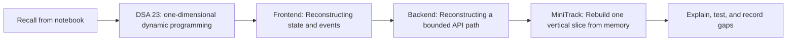
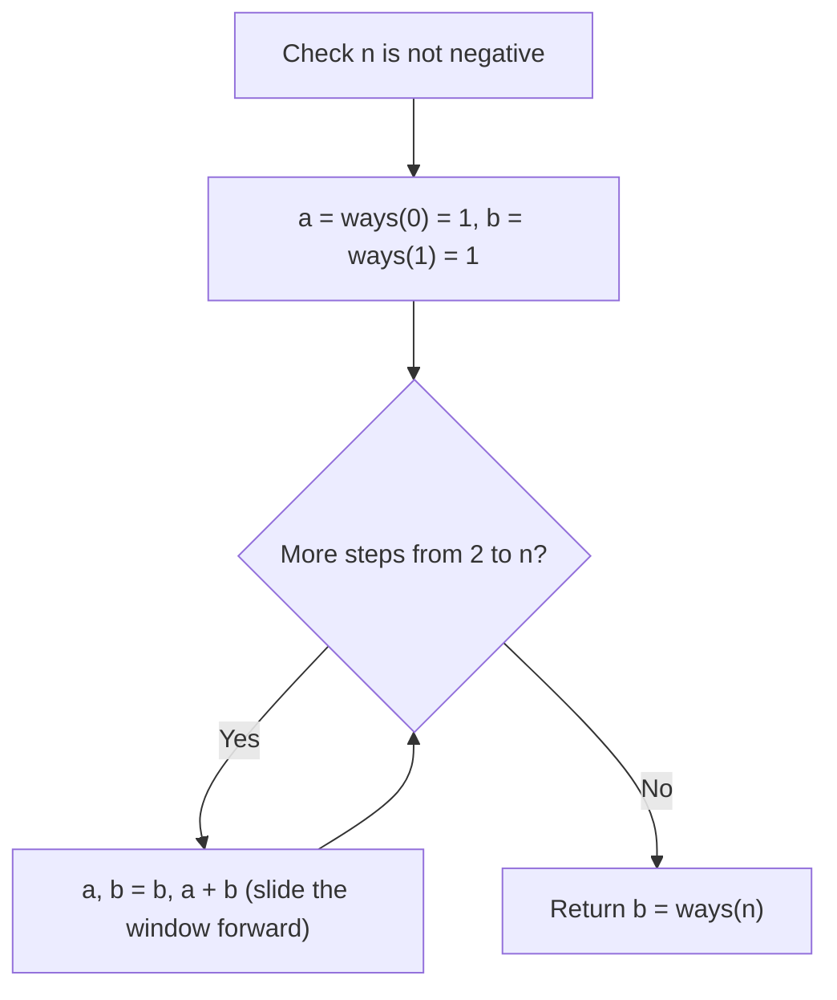

# Prep Day 23 — Rebuild one vertical slice from memory

**Date:** Monday, December 21, 2026  
**Time:** 7 study hours plus breaks  
**Starting point:** App Days 1–4 are complete. Continue from the current learner workspace and the previous preparation-day exit checklist.  
**Goal:** Rebuild one vertical slice from memory.

[Prep Day 22](prep-day-22.md) · [Preparation plan](../../docs/FULL_STACK_INTERVIEW_PREP_PLAN.md) · [Track home](README.md) · [Prep Day 24](prep-day-24.md)

**Everything to read today is below.** The original [App Day 5](../day-05.md),
[App Day 11](../day-11.md), [App Day 15](../day-15.md), and
[DSA Day 23](../../dsa-python/lessons/dsa-day-23.md) remain available for
comparison. Today is a **reconstruction** day: you rebuild the existing
“complete or reopen a task” slice from memory and repair the gaps you find. No
new feature is added. The final mock and project pitch belong to Prep Day 24;
light consolidation and the final checks belong to Prep Day 25. Write runnable
code in the named project and practice files, not in this Markdown file.

## Learning objectives

- explain reconstructing state and events in beginner-friendly language;
- explain reconstructing a bounded API path and its failure boundary;
- rebuild the MiniTrack completion slice from browser to PostgreSQL;
- solve DSA Day 23 using the one-dimensional dynamic programming pattern;
- record the result in your rough notebook and explain it without reading.

## 1. Start with notebook recall (45 minutes)

Before opening a lesson, write answers in
[`checkpoints/ROUGH/Notes.md`](../../checkpoints/ROUGH/Notes.md):

1. What did yesterday's browser action send to the server?
2. Where is persistent task data stored, and what state is only temporary?
3. What error or edge case can you already predict for today's topic?
4. What do you remember about the **one-dimensional dynamic programming** pattern?

Use this format:

```md
## Monday, December 21, 2026

- What:
- Why:
- How MiniTrack uses it:
- What can go wrong:
- First task:
```

Do not copy the source paragraph. Write what you remember, then compare.

## 2. Understand today's full-stack boundary (20 minutes)

**Frontend focus — Reconstructing state and events:** Begin with the user-visible state and event, derive what must be local, and keep persistent data on the server. Add loading and failure behavior as part of the feature.

**Backend focus — Reconstructing a bounded API path:** Define the method, path, input, success response, validation failures, authentication, authorization, and data operation before coding.

**Today's connection:** Reconstruction proves you can combine frontend, API, validation, and database reasoning without following a recipe.

**Today's slice:** a signed-in user ticks a task's checkbox. The browser sends
`PATCH /api/tasks/:id` with `{"done":true}`. The server checks the session,
validates the ID and body, runs an owner-scoped `UPDATE`, and returns the
updated task. The page then refreshes from PostgreSQL.



## 3. Python DSA practice (1 hour 45 minutes)

**Practice file:** [`dsa-python/practice/day-23.py`](../../dsa-python/practice/day-23.py)  
**Pattern:** one-dimensional dynamic programming

### Problem: Climbing Stairs

You are at the bottom of a staircase with `n` steps. Each move climbs either
**1 step** or **2 steps**. Return how many different sequences of moves reach
exactly the top.

Assumptions: `n` is a whole number. `n = 0` has exactly **one** way (make no
moves). A negative `n` is invalid and raises `ValueError`.

```python
solve(0)  # 1
solve(2)  # 2  (1+1, 2)
solve(5)  # 8
```

To reach step `i`, your last move was either 1 step (from `i - 1`) or 2 steps
(from `i - 2`). So the number of ways to reach `i` is
`ways(i - 1) + ways(i - 2)`. That rule is called a **recurrence**; storing the
answers for smaller steps so we never compute them twice is **dynamic
programming**.

### Start coding

In the practice file, replace the `raise NotImplementedError` line with your
own implementation. This is the starting shape:

```python
def solve(n):
    # Return the number of 1-step/2-step sequences that reach step n.
    raise NotImplementedError
```

Two Python helpers you will use:

- `range(2, n + 1)` produces `2, 3, …, n`. If `n` is `0` or `1`, it produces
  nothing, so the loop body never runs.
- `a, b = b, a + b` is **tuple assignment**. Python evaluates the whole right
  side first (`b` and `a + b`, using the old values) and then assigns both. So
  you do not need a temporary variable.
- `for _ in range(...)` uses `_` as a name that means “I do not need this
  loop value”.



### Invariant to say aloud

Define dp[i] from already solved smaller states and identify the smallest base cases.

Concretely: before handling step `i`, `a` holds `ways(i - 2)` and `b` holds
`ways(i - 1)`. The base cases are `ways(0) = 1` and `ways(1) = 1`.

### Work in this order

1. Restate the problem and ask about constraints.
2. Give a brute-force approach and its cost before optimizing.
3. Write the invariant above in your own words.
4. Implement without opening the solution for 25 minutes.
5. Test empty, smallest, typical, duplicate, and boundary cases where relevant.
6. Use a small hint if blocked; do not spend the entire block stuck.
7. Compare with the commented reference and re-code the key loop from memory.

From the repository root:

```bash
python3 dsa-python/scripts/check_practice.py 23
python3 -m unittest discover -s dsa-python/tests -v
```

**Expected observation:** the day-specific checker accepts your implementation
for `solve(0) == 1`, `solve(2) == 2`, and `solve(5) == 8`, and the completed
reference suite still passes. The checker's three examples are not a complete
test of every input, so add your own checks below.

You can also temporarily add these checks below your `solve` function in the
practice file, then run `python3 dsa-python/practice/day-23.py`:

```python
if __name__ == '__main__':
    assert solve(0) == 1
    assert solve(1) == 1
    assert solve(2) == 2
    assert solve(3) == 3
    assert solve(5) == 8
    assert solve(10) == 89
    try:
        solve(-1)
        raise AssertionError('negative n should raise ValueError')
    except ValueError:
        pass
    print('All checks passed')
```

### Brute-force code — reveal after attempting

<details>
<summary>Show the simple recursive solution</summary>

```python
def solve(n):
    if n < 0:
        raise ValueError('n must be nonnegative')
    if n <= 1:
        return 1  # ways(0) = 1 and ways(1) = 1
    # The last move was either 1 step or 2 steps.
    return solve(n - 1) + solve(n - 2)
```

</details>

This follows the recurrence directly, but it recomputes the same smaller
values many times: `solve(5)` calls `solve(3)` twice and `solve(2)` three
times. The number of calls grows roughly like Fibonacci numbers, which is
exponential, about O(1.62ⁿ) (often loosely written O(2ⁿ)). The recursion stack
uses O(n) space. Very large `n` can also exceed Python's recursion limit.

### Optimized code — reveal after attempting

<details>
<summary>Show the Climbing Stairs solution</summary>

```python
def solve(n):
    if n < 0:
        raise ValueError('n must be nonnegative')
    a, b = 1, 1  # ways for 0 steps and 1 step
    for _ in range(2, n + 1):
        # New b is ways(i) = ways(i - 1) + ways(i - 2); a moves up one step.
        a, b = b, a + b
    return b
```

</details>

Instead of a full `dp` list, keep only the last two answers. Each loop moves
the two-value window up by one step. Time is O(n); extra space is O(1)
variables (see DSA Q4 for the large-number caveat).

Trace for `solve(5)`:

| Step `i` | `a` before (`ways(i-2)`) | `b` before (`ways(i-1)`) | `a, b` after |
|---:|---:|---:|---|
| start | — | — | `1, 1` (ways 0 and 1) |
| 2 | 1 | 1 | `1, 2` |
| 3 | 1 | 2 | `2, 3` |
| 4 | 2 | 3 | `3, 5` |
| 5 | 3 | 5 | `5, 8` → return `8` |

### DSA interview questions and answers

#### DSA Q1. What is the brute-force approach?

**Interview-ready answer:** “I recurse on the last move. To reach step n, the
last move came from n minus 1 or n minus 2, so I return the sum of those two
recursive calls, with base cases for 0 and 1. It is correct but exponential,
because the same subproblems are solved again and again.”

**Example:** `solve(5)` calls `solve(4)` and `solve(3)`; `solve(4)` calls
`solve(3)` again. `solve(3)` is computed twice and `solve(2)` three times.

**Follow-up:** Adding a cache (`functools.lru_cache` or a dictionary) turns it
into top-down dynamic programming with O(n) time, but the recursion stack is
still O(n) and can hit Python's recursion limit.

#### DSA Q2. What is the core idea of the optimized solution?

**Interview-ready answer:** “I define ways(i) as the number of sequences that
reach step i. Every sequence ends with a 1-step or a 2-step, so
ways(i) = ways(i − 1) + ways(i − 2). I fill the answers from small to large
and keep only the last two, because nothing older is needed.”

**Example:** `ways(4) = ways(3) + ways(2) = 3 + 2 = 5`.

**Follow-up:** This is the Fibonacci sequence shifted by one. Recognizing that
is useful, but explain the recurrence from the problem rather than relying on
memory of Fibonacci.

#### DSA Q3. Why is the recurrence correct, and why is ways(0) equal to 1?

**Interview-ready answer:** “The two groups — sequences ending with a 1-step
and sequences ending with a 2-step — do not overlap and together cover every
sequence. So adding them counts every sequence exactly once. ways(0) is 1
because there is exactly one way to be at the bottom: do nothing. That base
case makes ways(2) = ways(1) + ways(0) = 2 come out right.”

**Example:** For `n = 2`: `[1, 1]` ends with a 1-step, `[2]` ends with a
2-step, total 2.

**Follow-up:** If you defined ways(0) as 0, then ways(2) would be 1, which is
wrong. Base cases are part of the correctness proof, not a detail.

#### DSA Q4. What are the time and space costs?

**Interview-ready answer:** “The loop runs n − 1 times with constant work per
iteration, so O(n) time, and it stores two variables, so O(1) extra space.”

**Example:** `solve(10)` runs the loop 9 times and returns `89`.

**Follow-up:** The answers grow exponentially, and Python integers have no
fixed size. For very large n the numbers have O(n) digits, so each addition is
not truly constant time. Interviews often ask for the answer modulo
`10**9 + 7` to keep numbers bounded.

#### DSA Q5. What edge cases should I test?

**Interview-ready answer:** “n = 0 returns 1, n = 1 returns 1, n = 2 returns
2, a larger value like 10 returns 89, and a negative n raises ValueError. I
also confirm with the interviewer what n = 0 should mean.”

**Example:** `solve(0) == 1` and `solve(1) == 1` both return before the loop
runs, because `range(2, 1)` and `range(2, 2)` are empty.

**Follow-up:** If the interviewer wants 0 for `n = 0`, change only that
contract at the boundary; do not silently change the recurrence.

#### DSA Q6. What if the allowed step sizes change?

**Interview-ready answer:** “With an allowed set like {1, 3, 5}, the last move
can be any of them, so ways(i) is the sum of ways(i − s) for each allowed s
with i − s ≥ 0. I keep a dp list of length n + 1, which costs O(n × k) time for
k step sizes.”

**Example:** Steps `{1, 2, 3}` give `1, 1, 2, 4, 7` for `n = 0..4`.

**Follow-up:** If each step has a cost and you want the cheapest path (Min
Cost Climbing Stairs), replace “sum” with “minimum of previous cost plus this
step's cost”. The state is the same; only the combine operation changes.

## 4. Frontend guided study (1 hour 30 minutes)

### What

Begin with the user-visible state and event, derive what must be local, and keep persistent data on the server. Add loading and failure behavior as part of the feature.

### Why

The browser layer should make state and feedback understandable without taking
ownership of persistent data or security decisions that belong on the server.

### How — specify before you code

Before writing any code, fill this table in your notebook **from memory**:

| Question | Your answer |
|---|---|
| Which value is persistent? | |
| Which values are temporary interaction state? | |
| Which event starts the slice? | |
| What request is sent (method, URL, body)? | |
| What does the user see while the request is pending? | |
| What happens after success? | |
| What does the user see after a failure, and what stays unchanged? | |

<details>
<summary>Compare with the reference specification</summary>

| Question | Reference answer |
|---|---|
| Persistent value | `task.done` in the PostgreSQL `tasks` row. The `tasks` prop is only a copy rendered by the server. |
| Temporary state | `busy` (a request is in flight) and `error` (the last failure message) in `TaskBoard`. |
| Starting event | The checkbox `onChange` for one task. |
| Request | `PATCH /api/tasks/42` with JSON `{"done":true}` (or `false` to reopen). |
| Pending | `busy` is `true`, so the checkboxes, input, and buttons are disabled. |
| Success | `router.refresh()` asks the Server Component to read PostgreSQL again; fresh props redraw the checkbox. |
| Failure | `error` shows `Request failed: Could not update task (404)` in a `role="alert"` paragraph. The checkbox remains bound to the server value because `checked={task.done}` comes from props. |

</details>

Files you will rebuild or check:

- `frontend/app/TaskBoard.tsx` (the `toggleTask` function and the checkbox)
- `frontend/app/api/tasks/[id]/route.ts` (the `PATCH` handler)
- `frontend/lib/tasks.ts` (the `setDone` data function)
- `frontend/lib/validation.ts` (`isValidId` and `isRecord`)

### Reference frontend code — reveal after your timed attempt

The browser part of this slice was written on App Day 5. Later days add
editing, search, accessibility, and memoization around it, but **the toggle
request itself does not change** when ownership is added: the browser never
sends an owner ID.

<details>
<summary>Show the <code>toggleTask</code> excerpt from <code>frontend/app/TaskBoard.tsx</code></summary>

These lines live inside the `TaskBoard` component, which already has
`'use client'`, `useState`, and `useRouter()` from Prep Days 01–02:

```tsx
const [busy, setBusy] = useState(false);
const [error, setError] = useState('');
const router = useRouter();

async function toggleTask(taskId: string, done: boolean) {
  setBusy(true); // Disable controls to reduce duplicate requests.
  setError('');

  try {
    const response = await fetch(`/api/tasks/${taskId}`, {
      method: 'PATCH',
      headers: { 'Content-Type': 'application/json' },
      body: JSON.stringify({ done }),
    });

    if (!response.ok) {
      setError(`Could not update task (${response.status})`);
      setBusy(false);
      return;
    }

    router.refresh(); // PostgreSQL stays the source of truth.
    setBusy(false);
  } catch {
    setError('Could not connect to the server');
    setBusy(false);
  }
}
```

The checkbox inside the task list:

```tsx
<input
  className="size-5 accent-violet-400"
  aria-label={`Complete ${task.title}`}
  type="checkbox"
  checked={task.done}
  disabled={busy}
  onChange={event => {
    void toggleTask(task.id, event.target.checked);
  }}
/>
```

And the error message below the form:

```tsx
{error && (
  <p
    className="mt-4 rounded-lg border border-rose-400/30 bg-rose-400/10 p-3 text-rose-200"
    role="alert"
  >
    Request failed: {error}
  </p>
)}
```

`void` tells TypeScript and the linter that we intentionally do not await the
Promise inside the event handler; `toggleTask` handles its own errors.

</details>

## 5. Backend guided study (1 hour 30 minutes)

### What

Define the method, path, input, success response, validation failures, authentication, authorization, and data operation before coding.

### Boundary checklist

- Validate untrusted path, query, and body values.
- Authenticate identity when the route is protected.
- Authorize the resource separately from authentication.
- Bind SQL values rather than concatenating untrusted data.
- Return an explicit success or error status.
- Log internal failures on the server without exposing secrets.

### Write the API contract from memory

Fill this in before coding:

| Part | Your answer |
|---|---|
| Method and path | |
| Path parameter rule | |
| Body rule | |
| Success response | |
| Validation failures | |
| Unauthenticated | |
| Task missing or owned by someone else | |
| Unexpected database error | |
| SQL statement | |

<details>
<summary>Compare with the reference contract</summary>

| Part | Reference answer |
|---|---|
| Method and path | `PATCH /api/tasks/:id` |
| Path parameter rule | `id` is a positive whole number with no leading zero that fits in a safe JavaScript integer (`isValidId`). |
| Body rule | JSON object with **exactly one** of `done` (boolean) or `title` (1–200 characters after trimming). Today's slice uses `done`. |
| Success | `200` with the updated task JSON: `{ id, title, done, created_at }`. |
| Validation failures | `400` for a bad ID, invalid JSON, both/neither fields, or a non-boolean `done`. |
| Unauthenticated | `401 {"error":"Unauthorized"}` |
| Missing or foreign task | `404 {"error":"Task not found"}` — the same response, so ownership is not leaked. |
| Database error | `500 {"error":"Internal server error"}`; details only in the server log. |
| SQL | `UPDATE tasks SET done = $1 WHERE id = $2 AND owner_id = $3 RETURNING id, title, done, created_at` |

</details>

### Reference backend code — reveal after your timed attempt

Study it in two layers. First the **Day 5 version** (no sign-in yet), then
the **final owner-scoped version** that Days 6, 10, and 11 produced.

<details>
<summary>Show layer 1: the Day 5 slice (validation, data function, PATCH handler)</summary>

`frontend/lib/validation.ts`:

```ts
export function normalizeTitle(value: unknown): string | null {
  if (typeof value !== 'string') return null;
  const title = value.trim();
  return title.length >= 1 && title.length <= 200 ? title : null;
}

export function isValidId(raw: string): boolean {
  return /^[1-9]\d*$/.test(raw) && Number.isSafeInteger(Number(raw));
}

export function isRecord(value: unknown): value is Record<string, unknown> {
  return typeof value === 'object' && value !== null && !Array.isArray(value);
}
```

The `setDone` function in `frontend/lib/tasks.ts` (the file already has
`TaskRow`, `toTask`, and `getPool` from Prep Day 01):

```ts
export async function setDone(id: string, done: boolean): Promise<Task | null> {
  const result = await getPool().query<TaskRow>(
    'UPDATE tasks SET done = $1 WHERE id = $2 RETURNING id, title, done, created_at',
    [done, id]
  );
  const row = result.rows[0];
  return row ? toTask(row) : null; // No row means "not found", not a crash.
}
```

The `PATCH` handler in `frontend/app/api/tasks/[id]/route.ts`:

```ts
import { setDone } from '../../../../lib/tasks';
import { isRecord, isValidId } from '../../../../lib/validation';

type RouteContext = { params: Promise<{ id: string }> };

export async function PATCH(request: Request, { params }: RouteContext): Promise<Response> {
  const { id } = await params; // Next.js passes dynamic params as a Promise.
  if (!isValidId(id)) {
    return Response.json({ error: 'Invalid task ID' }, { status: 400 });
  }

  let parsingBody = true;
  try {
    const body: unknown = await request.json();
    parsingBody = false;
    if (!isRecord(body) || typeof body.done !== 'boolean') {
      return Response.json({ error: 'done must be boolean' }, { status: 400 });
    }
    const task = await setDone(id, body.done);
    return task
      ? Response.json(task)
      : Response.json({ error: 'Task not found' }, { status: 404 });
  } catch (error: unknown) {
    if (parsingBody) {
      return Response.json({ error: 'Invalid JSON' }, { status: 400 });
    }
    console.error(`PATCH /api/tasks/${id} failed:`, error);
    return Response.json({ error: 'Internal server error' }, { status: 500 });
  }
}
```

</details>

<details>
<summary>Show layer 2: the final owner-scoped version (Days 6, 10, 11)</summary>

Three things changed after Day 5:

1. **Day 6** let `PATCH` rename a task, so the body must contain exactly one
   of `done` or `title`.
2. **Day 10** required a signed-in session (`auth()`), returning `401`
   otherwise.
3. **Day 11** made every data function take the owner ID **from the session**
   and include `owner_id` in the SQL predicate.

Owner-scoped data functions in `frontend/lib/tasks.ts` (owner first, matching
the Day 12 tests such as `renameTask(userA, taskB.id, 'Stolen')`):

```ts
export async function setDone(
  ownerId: string,
  id: string,
  done: boolean,
): Promise<Task | null> {
  const result = await getPool().query<TaskRow>(
    `
      UPDATE tasks
      SET done = $1
      WHERE id = $2 AND owner_id = $3
      RETURNING id, title, done, created_at
    `,
    [done, id, ownerId],
  );
  const row = result.rows[0];
  return row ? toTask(row) : null;
}

export async function renameTask(
  ownerId: string,
  id: string,
  title: string,
): Promise<Task | null> {
  const result = await getPool().query<TaskRow>(
    `
      UPDATE tasks
      SET title = $1
      WHERE id = $2 AND owner_id = $3
      RETURNING id, title, done, created_at
    `,
    [title, id, ownerId],
  );
  const row = result.rows[0];
  return row ? toTask(row) : null;
}
```

The final `PATCH` handler in `frontend/app/api/tasks/[id]/route.ts` (the
`DELETE` handler in the same file follows the same auth → validate →
owner-scoped query → status pattern):

```ts
import { auth } from '@/auth';
import type { Task } from '../../../types';
import { renameTask, setDone } from '../../../../lib/tasks';
import { isRecord, isValidId, normalizeTitle } from '../../../../lib/validation';

type RouteContext = { params: Promise<{ id: string }> };

export async function PATCH(request: Request, { params }: RouteContext): Promise<Response> {
  // 1. Authenticate: the owner always comes from the verified session.
  const session = await auth();
  if (!session?.user?.id) {
    return Response.json({ error: 'Unauthorized' }, { status: 401 });
  }
  const ownerId = session.user.id;

  // 2. Validate the path parameter.
  const { id } = await params;
  if (!isValidId(id)) {
    return Response.json({ error: 'Invalid task ID' }, { status: 400 });
  }

  // 3. Parse and validate the untrusted body.
  let parsingBody = true;
  try {
    const body: unknown = await request.json();
    parsingBody = false;
    if (!isRecord(body)) {
      return Response.json({ error: 'Provide either done or title' }, { status: 400 });
    }

    const hasDone = Object.hasOwn(body, 'done');
    const hasTitle = Object.hasOwn(body, 'title');
    // Both true or both false means the request contract is ambiguous.
    if (hasDone === hasTitle) {
      return Response.json({ error: 'Provide either done or title' }, { status: 400 });
    }

    let updateTask: () => Promise<Task | null>;
    if (hasTitle) {
      const title = normalizeTitle(body.title);
      if (!title) {
        return Response.json({ error: 'title must be 1–200 characters' }, { status: 400 });
      }
      updateTask = () => renameTask(ownerId, id, title);
    } else if (typeof body.done === 'boolean') {
      const done = body.done;
      updateTask = () => setDone(ownerId, id, done);
    } else {
      return Response.json({ error: 'done must be boolean' }, { status: 400 });
    }

    // 4. Authorize inside the query: zero rows means missing OR not yours.
    const task = await updateTask();
    return task
      ? Response.json(task)
      : Response.json({ error: 'Task not found' }, { status: 404 });
  } catch (error: unknown) {
    if (parsingBody) {
      return Response.json({ error: 'Invalid JSON' }, { status: 400 });
    }
    console.error(`PATCH /api/tasks/${id} failed:`, error);
    return Response.json({ error: 'Internal server error' }, { status: 500 });
  }
}
```

`session.user.id` is typed by the Day 11 module augmentation in
`frontend/types/next-auth.d.ts`. `@/auth` resolves to `frontend/auth.ts`
through the `"@/*": ["./*"]` path in `frontend/tsconfig.json`.

</details>

## 6. MiniTrack implementation (1 hour)

**Milestone source:** Timed MiniTrack reconstruction and targeted gap repair

### Step 1: Choose and prepare the slice (5 minutes)

Use the completion slice described above (or, if you know it is solid, the
create slice from Prep Day 01). Work on a separate branch so the working app is
safe:

```bash
git switch -c rebuild-day23
```

Then, **in the branch only**, delete the body of `setDone`, the `PATCH`
handler, and `toggleTask` (leave their signatures as comments). Do not open
sections 4–5's hidden code.

### Step 2: Rebuild for 60 minutes without the lesson

Order of work:

1. Write the API contract table (section 5) in your notebook.
2. Rebuild `setDone` with bound parameters and the owner predicate if your
   app is at Day 11 or later.
3. Rebuild the `PATCH` handler: auth → ID → JSON → body → query → status.
4. Rebuild `toggleTask` and the checkbox.
5. Use TypeScript errors (`npx tsc --noEmit`) as feedback, not the reference.

### Step 3: Run and verify

From the repository root:

```bash
cd frontend
npx tsc --noEmit
npm run lint
npm run dev
```

Open `http://localhost:3000`, sign in, tick a task, reload, and confirm it is
still ticked. In a second terminal, try the failure paths (replace `TASK_ID`
with a real ID):

```bash
# Anonymous request (no session cookie): expect 401 on Day 10+ apps.
curl -i -X PATCH http://localhost:3000/api/tasks/TASK_ID \
  -H 'Content-Type: application/json' -d '{"done":true}'

# Invalid ID: expect 400 on a Day 5 app (401 first on a Day 10+ app).
curl -i -X PATCH http://localhost:3000/api/tasks/abc \
  -H 'Content-Type: application/json' -d '{"done":true}'
```

To test validation **after** authentication, use the browser's developer tools
console while signed in:

```js
await fetch('/api/tasks/TASK_ID', {
  method: 'PATCH',
  headers: { 'Content-Type': 'application/json' },
  body: JSON.stringify({ done: 'yes' }),
}).then(r => r.status); // 400
```

**Expected observation:** ticking persists after reload; a bad body returns
`400`; an anonymous request returns `401`; a task ID owned by another account
returns `404` and that task is unchanged.

### Step 4: Compare and classify gaps (15 minutes)

Open the reference code in sections 4–5 only now. Record each difference in
your notebook using this table:

| Gap type | Example | Action |
|---|---|---|
| Missing concept | Forgot `AND owner_id = $3` | Re-explain aloud, then rebuild that function from memory again |
| Missing failure path | No `404` when zero rows | Re-derive the status table, then fix |
| API detail | Forgot `await params` | Note the API once; no rebuild needed |
| Harmless syntax | Different variable name | Ignore |

Finish by rebuilding only the weakest function a second time without looking.
Then return to your main branch (`git switch -`) and decide whether to keep
or delete the rebuild branch.

## 7. Trace the event or request

```mermaid
sequenceDiagram
  participant U as User A
  participant B as TaskBoard (browser)
  participant R as PATCH /api/tasks/[id]
  participant A as Auth.js auth()
  participant D as setDone()
  participant P as PostgreSQL
  U->>B: Tick "Practice SQL joins" (id 42)
  B->>B: setBusy(true); setError('')
  B->>R: PATCH /api/tasks/42 {"done":true}
  R->>A: auth()
  A-->>R: session.user.id = "7"
  R->>R: isValidId("42"), isRecord(body), done is boolean
  R->>D: setDone("7", "42", true)
  D->>P: UPDATE tasks SET done=$1 WHERE id=$2 AND owner_id=$3
  P-->>D: 1 row (or 0 rows if not owned)
  D-->>R: Task (or null)
  R-->>B: 200 task JSON (or 404)
  B->>B: router.refresh(); setBusy(false)
  B-->>U: Checkbox shows the saved value
```

Trace one concrete input: task `42`, owner `7`, body `{"done":true}`. Name
every boundary, value, and possible failure (`401`, `400`, `404`, `500`,
network error).

## 8. Deliberate debugging exercise (25 minutes)

**Break it:** Open the completed reference as soon as syntax feels uncertain.

**Predict before running:** write the expected symptom in your notebook.

**Expected symptom:** The exercise measures recognition rather than retrieval.

**Root cause:** The desired memory path was never practiced.

**Restore and verify:** Write pseudocode, use editor type feedback, and delay the reference until the timed attempt ends.

**Code-level variation:** in your rebuild branch, remove `AND owner_id = $3`
from `setDone`. Sign in as User B and tick User A's task ID from the console.
Predict the result (a `200` and User A's task changes — an IDOR bug), then
restore the predicate and confirm the same request returns `404`.

Do not stop after making the symptom disappear. Explain why the repair restores
the intended invariant.

## 9. Interview questions and answers (30 minutes)

### Q1. How do you reconstruct state and events for a feature?

**Interview-ready answer:** “I start from what the user sees and does. For the
completion checkbox, the persistent value is `task.done` in PostgreSQL, so the
component does not store its own copy. The only local state is `busy` and
`error`. The checkbox's `onChange` sends a PATCH; on success I call
`router.refresh()` so the server re-reads the database.”

**Example:** In `frontend/app/TaskBoard.tsx`, `checked={task.done}` comes from
props and `disabled={busy}` prevents a second click while the request is in
flight. On failure, `setError('Could not update task (404)')` renders a
`role="alert"` message and the checkbox still shows the server value.

**Senior follow-up:** If users complained the checkbox felt slow, I could add
an optimistic update with `useOptimistic` or local state and roll back on
error. I would measure first, because optimistic UI adds a second temporary
source of truth that must be reconciled.

### Q2. How should the backend handle reconstructing a bounded API path?

**Interview-ready answer:** “I write the contract first: method and path,
input rules, success status, every failure status, who may call it, and the
exact SQL. Then the handler follows a fixed order: authenticate, validate the
ID, parse JSON, validate the body, run one owner-scoped query, and map the
result to 200 or 404, with 500 for unexpected errors.”

**Example:** `PATCH /api/tasks/42` with `{"done":"yes"}` returns `400 done
must be boolean`; an anonymous call returns `401`; User B patching User A's
task gets `404` because `WHERE id = $2 AND owner_id = $3` matches zero rows.

**Senior follow-up:** The `500` path logs the error with
`` console.error(`PATCH /api/tasks/${id} failed:`, error) `` but returns only
`Internal server error`, so connection strings and SQL details never reach the
client. In production I would add a request ID to correlate the log line.

### Q3. What invariant makes the one-dimensional dynamic programming solution correct?

**Interview-ready answer:** Define dp[i] from already solved smaller states and identify the smallest base cases. For Climbing Stairs, ways(i) = ways(i − 1) + ways(i − 2) with ways(0) = ways(1) = 1, and before each loop step `a` holds ways(i − 2) and `b` holds ways(i − 1).

**Example:** For `solve(5)`, `(a, b)` goes `(1, 1) → (1, 2) → (2, 3) →
(3, 5) → (5, 8)`, so the answer is `8`.

**Senior follow-up:** O(n) time and O(1) space assume constant-time addition;
Python's unbounded integers grow with n, so huge inputs usually ask for a
modulo. With arbitrary step sizes, keep a dp list and pay O(n × k).

### Q4. How does today's work fit the complete MiniTrack system?

**Interview-ready answer:** “One checkbox click crosses every layer: React
state in the Client Component, a same-origin HTTP request, session
authentication in Auth.js, validation in the Route Handler, an owner-scoped
parameterized UPDATE in PostgreSQL, and a Server Component refresh. Being able
to rebuild it from memory shows I understand the boundaries, not just the
syntax.”

**Example:** Tick task `42` → `PATCH /api/tasks/42 {"done":true}` →
`auth()` returns owner `7` → `UPDATE ... WHERE id = 42 AND owner_id = 7` →
`200` → `router.refresh()` → owner-scoped `SELECT` → the checkbox stays
ticked after reload.

**Senior follow-up:** The first operational signal I would watch is the PATCH
error rate split by status: a spike in `404`s could mean stale tabs or an
authorization bug, and `500`s point to the database or pool. The
`(owner_id, id)` index keeps the UPDATE a point lookup as data grows.

## 10. Complexity and operational cost

- **DSA:** O(n) time and O(1) space with state compression.
- **Application:** The purpose is retrieval quality, not production speed. Track missing concepts separately from harmless syntax mistakes.
- **Learning:** Attempting, retrieving, and correcting is more valuable than
  copying several solutions. Keep the scope to one understood pattern today.

## Exit checklist

- [ ] I completed DSA Day 23 before reading its solution.
- [ ] I can state the invariant and complexity without notes.
- [ ] I completed or verified the MiniTrack milestone.
- [ ] I tested one success path and one failure path.
- [ ] I completed the deliberate debugging exercise.
- [ ] I answered all four interview questions aloud.
- [ ] I recorded what remains confusing and tomorrow's first task.

**Suggested commit:** `prep day 23: rebuild one vertical slice from memory`
