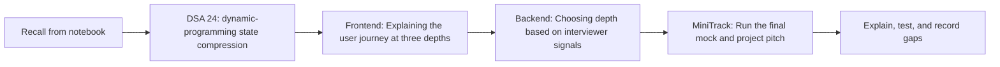
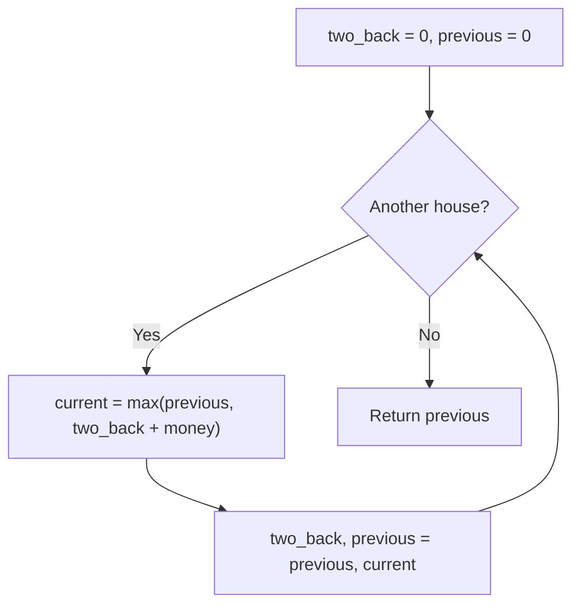
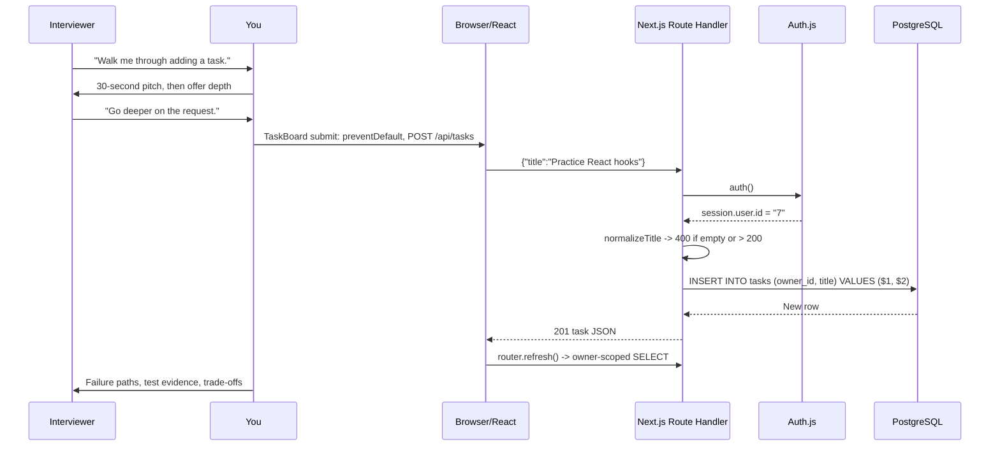

# Prep Day 24 — Run the final mock and project pitch

**Date:** Tuesday, December 22, 2026  
**Time:** 7 study hours plus breaks  
**Starting point:** App Days 1–4 are complete. Continue from the current learner workspace and the previous preparation-day exit checklist.  
**Goal:** Run the final mock and project pitch.

[Prep Day 23](prep-day-23.md) · [Preparation plan](../../docs/FULL_STACK_INTERVIEW_PREP_PLAN.md) · [Track home](README.md) · [Prep Day 25](prep-day-25.md)

**Everything to read today is below.** The original
[App overview](../../docs/APP_OVERVIEW.md),
[App architecture](../../docs/ARCHITECTURE.md),
[Interview index](../../docs/INTERVIEW_INDEX.md), [App Day 15](../day-15.md),
and [DSA Day 24](../../dsa-python/lessons/dsa-day-24.md) remain available for
comparison. Today is a **mock** day: no new feature code. You practice the
project pitch at three depths, one timed DSA problem, and one system-design
extension. Rebuilding a slice belonged to Prep Day 23; final verification and
recall sheets belong to Prep Day 25.

## Learning objectives

- explain the MiniTrack user journey at three depths in beginner-friendly language;
- choose answer depth from interviewer signals without losing correctness;
- complete one timed DSA, project, and system-design mock;
- solve DSA Day 24 using the dynamic-programming state compression pattern;
- record the result in your rough notebook and explain it without reading.

## 1. Start with notebook recall (45 minutes)

Before opening a lesson, write answers in
[`checkpoints/ROUGH/Notes.md`](../../checkpoints/ROUGH/Notes.md):

1. What did yesterday's browser action send to the server?
2. Where is persistent task data stored, and what state is only temporary?
3. What error or edge case can you already predict for today's topic?
4. What do you remember about the **dynamic-programming state compression** pattern?

Use this format:

```md
## Tuesday, December 22, 2026

- What:
- Why:
- How MiniTrack uses it:
- What can go wrong:
- First task:
```

Do not copy the source paragraph. Write what you remember, then compare.

## 2. Understand today's full-stack boundary (20 minutes)

**Frontend focus — Explaining the user journey at three depths:** A 30-second pitch states the problem and result, a two-minute pitch adds stack and key decisions, and a five-minute walkthrough traces one request plus trade-offs and testing.

**Backend focus — Choosing depth based on interviewer signals:** Start with the clear boundary-level answer and offer depth. Do not lead with every edge case before establishing the main flow.

**Today's connection:** The final mock turns implementation experience into a concise interview narrative.



## 3. Python DSA practice (1 hour 45 minutes)

**Practice file:** [`dsa-python/practice/day-24.py`](../../dsa-python/practice/day-24.py)  
**Pattern:** dynamic-programming state compression

### Problem: House Robber

A street has houses in a row. `nums[i]` is the money in house `i`. You may
take money from any houses **except two neighbours** (adjacent houses). Return
the largest total you can take.

Assumptions: values are non-negative whole numbers; an empty street returns
`0`.

```python
solve([1, 2, 3, 1])     # 4   (houses 0 and 2: 1 + 3)
solve([2, 7, 9, 3, 1])  # 12  (houses 0, 2, 4: 2 + 9 + 1)
```

At each house you make one choice: **skip** it (keep the best total so far) or
**take** it (its money plus the best total from two houses back, because the
neighbour must be skipped).

### Start coding

In the practice file, replace the `raise NotImplementedError` line with your
own implementation. This is the starting shape:

```python
def solve(nums):
    # Return the largest sum of non-adjacent values.
    raise NotImplementedError
```

Two Python helpers you will use:

- `max(a, b)` returns the larger of two numbers: `max(7, 11)` is `11`.
- `two_back, previous = previous, current` is **tuple assignment**: Python
  reads the right side with the old values first, then assigns both names at
  once. This slides the two remembered answers forward by one house.



### Invariant to say aloud

At each house, choose between skipping it and adding its value to the best result that cannot be adjacent.

Concretely: before house `i`, `previous` is the best total using houses
`0..i-1` and `two_back` is the best total using houses `0..i-2`.

### Work in this order

1. Restate the problem and ask about constraints.
2. Give a brute-force approach and its cost before optimizing.
3. Write the invariant above in your own words.
4. Implement without opening the solution for 25 minutes.
5. Test empty, smallest, typical, duplicate, and boundary cases where relevant.
6. Use a small hint if blocked; do not spend the entire block stuck.
7. Compare with the commented reference and re-code the key loop from memory.

From the repository root:

```bash
python3 dsa-python/scripts/check_practice.py 24
python3 -m unittest discover -s dsa-python/tests -v
```

**Expected observation:** the day-specific checker accepts your implementation
for `[1, 2, 3, 1] → 4` and `[2, 7, 9, 3, 1] → 12`, and the completed reference
suite still passes. Those two examples do not cover an empty list or a single
house, so add the checks below.

You can also temporarily add these checks below your `solve` function in the
practice file, then run `python3 dsa-python/practice/day-24.py`:

```python
if __name__ == '__main__':
    assert solve([1, 2, 3, 1]) == 4
    assert solve([2, 7, 9, 3, 1]) == 12
    assert solve([]) == 0
    assert solve([5]) == 5
    assert solve([2, 1]) == 2
    assert solve([0, 0, 0]) == 0
    assert solve([2, 1, 1, 2]) == 4  # houses 0 and 3, not every other house
    print('All checks passed')
```

### Brute-force code — reveal after attempting

<details>
<summary>Show the simple recursive solution</summary>

```python
def solve(nums):
    # best(i) = the largest total using only houses i, i+1, ..., end.
    def best(i):
        if i >= len(nums):
            return 0  # No houses left.
        skip = best(i + 1)
        take = nums[i] + best(i + 2)  # Taking i forces us to skip i + 1.
        return max(skip, take)

    return best(0)
```

</details>

A function defined inside another function (`best` inside `solve`) can read
the outer variable `nums`. Each call branches into two more calls, and the same
`best(i)` is recomputed many times, so time is exponential (about O(1.62ⁿ),
often written O(2ⁿ)). The recursion stack is O(n).

### Optimized code — reveal after attempting

<details>
<summary>Show the House Robber solution</summary>

```python
def solve(nums):
    two_back = 0   # best total ending two houses ago
    previous = 0   # best total ending at the previous house
    for money in nums:
        # Skip this house, or take it plus the best non-adjacent total.
        current = max(previous, two_back + money)
        two_back, previous = previous, current
    return previous
```

</details>

A full `dp` list would store the best total for every prefix, but each step
only reads the last two values, so two variables are enough. Time is O(n);
extra space is O(1).

Trace for `[2, 7, 9, 3, 1]`:

| House | `money` | `two_back` before | `previous` before | `current = max(skip, take)` | After |
|---:|---:|---:|---:|---|---|
| 0 | 2 | 0 | 0 | `max(0, 0 + 2) = 2` | `0, 2` |
| 1 | 7 | 0 | 2 | `max(2, 0 + 7) = 7` | `2, 7` |
| 2 | 9 | 2 | 7 | `max(7, 2 + 9) = 11` | `7, 11` |
| 3 | 3 | 7 | 11 | `max(11, 7 + 3) = 11` | `11, 11` |
| 4 | 1 | 11 | 11 | `max(11, 11 + 1) = 12` | `11, 12` → return `12` |

### DSA interview questions and answers

#### DSA Q1. What is the brute-force approach?

**Interview-ready answer:** “For each house I try both choices: skip it and
solve the rest, or take it and solve from two houses later. I return the
larger result. It is correct because it explores every valid choice, but it is
exponential because the same suffixes are recomputed.”

**Example:** `best(0)` calls `best(1)` and `best(2)`; `best(1)` also calls
`best(2)`, so `best(2)` is computed twice already.

**Follow-up:** Caching `best(i)` makes it O(n) time and O(n) space. The
bottom-up loop then removes the cache and the recursion stack.

#### DSA Q2. What is the core idea of the optimized solution?

**Interview-ready answer:** “Let best(i) be the largest total using houses 0
through i. Then best(i) = max(best(i − 1), best(i − 2) + nums[i]). Because each
state needs only the two before it, I keep two variables instead of a list.”

**Example:** At house 2 in `[2, 7, 9]`: skip gives `7`, take gives
`2 + 9 = 11`, so best is `11`.

**Follow-up:** This is **state compression**: the recurrence's dependency
window decides how much memory you need. A window of two means O(1) space.

#### DSA Q3. Why is it correct?

**Interview-ready answer:** “The best plan for the first i houses either skips
house i — then it is the best plan for the first i − 1 houses — or takes house
i — then house i − 1 is skipped and the rest is the best plan for the first
i − 2 houses. Those two cases cover every valid plan, and taking the maximum
picks the better one.”

**Example:** `[2, 1, 1, 2]` returns `4` by taking houses 0 and 3. A naive
“every other house” idea gives only `3`.

**Follow-up:** Starting both variables at `0` represents “no houses yet”, so
the first house correctly becomes `max(0, 0 + nums[0])`.

#### DSA Q4. What are the time and space costs?

**Interview-ready answer:** “O(n) time, because I visit each house once with
constant work, and O(1) extra space, because I keep two numbers.”

**Example:** For 1,000,000 houses, the loop runs 1,000,000 times and still
stores only `two_back`, `previous`, and `current`.

**Follow-up:** If the interviewer wants the actual houses chosen, I need the
full dp list (O(n) space) so I can walk backwards and reconstruct the choices.

#### DSA Q5. What edge cases should I test?

**Interview-ready answer:** “Empty list returns 0, one house returns its
value, two houses returns the larger, all zeros returns 0, and a case like
[2, 1, 1, 2] where alternating houses is not optimal.”

**Example:** `solve([2, 1]) == 2` and `solve([]) == 0` (the loop never runs).

**Follow-up:** If negative values were allowed, the `max` with “skip” already
avoids taking a negative house, so the answer is still never below `0`. Ask
whether an empty selection is allowed.

#### DSA Q6. What if the houses form a circle?

**Interview-ready answer:** “Now the first and last houses are neighbours, so
they cannot both be taken. I solve the straight-line problem twice — once
without the last house and once without the first — and return the larger.
One house is a special case.”

**Example:** `[2, 3, 2]` in a circle returns `3`: without the last house the
best is `3`, and without the first house the best is `3`.

**Follow-up:** It stays O(n) time; slicing copies cost O(n) extra space, which
you can avoid by passing start and end indices instead of slices.

## 4. Frontend guided study (1 hour 30 minutes)

### What

A 30-second pitch states the problem and result, a two-minute pitch adds stack and key decisions, and a five-minute walkthrough traces one request plus trade-offs and testing.

### Why

The browser layer should make state and feedback understandable without taking
ownership of persistent data or security decisions that belong on the server.
In an interview, the same rule applies to your story: begin with what the user
experiences, then explain which layer owns which decision.

### The user journey to narrate

From `docs/APP_OVERVIEW.md`:

1. Open MiniTrack and see three tasks.
2. Add **Practice React hooks**.
3. The new task appears in the list and persists after refresh.
4. Complete **Build first Node.js endpoint**.
5. Filter to **Open** tasks.
6. Search for **SQL** and edit the matching task.
7. Sign in on another device and see your own tasks.

### The architecture to draw

From `docs/ARCHITECTURE.md`:

```text
Browser (http://localhost:3000)
  ├── Next.js Server Components: session, URL filters, PostgreSQL reads
  └── React Client Components: POST/PATCH/DELETE to Route Handlers
                                  |
                    Next.js app (TypeScript)
                      ├── Auth.js session checks ─── GitHub OAuth
                      └── pg Pool / parameterized SQL
                                      |
                                  PostgreSQL
```

### How — write your own pitch first

For 20 minutes, write your own 30-second, two-minute, and five-minute pitches
in your notebook. Then record yourself saying each one and only afterwards
compare with the model scripts.

<details>
<summary>Show the 30-second model pitch</summary>

> “MiniTrack is a small personal task tracker I built with Next.js 16, React
> 19, TypeScript, and PostgreSQL. You sign in with GitHub, then add, rename,
> complete, search, filter, and delete your own tasks. I kept the product tiny
> on purpose so the effort goes into the engineering: validated APIs,
> parameterized and owner-scoped SQL, tests that prove one user cannot touch
> another user's data, accessibility, and a documented production release.”

</details>

<details>
<summary>Show the two-minute model pitch</summary>

> “MiniTrack is one Next.js app that serves both the UI and a same-origin API,
> so there is no separate server and no CORS setup.
>
> **Reads** happen in a Server Component: it calls `auth()`, then a
> server-only function runs an owner-scoped `SELECT` through a `pg` pool. With
> Cache Components, that request-time work sits inside `<Suspense>` after
> `io()`, so the page shell stays static.
>
> **Writes** start in a Client Component, `TaskBoard`. A controlled input and a
> checkbox send `POST`, `PATCH`, or `DELETE` to Route Handlers. Each handler
> authenticates, validates untrusted input, and calls a data function whose SQL
> includes `owner_id` from the session. After success the client calls
> `router.refresh()`, so PostgreSQL stays the single source of truth.
>
> **Key decisions:** raw SQL instead of an ORM to learn parameterization and
> pooling; search filters live in the URL so they survive reload; no
> optimistic UI yet, because correctness came first. Tests cover units,
> PostgreSQL integration against a separate database, a Playwright journey, and
> negative authorization cases.”

</details>

<details>
<summary>Show the five-minute model walkthrough</summary>

1. **Problem and result (20 s):** the 30-second pitch.
2. **Architecture (45 s):** draw the diagram above; name the two paths (server
   reads, client mutations through Route Handlers).
3. **Trace one request (2 min):** a user ticks a task.

   ```text
   1. TaskBoard checkbox onChange -> toggleTask("42", true)
   2. fetch PATCH /api/tasks/42 {"done":true}
   3. Route Handler: auth() -> 401 if no session.user.id
   4. isValidId("42"), request.json(), done must be boolean -> else 400
   5. setDone(ownerId, "42", true)
      UPDATE tasks SET done = $1 WHERE id = $2 AND owner_id = $3 RETURNING ...
   6. Row -> 200 task JSON; no row -> 404 (missing or not yours)
   7. Client: router.refresh() -> Server Component re-runs owner-scoped SELECT
   ```

4. **Failure behaviour (45 s):** `400` invalid input, `401` anonymous, `404`
   for missing or foreign tasks (no ownership leak), `500` with a generic body
   while details go to the server log; the UI shows a `role="alert"` message.
5. **Evidence (45 s):** integration test creates User A and User B, then
   asserts `renameTask(userA, taskB.id, 'Stolen')` returns `null` **and** User
   B's row is unchanged.
6. **Trade-offs and next steps (45 s):** no pagination, no optimistic
   concurrency/version column, basic rate limiting, one OAuth provider; what
   I would measure before changing each.

</details>

## 5. Backend guided study (1 hour 30 minutes)

### What

Start with the clear boundary-level answer and offer depth. Do not lead with every edge case before establishing the main flow.

### Boundary checklist

- Validate untrusted path, query, and body values.
- Authenticate identity when the route is protected.
- Authorize the resource separately from authentication.
- Bind SQL values rather than concatenating untrusted data.
- Return an explicit success or error status.
- Log internal failures on the server without exposing secrets.

### Choosing depth from interviewer signals

| Signal from the interviewer | Depth to use | What to say next |
|---|---|---|
| “Briefly, what did you build?” or a glance at the clock | 30-second pitch | “Happy to go deeper into any layer.” |
| “How is it put together?” | Two-minute pitch | Offer one request trace. |
| “Walk me through what happens when…” | Five-minute trace | Follow the numbered request path. |
| “What if the database is down / two users…?” | One boundary, in depth | Name the layer, the status code, and the evidence. |
| Interrupts with a specific question | Stop and answer that | Do not finish the prepared script. |

### API summary to recite

From App Day 15:

| Route | Authentication | Authorization |
|---|---|---|
| `GET /api/health` | Public | No task data |
| `GET /api/tasks` | Required | Owner-scoped list |
| `POST /api/tasks` | Required | Owner from session |
| `PATCH /api/tasks/:id` | Required | ID and owner predicate |
| `DELETE /api/tasks/:id` | Required | ID and owner predicate |

### Boundary responsibilities to recite

- **Browser:** interaction and temporary UI state.
- **Route Handler:** HTTP validation and status mapping.
- **Auth.js:** verified identity and session.
- **Data layer:** parameterized, owner-scoped SQL.
- **PostgreSQL:** constraints, persistence, and transactions.
- **Tests:** regression and isolation evidence.
- **Deployment:** configuration, observability, and recovery.

### Code excerpts to point at during the walkthrough

Owner-scoped creation from App Day 11 (`frontend/lib/tasks.ts`):

```ts
export async function createTask(
  ownerId: string,
  title: string,
): Promise<Task> {
  const result = await getPool().query<TaskRow>(
    `
      INSERT INTO tasks (owner_id, title)
      VALUES ($1, $2)
      RETURNING id, title, done, created_at
    `,
    [ownerId, title],
  );

  return toTask(result.rows[0]);
}
```

Server entry point pattern from App Day 11 (the owner never comes from the
request body):

```ts
const session = await auth();
if (!session?.user?.id) {
  return Response.json({ error: 'Unauthorized' }, { status: 401 });
}

const task = await renameTask(session.user.id, id, title);
return task
  ? Response.json(task)
  : Response.json({ error: 'Task not found' }, { status: 404 });
```

The isolation test from App Day 12
(`frontend/test/integration/authorization.test.ts`):

```ts
test('users cannot read or mutate one another tasks', async () => {
  const userA = await createTestUser(pool, 'a@example.test');
  const userB = await createTestUser(pool, 'b@example.test');
  const taskA = await createTask(userA, 'A private task');
  const taskB = await createTask(userB, 'B private task');

  const visibleToA = await searchTasks(userA, {
    query: '',
    status: 'all',
  });
  assert.deepEqual(visibleToA.map(task => task.id), [taskA.id]);

  assert.equal(await renameTask(userA, taskB.id, 'Stolen'), null);
  assert.equal(await deleteTask(userA, taskB.id), false);

  const stillVisibleToB = await searchTasks(userB, {
    query: '',
    status: 'all',
  });
  assert.equal(stillVisibleToB[0]?.title, 'B private task');
});
```

### Trade-offs to state honestly

From `docs/ARCHITECTURE.md` and App Day 15:

- no task sharing or teams — every task has one owner;
- no optimistic UI — server-as-source-of-truth refresh first;
- no separate API framework — Route Handlers are enough for one app;
- simple validation — no schema library yet;
- no pagination or measured index tuning beyond `(owner_id, id)`;
- no optimistic concurrency/version column;
- limited rate limiting and basic monitoring; one OAuth provider.

## 6. MiniTrack implementation (1 hour)

**Milestone source:** Final DSA, project, and system-design mock

No code changes today. Run the mock as if it were real: timer on, notes
closed, camera or voice recorder on.

### Mock schedule (60 minutes)

| Minutes | Part | Rule |
|---:|---|---|
| 0–25 | DSA: one unseen or weak problem | Restate, brute force, invariant, code, test, complexity |
| 25–35 | Project pitch | 30 s → 2 min → interviewer chooses one 5-minute trace |
| 35–55 | System-design extension | Clarify, propose, trade-offs, what you would measure |
| 55–60 | Self-review | Write only **critical** gaps (max three) |

### Part 1: DSA mock problem — House Robber II

Houses are arranged in a **circle**, so the first and last houses are
neighbours. Return the largest total without taking two neighbours. Reuse your
`solve` from section 3 as a helper.

```python
rob_circle([2, 3, 2])     # 3
rob_circle([1, 2, 3, 1])  # 4
rob_circle([5])           # 5
rob_circle([])            # 0
```

<details>
<summary>Show a model solution</summary>

```python
def rob_circle(nums):
    if len(nums) == 1:
        return nums[0]  # One house has no neighbour to conflict with.
    # Either the last house is excluded, or the first house is excluded.
    return max(solve(nums[:-1]), solve(nums[1:]))
```

`nums[:-1]` is every house except the last; `nums[1:]` is every house except
the first. O(n) time; the two slices use O(n) extra space.

</details>

### Part 2: Project pitch scorecard

Score each line 0 (missing), 1 (partial), or 2 (clear):

| Criterion | Score |
|---|---|
| Started with the user problem, not a technology list | |
| Named the two paths: server reads and client mutations | |
| Traced one request with real file and function names | |
| Explained authentication versus owner authorization | |
| Gave failure statuses and what the user sees | |
| Cited test evidence (including the cross-user test) | |
| Stated at least two honest limitations | |
| Stopped when the interviewer signalled enough depth | |

### Part 3: System-design extension bank

Pick **one** question, answer for 20 minutes, then compare.

<details>
<summary>Q1. “MiniTrack now has a million users and some have 50,000 tasks. What changes?”</summary>

**Model answer:** “First I would measure: slow-query logs and
`EXPLAIN ANALYZE` on the owner-scoped list. The `(owner_id, id)` index already
keeps each user's rows together. The biggest change is pagination: keyset
pagination such as `WHERE owner_id = $1 AND id > $2 ORDER BY id LIMIT 50`
stays fast where `OFFSET` scans skipped rows. Search with `ILIKE '%sql%'`
cannot use a normal B-tree index, so I would measure and consider a trigram
index. The Next.js app is stateless, so it can scale horizontally behind a
load balancer; then the PostgreSQL connection count becomes the limit, so I
would size the `pg` pool per instance or add a pooler such as PgBouncer. Read
replicas come later and bring replication-lag trade-offs.”

</details>

<details>
<summary>Q2. “A user edits the same task in two tabs. How do you avoid lost updates?”</summary>

**Model answer:** “Today the last write wins. I would add a `version` column
and make the update conditional: `UPDATE tasks SET title = $1, version =
version + 1 WHERE id = $2 AND owner_id = $3 AND version = $4 RETURNING ...`.
Zero rows means either missing/foreign or stale; a follow-up owner-scoped
`SELECT` tells which, so I can return `404` or `409 Conflict` and let the UI
show the latest value. This is optimistic concurrency; it avoids holding
locks while a user types.”

</details>

<details>
<summary>Q3. “A flaky network retries POST /api/tasks. How do you prevent duplicates?”</summary>

**Model answer:** “POST is not idempotent, and disabling the button only stops
double clicks. The client sends an `Idempotency-Key` header with a random ID
per intended creation. The server stores the key with the owner and the
created task, under a unique constraint, in the same transaction as the
insert. A retry with the same key returns the stored task instead of creating
another. Keys expire after a retention window.”

</details>

<details>
<summary>Q4. “Should you add caching?”</summary>

**Model answer:** “Only after measuring. Task lists are private per user, so
I must never cache session-dependent output as shared data — the Day 10 rule
is not to put `"use cache"` on private session output. The reads are already
indexed point and range queries. If a measured hot path appeared, I would
consider a per-user cache keyed by owner with explicit invalidation on every
mutation, and weigh the staleness risk against the database load saved.”

</details>

<details>
<summary>Q5. “Add teams so tasks can be shared.”</summary>

**Model answer:** “That is a new authorization model, not a column tweak. I
would add `teams` and `memberships (team_id, user_id, role)`, give tasks a
`team_id`, and change every predicate from `owner_id = $session` to ‘the
session user has a membership in this task's team with a role that allows this
action’. The Day 12 negative tests must be extended to cross-team cases before
release.”

</details>

### Part 4: Record only final critical gaps

In your notebook, write at most three gaps that would change an interview
outcome (for example, “cannot explain why `404` instead of `403`”). Ignore
cosmetic wording. Each gap gets one concrete fix for Prep Day 25.

**Expected observation:** you finished all four parts inside 60 minutes, your
pitch stayed within each time box, and your gap list is short and specific.

## 7. Trace the event or request



Trace one concrete input: title `"Practice React hooks"` from owner `7`. Name
every boundary, value, and possible failure (`400`, `401`, `500`, network).

## 8. Deliberate debugging exercise (25 minutes)

**Break it:** Describe MiniTrack as a list of technologies.

**Predict before running:** write the expected symptom in your notebook.

**Expected symptom:** The interviewer cannot see the user problem, architecture decisions, or your contribution.

**Root cause:** Tools replaced the engineering story.

**Restore and verify:** Lead with the user journey, then explain boundaries, trade-offs, and verified outcomes.

**Try it:** record yourself saying “Next.js, React, TypeScript, Tailwind,
PostgreSQL, pg, Auth.js, Playwright” for 30 seconds, then the model 30-second
pitch. Note which version names a user, a decision, and evidence.

Do not stop after making the symptom disappear. Explain why the repair restores
the intended invariant.

## 9. Interview questions and answers (30 minutes)

### Q1. How do you explain the MiniTrack user journey at three depths?

**Interview-ready answer:** “In 30 seconds I say what it is and why it is
interesting: a personal task tracker where the work went into validation,
owner-scoped SQL, tests, and deployment. In two minutes I add the two paths —
Server Components read PostgreSQL directly; Client Components mutate through
Route Handlers and refresh. In five minutes I trace one request with real
function names, its failure statuses, and the test that proves isolation.”

**Example:** The five-minute version traces `toggleTask("42", true)` in
`frontend/app/TaskBoard.tsx` → `PATCH /api/tasks/42` → `auth()` →
`setDone(ownerId, "42", true)` → `200` → `router.refresh()`.

**Senior follow-up:** The structure stays the same when the product grows;
only the request I choose to trace changes. If an interviewer cares about the
frontend, I trace focus, `role="alert"`, and `busy`; if they care about data,
I trace the SQL predicate and index.

### Q2. How do you choose depth based on interviewer signals?

**Interview-ready answer:** “I give the boundary-level answer first, then
offer depth: ‘Happy to go into the SQL or the auth check.’ I follow their
choice instead of reciting every edge case.”

**Example:** Asked “What happens if the database is down?”, I answer: “A
mutation's Route Handler `catch` logs the error on the server and returns
`500 Internal server error`, and `TaskBoard` shows `Request failed: Could not
add task (500)`. The page read shows `Could not load tasks` in a
`role="alert"` element instead of an empty list that pretends to succeed.”
Then I stop.

**Senior follow-up:** Logs must not include the `DATABASE_URL`, OAuth secrets,
or task contents. In production I would add a request ID to both the log line
and the response so support can correlate them.

### Q3. What invariant makes the dynamic-programming state compression solution correct?

**Interview-ready answer:** At each house, choose between skipping it and adding its value to the best result that cannot be adjacent. Before house i, `previous` is the best total for houses `0..i-1` and `two_back` is the best for `0..i-2`.

**Example:** For `[2, 7, 9, 3, 1]`, `(two_back, previous)` goes
`(0, 2) → (2, 7) → (7, 11) → (11, 11) → (11, 12)`, so the answer is `12`.

**Senior follow-up:** O(n) time and O(1) space hold because the recurrence
only looks two steps back. If you must return the chosen houses, keep the full
dp list; for a circle, run the line version twice.

### Q4. How does today's work fit the complete MiniTrack system?

**Interview-ready answer:** “The mock turns the whole build into a story an
interviewer can follow: one user problem, two data paths, one traced request,
explicit failures, test evidence, and honest limitations.”

**Example:** Begin with “add Practice React hooks”, end with “it survives
reload because `router.refresh()` re-ran the owner-scoped `SELECT`, and the
cross-user test proves User B cannot see it.”

**Senior follow-up:** Before adding infrastructure I would measure p95
latency of `GET` and `PATCH`, the `pg` pool wait time, and the `4xx`/`5xx`
rate. The first likely bottleneck is unpaginated lists for heavy users, not
the Next.js server.

## 10. Complexity and operational cost

- **DSA:** O(n) time and O(1) space.
- **Application:** Communication should compress detail without losing correctness. Spend depth on decisions relevant to the question.
- **Learning:** Attempting, retrieving, and correcting is more valuable than
  copying several solutions. Keep the scope to one understood pattern today.

## Exit checklist

- [ ] I completed DSA Day 24 before reading its solution.
- [ ] I can state the invariant and complexity without notes.
- [ ] I completed or verified the MiniTrack milestone.
- [ ] I tested one success path and one failure path.
- [ ] I completed the deliberate debugging exercise.
- [ ] I answered all four interview questions aloud.
- [ ] I recorded what remains confusing and tomorrow's first task.

**Suggested commit:** `prep day 24: run the final mock and project pitch`
